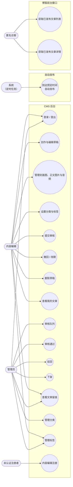

# 博客内容管理系统（CMS）
## 软件需求规格说明书

| 项目 | 内容 |
|---|---|
| 文档版本 | v2.3 |
| 编制日期 | 2026-10-16 |
| 文档性质 | **对外交付主文档（需求基线）** |

> **本文是当前唯一的对外交付需求文档与需求基线。** 业务规则、状态迁移、权限矩阵和验收标准以本文为准；`doc/context/project-overview.md` 仅作为背景与取舍记录，不定义业务规则。
>
> 数据库设计、接口设计和实现架构不作为本期独立交付文档，后续实现以本文需求为依据。

---

## 1 引言

### 1.1 编写目的

本文档描述博客内容管理系统（以下简称 CMS）的功能需求与业务规则，作为开发、数据库设计、接口设计、测试与项目验收的共同依据。

### 1.2 文档范围

本文档覆盖 CMS 管理后台的全部功能需求，包括用户角色与权限、文章状态与生命周期、业务规则、文章内容模型、功能需求条目以及验收标准。系统架构、技术选型、接口签名与界面视觉规范不在本文档范围内。

### 1.3 术语

| 术语 | 说明 |
|---|---|
| CMS | 内容管理系统（Content Management System） |
| 内容编辑 | CMS 中的内容生产角色，没有最终发布权限 |
| 管理员 | CMS 中的内容审核与系统管理角色 |
| 归属编辑 | 某篇文章的创建人，该文章的归属者 |
| 留痕 | 系统自动记录的文章操作历史，只增不改不删 |
| 预定发布时间 | 作者为文章设定的计划对外发布时间 |
| 实际发布时间 | 文章真正对外公开的时间，由系统写入 |

### 1.4 本版账号规则

当前测试环境采用以下账号规则：

- 内容编辑账号（创作者账号）可以通过注册入口直接注册，注册成功后立即启用，不需要管理员审核。
- 管理员账号不开放注册。每个测试数据库在初始化时创建一个且仅一个管理员账号。
- 本期不提供密码找回、邮件验证、重置令牌或邮件找回服务。测试环境需要恢复账号时，通过数据库初始化或维护脚本直接处理，不提供面向用户的找回接口。

以上规则适用于当前测试环境；管理员账号的生产环境部署方式和正式运维流程不在本版 SRS 中定义。

---

## 2 项目概述

### 2.1 项目背景

随着博客网站内容数量不断增加，仅依靠网站前台直接维护内容，会导致内容管理、权限控制、分类整理以及内容维护等工作不够集中和规范。因此需要建立独立的内容管理后台，为网站管理人员提供统一的内容管理入口。

### 2.2 项目目标

1. 建立独立的博客内容管理后台。
2. 对博客网站内容进行统一管理。
3. 对文章进行分类和组织，方便内容维护。
4. 提供文章内容的创建、编辑、删除和发布等基本管理能力。
5. 为不同角色提供相应的操作权限。
6. 保证 CMS 管理的数据能够提供给博客前台展示。

### 2.3 系统定位与边界

**本系统是博客网站的内容管理平台，不是博客网站本身。**

CMS 负责后台的内容生产与管理，博客网站负责将经 CMS 管理的内容展示给最终访客。CMS 不承担博客前台展示功能，但必须向博客前台提供已发布内容的数据接口。

```
        ┌─────────────────────────┐
        │      CMS 管理后台        │
        │                         │
        │  内容编辑 / 管理员       │
        │  创作 · 审核 · 发布      │
        └───────────┬─────────────┘
                    │ 已发布内容数据
                    ▼
        ┌─────────────────────────┐
        │        博客前台          │
        └───────────┬─────────────┘
                    ▼
                 网站访客
```

---

## 3 系统范围

### 3.1 本期范围

用户登录与身份认证、测试环境下内容编辑账号直接注册、CMS 后台管理、文章管理、文章分类管理、标签管理、草稿管理、媒体资源管理、内容合规与质量审核、内容发布与下架、内容状态管理、内容筛选（结构化筛选，不含正文检索）、当前版本的账号初始化与角色边界（后台用户管理、角色修改与文章改派属后续版本，见 8.2 FR-USER）、文章操作留痕。

### 3.2 不在本期范围

博客前台页面设计、社交聊天、电商功能、在线支付、广告管理、复杂数据分析平台、多站点管理、多语言内容管理、评论系统、审核结果的站内／邮件／短信主动通知、文章版本历史与回滚、正文全文检索、面向博客访客的公众注册、管理员公开注册和作者自助投稿、Markdown 代码区域之外的原始 HTML／脚本／iframe 与播放器嵌入代码（代码块和行内代码中的文本示例允许保存，视频仅以链接形式保存）、视频文件上传与视频内容下载、代理或转码。

以上可作为后续扩展，本期不建设。

---

## 4 用户角色与权限

### 4.1 角色定义

CMS 后台的账号体系包含两类角色：

| 角色 | 人数 | 职责 |
|---|---|---|
| 内容编辑 | N | 内容生产与维护，**没有最终发布权限** |
| 管理员 | 1 | 内容合规性审核与 CMS 整体管理 |

角色设计的基本思想是**内容生产与内容管理、审核相分离**。内容编辑是负责生产和维护博客内容、但没有最终发布权限的工作人员。

访客与博客读者不进入本系统账号体系，他们属于博客前台；CMS 仅对已发布内容提供数据。

### 4.1.1 账号创建与密码规则

- 内容编辑账号（创作者账号）在当前测试环境中通过注册入口直接创建，注册成功后立即启用，不需要管理员审核。
- 管理员账号不开放注册；数据库初始化时创建一个且仅一个管理员账号。
- 当前版本不提供密码找回、邮件验证、密码重置令牌或邮件自助找回接口。测试环境中的账号恢复通过数据库初始化或维护脚本完成。
- 注册流程只能创建内容编辑账号，不能通过注册请求创建管理员账号。

### 4.2 角色互斥

- **BR-ROLE-001** 一个账号只能有一个角色，不支持兼任：账号或是内容编辑、或是管理员。
- **BR-ROLE-002** 管理员不下场撰写文章。管理员如需撰写文章，应另行开设内容编辑账号。
- **BR-ROLE-003** 审核独立性由角色模型结构性保证，不依赖运行时校验：由于管理员不撰写文章，任何文章的作者必然是内容编辑，而审核者必然是另一账号的管理员，`author ≠ reviewer` 是模型自带的结论，系统无需额外校验"审核人不得为作者"。

### 4.3 数据归属与隔离

- **BR-ISO-001** 每篇文章有唯一的归属编辑（创建人）。内容编辑只能读写自己创建的文章；管理员可读取全部文章，并仅可执行 4.5 权限矩阵明确授权的操作，管理员不得编辑任何文章内容字段。
- **BR-ISO-002** 隔离对所有状态一视同仁：草稿、待审核、驳回、待发布、已发布、已下架，编辑都只能看到自己的文章，不因"已发布"而对其他编辑开放。
- **BR-ISO-003** 隔离在**数据层**强制执行，不在界面上隐藏入口。内容编辑的文章查询与写操作必须附加 `author_id = 当前用户` 条件；管理员访问须单独通过角色、动作和状态授权检查，不得以界面隐藏代替校验，也不得突破 4.5 权限矩阵。
- **BR-ISO-004** 隔离针对 CMS 后台管理接口。博客前台通过独立接口读取已发布文章的公开字段，不受后台归属过滤约束，任何非「已发布」状态的内容均不得返回；媒体文件出口按 FR-MEDIA-002 单独判定公开访问权限。

### 4.4 权限判定的三道闸门

本系统的权限不是"角色对了就行"。需要认证的后台文章请求先校验会话，再通过三道**互相独立**的闸门；匿名入口见 FR-AUTH-004，公开文章与媒体出口按各自规则授权：

| 闸门 | 检查内容 | 依据 |
|---|---|---|
| 角色闸 | 你的角色允许执行这个动作吗？ | 4.5 权限矩阵 |
| 归属闸 | 编辑是否为文章归属者；管理员是否处于明确授权范围 | BR-ISO-001、BR-ISO-003 |
| 状态闸 | 这条数据当前的状态允许这个动作吗？ | 5.2 状态迁移 |

三道闸全部通过才放行；任何一道不过即整体拒绝。

**关键约束：前两道闸的拒绝响应必须统一，不得暴露是哪一道未通过。**

若角色闸失败返回 403、归属闸失败返回 404，请求者仅凭返回码即可分辨"这篇文章存在但不是你的"与"你没有该权限"，前者泄露了资源存在性。因此：

> **角色闸与归属闸失败一律返回 404，且响应内容与"资源不存在"完全一致。**

**状态闸是这条收口的唯一例外，失败时返回 409。** 能走到状态闸，说明角色闸与归属闸都已通过——请求者对该资源的可见性本来就是确定的（自己的文章，或管理员可见的全部文章），409 不泄露任何它本来不知道的信息。这与 4.6、8.3 各条关键需求以及 9.1 第 5 条一致：**非法状态迁移一律 409**。

**媒体文件出口再例外一次**：媒体请求匿名可达，匿名请求者与目标资源之间不存在"前两道闸已通过"这个前提，因此该出口的任何拒绝**一律 404**（见 8.3 FR-MEDIA-002），不返回 409，也不因未认证而返回 401。

代价是调试时不直观，换来的是不存在可用于探测信息的响应差异。

### 4.5 权限矩阵

行是动作，列是请求者与目标文章的关系。`—` 表示不允许。

| 动作 | 编辑（自己的文章） | 编辑（他人的文章） | 管理员 |
|---|:---:|:---:|:---:|
| 创建文章 | ✓ | — | — |
| 读取文章详情 | ✓ | — | ✓ |
| 读取文章列表、筛选、计数 | ✓（仅本人结果集） | — | ✓（全部） |
| 编辑内容（标题、正文、摘要、封面、音频、分类、标签、预定时间） | ✓ 仅限草稿、驳回、已下架 | — | — |
| 删除 | ✓ 仅限草稿**且无任何留痕**（从未提交过） | — | — |
| 提交审核 | ✓ 仅限草稿、驳回、已下架 | — | — |
| 撤回 | ✓ 仅限待发布 | — | — |
| 改期 | ✓ 仅限待发布 | — | — |
| 审核通过 | — | — | ✓ 仅限待审核 |
| 驳回 | — | — | ✓ 仅限待审核 |
| 下架 | — | — | ✓ 仅限已发布 |
| 查看留痕 | ✓ | — | ✓ |
| 上传并关联、移除、替换封面图、正文图片与音频 | ✓ 仅限草稿、驳回、已下架 | — | — |
| 访问封面图、正文图片与文章音频 | ✓（含未发布状态） | 仅已发布文章的公开文件 | ✓ |
| 创建分类 | — | — | ✓ |
| 修改分类名称、删除分类 | — | — | ✓ 仅限未被任何文章引用 |
| 创建标签 | ✓（全局共享） | ✓（全局共享） | ✓ |
| 修改标签名称 | ✓ 仅限未被任何文章引用 | ✓ 仅限未被任何文章引用 | ✓ 仅限未被任何文章引用 |
| 删除标签 | ✓ 仅限未被任何文章引用 | ✓ 仅限未被任何文章引用 | ✓ 仅限未被任何文章引用 |
| 管理用户与角色 | — | — | — |
| 发布文章 | — | — | — |

**三处需要说明：**

1. **「编辑内容」对管理员是空的。** 这不仅是"管理员不插手内容"的约定，而是 BR-007 的硬性要求：管理员一旦能改正文，审核独立性即不成立（可将违规内容改到合规再通过）。管理员处理内容只有下架一条路径。
2. **「发布文章」对两种角色均为空**，因为审核通过后由系统自动发布，不存在人工发布的动作。
3. **标签对全体编辑开放、分类只归管理员**。分类、标签是共享资源，其权限不按文章或资源创建人归属划分；所有角色均受 BR-TAX-004~005 的引用保护约束。文章自身的分类、标签关联仅可由归属编辑在允许编辑的状态下修改。媒体公开读取是后台归属隔离的例外，不授予其他编辑任何后台文章读取或写入权限。

### 4.6 必须失败的组合

以下组合必须被测试证明无法成立。

| # | 请求 | 预期结果 | 依据 |
|---|---|---|---|
| 1 | 编辑使自己的文章进入「已发布」 | 404 / 无此接口 | BR-006、BR-010 |
| 2 | 编辑执行审核通过或驳回 | 404 | 4.5 |
| 3 | 编辑执行下架 | 404 | 4.5 |
| 4 | 管理员手动发布（独立发布接口） | 无此接口 | BR-PUB-001、BR-010 |
| 5 | 管理员把已下架文章直接恢复为「已发布」 | 404 / 无此接口 | BR-011、BR-010 |
| 6 | 管理员编辑他人文章内容 | 404 | BR-007 |
| 7 | 管理员删除他人草稿 | 404 | BR-DEL-003 |
| 8 | 编辑读取、编辑或删除他人文章 | 404 | BR-ISO-001 |
| 9 | 编辑读取他人文章的留痕 | 404 | BR-AUDIT-002 |
| 10 | 匿名访问非「已发布」状态文章的正文 | 404 | BR-ISO-004 |
| 11 | 匿名访问非「已发布」状态文章的封面图、正文图片或文章音频（含已下架） | 404 | BR-MEDIA-003 |
| 12 | 直接提交状态字段修改状态 | 400 或字段被忽略且状态不变 | X-STATE-01 |
| 13 | 驳回或下架时不带原因、带空字符串、带纯空格 | 400 且状态不变 | BR-AUDIT-003 |
| 14 | 删除非「草稿」的文章，或删除"提交后又被撤回"的草稿 | 409 | BR-DEL-001 |
| 15 | 对「待审核」文章重复提交审核 | 409 | BR-001 |
| 16 | 通过筛选参数或计数接口推断他人文章数量 | 总数与结果集均只反映本人可见范围 | BR-SEARCH-003 |
| 17 | 在 Markdown 代码块、行内代码之外保存原始 HTML、脚本、iframe 或视频平台嵌入代码 | 400，不入库；代码区域内的文本示例允许保存 | BR-MEDIA-006 |


## 5 文章状态与生命周期

### 5.1 状态定义

系统共维护 6 个文章状态：

| 状态 | 含义 |
|---|---|
| 草稿 | 编辑正在创建或修改，尚未提交 |
| 待审核 | 已提交，等待管理员审核 |
| 驳回 | 管理员审核不通过，等待编辑按驳回意见修改后重新提交 |
| 待发布 | 已审核通过，等待预定发布时间到达；归属编辑可在此期间改期或撤回 |
| 已发布 | 已经对博客前台公开 |
| 已下架 | 曾经发布，被管理员下架，当前不再公开 |

「驳回」是独立状态，不是「草稿」的同义词。理由是状态可见性：编辑必须能从文章列表中直接分辨"尚未写完"与"已被驳回"，否则会反复提交同一篇文章。驳回意见（驳回人、时间、原因）挂在该状态上，在列表与详情页直接可见。

「已下架」是可修复的状态，不是终态。归属编辑可以修改已下架文章并重新提交审核，审核通过后回到「已发布」。下架文章不能由管理员直接恢复上线，恢复必须重新过审。

「待发布」是可纠错的窗口，不是锁定态。归属编辑在预定时间到达前可改期（审核结论继续有效）或撤回（审核结论作废，回到草稿，需重新过审）。文章一旦进入「已发布」则不能再撤回，只能走下架路径。

### 5.2 状态迁移

系统共 11 条状态迁移路径：

| # | 触发者 | 迁移 |
|---|---|---|
| 1 | 归属编辑 | 草稿 → 待审核（提交） |
| 2 | 归属编辑 | 驳回 → 待审核（修改后重新提交） |
| 3 | 归属编辑 | 待发布 → 待发布（改期，内容不变，审核结论继续有效） |
| 4 | 归属编辑 | 待发布 → 草稿（撤回，审核结论作废，需重新过审） |
| 5 | 归属编辑 | 已下架 → 待审核（修改后重新提交） |
| 6 | 管理员 | 待审核 → 驳回（必须填写驳回意见） |
| 7 | 管理员 | 待审核 → 已发布（未设预定时间，或预定时间已到达） |
| 8 | 管理员 | 待审核 → 待发布（设有未来的预定时间） |
| 9 | 管理员 | 已发布 → 已下架（必须填写下架原因） |
| 10 | 系统 | 待发布 → 已发布（到达预定发布时间时自动触发） |
| 11 | 归属编辑 | 草稿 → 删除（记录消失，仅无任何留痕、从未提交过的草稿可用，不生成流程留痕） |

### 5.3 系统必须禁止的路径

下列路径必须被测试证明**无法走通**：

| 被禁止的路径 | 依据 |
|---|---|
| 内容编辑使文章进入「已发布」 | BR-006、BR-010 |
| 管理员手动发布文章 | BR-PUB-001、BR-010 |
| 已下架文章直接恢复为「已发布」 | BR-011、BR-010 |
| 非「草稿」状态的文章被删除，以及"提交后又被撤回"的草稿被删除 | BR-DEL-001 |
| 内容编辑读写他人文章 | BR-ISO-001、BR-ISO-003 |

### 5.4 全流程不变量

**文章发布必须具有针对当前内容且仍然有效的审核通过结论。**

合法发布路径仅有 5.2 #7（审核通过后立即发布）和 #10（审核通过后到期自动发布）。审核结论覆盖当前文章内容及关联媒体；待审核、待发布与已发布期间禁止改变这些内容，共享分类、标签遵守引用保护。撤回或下架后，旧审核结论不得再次用于发布，必须重新提交并通过审核。内容编辑不能自行发布，管理员不能手动发布，下架文章不能直接恢复上线；验收必须同时证明两条合法路径可用，以及没有有效审核结论的任何发布尝试均失败。

### 5.5 发布时间字段

系统维护两个职责不同、不允许混用的时间字段：

| 字段 | 含义 | 设置方式 |
|---|---|---|
| `scheduled_publish_time` | 作者预定的发布时间 | 内容编辑设置，可为空 |
| `published_at` | 文章实际对外发布时间 | 系统在真正发布时写入 |

作者可以选择是否设置预定发布时间。审核通过后，系统按下列规则处理：

| 情形 | 处理 |
|---|---|
| 未设置预定时间 | 立即发布，`published_at` = 审核通过时间 |
| 预定时间尚未到达 | 进入「待发布」，到达预定时间后系统自动发布 |
| 预定时间已经到达或超过 | 立即发布，不顺延发布时间 |

内容编辑与管理员均不能手动伪造实际发布时间。

所有时间比较以服务端时间为准，日期时间输入、接口交换必须携带时区偏移或等价的明确时区信息；后台界面统一按 Asia/Shanghai（UTC+08:00）显示并标明时区。`published_at` 记录本次实际发布时间：下架期间保留上次取值，再次审核发布或到期发布时更新为本次取值；同一发布周期重复触发不得覆盖。历次实际发布时间通过对应发布留痕追溯。

### 5.6 并发与失败一致性

文章流程操作必须基于同一份最新状态与操作前提生效。发布、撤回、改期竞争同一待发布状态时，仅一个操作可基于该次状态成功，其余请求重新判定前提；状态或预定时间已经变化的旧请求返回 409，系统发布任务重新读取后再处理。不得覆盖已成功的结果。

每次流程操作的状态、相关时间字段、审核结论有效性与对应留痕必须共同成功；任一部分失败时均不生效。系统重试不得重复生成发布留痕或覆盖同一发布周期的实际发布时间。审核通过后立即发布的留痕记录实际发布时间；到期自动发布留痕记录实际发布时间并关联仍有效的审核通过记录。定时任务、服务与数据库正常可用时，到期文章须在预定时间后 60 秒内发布；服务恢复后自动补处理已到期文章，`published_at` 取真正发布时刻。

---

## 6 业务规则

### 6.1 提交与审核

| 编号 | 规则 |
|---|---|
| BR-001 | 只有处于「草稿」「驳回」「已下架」状态的文章可以提交审核。 |
| BR-002 | 处于「待审核」状态的文章，内容编辑不能直接修改；如需编辑修改，管理员必须驳回并填写意见，使文章进入「驳回」状态后再由归属编辑修改。不存在独立的「退回」状态或操作。 |
| BR-003 | 管理员确认文章符合发布要求后，状态由「待审核」进入发布流程。 |
| BR-004 | 管理员认为需要修改时驳回，状态由「待审核」变为「驳回」，**必须填写驳回意见**，该意见作为编辑修改的依据。 |
| BR-005 | 处于「驳回」状态的文章，编辑修改完成后可重新提交审核，状态回到「待审核」。 |
| BR-006 | 内容编辑不能直接将文章置为「已发布」，也不能通过修改状态绕过审核流程。 |
| BR-007 | 管理员不能直接修改文章内容（不改标题、不改正文、不替编辑润色、不决定内容方向）；审核须按 6.1.1 的合规性与内容质量标准执行。 |
| BR-008 | 管理员可以将已发布的文章下架，下架后不再对博客前台公开。下架时**必须填写下架原因**，该原因记入留痕并对归属编辑可见。 |
| BR-009 | 系统应保存 6.6 所定义的审核与发布流程留痕；该留痕不代表记录每次普通内容字段编辑，也不提供完整内容版本历史。 |
| BR-010 | 文章进入「已发布」必须具有针对当前内容且仍然有效的审核通过结论；仅允许审核通过后立即发布或审核通过后到期自动发布两条路径，撤回、下架后的旧结论不得用于再次发布。 |
| BR-011 | 「已下架」不是终态，归属编辑修改后可重新提交审核，经审核通过回到「已发布」。 |

#### 6.1.1 内容审核标准（以博客园社区规范为基线）

本期由管理员人工审核，审核标准版本初始为 `CMS-CONTENT-REVIEW-1.0`。合规性审核以适用法律法规和博客园官方《社区规范》为基线；博客园首页内容质量要求作为本 CMS 的技术博客定位标准。CSDN、知乎、简书等其他平台的专属规则不自动适用，除非本需求另行明确采纳。审核标准变更时必须提升版本号；审核结论需记录所依据的版本。评论审核不在本期范围内。

| 编号 | 内容审核规则 |
|---|---|
| BR-CONTENT-001 | 审核范围包括文章标题、正文、摘要、分类与标签、封面图、正文图片、文章音频和正文视频链接。管理员审核时必须能够查看文章完整内容及关联媒体。 |
| BR-CONTENT-002 | 文章不得包含违反适用法律法规或社区规范的内容，包括危害国家安全或公共秩序、恐怖主义或极端主义、淫秽色情、暴力、教唆犯罪、赌博诈骗、造谣传谣、歧视仇恨、骚扰引战、危害未成年人等内容。该列表为示例，不构成穷尽清单。 |
| BR-CONTENT-003 | 文章不得侵犯他人名誉、隐私、肖像、知识产权或商业秘密；转载或使用第三方素材须具备必要授权或合法依据，并按要求注明来源。涉及重要事实或专业结论的内容应有合理依据，不得以误导性标题或无根据断言误导读者。 |
| BR-CONTENT-004 | 内容须符合技术博客定位，主题明确、结构完整、表达清晰、排版可读，并对读者具有实质参考价值。仅有代码而无必要说明、简单提问、未完成内容、单纯软件发布、招聘、广告或引流推广等，可按内容质量或定位不符驳回。 |
| BR-CONTENT-005 | 驳回类别固定为：违法违规、真实性／来源、版权／隐私、未成年人／低俗／暴力、歧视／骚扰／引战、垃圾／营销、内容质量／博客定位、其他。合规违规与内容质量不符必须使用不同类别；质量或定位问题不得标记为违法违规。审核员不确定是否违规时，不得以“已通过”结束审核，须先核实并在待审核流程中完成决定。 |

### 6.2 自动发布

| 编号 | 规则 |
|---|---|
| BR-PUB-001 | 管理员审核通过后由系统自动触发发布，管理员不需要也不应再次执行发布操作。 |
| BR-PUB-002 | 作者可以选择是否设置预定发布时间。 |
| BR-PUB-003 | 未设置预定时间的文章，审核通过后立即发布，`published_at` 取审核通过时间。 |
| BR-PUB-004 | 设置了未来预定时间的文章，审核通过后进入「待发布」；任务、服务与数据库正常可用时，在预定时间到达后 60 秒内自动发布，服务恢复后补处理到期文章。 |
| BR-PUB-005 | 审核通过时若预定时间已经到达或超过，立即发布，不顺延发布时间。 |
| BR-PUB-006 | `published_at` 由系统在每次真正发布时写入；再次发布记录本次时间，同一发布周期重试不得覆盖，历次时间由留痕追溯。时间与并发处理遵守 5.5~5.6，内容编辑与管理员均不能手动伪造。 |
| BR-PUB-007 | 只有经过管理员审核通过的文章，系统才允许进入自动发布流程。 |
| BR-PUB-008 | 「待发布」不是锁定态：归属编辑在原预定时间到达前可以改期；新时间必须严格晚于服务端当前时间，早于或等于返回 400。原预定时间已到达但系统尚未发布时，改期返回 409。改期不改变内容，原审核结论继续有效，并发处理遵守 5.6。 |
| BR-PUB-009 | 归属编辑可以撤回待发布文章。撤回后状态回到「草稿」，审核结论同时作废，再次上线必须重新提交审核并重新过审。撤回不产生驳回记录，但应记入操作留痕。 |
| BR-PUB-010 | 文章一旦进入「已发布」，不能再撤回，只能走下架路径（BR-008）。 |

### 6.3 内容筛选

| 编号 | 规则 |
|---|---|
| BR-SEARCH-001 | 文章的查找能力为**结构化筛选**：按状态、分类、标签、归属编辑筛选，并对标题做模糊匹配。不提供正文检索，不建全文索引，不引入检索引擎。 |
| BR-SEARCH-002 | 筛选与关键字不得构成绕过列表的例外查询路径，必须走与列表同一套归属过滤。 |
| BR-SEARCH-003 | 筛选结果受 BR-ISO-001 约束：编辑只能筛出自己的文章，管理员可筛全部；分页与计数也必须基于过滤后的结果集，不得先全量计数再过滤。 |
| BR-SEARCH-004 | 一篇文章可以带多个标签，标签为多对多关系。 |
| BR-SEARCH-005 | 选中多个标签时筛选语义为**交集**，只返回同时具备全部选中标签的文章。 |
| BR-SEARCH-006 | 标签是扁平集合，不建层级、不做父子关系。 |

### 6.4 媒体资源

| 编号 | 规则 |
|---|---|
| BR-MEDIA-001 | 文章可以设置一张封面图；Markdown 正文可以插入通过 CMS 上传的图片。封面图和正文图片均不采用外部图片链接。 |
| BR-MEDIA-002 | 上传封面图、正文图片或文章音频时，文件类型必须在对应的类型白名单内且不超过大小上限；存储文件名由系统生成，不采用用户提供的文件名与扩展名。图片白名单为 jpg／jpeg／png／gif／webp、单文件上限 5 MB，封面图与正文图片共用同一份白名单，不支持 SVG；音频白名单见 BR-MEDIA-005。本期不上传视频文件或任意其他文件。所有上传须指定已存在的归属文章，仅归属编辑可在草稿、驳回、已下架状态上传并关联、移除或替换媒体；他人及管理员写操作返回 404，本人操作不允许编辑的状态返回 409。上传后文件内容不可原地覆盖，替换必须产生新资源并更新引用；引用关系变更与文章内容保存须共同成功，遵守 5.6 的状态前提校验。 |
| BR-MEDIA-003 | 封面图、正文图片与文章音频的访问控制与文章状态绑定：草稿、待审核、驳回、待发布、已下架五种状态下，这些文件不能被匿名访问，只有已发布文章的文件才可公开。正文中的视频链接同样不能通过未发布文章接口泄露。 |
| BR-MEDIA-004 | 移除或替换媒体引用、删除文章后，清理该文章拥有且已不再使用的封面图、正文图片与音频文件。清理失败须记录并自动重试，不恢复已删除的文章或已解除的引用；解除引用后文件不再可通过媒体出口访问。上传成功但从未保存到文章引用中的文件，在上传满 24 小时后由系统清理，正常运行时在接下来的 60 秒内完成；清理前再次确认其仍未关联，禁止与引用保存竞争而误删有效文件。未关联文件仅归属编辑、管理员可读取，不可匿名访问。 |
| BR-MEDIA-005 | 文章可以设置一个可选音频文件，与封面图同构：每篇最多一个，必须通过 CMS 上传，不采用外部音频链接。音频类型白名单为 mp3／m4a／wav／ogg，单文件大小上限 20 MB。 |
| BR-MEDIA-006 | 正文中的视频只保存链接：CMS 保存的是一个 URL，不限制来源域名；视频链接协议必须为 https。正文按 Markdown 结构校验：代码块、行内代码中的 HTML、脚本、iframe 或嵌入代码示例作为普通文本允许保存，代码区域之外的原始 HTML、脚本、iframe 或播放器嵌入代码返回 400，不入库。不得仅按关键词匹配拒绝代码示例；渲染代码示例必须作为文本显示，不得执行。CMS 不判断视频链接目标的实际内容，内容是否对外公开由管理员审核决定。 |
| BR-MEDIA-007 | CMS 不下载、不代理、不转码视频文件，因此不产生 CMS 侧的视频文件清理任务；前台是否内嵌播放器、如何内嵌属于博客前台的范围。 |
| BR-MEDIA-008 | 媒体资源有且仅有一篇归属文章，归属在上传时确定且不可改派；正文、封面与音频不得引用其他文章的媒体资源，包括其他已发布文章的公开媒体，跨文章引用返回 400 且不保存。资源引用保存时须验证存在性与归属，读取权限仍按 FR-MEDIA-002 判定。 |

视频链接的来源域名不受限制。CMS 只保存链接，不接受作为活动内容的嵌入代码；代码区域内的文本示例不属于活动内容。正文仍保存 Markdown 原文，不保存渲染后 HTML。

### 6.5 文章删除

| 编号 | 规则 |
|---|---|
| BR-DEL-001 | 只有**从未提交过的**「草稿」可以被删除，即状态为「草稿」且没有任何留痕的文章。其他五种状态、以及"提交过又被撤回"的草稿，一律不可删除。将已发布文章从线上撤下应走下架，不走删除。 |
| BR-DEL-002 | 删除是物理删除，不是软删除，记录从数据库中移除，不留删除标记。按 BR-DEL-001 的定义，可删除的文章必然没有任何留痕，因此不会产生孤儿留痕。 |
| BR-DEL-003 | 删除权限归归属编辑本人。管理员不能删除他人草稿。 |
| BR-DEL-004 | 删除文章时，清理该文章拥有的全部封面图、正文图片与音频文件，含尚未保存到引用中的上传资源；失败记录与自动重试遵守 BR-MEDIA-004，不得因文件清理失败恢复已删除文章。 |
| BR-DEL-005 | 删除不可撤销，界面上必须二次确认。 |

### 6.6 操作留痕

本期留痕仅记录下表 7 类审核与发布流程事件，不记录普通内容字段编辑的前后值，也不提供完整内容版本历史或回滚。每条留痕至少包含文章 ID、操作类型、操作人、操作时间、原因与意见；驳回另记类别，审核通过、驳回和下架另记审核标准版本。改期记录变更前后预定时间；立即发布的审核通过记录及到期自动发布记录写入本次实际发布时间，到期自动发布另关联有效的审核通过记录，以追溯历次发布。

操作人分为两种主体：用户账号（归属编辑、管理员）与系统。

| 操作类型 | 操作人 | 原因与意见 | 驳回类别 | 审核标准版本 | 对应迁移路径 |
|---|---|---|---|---|---|
| 提交审核 | 归属编辑 | 否 | — | — | 5.2 #1、#2、#5 |
| 审核通过 | 管理员 | 否 | — | 必填 | 5.2 #7、#8 |
| 驳回 | 管理员 | **必填**（驳回意见） | **必填** | 必填 | 5.2 #6 |
| 下架 | 管理员 | **必填**（下架原因） | — | 必填 | 5.2 #9 |
| 撤回 | 归属编辑 | 否 | — | — | 5.2 #4 |
| 改期 | 归属编辑 | 否 | — | — | 5.2 #3 |
| 到期自动发布 | 系统 | 否 | — | — | 5.2 #10 |

5.2 的 11 条迁移路径各自对应上表的一类留痕，唯一例外是 #11（草稿 → 删除）：按 BR-DEL-001，可删除的文章从未提交过、没有任何留痕，删除后记录本身也随之消失（BR-DEL-002）。

| 编号 | 规则 |
|---|---|
| BR-AUDIT-001 | 留痕记录只增不改不删，不提供修改与删除接口。 |
| BR-AUDIT-002 | 归属编辑可以查看自己文章的全部留痕，管理员可以查看全部文章的留痕。此条同样受 BR-ISO-001 约束。 |
| BR-AUDIT-003 | 驳回类别、驳回意见与下架原因是强制字段；类别缺失或无效、驳回意见或下架原因为空字符串或纯空格时，不允许提交对应操作。 |
| BR-AUDIT-004 | 留痕的操作人分为用户与系统两种主体：用户主体必须指向一个账号，系统主体必须不指向任何账号，两者不可互换、也不能只存其一。系统主体只用于没有人工触发者的迁移，当前为「到期自动发布」一类。 |
| BR-AUDIT-005 | 每次审核通过或驳回留痕必须关联其处理的提交审核留痕；审核通过、驳回和下架留痕必须记录当时的审核标准版本。待审核期间内容不可编辑，因此本期不保存完整审核内容快照；文章版本历史与回滚仍不在本期范围。 |

留痕样例（覆盖全部 7 类操作）：

```
文章：《Spring Boot 入门教程》   （未设预定时间，审核通过即发布）

2026-09-28 10:00  张三（编辑）    提交审核
2026-09-28 10:30  李四（管理员）  驳回      类别：内容质量／定位；标准：CMS-CONTENT-REVIEW-1.0；意见：正文缺少实际案例
2026-09-28 14:00  张三（编辑）    提交审核
2026-09-28 15:20  李四（管理员）  审核通过  标准：CMS-CONTENT-REVIEW-1.0
2026-10-02 09:00  李四（管理员）  下架      标准：CMS-CONTENT-REVIEW-1.0；原因：技术结论已过期，需更新

文章：《Vue 3 组合式 API 笔记》   （设有未来预定时间，进入「待发布」，到点自动上线）

2026-09-28 16:00  张三（编辑）    提交审核
2026-09-28 16:20  李四（管理员）  审核通过  标准：CMS-CONTENT-REVIEW-1.0
2026-09-29 11:00  张三（编辑）    改期      新时间：2026-10-04 09:00
2026-10-04 09:00  系统            到期自动发布

文章：《草稿：Docker 入门》       （待发布期间撤回，审核结论作废）

2026-09-28 17:00  张三（编辑）    提交审核
2026-09-28 17:20  李四（管理员）  审核通过  标准：CMS-CONTENT-REVIEW-1.0
2026-09-29 09:00  张三（编辑）    撤回
```

「到期自动发布」一条的操作人为系统，不对应任何账号，也没有人工触发的发布动作（BR-PUB-001）；其实际发布时间由系统写入（BR-PUB-006）。

## 7 文章内容模型

### 7.1 分类与标签

| 编号 | 规则 |
|---|---|
| BR-TAX-001 | 分类为单选：一篇文章只属于一个分类。 |
| BR-TAX-002 | 标签为多选：一篇文章可以有多个标签，多对多关系。 |
| BR-TAX-003 | 两者职责不同。**分类是封闭集合**，由管理员维护、数量有限且稳定，用于前台导航与面包屑；**标签是开放集合**，随写作自然增长，不预定义、不做层级。 |
| BR-TAX-004 | 分类、标签只要被任意状态的文章引用，就不能修改名称或删除，管理员与编辑均受此限制；通过角色校验后因引用保护拒绝时返回 409，名称、文章关联及公开内容保持不变。共享分类、标签的变更不得改变待审核、待发布或已发布文章的已审核内容。需要纠正名称时新建资源，由归属编辑在允许编辑的状态下调整文章关联，重新提交审核后方可发布。 |
| BR-TAX-005 | 分类仅管理员可创建、修改名称或删除；标签全体编辑与管理员均可创建，未被任何文章引用的标签可由任一编辑或管理员修改名称或删除，不限制资源创建人。引用保护判定与修改、删除及文章关联保存必须作为同一并发一致性要求执行，禁止因并发新增引用而绕过 BR-TAX-004；删除分类不得把文章分类置空或级联删除文章。 |

### 7.2 字段清单

**（1）编辑填写的内容字段**

| 字段 | 必填 | 形态 | 说明 |
|---|:---:|---|---|
| 标题 `title` | 是 | 单行文本 | 不允许全空白 |
| 正文 `content` | 是 | Markdown 源文本 | 存储 Markdown 原文，可包含 CMS 正文图片引用和视频链接（只存 URL）；不存储渲染后的 HTML，渲染由前台负责 |
| 摘要 `excerpt` | 否 | 多行文本 | 选填，作者不填写即为空，系统不自动截取正文 |
| 封面图 `cover` | 否 | 图片文件 | 类型白名单 jpg／jpeg／png／gif／webp，单文件上限 5 MB；与正文图片共用同一份白名单（见 6.4） |
| 文章音频 `audio` | 否 | 音频文件 | 可选，每篇最多一个；类型白名单 mp3／m4a／wav／ogg，单文件大小上限 20 MB；通过 CMS 上传，与封面图同构（见 6.4） |
| 分类 `category_id` | 是 | 单选，外键 | 必填：一篇文章必须属于且只属于一个分类，不允许为空；因此前台不需要"未分类"兜底栏目 |
| 标签 `tags` | 否 | 多选，多对多 | —— |
| 预定发布时间 `scheduled_publish_time` | 否 | 日期时间 | 见 5.5 |

**（2）系统维护、编辑不可写的字段**

| 字段 | 说明 |
|---|---|
| 状态 `status` | 6 值枚举，只能由 5.2 的迁移路径改变，不能直接赋值 |
| 归属编辑 `author_id` | 创建时写入，此后不可修改 |
| 实际发布时间 `published_at` | 仅由系统在真正发布时写入 |
| 创建时间 `created_at` | 系统写入 |
| 最后修改时间 `updated_at` | 系统写入 |
| 提交审核时间 `submitted_at` | 用于审核队列排序 |

**（3）不存放在文章记录上的内容**

驳回意见、下架原因、审核通过等全部记入操作留痕（见 6.6），不在文章记录上冗余存放"最近驳回原因"之类的字段，以保证留痕是唯一事实来源。

由此产生一条查询要求：文章列表需要显示"最近一次驳回或下架的原因与时间"。该查询需取每篇文章在留痕中的最新一条指定类型记录。

---

## 8 功能需求

编号约定为 `FR-<模块>-<三位序号>`。每条需求的「关联规则」指向第 6 章的业务规则编号。

### 8.1 横切需求

以下九条按隔离、状态与留痕分为三组，对其适用范围内的全部模块生效。

| 编号 | 需求 |
|---|---|
| X-ISO-01 | 所有涉及后台文章的读写接口，都必须在数据层附加归属条件：内容编辑仅能命中自己创建的文章，管理员可命中全部但操作仍受权限矩阵约束。公开文章接口与媒体文件出口分别按 BR-ISO-004、FR-MEDIA-002 授权。 |
| X-ISO-02 | 后台归属隔离作用于全部文章查询入口：列表、详情、筛选、计数、留痕及后续新增的后台查询或导出入口。媒体文件出口独立判定读取权限；公开查询不套用后台归属条件，必须强制过滤已发布状态。 |
| X-ISO-03 | 分页总数与筛选结果计数必须基于过滤后的结果集，不能先全量计数再过滤。 |
| X-ISO-04 | 已认证请求指定他人文章资源或执行未授权动作时，返回 404 且响应与资源不存在完全一致；后台列表、筛选和计数正常返回本人过滤结果，无结果时为空列表及零计数。未认证后台请求按 FR-AUTH-004 返回 401；媒体读取拒绝统一 404。 |
| X-STATE-01 | 文章状态只能经 5.2 的 11 条迁移路径改变，任何接口都不得直接赋值状态字段。 |
| X-STATE-02 | 进入「已发布」仅允许 5.2 #7、#10 两条路径，且必须具有针对当前内容仍有效的审核通过结论，不得新增绕过该前提的发布路径。 |
| X-AUDIT-01 | 第 6.6 节列出的七类流程事件必须生成留痕，驳回与下架带必填原因；从未提交过的草稿删除不生成流程留痕，不记录普通字段编辑。流程结果与留痕共同成功，遵守 5.6。 |
| X-AUDIT-02 | 留痕只增不改不删，不提供任何修改与删除接口。 |
| X-AUDIT-03 | 留痕查询同样受 X-ISO-01 约束。 |

### 8.2 模块需求

下表共 37 条已编号功能需求，其中本期实现 33 条、后续版本 3 条、本期不做 1 条。验收仅覆盖标记为「本期实现」的条目，关联规则和第 9 章验收要求同时生效。

**FR-AUTH 认证与会话**

| 编号 | 功能 | 角色 | 关联规则 | 交付范围 |
|---|---|---|---|---|
| FR-AUTH-001 | 账号密码登录，成功建立服务端会话 | 全部 | — | 本期实现 |
| FR-AUTH-002 | 登出并销毁会话 | 全部 | — | 本期实现 |
| FR-AUTH-003 | 会话以 httpOnly Cookie 承载，带 CSRF 防护 | 全部 | — | 本期实现 |
| FR-AUTH-004 | 除登录、测试环境编辑注册、公开已发布文章列表与详情、媒体文件出口外，后台业务接口均要求有效会话；未认证返回 401，不返回业务数据。媒体出口按 FR-MEDIA-002 授权，拒绝统一 404；登录、注册等匿名入口仍须执行输入校验及适用的 CSRF 防护 | 全部 | BR-ISO-004 | 本期实现 |
| FR-AUTH-005 | 按角色分流，编辑端与管理员端可见菜单不同 | 全部 | BR-ROLE-001 | 本期实现 |

**FR-USER 用户与角色管理**

当前版本只实现测试环境账号初始化和内容编辑账号直接注册；后台用户管理、账号停用和文章归属改派仍属于后续版本。密码找回和自助重置本期明确不提供。

| 编号 | 功能 | 角色 | 交付范围 |
|---|---|---|---|
| FR-USER-001 | 内容编辑账号直接注册并立即启用；管理员账号由数据库初始化创建唯一账号 | 未认证注册者、系统 | 本期实现 |
| FR-USER-002 | 修改账号角色 | 管理员 | 后续版本 |
| FR-USER-003 | 停用与启用账号 | 管理员 | 后续版本 |
| FR-USER-004 | 密码找回、密码重置与自助改密 | 全部 | 本期不做 |
| FR-USER-005 | 改派文章归属编辑 | 管理员 | 后续版本 |

**FR-ARTICLE 文章管理**

| 编号 | 功能 | 角色 | 关联规则 | 交付范围 |
|---|---|---|---|---|
| FR-ARTICLE-001 | 创建文章草稿 | 编辑 | BR-ISO-001 | 本期实现 |
| FR-ARTICLE-002 | 编辑文章（受状态限制） | 编辑 | BR-002、BR-007、BR-ISO-001 | 本期实现 |
| FR-ARTICLE-003 | 查看"我的文章"列表，支持按状态、分类、标签筛选与标题模糊匹配 | 编辑 | BR-SEARCH-001~003、BR-ISO-001 | 本期实现 |
| FR-ARTICLE-004 | 查看文章详情，含当前状态、最近一次驳回类别与意见、下架原因；审核结果可在后台列表和详情中查看，本期不主动推送通知 | 编辑、管理员 | BR-ISO-001、BR-009、BR-CONTENT-005 | 本期实现 |
| FR-ARTICLE-005 | 删除草稿（限从未提交过者） | 编辑 | BR-DEL-001~005 | 本期实现 |
| FR-ARTICLE-006 | 查看全部文章列表，可按归属编辑筛选 | 管理员 | BR-SEARCH-001 | 本期实现 |

**FR-SUBMIT 提交、撤回与改期**

| 编号 | 功能 | 角色 | 关联规则 | 交付范围 |
|---|---|---|---|---|
| FR-SUBMIT-001 | 提交审核 | 编辑 | BR-001、BR-ISO-001 | 本期实现 |
| FR-SUBMIT-002 | 撤回待发布文章 | 编辑 | BR-PUB-009 | 本期实现 |
| FR-SUBMIT-003 | 修改待发布文章的预定时间 | 编辑 | BR-PUB-008 | 本期实现 |

**FR-REVIEW 审核与下架**

| 编号 | 功能 | 角色 | 关联规则 | 交付范围 |
|---|---|---|---|---|
| FR-REVIEW-001 | 查看审核队列，分页并按提交时间升序（先提交先审）；提交时间相同按文章 ID 升序；可查看完整正文与关联媒体 | 管理员 | BR-SEARCH-001、BR-CONTENT-001 | 本期实现 |
| FR-REVIEW-002 | 按审核标准通过文章并进入发布流程 | 管理员 | BR-003、BR-PUB-001、BR-CONTENT-001~005、BR-AUDIT-005 | 本期实现 |
| FR-REVIEW-003 | 驳回，必须选择驳回类别并填写具体意见 | 管理员 | BR-004、BR-CONTENT-005、BR-AUDIT-003、BR-AUDIT-005 | 本期实现 |
| FR-REVIEW-004 | 下架已发布文章，必须填写下架原因并记录审核标准版本 | 管理员 | BR-008、BR-AUDIT-003、BR-AUDIT-005 | 本期实现 |

**FR-PUBLISH 发布**

| 编号 | 功能 | 角色 | 关联规则 | 交付范围 |
|---|---|---|---|---|
| FR-PUBLISH-001 | 审核通过且无未来预定时间时立即发布 | 系统 | BR-PUB-003、BR-PUB-005 | 本期实现 |
| FR-PUBLISH-002 | 到达预定时间自动发布 | 系统 | BR-PUB-004、BR-PUB-007 | 本期实现 |
| FR-PUBLISH-003 | 发布时写入实际发布时间 | 系统 | BR-PUB-006 | 本期实现 |

**FR-TAX 分类与标签**

| 编号 | 功能 | 角色 | 关联规则 | 交付范围 |
|---|---|---|---|---|
| FR-TAX-001 | 创建分类；仅允许修改名称或删除未被任何文章引用的分类，被引用时返回 409 | 管理员 | BR-TAX-003~005 | 本期实现 |
| FR-TAX-002 | 创建标签；全体编辑、管理员均可修改名称或删除未被任何文章引用的标签，不限制创建人，被引用时返回 409 | 编辑、管理员 | BR-TAX-003~005 | 本期实现 |
| FR-TAX-003 | 在允许编辑的状态为本人文章设置分类与标签，引用保存须与资源修改、删除执行一致性检查 | 编辑 | BR-TAX-001~005 | 本期实现 |

**FR-MEDIA 媒体资源**

| 编号 | 功能 | 角色 | 关联规则 | 交付范围 |
|---|---|---|---|---|
| FR-MEDIA-001 | 仅归属编辑在草稿、驳回、已下架状态上传并关联、移除、替换封面图、正文图片与音频；验证类型、大小、资源归属；文件不可原地覆盖，替换生成新资源 | 编辑 | BR-MEDIA-001~002、BR-MEDIA-005、BR-MEDIA-008 | 本期实现 |
| FR-MEDIA-002 | 封面图、正文图片与文章音频访问控制，与文章状态绑定 | 全部 | BR-MEDIA-003 | 本期实现 |
| FR-MEDIA-003 | 清理移除、替换或删除文章后不再使用的封面图、正文图片和音频；未关联上传满 24 小时后 60 秒内清理；清理失败记录并重试 | 系统 | BR-MEDIA-004、BR-DEL-004 | 本期实现 |
| FR-MEDIA-004 | 保存正文 HTTPS 视频链接，不限制来源域名；按 Markdown 结构拒绝代码区域之外的原始 HTML、脚本、iframe 或播放器嵌入代码，允许代码区域内文本示例；不上传、不代理视频文件 | 编辑 | BR-MEDIA-006~007 | 本期实现 |

**FR-AUDIT 操作留痕**

| 编号 | 功能 | 角色 | 关联规则 | 交付范围 |
|---|---|---|---|---|
| FR-AUDIT-001 | 第 6.6 节七类流程事件自动生成留痕，与流程结果共同成功；从未提交过的草稿删除不生成流程留痕 | 系统 | BR-AUDIT-001、X-AUDIT-01 | 本期实现 |
| FR-AUDIT-002 | 查看文章留痕 | 编辑（仅本人文章）、管理员 | BR-AUDIT-002、BR-ISO-001 | 本期实现 |

**FR-PUBLIC 前台公开内容接口**

| 编号 | 功能 | 角色 | 关联规则 | 交付范围 |
|---|---|---|---|---|
| FR-PUBLIC-001 | 公开已发布文章列表，支持分页与按分类、标签筛选 | 匿名访客 | BR-SEARCH-005、BR-ISO-004 | 本期实现 |
| FR-PUBLIC-002 | 公开已发布文章详情，含 Markdown 原文、正文图片引用、正文视频链接、文章音频地址与封面图地址 | 匿名访客 | BR-ISO-004、BR-MEDIA-003、BR-MEDIA-005 | 本期实现 |

### 8.3 关键需求定义

以下 13 条是权限模型和媒体安全可验证性的关键，逐条给出完整定义。

**FR-ARTICLE-002 编辑文章**

- 角色：归属编辑
- 前置条件：请求者是该文章的创建人；状态为草稿、驳回或已下架之一
- 输入：文章 ID 与可改字段（标题、正文、摘要、封面、音频、分类、标签、预定时间）
- 处理：校验归属 → 校验状态允许编辑 → 写入字段 → 更新最后修改时间
- 输出：更新后的文章
- 异常：非归属编辑返回 404；状态为待审核、待发布或已发布时返回 409；标题或正文为空、或未指定分类返回 400
- 关联规则：BR-002、BR-007、BR-ISO-001、BR-ISO-004

**FR-ARTICLE-005 删除草稿**

- 角色：归属编辑
- 前置条件：状态严格等于「草稿」**且该文章没有任何留痕**（等价于"从未提交过"）；请求者是归属编辑
- 输入：文章 ID 与二次确认标记
- 处理：先校验角色与归属，再校验状态、留痕及二次确认 → 物理删除记录，不生成流程留痕 → 清理该文章拥有的封面图、正文图片、音频及未关联上传文件；清理失败记录并重试，不恢复文章
- 输出：删除成功
- 异常：状态不是草稿、或草稿但存在留痕返回 409；非归属编辑返回 404；未带二次确认返回 400
- 关联规则：BR-DEL-001~005

**FR-SUBMIT-001 提交审核**

- 角色：归属编辑
- 前置条件：状态为草稿、驳回或已下架之一；请求者是创建人
- 输入：文章 ID
- 处理：校验归属与状态 → 状态置「待审核」→ 写入提交审核时间 → 生成留痕
- 输出：新状态
- 异常：状态不允许返回 409；非归属编辑返回 404；必填内容缺失返回 400
- 关联规则：BR-001、BR-006、BR-ISO-001、BR-AUDIT-001

**FR-SUBMIT-002 撤回待发布文章**

- 角色：归属编辑
- 前置条件：状态严格等于「待发布」；请求者是创建人
- 输入：文章 ID
- 处理：校验归属与状态 → 状态置「草稿」→ 清空预定发布时间 → 原审核结论作废 → 生成留痕
- 输出：新状态
- 异常：状态不是待发布返回 409；非归属编辑返回 404
- 关联规则：BR-PUB-009

**FR-SUBMIT-003 修改待发布文章的预定时间**

- 角色：归属编辑
- 前置条件：状态严格等于「待发布」且原预定时间未到达；请求者是创建人；新时间严格晚于服务端当前时间
- 输入：文章 ID 与新的预定发布时间
- 处理：校验归属与状态 → 更新预定时间 → 生成留痕 → 保持审核结论有效，不退回待审核
- 输出：更新后的预定时间
- 异常：状态不是待发布、原预定时间已到达或并发操作使原前提失效返回 409；新时间早于或等于服务端当前时间返回 400；非归属编辑返回 404
- 关联规则：BR-PUB-008

**FR-REVIEW-002 审核通过**

- 角色：管理员
- 前置条件：状态严格等于「待审核」；文章内容与关联媒体可供审核
- 输入：文章 ID
- 处理：按 6.1.1 审核标准检查内容与媒体 → 校验状态 → 判断预定发布时间：为空、或已到达、或已过期则立即发布并写入实际发布时间；为未来时间则状态置「待发布」→ 生成留痕，关联本次提交审核记录并记录审核标准版本
- 输出：新状态（已发布或待发布）
- 异常：状态不是待审核返回 409
- 关联规则：BR-003、BR-PUB-001、BR-PUB-003~005、BR-CONTENT-001~005、BR-AUDIT-005

**FR-REVIEW-003 驳回**

- 角色：管理员
- 前置条件：状态严格等于「待审核」
- 输入：文章 ID、驳回类别与具体意见（均必填）
- 处理：校验状态、类别属于允许枚举、意见非空 → 状态置「驳回」→ 生成留痕并记录类别、意见、对应提交审核记录及审核标准版本
- 输出：新状态
- 异常：类别缺失或无效、意见为空或纯空格返回 400；状态不是待审核返回 409
- 关联规则：BR-004、BR-CONTENT-005、BR-AUDIT-003、BR-AUDIT-005

**FR-REVIEW-004 下架**

- 角色：管理员
- 前置条件：状态严格等于「已发布」
- 输入：文章 ID 与下架原因（必填）
- 处理：校验状态与原因非空 → 状态置「已下架」→ 生成留痕并附原因及审核标准版本 → 前台接口立即不再返回该文章
- 输出：新状态
- 异常：原因为空返回 400；状态不是已发布返回 409
- 关联规则：BR-008、BR-AUDIT-003、BR-AUDIT-005

**FR-PUBLISH-002 到达预定时间自动发布**

- 角色：系统（定时触发）
- 前置条件：文章状态为「待发布」、预定时间已到达，且具有针对当前内容仍有效的审核通过结论
- 处理：基于最新状态与预定时间取得符合条件的文章 → 状态、实际发布时间及关联审核通过记录的发布留痕共同写入；正常运行时到期后 60 秒内发布，服务恢复后补处理到期文章
- 输出：无对外输出
- 异常：任务重入、并发触发不得造成重复发布、重复留痕或覆盖同一发布周期的实际发布时间；与改期、撤回竞争时遵守 5.6；任一写入失败均不生效，单篇失败不应中断其余文章
- 关联规则：BR-PUB-004、BR-PUB-006

**FR-MEDIA-002 媒体文件访问控制**

- 角色：全部，含匿名访客
- 前置条件：请求文件及其归属文章存在，文件尚未因移除或替换而失去全部当前引用；从未关联的上传文件按下述私有规则处理
- 处理：已保存到当前文章引用中的文件，仅在文章已发布时可匿名访问，其余状态仅归属编辑、管理员可读；上传后尚未保存到引用中的文件只允许归属编辑、管理员读取；移除或替换后失去全部当前引用、或文章已删除的文件即使清理未完成也不可读取，同一文章仍有其他有效引用时保留相应权限
- 输出：文件字节流或拒绝
- 异常：未授权返回 404，不返回文件也不暴露存在性
- 关联规则：BR-MEDIA-003

**FR-MEDIA-004 正文视频链接**

- 角色：内容编辑
- 前置条件：文章处于允许编辑的状态，且请求者是文章归属编辑
- 输入：文章 ID 与正文中的视频链接
- 处理：校验视频链接协议为 https → 按 Markdown 结构校验代码区域之外不存在原始 HTML、脚本、iframe 或播放器嵌入代码 → 保存 Markdown 原文与链接，代码区域内示例保留为文本 → 不下载、不代理视频文件 → 公开接口仅在文章已发布时随正文返回该链接
- 输出：保存后的正文内容
- 异常：非归属编辑返回 404；文章状态不允许编辑返回 409；视频链接非 https 或代码区域之外含原始 HTML、脚本、iframe、播放器嵌入代码返回 400
- 关联规则：BR-MEDIA-006~007
- 验收标准：① 任意 https 域名的视频链接可以保存，并随已发布文章的公开内容返回；② 代码区域之外的原始 HTML、脚本、iframe 或嵌入代码不能保存；③ 代码块与行内代码中展示 `<script>`、`<iframe>` 等示例允许保存且仅作为文本显示；④ 未发布文章的正文及视频链接不可通过匿名接口获得；⑤ CMS 不保存、不下载、不代理视频文件；⑥ 正文图片与文章音频仍通过 CMS 上传并遵守媒体访问控制。

**FR-AUDIT-002 查看文章留痕**

- 角色：编辑（仅本人文章）、管理员（全部）
- 前置条件：请求者为该文章的归属编辑或管理员
- 处理：按文章 ID 取留痕，按时间正序返回
- 输出：留痕列表
- 异常：非归属编辑返回 404；文章不存在返回 404
- 关联规则：BR-AUDIT-001~003、BR-ISO-001

**FR-PUBLIC-001 公开已发布文章列表**

- 角色：匿名访客
- 输入：分页参数、分类与标签筛选（多标签取交集）
- 处理：仅取状态为「已发布」的文章 → 按多标签交集过滤 → 分页返回公开字段
- 输出：文章摘要列表与总数
- 异常：标签组合无结果时返回空列表而不报错
- 关联规则：BR-ISO-004、BR-SEARCH-005

### 8.4 用例图



**说明：** 管理员不连接"创作与编辑草稿""提交审核""删除草稿"等用例，这不是界面隐藏，而是 BR-ROLE-002 与 BR-007 的模型结论。系统（定时任务）作为参与者出现，因为 FR-PUBLISH-002 是唯一没有人类触发者的功能。

本图仅展示本期参与者与功能的关联，不表示执行顺序、必然调用或审核结果。流程分支见 5.2；留痕生成属于系统处理，查看留痕属于独立查询。后台用户管理、角色修改与文章改派不纳入本期用例。

## 9 验收标准

### 9.1 硬性验收底线

以下六条是全套需求的验收底线，须纳入验收清单并在持续集成中自动执行。

| # | 验收标准 |
|---|---|
| 1 | **发布须有有效审核结论**：穷举全部对外接口与发布任务，无有效结论不能发布；审核通过后立即发布、有效待发布文章到期自动发布均可成功。撤回、下架后旧结论不可复用；共享分类、标签及媒体不可绕过审核改变受保护内容。 |
| 2 | **后台文章归属隔离**：已认证编辑指定他人文章执行详情、读写、删除、提交、留痕等请求返回 404，响应与不存在完全一致；列表、筛选、计数正常返回本人结果，无结果返回空列表与零计数。公开文章与媒体出口按独立规则授权，不套用后台归属过滤。 |
| 3 | **未公开内容不泄露**：草稿、待审核、驳回、待发布、已下架五种状态的文章正文、正文内上传图片、封面图、文章音频和正文中的视频链接对匿名请求均不可得。 |
| 4 | **强制字段由服务端强制**：驳回类别与驳回意见、下架原因均在服务端校验，绕过界面直接调用接口同样失败。 |
| 5 | **状态不可绕过**：不存在允许直接设置状态字段的接口；已通过角色与归属校验的非法状态操作返回 409，前两道闸失败返回 404，直接提交状态字段按 TU-13 处理；流程结果、时间与留痕共同成功。 |
| 6 | **查询授权全覆盖**：新增后台文章查询必须经过归属过滤并有相应测试；新增公开查询和媒体出口分别验证已发布限制与媒体授权，不得将其作为后台数据隔离的绕过入口。 |

### 9.2 关键需求的验收要点

| 需求 | 验收要点 |
|---|---|
| FR-ARTICLE-002 | ① 编辑 B 编辑 A 的草稿返回 404；② 对「待审核」文章调用编辑返回 409 且内容未变；③ 管理员调用本接口返回 404。 |
| FR-ARTICLE-005 | ① 删除自己从未提交过的草稿成功且记录消失、不生成流程留痕；② 删除自己的「驳回」文章返回 409；③ 删除"提交后又被撤回"的草稿返回 409；④ 删除他人草稿、管理员删除草稿均返回 404；⑤ 封面、正文图片、音频与未关联上传文件均清理；模拟清理失败时文章仍不存在、文件不可访问并可重试清理。 |
| FR-SUBMIT-001 | ① 草稿、驳回、已下架三种状态均可提交；② 处于「待审核」再次提交返回 409；③ 编辑 B 对 A 的文章提交返回 404。 |
| FR-SUBMIT-002 | ① 撤回后再次上线必须重新提交审核并重新过审；② 撤回不产生驳回类型的留痕；③ 对已发布文章调用本接口返回 409。 |
| FR-SUBMIT-003 | ① 原预定时间未到达时可改期，状态仍为待发布、审核继续有效；② 新时间早于或等于服务端当前时间返回 400；③ 原时间已到达或并发使前提失效返回 409；④ 留痕记录改期前后时间；⑤ 带不同时区偏移但代表相同时刻的输入按同一时刻比较。 |
| FR-REVIEW-001 | ① 队列按提交时间升序且先提交先审；② 同一提交时间按文章 ID 稳定排序；③ 支持分页；④ 管理员可查看正文及关联媒体。 |
| FR-REVIEW-002 | ① 三条分支的结果与实际发布时间取值符合 5.5；② 审核留痕关联本次提交记录并写入审核标准版本；③ 接口不接受"发布"动作参数，不存在独立的发布接口。 |
| FR-REVIEW-003 | ① 不传类别或传无效类别返回 400 且状态不变；② 不传意见、空字符串或纯空格返回 400；③ 驳回类别与具体意见对归属编辑可见；④ 质量类驳回不得记为违法违规。 |
| FR-REVIEW-004 | ① 下架后前台列表与详情均查不到；② 不存在"恢复上线"接口；③ 封面图在已下架状态下不可匿名访问；④ 留痕包含下架原因和审核标准版本。 |
| FR-PUBLISH-002 | ① 任务、服务、数据库正常可用时到期后 60 秒内上线，恢复后补处理到期文章；② 重复触发不覆盖同周期实际发布时间、不重复留痕；③ 不处理其他状态或无有效审核结论的文章；④ 发布与撤回、改期竞争时仅一个可基于同次状态成功，旧请求不能覆盖新结果；⑤ 模拟任一写入失败，状态、发布时间与留痕均不部分生效；⑥ 下架重新过审后再次发布更新本次时间，历次时间可由留痕追溯。 |
| FR-MEDIA-002 | ① 封面、正文图片、音频在五种非已发布状态下匿名读取均返回 404，归属编辑与管理员可读；② 当前关联且已发布的媒体允许匿名及其他编辑读取；③ 下架后立即禁止匿名访问；④ 文件名由系统生成；⑤ 移除、替换、删除文章后旧文件即使尚未清理也不可读；⑥ 未关联上传文件仅归属编辑、管理员可读。 |
| FR-MEDIA-001 | ① 对草稿、驳回、已下架的本人文章可上传并关联、移除或替换媒体；② 对待审核、待发布、已发布状态写入返回 409；③ 他人、管理员写入返回 404；④ 文件不可原地覆盖，替换产生新资源；⑤ 引用其他文章的媒体返回 400 且文章不变；⑥ 媒体引用保存与提交审核并发时不得在待审核后写入未经审核的新引用。 |
| FR-MEDIA-003 | ① 移除、替换、删除文章覆盖封面、正文图片和音频清理；② 从未关联上传满 24 小时后，正常运行时 60 秒内清理，期限前不清理；③ 清理前若资源已被保存引用则保留，并发保存不得误删；④ 清理失败记录、自动重试且不恢复文章或旧引用。 |
| FR-MEDIA-004 | ① 普通 HTTPS 视频链接可保存，HTTP 视频链接拒绝；② Markdown 代码区域之外直接插入 `<script>`、`<iframe>` 或播放器嵌入代码返回 400；③ 围栏代码块、缩进代码块、行内代码中的同类文本允许保存，渲染时不执行；④ 匿名不可读取未发布正文及其中视频链接。 |
| FR-TAX-001~003 | ① 有权限的角色修改或删除任意状态文章引用中的分类、标签时返回 409，包含管理员请求，文章关联与公开内容不变，编辑管理分类始终返回 404；② 未引用分类仅管理员可改名、删除，未引用标签任一编辑及管理员均可改名、删除；③ 修正引用名称须新建资源，由归属编辑在可编辑状态调整关联并重新审核；④ 分类、标签删除或改名与新增引用并发时不得绕过引用保护或产生无效引用。 |
| FR-AUTH-001~004、FR-USER-001 | ① 未登录可到达登录、测试环境编辑注册和公开文章入口，仍执行相应校验；② 其余后台业务接口未认证返回 401，无业务数据；③ 媒体读取拒绝统一 404；④ 注册只能创建编辑账号。 |
| FR-AUDIT-001 | ① 七类流程事件均有且仅有对应留痕；② 从未提交草稿删除不生成流程留痕；③ 模拟留痕写入失败时流程结果不生效；④ 到期发布关联有效审核通过记录，立即发布及定时发布均记录本次实际发布时间。 |
| FR-AUDIT-002 | ① 编辑 B 查 A 的文章留痕返回 404；② 不存在任何修改或删除留痕的接口；③ 驳回与下架的留痕必带原因。 |
| FR-PUBLIC-001 | ① 五种非「已发布」状态的文章在任何筛选组合下都不出现；② 多标签筛选为交集语义；③ 不存在可传入状态参数绕过限制的入口。 |

### 9.3 越权测试用例

编号 `TU-<序号>`，可直接作为自动化测试清单。

| 编号 | 场景 | 请求者 → 目标 | 预期结果 |
|---|---|---|---|
| TU-01 | 同角色读取越权 | 编辑 A → 编辑 B 的草稿详情 | 404，响应与"不存在"一致 |
| TU-02 | 同角色写入越权 | 编辑 A → 编辑 B 的草稿执行编辑 | 404，且 B 的文章内容未变 |
| TU-03 | 同角色删除越权 | 编辑 A → 编辑 B 的草稿执行删除 | 404，且 B 的草稿仍存在 |
| TU-03b | 有留痕的草稿不可删 | 编辑 A → 自己"提交后撤回"的草稿执行删除 | 409，文章保留 |
| TU-04 | 同角色提交越权 | 编辑 A → 编辑 B 的草稿执行提交审核 | 404，且 B 的文章状态未变 |
| TU-05 | 列表越权 | 编辑 A 请求文章列表 | 结果集不含 B 的任何文章 |
| TU-06 | 筛选越权 | 编辑 A 按状态筛选 | 仅返回 A 自己的文章 |
| TU-07 | 计数侧信道 | 编辑 A 请求分页总数 | 总数等于 A 在当前筛选条件下可见的本人文章数；无结果时为零，不计入 B 的文章 |
| TU-08 | 留痕越权 | 编辑 A → 编辑 B 的文章留痕 | 404 |
| TU-09 | 媒体文件越权（同角色） | 匿名或编辑 A → B 的草稿封面图／正文图片／文章音频 | 404，不返回字节流 |
| TU-10 | 媒体文件状态越权 | 匿名 → 已下架文章的封面图／文章音频 | 404 |
| TU-11 | 跨角色越权（编辑冒充管理员） | 编辑 → 审核通过、驳回、下架接口 | 404 |
| TU-12 | 跨角色越权（管理员越界） | 管理员 → 编辑他人文章内容 | 404 |
| TU-13 | 状态绕过 | 编辑 → 直接提交状态字段 | 状态不变，返回 400 或忽略该字段 |
| TU-14 | 无有效结论不可发布 | 穷举全部对外接口与发布任务，尝试发布未通过当前轮审核或已撤回、已下架的文章 | 全部失败，旧结论不可复用 |
| TU-14b | 合法发布路径 | 当前轮审核通过立即发布；具有有效结论的待发布文章到期后自动发布 | 两条路径均成功，发布结果与对应留痕一致；任务重试不重复发布 |
| TU-15 | 强制字段绕过 | 绕过界面直接调用驳回接口且缺少类别或意见，或下架接口缺少原因 | 400，状态不变 |
| TU-16 | 匿名越权 | 匿名 → 待审核、待发布、已下架文章详情 | 404 |
| TU-17 | 未认证访问 | 未登录 → 需要认证的后台业务接口 | 401，不返回业务数据；登录、测试环境编辑注册、公开文章与媒体出口按各自规则处理 |
| TU-18 | 共享资源绕过审核 | 编辑或管理员 → 被任意文章引用的分类、标签执行改名或删除 | 409，引用及公开内容不变；编辑操作分类因无权限返回 404 |
| TU-19 | 媒体写入绕过审核 | 归属编辑 → 待审核、待发布、已发布文章上传并关联、移除、替换媒体 | 409，内容与引用不变；管理员或其他编辑执行媒体写入返回 404 |
| TU-20 | 跨文章媒体引用 | 归属编辑 → 本人可编辑文章引用另一篇文章的媒体资源 | 400，不保存；即使来源文章已发布也拒绝 |
| TU-21 | 公开出口边界 | 匿名及其他编辑 → 已发布文章公开详情及当前关联媒体；匿名 → 未关联上传文件或已移除媒体 | 合法公开读取成功，不扩大后台读取权限；后两类文件读取均返回 404 |

**覆盖范围：** TU-01~TU-10 覆盖同角色越权（最易遗漏的一类，靠隐藏界面按钮无法防住）；TU-11~TU-12 覆盖跨角色；TU-13~TU-15 覆盖规则绕过；TU-16~TU-17 覆盖未授权访问。**TU-03b 单独说明**：它的目标是自己"提交后撤回"的草稿，归属闸是通过的，被拒的是"有留痕即不可删"这条规则，因此它属于规则绕过落在同角色场景上的一例，不与 TU-01~TU-03 的归属越权同类。

TU-14b 是发布不变量的正向验证；TU-18~TU-20 覆盖共享资源与媒体变更绕过，TU-21 覆盖公开读取与后台隔离的边界。全部 23 条场景与 9.2 的并发、失败一致性及时间边界验收共同构成本期检查清单。

---

## 10 附录

### 10.1 需求追溯矩阵

| 业务规则组 | 规则数 | 承接需求 |
|---|---|---|
| BR-001~011（提交与审核） | 11 | FR-SUBMIT-001、FR-REVIEW-002~004、FR-ARTICLE-002、FR-ARTICLE-004、FR-PUBLISH-001 |
| BR-PUB-001~010（自动发布） | 10 | FR-PUBLISH-001~003、FR-SUBMIT-002~003、FR-REVIEW-002 |
| BR-ISO-001~004（数据隔离） | 4 | X-ISO-01~04、FR-MEDIA-002、FR-PUBLIC-001~002、FR-AUDIT-002 |
| BR-ROLE-001~003（角色互斥） | 3 | FR-AUTH-005 |
| BR-SEARCH-001~006（筛选） | 6 | FR-ARTICLE-003、FR-REVIEW-001、FR-PUBLIC-001、X-ISO-03 |
| BR-TAX-001~005（分类标签） | 5 | FR-TAX-001~003 |
| BR-MEDIA-001~008（媒体） | 8 | FR-MEDIA-001~004 |
| BR-DEL-001~005（删除） | 5 | FR-ARTICLE-005 |
| BR-CONTENT-001~005（内容审核） | 5 | FR-REVIEW-001~003、FR-ARTICLE-004 |
| BR-AUDIT-001~005（留痕） | 5 | X-AUDIT-01~03、FR-AUDIT-001~002、FR-REVIEW-002~004 |
| **合计** | **62** | — |

全部 62 条业务规则均有需求承接；时间与并发一致性要求由 5.5~5.6、X-AUDIT-01、FR-PUBLISH-001~003 及各流程操作共同承接。

### 10.2 需求统计

| 项 | 数量 |
|---|---|
| 用户角色 | 2 类（内容编辑、管理员） |
| 文章状态 | 6 个 |
| 状态迁移路径 | 11 条 |
| 明确禁止的路径 | 5 条 |
| 全流程不变量 | 1 条 |
| 业务规则 | 62 条，分 10 组 |
| 已编号功能需求 | 37 条，分 10 个模块 |
| 本期实现功能需求 | 33 条，本期验收范围 |
| 后续版本功能需求 | 3 条：FR-USER-002、FR-USER-003、FR-USER-005 |
| 本期明确不做 | 1 条：FR-USER-004 |
| 横切需求 | 9 条（隔离 4、状态 2、留痕 3） |
| 关键需求完整定义 | 13 条 |
| 硬性验收底线 | 6 条 |
| 必须失败的组合 | 17 条 |
| 越权与边界测试用例 | 23 条（含 TU-03b、TU-14b） |

### 10.3 后续版本待补充

1. 更完整的非功能需求：整体性能、容量、可用性、日志与监控；本期已定义的流程并发一致性、发布延迟和媒体清理期限必须验收，不得延期
2. 接口清单与字段级签名
3. 页面与交互需求

本 SRS 是当前唯一的对外交付需求文档；数据库结构、接口字段和系统架构应在后续实现阶段依据本 SRS 设计。
