# 博客内容管理系统（CMS）
## 软件需求规格说明书

| 项目 | 内容 |
|---|---|
| 文档版本 | v2.6（按课程评分表重开的需求基线） |
| 编制日期 | 2026-10-16（v2.5）；2026-11-23（v2.6） |
| 冻结日期 | v2.5：2026-10-19；v2.6：待 A 改写定稿后冻结 |
| 文档性质 | **对外交付主文档（需求基线）** |

> **本文是当前唯一的对外交付需求文档与需求基线。** 业务规则、状态迁移、权限矩阵和验收标准以本文为准；`doc/context/project-overview.md` 仅作为背景与取舍记录，不定义业务规则。
>
> 数据库设计见 `doc/db/schema.md`，接口设计见 `doc/api/api-spec.md` 与 `doc/api/openapi.yaml`，实现架构见 `doc/context/architecture.md`，三者属于结题交付物；与本文冲突时以本文为准。
>
> **v2.5 → v2.6：按《JAVA框架技术(一)》课程项目评分表重开版本。** 新增后台用户管理与角色分配、基于权限点的接口授权（RBAC）、系统操作日志、两级分类与排序启停、批量审核与批量删除、文章／分类／标签逻辑删除、多字段排序与时间范围筛选、媒体下载；状态机、三道闸门的 404 收口、流程留痕等核心设计不变。变更明细见 §10.4。本版之后的需求变更仍须重开版本号并重新评审、重新走 §9 验收追溯；本文内的计数与 §10.1 追溯矩阵须随版本同步更新，不得只改正文条目而不同步计数。
>
> **技术栈表述（待任课老师确认，决策 D12）**：本项目是"基于实验二 SSM 整合升级"的企业级 CMS，实现拟采用 Spring Boot 3（Spring MVC）+ Spring Security（仅认证）+ Spring AOP + MyBatis-Plus + MySQL 8。本文不规定实现技术，此处只说明交付口径；报告与答辩中的技术栈写法以老师确认后的为准。

---

## 1 引言

### 1.1 编写目的

本文档描述博客内容管理系统（以下简称 CMS）的功能需求与业务规则，作为开发、数据库设计、接口设计、测试与项目验收的共同依据。

### 1.2 文档范围

本文档覆盖 CMS 管理后台的全部功能需求，包括用户角色与权限、文章状态与生命周期、业务规则、文章内容模型、功能需求条目以及验收标准。系统架构、技术选型、接口签名与界面视觉规范不在本文档范围内。

### 1.3 术语

| 术语 | 说明 |
|---|---|
| CMS | 内容管理系统（Content Management System） |
| 内容编辑 | CMS 中的内容生产角色，没有最终发布权限 |
| 管理员 | CMS 中的内容审核与系统管理角色 |
| 归属编辑 | 某篇文章的创建人，该文章的归属者 |
| 留痕 | 系统自动记录的文章操作历史，只增不改不删 |
| 预定发布时间 | 作者为文章设定的计划对外发布时间 |
| 实际发布时间 | 文章真正对外公开的时间，由系统写入 |
| 权限点 | 后台接口所需的最小授权单位，编码为 `资源:动作`（如 `review:approve`），由角色持有（§4.7） |
| 逻辑删除 | 记录保留在数据库中并打删除标记，所有查询视其为不存在；本期不提供恢复（§6.5） |
| 操作日志 | 系统自动记录的后台写操作与登录登出的运维记录，与文章流程留痕相互独立（§6.7） |
| 批量操作 | 一次请求对多篇文章逐条执行同一动作，每条独立成败（§6.1.2） |

### 1.4 本版账号规则

当前测试环境采用以下账号规则：

- 内容编辑账号（创作者账号）可以通过注册入口直接注册，注册成功后立即启用，不需要管理员审核。
- 管理员账号不开放注册。每个测试数据库在初始化时创建一个初始管理员账号；此后管理员可通过角色分配把符合条件的内容编辑提升为管理员（BR-ROLE-005），系统任一时刻至少保留一个启用的管理员（BR-ROLE-004）。
- 本期不提供密码找回、邮件验证、重置令牌或邮件找回服务。测试环境需要恢复账号时，通过数据库初始化或维护脚本直接处理，不提供面向用户的找回接口。

以上规则适用于当前测试环境；管理员账号的生产环境部署方式和正式运维流程不在本版 SRS 中定义。

---

## 2 项目概述

### 2.1 项目背景

随着博客网站内容数量不断增加，仅依靠网站前台直接维护内容，会导致内容管理、权限控制、分类整理以及内容维护等工作不够集中和规范。因此需要建立独立的内容管理后台，为网站管理人员提供统一的内容管理入口。

### 2.2 项目目标

1. 建立独立的博客内容管理后台。
2. 对博客网站内容进行统一管理。
3. 对文章进行分类和组织，方便内容维护。
4. 提供文章内容的创建、编辑、删除和发布等基本管理能力。
5. 为不同角色提供相应的操作权限。
6. 保证 CMS 管理的数据能够提供给博客前台展示。
7. 提供后台用户管理、基于角色与权限点的细粒度授权，以及系统操作日志。

### 2.3 系统定位与边界

**本系统是博客网站的内容管理平台，不是博客网站本身。**

CMS 负责后台的内容生产与管理，博客网站负责将经 CMS 管理的内容展示给最终访客。CMS 不承担博客前台展示功能，但必须向博客前台提供已发布内容的数据接口。

```
        ┌─────────────────────────┐
        │      CMS 管理后台        │
        │                         │
        │  内容编辑 / 管理员       │
        │  创作 · 审核 · 发布      │
        └───────────┬─────────────┘
                    │ 已发布内容数据
                    ▼
        ┌─────────────────────────┐
        │        博客前台          │
        └───────────┬─────────────┘
                    ▼
                 网站访客
```

---

## 3 系统范围

### 3.1 本期范围

用户登录与身份认证、测试环境下内容编辑账号直接注册、CMS 后台管理、文章管理、文章分类管理、标签管理、草稿管理、媒体资源管理、内容合规与质量审核、内容发布与下架、内容状态管理、内容筛选（结构化筛选与多字段排序，不含正文检索）、账号初始化与角色边界、后台用户管理（用户列表、启用停用、角色分配，见 8.2 FR-USER；文章改派属后续版本）、基于权限点的接口授权（§4.7）、系统操作日志（§6.7）、两级分类与排序、启停（§7.1）、批量审核通过、批量下架与批量删除草稿（§6.1.2）、文章／分类／标签逻辑删除（§6.5）、媒体下载（FR-MEDIA-005）、文章操作留痕。

### 3.2 不在本期范围

博客前台页面设计、社交聊天、电商功能、在线支付、广告管理、复杂数据分析平台、多站点管理、多语言内容管理、评论系统、审核结果的站内／邮件／短信主动通知、文章版本历史与回滚、正文全文检索、面向博客访客的公众注册、管理员公开注册和作者自助投稿、Markdown 代码区域之外的原始 HTML／脚本／iframe 与播放器嵌入代码（代码块和行内代码中的文本示例允许保存，视频仅以链接形式保存）、视频文件上传与视频内容下载、代理或转码、运行时修改角色权限、自定义角色、一个账号兼任多个角色、删除账号（只能停用）、已删除数据的恢复、批量驳回。

以上可作为后续扩展，本期不建设。

---

## 4 用户角色与权限

### 4.1 角色定义

CMS 后台的账号体系包含两类角色：

| 角色 | 人数 | 职责 |
|---|---|---|
| 内容编辑 | N | 内容生产与维护，**没有最终发布权限** |
| 管理员 | ≥ 1 | 内容合规性审核与 CMS 整体管理（含用户管理与角色分配） |

角色设计的基本思想是**内容生产与内容管理、审核相分离**。内容编辑是负责生产和维护博客内容、但没有最终发布权限的工作人员。

访客与博客读者不进入本系统账号体系，他们属于博客前台；CMS 仅对已发布内容提供数据。

### 4.1.1 账号创建与密码规则

- 内容编辑账号（创作者账号）在当前测试环境中通过注册入口直接创建，注册成功后立即启用，不需要管理员审核。
- 管理员账号不开放注册；数据库初始化时创建一个初始管理员账号，其余管理员只能由已有管理员通过角色分配产生（BR-ROLE-005）。
- 当前版本不提供密码找回、邮件验证、密码重置令牌或邮件自助找回接口。测试环境中的账号恢复通过数据库初始化或维护脚本完成。
- 注册流程只能创建内容编辑账号，不能通过注册请求创建管理员账号。

本期注册与登录采用以下统一规则，管理员初始化账号同样遵守登录名和密码的有效条件：

- 注册必填登录名与密码；登录仅使用登录名，不使用邮箱或手机号。本期不采集邮箱、手机号，也不要求另设公开昵称。
- 登录名先去除首尾空白，再校验为 3～32 个 ASCII 字母、数字或下划线；匹配与唯一性判定均不区分 ASCII 字母大小写。注册、登录和管理员初始化使用同一规范化规则，例如 ` Editor_01 ` 与 `editor_01` 表示同一登录名。
- 密码长度为 8～64 个 Unicode 码点，不允许全空白；除上述条件外不限定字符组合。密码不去除首尾空白、不转换大小写、不截断，登录时按原始输入校验。
- 注册缺少必填项、登录名或密码不符合规则时返回 400，不创建账号；规范化后登录名已存在时返回 409，不覆盖原账号。同一登录名并发注册只能有一个成功，其余返回 409；管理员登录名也参与同一唯一性约束。
- 登录缺少必填项或格式不合法返回 400；格式合法但登录名不存在、密码错误或账号已停用统一返回 401，响应内容相同，且不建立有效会话。注册成功只表示账号已启用，仍须通过登录建立会话。

### 4.1.2 会话与登录安全基线

本期认证与会话至少满足以下基线，均可按 §9.2、§9.3 验收。

- **会话标识**：由服务端安全随机生成，客户端不得指定或自行构造；登录成功后服务端必须更换会话标识，登录前取得的标识立即失效（会话固定防护）。
- **会话有效期**：空闲超过 30 分钟无操作即失效；自登录起绝对有效期 12 小时。每次通过认证的请求刷新空闲计时，绝对有效期不因活动而延长。会话失效后的请求按 FR-AUTH-004 返回 401，须重新登录。
- **登出**：登出由服务端销毁会话，销毁成功后旧会话标识再次使用返回 401；登出只影响当前会话。
- **Cookie 属性**：会话 Cookie 必须设置 `httpOnly`、`SameSite=Lax`、`Path=/`，`Max-Age` 不得超过会话绝对有效期；以 HTTPS 部署时必须设置 `Secure`（当前测试环境若以 HTTP 运行，`Secure` 作为部署环境例外，不改变生产要求）。
- **认证尝试限制**：同一登录名连续 5 次认证失败后锁定 15 分钟，锁定期间即使密码正确也拒绝；锁定到期自动解除，无需人工干预。失败与锁定期间的响应内容保持 §4.1.1 的统一口径，不得区分登录名是否存在或是否处于锁定。
- **CSRF 防护**：除登录以外的所有改变状态请求必须校验 CSRF 令牌——已认证会话下的请求（含登出）使用会话绑定令牌，匿名注册使用服务端在注册页下发的令牌；登录请求不要求 CSRF 令牌（登录前无会话可被冒用），但仍须执行 §4.1.1 的输入校验与本节失败限制。令牌缺失或不匹配返回 403，且不执行该操作，不因请求来自已认证会话而豁免。校验顺序固定为：认证（401）→ CSRF（403）→ §4.4 三道闸门（404／409）；CSRF 校验不属于三道闸门，403 不涉及资源存在性。
- **并发会话**：同一账号允许在多个会话同时登录，不提供单点登录限制；账号停用后的登录与会话按 BR-USER-001 处理。
- **密码存储**：密码不得以明文或可逆加密形式存储，必须使用带盐的单向哈希；数据库中的存储值不得等于登录密码原文。

### 4.2 角色互斥

- **BR-ROLE-001** 一个账号只能有一个角色，不支持兼任：账号或是内容编辑、或是管理员。由账号记录上单值、非空的角色引用在结构上保证一人一角色。
- **BR-ROLE-002** 管理员不下场撰写文章。管理员如需撰写文章，应另行开设内容编辑账号。
- **BR-ROLE-003** 审核独立性由角色模型结构性保证，不依赖运行时校验：由于管理员不撰写文章，任何文章的作者必然是内容编辑，而审核者必然是另一账号的管理员，`author ≠ reviewer` 是模型自带的结论，系统无需额外校验"审核人不得为作者"。角色分配受 BR-ROLE-005 约束，以保证这一结论在 v2.6 仍然成立。
- **BR-ROLE-004** 系统任一时刻至少有一个启用状态的管理员：停用或降级会导致启用管理员为 0 时拒绝（409）；管理员不能停用或降级自己（409）。
- **BR-ROLE-005** 角色分配：管理员可以把**名下没有任何文章（含已逻辑删除的）**的内容编辑提升为管理员，也可以把其他管理员降为内容编辑；名下有文章的内容编辑提升为管理员时拒绝（409）。由此 BR-ROLE-002、BR-ROLE-003 仍是结构性结论。角色变更在被操作账号的下一次请求生效（BR-RBAC-005）。

### 4.2.1 账号状态

- **BR-USER-001** 账号状态为「启用」或「停用」。停用账号登录按 §4.1.1 统一返回 401，不暴露"已停用"；已建立的会话在下一次请求返回 401。仅管理员可启用或停用其他账号，受 BR-ROLE-004 约束。
- **BR-USER-002** 账号不提供删除（含逻辑删除），只能停用：留痕、文章、操作日志都引用账号。

### 4.3 数据归属与隔离

- **BR-ISO-001** 每篇文章有唯一的归属编辑（创建人）。内容编辑只能读写自己创建的文章；管理员可读取全部文章，并仅可执行 4.5 权限矩阵明确授权的操作，管理员不得编辑任何文章内容字段。
- **BR-ISO-002** 隔离对所有状态一视同仁：草稿、待审核、驳回、待发布、已发布、已下架，编辑都只能看到自己的文章，不因"已发布"而对其他编辑开放。
- **BR-ISO-003** 隔离在**数据层**强制执行，不在界面上隐藏入口。内容编辑的文章查询与写操作必须附加 `author_id = 当前用户` 条件；管理员访问须单独通过角色、动作和状态授权检查，不得以界面隐藏代替校验，也不得突破 4.5 权限矩阵。
- **BR-ISO-004** 隔离针对 CMS 后台管理接口。博客前台通过独立接口读取已发布文章的公开字段，不受后台归属过滤约束，任何非「已发布」状态的内容均不得返回；媒体文件出口按 FR-MEDIA-002 单独判定公开访问权限。

### 4.4 权限判定的三道闸门

本系统的权限不是"角色对了就行"。需要认证的后台文章请求先校验会话，再通过三道**互相独立**的闸门；匿名入口见 FR-AUTH-004，公开文章与媒体出口按各自规则授权：

| 闸门 | 检查内容 | 依据 |
|---|---|---|
| 权限闸 | 你的角色是否拥有该接口声明的权限点？ | 4.5 权限矩阵、4.7 权限点 |
| 归属闸 | 编辑是否为文章归属者；管理员是否处于明确授权范围 | BR-ISO-001、BR-ISO-003 |
| 状态闸 | 这条数据当前的状态允许这个动作吗？ | 5.2 状态迁移 |

三道闸全部通过才放行；任何一道不过即整体拒绝。

**关键约束：前两道闸的拒绝响应必须统一，不得暴露是哪一道未通过。**

若权限闸失败返回 403、归属闸失败返回 404，请求者仅凭返回码即可分辨"这篇文章存在但不是你的"与"你没有该权限"，前者泄露了资源存在性。因此：

> **权限闸与归属闸失败一律返回 404，且响应内容与"资源不存在"完全一致。**

**状态闸是这条收口的唯一例外，失败时返回 409。** 能走到状态闸，说明权限闸与归属闸都已通过——请求者对该资源的可见性本来就是确定的（自己的文章，或管理员可见的全部文章），409 不泄露任何它本来不知道的信息。这与 4.6、8.3 各条关键需求以及 9.1 第 5 条一致：**非法状态迁移一律 409**。

**媒体文件出口再例外一次**：媒体请求匿名可达，匿名请求者与目标资源之间不存在"前两道闸已通过"这个前提，因此该出口的任何拒绝**一律 404**（见 8.3 FR-MEDIA-002），不返回 409，也不因未认证而返回 401。

代价是调试时不直观，换来的是不存在可用于探测信息的响应差异。

**v2.6 的实现约束**（本节只规定判定语义与顺序，具体实现见 architecture）：

- 「权限闸」即 v2.5 的「角色闸」，改为按权限点判定：每个后台接口声明所需权限点（BR-RBAC-003），请求者角色不持有该权限点即按本节返回 404。权限闸须以 Spring AOP 切面（自定义注解 `@RequiresPermission`）集中实现；Spring Security 只负责认证、会话、CSRF 与密码哈希，不承担授权判定。
- 归属闸：不变。是否持有 `article:read:all` 决定管理员可见全部文章、编辑仅见本人文章。
- 状态闸：不变，由状态机的条件更新判定。
- 固定顺序：认证（401）→ CSRF（403）→ 权限闸（404）→ 归属闸（404）→ 状态闸（409）。
- 批量接口（§6.1.2）对每条目逐一执行本节判定，逐条结果遵守同一收口：不存在与无权条目返回相同结果。

### 4.5 权限矩阵

行是动作，列是请求者与目标文章的关系。`—` 表示不允许。

| 动作 | 编辑（自己的文章） | 编辑（他人的文章） | 管理员 |
|---|:---:|:---:|:---:|
| 创建文章 | ✓ | — | — |
| 读取文章详情 | ✓ | — | ✓ |
| 读取文章列表、筛选、计数 | ✓（仅本人结果集） | — | ✓（全部） |
| 编辑内容（标题、正文、摘要、封面、音频、分类、标签、预定时间） | ✓ 仅限草稿、驳回、已下架 | — | — |
| 删除 | ✓ 仅限草稿**且无任何留痕**（从未提交过） | — | — |
| 提交审核 | ✓ 仅限草稿、驳回、已下架 | — | — |
| 撤回 | ✓ 仅限待发布 | — | — |
| 改期 | ✓ 仅限待发布 | — | — |
| 审核通过 | — | — | ✓ 仅限待审核 |
| 驳回 | — | — | ✓ 仅限待审核 |
| 下架 | — | — | ✓ 仅限已发布 |
| 查看留痕 | ✓ | — | ✓ |
| 上传并关联、移除、替换封面图、正文图片与音频 | ✓ 仅限草稿、驳回、已下架 | — | — |
| 访问封面图、正文图片与文章音频 | ✓（含未发布状态） | 仅已发布文章的公开文件 | ✓ |
| 创建分类 | — | — | ✓ |
| 修改分类名称或父分类、删除分类 | — | — | ✓ 仅限未被任何未删除文章引用；删除另要求无未删除子分类 |
| 分类启用／停用、调整同级排序 | — | — | ✓ 不受引用保护限制 |
| 创建标签 | ✓（全局共享） | ✓（全局共享） | ✓ |
| 修改标签名称 | ✓ 仅限未被任何未删除文章引用 | ✓ 仅限未被任何未删除文章引用 | ✓ 仅限未被任何未删除文章引用 |
| 删除标签 | ✓ 仅限未被任何未删除文章引用 | ✓ 仅限未被任何未删除文章引用 | ✓ 仅限未被任何未删除文章引用 |
| 批量删除草稿 | ✓ 逐条按「删除」判定 | — | — |
| 批量审核通过、批量下架 | — | — | ✓ 逐条按「审核通过」「下架」判定 |
| 下载封面图、正文图片与文章音频 | 同「访问」 | 同「访问」 | 同「访问」 |
| 查看用户列表、启用／停用账号、分配角色 | — | — | ✓ 受 BR-ROLE-004、BR-ROLE-005 约束 |
| 查看角色与权限点（只读） | — | — | ✓ |
| 修改角色的权限点 | — | — | —（本期无此功能，BR-RBAC-002） |
| 查看系统操作日志 | — | — | ✓ |
| 发布文章 | — | — | — |

**三处需要说明：**

1. **「编辑内容」对管理员是空的。** 这不仅是"管理员不插手内容"的约定，而是 BR-007 的硬性要求：管理员一旦能改正文，审核独立性即不成立（可将违规内容改到合规再通过）。管理员处理内容只有下架一条路径。
2. **「发布文章」对两种角色均为空**，因为审核通过后由系统自动发布，不存在人工发布的动作。
3. **标签对全体编辑开放、分类只归管理员**。分类、标签是共享资源，其权限不按文章或资源创建人归属划分；所有角色均受 BR-TAX-004~005 的引用保护约束。
4. **本矩阵由权限点落实（§4.7）。** 矩阵的每一行对应一个或多个权限点，角色与权限点的对应关系即本矩阵本身；因为本期不提供运行时修改角色权限（BR-RBAC-002），本矩阵在系统运行期间是不变量。文章自身的分类、标签关联仅可由归属编辑在允许编辑的状态下修改。媒体公开读取是后台归属隔离的例外，不授予其他编辑任何后台文章读取或写入权限。

### 4.6 必须失败的组合

以下组合必须被测试证明无法成立。

| # | 请求 | 预期结果 | 依据 |
|---|---|---|---|
| 1 | 编辑使自己的文章进入「已发布」 | 404 / 无此接口 | BR-006、BR-010 |
| 2 | 编辑执行审核通过或驳回 | 404 | 4.5 |
| 3 | 编辑执行下架 | 404 | 4.5 |
| 4 | 管理员手动发布（独立发布接口） | 无此接口 | BR-PUB-001、BR-010 |
| 5 | 管理员把已下架文章直接恢复为「已发布」 | 404 / 无此接口 | BR-011、BR-010 |
| 6 | 管理员编辑他人文章内容 | 404 | BR-007 |
| 7 | 管理员删除他人草稿 | 404 | BR-DEL-003 |
| 8 | 编辑读取、编辑或删除他人文章 | 404 | BR-ISO-001 |
| 9 | 编辑读取他人文章的留痕 | 404 | BR-AUDIT-002 |
| 10 | 匿名访问非「已发布」状态文章的正文 | 404 | BR-ISO-004 |
| 11 | 匿名访问非「已发布」状态文章的封面图、正文图片或文章音频（含已下架） | 404 | BR-MEDIA-003 |
| 12 | 直接提交状态字段修改状态 | 400 或字段被忽略且状态不变 | X-STATE-01 |
| 13 | 驳回或下架时不带原因、带空字符串、带纯空格 | 400 且状态不变 | BR-AUDIT-003 |
| 14 | 删除非「草稿」的文章，或删除"提交后又被撤回"的草稿 | 409 | BR-DEL-001 |
| 15 | 对「待审核」文章重复提交审核 | 409 | BR-001 |
| 16 | 通过筛选参数或计数接口推断他人文章数量 | 总数与结果集均只反映本人可见范围 | BR-SEARCH-003 |
| 17 | 在 Markdown 代码块、行内代码之外保存原始 HTML、脚本、iframe 或视频平台嵌入代码；保存外部图片链接、非绝对 https 的视频链接、不合规的正文链接（`http:`、以 `//` 开头的协议相对地址、协议缺失且非站内相对），或 `javascript:`／`data:`／`vbscript:` 等危险协议 | 400，不入库；代码区域内的文本示例允许保存 | BR-MEDIA-001、BR-MEDIA-006 |
| 18 | 内容编辑调用用户管理、角色权限查询或操作日志接口 | 404 | BR-RBAC-004 |
| 19 | 停用或降级最后一个启用的管理员，或管理员停用、降级自己 | 409，账号不变 | BR-ROLE-004 |
| 20 | 把名下有文章（含已逻辑删除的）的内容编辑提升为管理员 | 409，角色不变 | BR-ROLE-005 |
| 21 | 批量操作为空或超过 50 条 | 400，不执行任何一条 | BR-BATCH-002 |
| 22 | 新建或编辑文章时选用已停用的分类 | 400，不保存 | BR-TAX-008 |


### 4.7 角色与权限点（RBAC）

| 编号 | 规则 |
|---|---|
| BR-RBAC-001 | 授权模型为：用户 →（1 个）角色 → 多个权限点。本期内置「内容编辑」`EDITOR` 与「管理员」`ADMIN` 两个角色，不支持自定义角色。 |
| BR-RBAC-002 | 权限点编码为 `资源:动作`，清单见下表。角色与权限点的对应关系由数据库初始化脚本维护，**本期不提供运行时修改角色权限的接口**；否则管理员可以给内容编辑授予 `review:approve`，§4.5 矩阵与 BR-ROLE-003 就不再是不变量。 |
| BR-RBAC-003 | 每个后台接口必须声明所需权限点；只要求已认证的接口（登出、当前用户）与匿名接口（登录、注册、CSRF 令牌、公开文章、媒体出口与下载）须明确登记为例外。既未声明权限点、也未登记为例外的后台接口，应用启动即失败。 |
| BR-RBAC-004 | 权限不足按 §4.4 返回与"资源不存在"完全相同的 404。 |
| BR-RBAC-005 | 权限集每次请求按当前角色从数据库取得，不缓存在会话中；角色分配、账号停用在被操作账号的下一次请求生效。 |

权限点清单（27 个）：

| 模块 | 权限点 | 内容编辑 | 管理员 |
|---|---|:---:|:---:|
| 文章 | `article:create` `article:update` `article:delete` `article:submit` `article:withdraw` `article:reschedule` | ✓ | — |
| 文章 | `article:read`（详情、列表、计数；可见范围由下一条决定） | ✓ | ✓ |
| 文章 | `article:read:all`（可见全部文章，归属闸据此给出全部范围） | — | ✓ |
| 审核 | `review:queue` `review:approve` `review:reject` `review:unpublish` | — | ✓ |
| 留痕 | `audit:read` | ✓ | ✓ |
| 分类 | `category:read` | ✓ | ✓ |
| 分类 | `category:create` `category:update` `category:delete` | — | ✓ |
| 标签 | `tag:read` `tag:create` `tag:update` `tag:delete` | ✓ | ✓ |
| 媒体 | `media:upload` | ✓ | — |
| 系统 | `user:read` `user:status` `user:assign-role` `role:read` `oplog:read` | — | ✓ |

内容编辑持有 14 个、管理员持有 20 个。媒体的在线访问与下载不设权限点，按 FR-MEDIA-002 单独判权；批量接口使用对应单条动作的权限点。

## 5 文章状态与生命周期

### 5.1 状态定义

系统共维护 6 个文章状态：

| 状态 | 含义 |
|---|---|
| 草稿 | 编辑正在创建或修改，尚未提交 |
| 待审核 | 已提交，等待管理员审核 |
| 驳回 | 管理员审核不通过，等待编辑按驳回意见修改后重新提交 |
| 待发布 | 已审核通过，等待预定发布时间到达；归属编辑可在此期间改期或撤回 |
| 已发布 | 已经对博客前台公开 |
| 已下架 | 曾经发布，被管理员下架，当前不再公开 |

「驳回」是独立状态，不是「草稿」的同义词。理由是状态可见性：编辑必须能从文章列表中直接分辨"尚未写完"与"已被驳回"，否则会反复提交同一篇文章。驳回意见（驳回人、时间、原因）记入操作留痕（6.6），并按 7.2（3）在列表与详情页直接可见。

「已下架」是可修复的状态，不是终态。归属编辑可以修改已下架文章并重新提交审核，审核通过后回到「已发布」。下架文章不能由管理员直接恢复上线，恢复必须重新过审；下架原因、时间与操作人同样记入留痕并对归属编辑可见。

「待发布」是可纠错的窗口，不是锁定态。归属编辑在预定时间到达前可改期（审核结论继续有效）；只要仍处于「待发布」即可撤回（审核结论作废，回到草稿，需重新过审），包括预定时间已到达但系统尚未实际发布的窗口。文章一旦进入「已发布」则不能再撤回，只能走下架路径。

### 5.2 状态迁移

系统共 11 条状态迁移路径：

| # | 触发者 | 迁移 |
|---|---|---|
| 1 | 归属编辑 | 草稿 → 待审核（提交） |
| 2 | 归属编辑 | 驳回 → 待审核（修改后重新提交） |
| 3 | 归属编辑 | 待发布 → 待发布（改期，内容不变，审核结论继续有效） |
| 4 | 归属编辑 | 待发布 → 草稿（撤回，审核结论作废，需重新过审） |
| 5 | 归属编辑 | 已下架 → 待审核（修改后重新提交） |
| 6 | 管理员 | 待审核 → 驳回（必须填写驳回意见） |
| 7 | 管理员 | 待审核 → 已发布（未设预定时间，或预定时间已到达） |
| 8 | 管理员 | 待审核 → 待发布（设有未来的预定时间） |
| 9 | 管理员 | 已发布 → 已下架（必须填写下架原因） |
| 10 | 系统 | 待发布 → 已发布（到达预定发布时间时自动触发） |
| 11 | 归属编辑 | 草稿 → 删除（逻辑删除，此后所有查询视其为不存在；仅无任何留痕、从未提交过的草稿可用，不生成流程留痕） |

> **「触发者」的语义：** 表中触发者指**发起该条迁移的主体**，不表示执行写入的组件。#7 由管理员发起审核通过，其中「立即发布」、`published_at` 写入与审核通过留痕由系统在同一次流程操作内同步完成，不存在单独的人工发布动作（BR-PUB-001、BR-PUB-003、5.6）；#10 由系统任务独立触发。发布只允许 #7、#10 两条路径，二者都不得拆分出人工发布步骤。

### 5.3 系统必须禁止的路径

下列路径必须被测试证明**无法走通**：

| 被禁止的路径 | 依据 |
|---|---|
| 内容编辑使文章进入「已发布」 | BR-006、BR-010 |
| 管理员手动发布文章 | BR-PUB-001、BR-010 |
| 已下架文章直接恢复为「已发布」 | BR-011、BR-010 |
| 非「草稿」状态的文章被删除，以及"提交后又被撤回"的草稿被删除 | BR-DEL-001 |
| 内容编辑读写他人文章 | BR-ISO-001、BR-ISO-003 |

### 5.4 全流程不变量

**文章发布必须具有针对当前内容且仍然有效的审核通过结论。**

合法发布路径仅有 5.2 #7（审核通过后立即发布）和 #10（审核通过后到期自动发布）。审核结论覆盖当前文章内容及关联媒体；待审核、待发布与已发布期间禁止改变这些内容，共享分类、标签遵守引用保护。撤回或下架后，旧审核结论不得再次用于发布，必须重新提交并通过审核。内容编辑不能自行发布，管理员不能手动发布，下架文章不能直接恢复上线；验收必须同时证明两条合法路径可用，以及没有有效审核结论的任何发布尝试均失败。

### 5.5 发布时间字段

系统维护两个职责不同、不允许混用的时间字段：

| 字段 | 含义 | 设置方式 |
|---|---|---|
| `scheduled_publish_time` | 作者预定的发布时间 | 内容编辑设置，可为空 |
| `published_at` | 文章实际对外发布时间 | 系统在真正发布时写入 |

作者可以选择是否设置预定发布时间。审核通过后，系统按下列规则处理：

| 情形 | 处理 |
|---|---|
| 未设置预定时间 | 立即发布，`published_at` = 审核通过时间 |
| 预定时间尚未到达 | 进入「待发布」，到达预定时间后系统自动发布 |
| 预定时间已经到达或超过 | 立即发布，不顺延发布时间 |

内容编辑与管理员均不能手动伪造实际发布时间。

所有时间比较以服务端时间为准，日期时间输入、接口交换必须携带时区偏移或等价的明确时区信息；后台界面统一按 Asia/Shanghai（UTC+08:00）显示并标明时区。`published_at` 记录本次实际发布时间：下架期间保留上次取值，再次审核发布或到期发布时更新为本次取值；同一发布周期重复触发不得覆盖。历次实际发布时间通过对应发布留痕追溯。

### 5.6 并发与失败一致性

文章流程操作必须基于同一份最新状态与操作前提生效。发布、撤回、改期竞争同一待发布状态时，仅一个操作可基于该次状态成功，其余请求重新判定前提；状态或预定时间已经变化的旧请求返回 409，系统发布任务重新读取后再处理。不得覆盖已成功的结果。

审核通过与驳回必须绑定管理员实际查看的提交轮次，以该轮提交审核留痕的唯一标识作为轮次标识。审核详情须返回该标识，审核请求必须携带该标识；缺失或格式无效返回 400。通过角色与归属校验后，仅当文章仍为「待审核」且当前提交轮次与请求一致时才可生效；轮次不匹配返回 409，状态、审核结论和留痕均不变化。轮次匹配、状态判定、审核结果与留痕写入必须共同成功。即使文章经历驳回、修改、重新提交后再次成为「待审核」，旧页面或旧请求也不得审核新一轮内容；管理员须重新查看该轮内容及媒体。

每次流程操作的状态、相关时间字段、审核结论有效性与对应留痕必须共同成功；任一部分失败时均不生效。系统重试不得重复生成发布留痕或覆盖同一发布周期的实际发布时间。审核通过后立即发布的留痕记录实际发布时间；到期自动发布留痕记录实际发布时间并关联仍有效的审核通过记录。定时任务、服务与数据库正常可用时，到期文章须在预定时间后 60 秒内发布；服务恢复后自动补处理已到期文章，`published_at` 取真正发布时刻。

**审核通过与发布的原子性：** 立即发布与到期自动发布都以「一次流程操作」为原子单位：审核结论生效、状态变更、`published_at` 写入与留痕（到期路径另含关联的有效审核通过记录）必须共同成功，任一部分失败则整体不生效，不得出现「审核已通过但文章未发布」「已发布但无审核通过留痕」或「状态已变但时间未写入」的中间状态。立即发布由管理员的审核通过请求同步完成，到期发布由系统任务完成；两者都不产生人工发布动作，也不得被重试重复执行或覆盖已成功的结果。

---

## 6 业务规则

### 6.1 提交与审核

| 编号 | 规则 |
|---|---|
| BR-001 | 只有处于「草稿」「驳回」「已下架」状态的文章可以提交审核。 |
| BR-002 | 处于「待审核」状态的文章，内容编辑不能直接修改；如需编辑修改，管理员必须驳回并填写意见，使文章进入「驳回」状态后再由归属编辑修改。不存在独立的「退回」状态或操作。 |
| BR-003 | 管理员确认文章符合发布要求后，状态由「待审核」进入发布流程。 |
| BR-004 | 管理员认为需要修改时驳回，状态由「待审核」变为「驳回」，**必须填写驳回意见**，该意见作为编辑修改的依据。 |
| BR-005 | 处于「驳回」状态的文章，编辑修改完成后可重新提交审核，状态回到「待审核」。 |
| BR-006 | 内容编辑不能直接将文章置为「已发布」，也不能通过修改状态绕过审核流程。 |
| BR-007 | 管理员不能直接修改文章内容（不改标题、不改正文、不替编辑润色、不决定内容方向）；审核须按 6.1.1 的合规性与内容质量标准执行。 |
| BR-008 | 管理员可以将已发布的文章下架，下架后不再对博客前台公开。下架时**必须填写下架原因**，该原因记入留痕并对归属编辑可见。 |
| BR-009 | 系统应保存 6.6 所定义的审核与发布流程留痕；该留痕不代表记录每次普通内容字段编辑，也不提供完整内容版本历史。 |
| BR-010 | 文章进入「已发布」必须具有针对当前内容且仍然有效的审核通过结论；仅允许审核通过后立即发布或审核通过后到期自动发布两条路径，撤回、下架后的旧结论不得用于再次发布。 |
| BR-011 | 「已下架」不是终态，归属编辑修改后可重新提交审核，经审核通过回到「已发布」。 |

#### 6.1.1 内容审核标准（以博客园社区规范为基线）

本期由管理员人工审核，审核标准版本初始为 `CMS-CONTENT-REVIEW-1.0`。合规性审核以适用法律法规和博客园官方《社区规范》为基线；博客园首页内容质量要求作为本 CMS 的技术博客定位标准。CSDN、知乎、简书等其他平台的专属规则不自动适用，除非本需求另行明确采纳。审核标准变更时必须提升版本号；审核结论需记录所依据的版本。评论审核不在本期范围内。

| 编号 | 内容审核规则 |
|---|---|
| BR-CONTENT-001 | 审核范围包括文章标题、正文、摘要、分类与标签、封面图、正文图片、文章音频和正文视频链接。管理员审核时必须能够查看文章完整内容及关联媒体。 |
| BR-CONTENT-002 | 文章不得包含违反适用法律法规或社区规范的内容，包括危害国家安全或公共秩序、恐怖主义或极端主义、淫秽色情、暴力、教唆犯罪、赌博诈骗、造谣传谣、歧视仇恨、骚扰引战、危害未成年人等内容。该列表为示例，不构成穷尽清单。 |
| BR-CONTENT-003 | 文章不得侵犯他人名誉、隐私、肖像、知识产权或商业秘密；转载或使用第三方素材须具备必要授权或合法依据，并按要求注明来源。涉及重要事实或专业结论的内容应有合理依据，不得以误导性标题或无根据断言误导读者。 |
| BR-CONTENT-004 | 内容须符合技术博客定位，主题明确、结构完整、表达清晰、排版可读，并对读者具有实质参考价值。仅有代码而无必要说明、简单提问、未完成内容、单纯软件发布、招聘、广告或引流推广等，可按内容质量或定位不符驳回。 |
| BR-CONTENT-005 | 驳回类别固定为：违法违规、真实性／来源、版权／隐私、未成年人／低俗／暴力、歧视／骚扰／引战、垃圾／营销、内容质量／博客定位、其他。合规违规与内容质量不符必须使用不同类别；质量或定位问题不得标记为违法违规。审核员不确定是否违规时，不得以“已通过”结束审核，须先核实并在待审核流程中完成决定。 |

#### 6.1.2 批量操作

| 编号 | 规则 |
|---|---|
| BR-BATCH-001 | 本期提供三种批量操作：管理员批量审核通过（即"批量发布"：按各篇预定时间立即发布或进入待发布）、管理员批量下架（共用一个下架原因）、内容编辑批量删除本人从未提交过的草稿。**不提供批量驳回**：驳回意见必须针对单篇文章填写（BR-004）。 |
| BR-BATCH-002 | 每批 1～50 条，条目 ID 去重后计数；为空或超过 50 条返回 400，不执行任何一条。 |
| BR-BATCH-003 | **逐条独立事务**：每一条按对应单条操作的完整规则执行（§4.4 三道闸门、§5.6 轮次与并发校验、§6.6 留痕），一条失败不回滚其他条。 |
| BR-BATCH-004 | 返回逐条结果（条目 ID、是否成功、结果码、说明）及成功、失败计数，整体请求视为成功处理；不存在与无权条目返回与单条接口相同的 404 结果码，不得泄露存在性。 |
| BR-BATCH-005 | 批量审核通过必须逐条携带该篇管理员实际查看的提交轮次标识，§5.6 的轮次保护不因批量而放宽。 |

### 6.2 自动发布

| 编号 | 规则 |
|---|---|
| BR-PUB-001 | 管理员审核通过后由系统自动触发发布，管理员不需要也不应再次执行发布操作。审核通过与立即发布属于同一次流程操作，由审核通过请求同步完成并原子生效（见 5.6）；不存在独立的人工发布动作或接口。 |
| BR-PUB-002 | 作者可以选择是否设置预定发布时间。 |
| BR-PUB-003 | 未设置预定时间的文章，审核通过后立即发布，`published_at` 取审核通过时间。 |
| BR-PUB-004 | 设置了未来预定时间的文章，审核通过后进入「待发布」；任务、服务与数据库正常可用时，在预定时间到达后 60 秒内自动发布，服务恢复后补处理到期文章。 |
| BR-PUB-005 | 审核通过时若预定时间已经到达或超过，立即发布，不顺延发布时间。 |
| BR-PUB-006 | `published_at` 由系统在每次真正发布时写入；再次发布记录本次时间，同一发布周期重试不得覆盖，历次时间由留痕追溯。时间与并发处理遵守 5.5~5.6，内容编辑与管理员均不能手动伪造。 |
| BR-PUB-007 | 只有经过管理员审核通过的文章，系统才允许进入自动发布流程。 |
| BR-PUB-008 | 「待发布」不是锁定态：归属编辑在原预定时间到达前可以改期；新时间必须严格晚于服务端当前时间，早于或等于返回 400。原预定时间已到达但系统尚未发布时，改期返回 409。改期不改变内容，原审核结论继续有效，并发处理遵守 5.6。 |
| BR-PUB-009 | 归属编辑可以撤回仍处于待发布状态的文章，包括预定时间已到达但尚未实际发布的文章；与发布竞争时遵守 5.6，发布已成功则撤回返回 409。撤回后状态回到「草稿」，清空预定发布时间，审核结论同时作废，再次上线必须重新提交审核并重新过审。撤回不产生驳回记录，但应记入操作留痕。 |
| BR-PUB-010 | 文章一旦进入「已发布」，不能再撤回，只能走下架路径（BR-008）。 |

### 6.3 内容筛选

| 编号 | 规则 |
|---|---|
| BR-SEARCH-001 | 文章的查找能力为**结构化筛选**：按状态、分类、标签、归属编辑筛选，按创建、最后修改、实际发布时间范围筛选，并对标题或摘要做关键字模糊匹配。不提供正文检索，不建全文索引，不引入检索引擎。 |
| BR-SEARCH-002 | 筛选与关键字不得构成绕过列表的例外查询路径，必须走与列表同一套归属过滤。 |
| BR-SEARCH-003 | 筛选结果受 BR-ISO-001 约束：编辑只能筛出自己的文章，管理员可筛全部；分页与计数也必须基于过滤后的结果集（不含已逻辑删除的记录），不得先全量计数再过滤。 |
| BR-SEARCH-004 | 一篇文章可以带多个标签，标签为多对多关系。 |
| BR-SEARCH-005 | 选中多个标签时筛选语义为**交集**，只返回同时具备全部选中标签的文章。 |
| BR-SEARCH-006 | 标签是扁平集合，不建层级、不做父子关系。 |
| BR-SEARCH-007 | 列表支持多字段排序，形式为 `字段,asc|desc`，可多次指定、按出现顺序生效；字段必须在白名单内（文章：最后修改时间、创建时间、实际发布时间、标题、ID；用户：创建时间、登录名；操作日志：时间），否则返回 400；未指定时使用各列表的默认排序；系统在末尾固定追加 ID 以保证分页稳定。公开列表只允许按实际发布时间排序。 |
| BR-SEARCH-008 | 按一级分类筛选时包含其子分类下的文章；后台列表与公开列表语义一致。 |

### 6.4 媒体资源

| 编号 | 规则 |
|---|---|
| BR-MEDIA-001 | 文章可以设置一张封面图；Markdown 正文可以插入通过 CMS 上传的图片。封面图和正文图片均不采用外部图片链接：正文图片引用（Markdown 图片语法 ``）只能指向本文章通过 CMS 上传的媒体，必须使用站内相对地址（定义见 BR-MEDIA-006）；地址为外部 URL 或非本文章媒体地址时保存返回 400 且不入库；跨文章引用按 BR-MEDIA-008 处理。 |
| BR-MEDIA-002 | 上传封面图、正文图片或文章音频时，文件类型必须在对应的类型白名单内且不超过大小上限；存储文件名由系统生成，不采用用户提供的文件名与扩展名。图片白名单为 jpg／jpeg／png／gif／webp、单文件上限 5 MB，封面图与正文图片共用同一份白名单，不支持 SVG；音频白名单见 BR-MEDIA-005。本期不上传视频文件或任意其他文件。文件类型由服务端依据文件内容（文件签名／魔数）判定真实格式，扩展名与请求头 `Content-Type` 仅作辅助、不得作为唯一判定依据；类型不在白名单、真实格式与白名单不符或超过大小上限时返回 400，不落盘、不创建资源记录；存储文件名与响应类型以判定结果为准；扩展名或请求头声明的类型与服务端判定结果不一致时，同样返回 400。所有上传须指定已存在的归属文章，仅归属编辑可在草稿、驳回、已下架状态上传并关联、移除或替换媒体；他人及管理员写操作返回 404，本人操作不允许编辑的状态返回 409。上传后文件内容不可原地覆盖，替换必须产生新资源并更新引用；引用关系变更与文章内容保存须共同成功，遵守 5.6 的状态前提校验。 |
| BR-MEDIA-003 | 封面图、正文图片与文章音频的访问控制与文章状态绑定：草稿、待审核、驳回、待发布、已下架五种状态下，这些文件不能被匿名访问，只有已发布文章的文件才可公开。正文中的视频链接同样不能通过未发布文章接口泄露。 |
| BR-MEDIA-004 | 移除或替换媒体引用、删除文章后，清理该文章拥有且已不再使用的封面图、正文图片与音频文件。清理失败须记录并自动重试，不恢复已删除的文章或已解除的引用；解除引用后文件不再可通过媒体出口访问。上传成功但从未保存到文章引用中的文件，在上传满 24 小时后由系统清理，正常运行时在接下来的 60 秒内完成；清理前再次确认其仍未关联，禁止与引用保存竞争而误删有效文件。未关联文件仅归属编辑、管理员可读取，不可匿名访问。 |
| BR-MEDIA-005 | 文章可以设置一个可选音频文件，与封面图同构：每篇最多一个，必须通过 CMS 上传，不采用外部音频链接。音频类型白名单为 mp3／m4a／wav／ogg，单文件大小上限 20 MB。真实格式判定、失败响应与存储命名规则同 BR-MEDIA-002。 |
| BR-MEDIA-006 | 正文中的视频只保存链接：CMS 保存的是一个 URL，不限制来源域名；视频链接必须是绝对 https URL，不得使用相对地址。正文 URL 在保存时只校验代码区域之外的 Markdown 链接与图片目标：**站内相对地址**指以单个 `/` 开头、不以 `//` 开头的站内路径；图片引用只能指向本文章通过 CMS 上传的媒体（站内相对地址，见 BR-MEDIA-001、BR-MEDIA-008）；普通链接可为绝对 https URL 或站内相对地址。`javascript:`、`data:`、`vbscript:` 等危险协议、`http:`、以 `//` 开头的协议相对地址，以及不符合上述各类目标要求的地址，一律返回 400，不入库。正文按 Markdown 结构校验：代码块、行内代码中的 HTML、脚本、iframe 或嵌入代码示例作为普通文本允许保存，代码区域之外的原始 HTML、脚本、iframe 或播放器嵌入代码返回 400，不入库。不得仅按关键词匹配拒绝代码示例；渲染代码示例必须作为文本显示，不得执行；CMS 侧只保证保存原文并拒绝上述内容，不渲染、不执行正文。CMS 不判断视频链接目标的实际内容，内容是否对外公开由管理员审核决定。 |
| BR-MEDIA-007 | CMS 不下载、不代理、不转码视频文件，因此不产生 CMS 侧的视频文件清理任务；前台是否内嵌播放器、如何内嵌属于博客前台的范围。 |
| BR-MEDIA-008 | 媒体资源有且仅有一篇归属文章，归属在上传时确定且不可改派；正文、封面与音频不得引用其他文章的媒体资源，包括其他已发布文章的公开媒体，跨文章引用返回 400 且不保存。资源引用保存时须验证存在性与归属，读取权限仍按 FR-MEDIA-002 判定。 |

视频链接的来源域名不受限制。CMS 只保存链接，不接受作为活动内容的嵌入代码；代码区域内的文本示例不属于活动内容。正文仍保存 Markdown 原文，不保存渲染后 HTML。

**渲染责任边界：** CMS 侧的可验收范围止于三件事：保存 Markdown 原文、在保存与提交时拒绝上述危险内容、公开接口按原文返回；CMS 不渲染、不执行正文，也不对正文做消毒。正文渲染（含代码示例转义、图片与链接地址的协议校验、外链打开方式）由博客前台负责；博客前台属于博客网站、不在本期 CMS 范围内，因此 CMS 验收只验证「原文保存 + 拒绝规则」，不验证前台渲染结果。前台不得把正文中的任何 URL 直接作为脚本或活动文档执行。

### 6.5 文章删除

| 编号 | 规则 |
|---|---|
| BR-DEL-001 | 只有**从未提交过的**「草稿」可以被删除，即状态为「草稿」且没有任何留痕的文章。其他五种状态、以及"提交过又被撤回"的草稿，一律不可删除。将已发布文章从线上撤下应走下架，不走删除。 |
| BR-DEL-002 | 删除为**逻辑删除**：记录保留并打删除标记，所有后台、公开、计数、筛选与引用判定查询均视其为不存在；本期不提供恢复。按 BR-DEL-001 的定义，可删除的文章必然没有任何留痕，因此不会产生指向已删除文章的流程留痕。 |
| BR-DEL-003 | 删除权限归归属编辑本人。管理员不能删除他人草稿。 |
| BR-DEL-004 | 逻辑删除文章时，在同一次操作中解除并删除其全部媒体资源记录与标签关联，并清理该文章拥有的全部封面图、正文图片与音频文件（含尚未保存到引用中的上传资源），即"保留文章记录、不保留文件"；失败记录与自动重试遵守 BR-MEDIA-004，不得因文件清理失败恢复已删除文章。 |
| BR-DEL-005 | 删除不可撤销，界面上必须二次确认。 |
| BR-DEL-006 | 适用逻辑删除的数据为文章、分类、标签。账号不删除（BR-USER-002）；流程留痕与操作日志只增不删；关联关系、媒体资源记录、字典数据与登录失败计数按各自规则处理，不使用删除标记。 |
| BR-DEL-007 | 分类、标签逻辑删除后释放其名称，可以重新创建同名分类、标签。 |
| BR-DEL-008 | 删除操作（含批量删除）记入系统操作日志（§6.7）；文章删除仍不产生流程留痕。 |

### 6.6 操作留痕

本期留痕是文章流程的**业务事实**，与对应流程操作共同成功、任一失败均不生效；系统操作日志（§6.7）是独立的运维记录，两者不互相替代。留痕仅记录下表 7 类审核与发布流程事件，不记录普通内容字段编辑的前后值，也不提供完整内容版本历史或回滚。每条留痕必须包含文章 ID、操作类型、操作人、操作时间；其余字段按事件类型**条件必填**或**不存在**，逐项定义见下表后的留痕字段规则表。所谓「不存在」指该事件不写入该字段，存储与查询结果统一以空值（`null`）表示，不得写入空字符串或占位值；表中「必填」指必须提供且经服务端校验非空白，表中「—」与「不写入」同义，均指该事件不包含该字段。

操作人分为两种主体：用户账号（归属编辑、管理员）与系统。

| 操作类型 | 操作人 | 原因与意见 | 驳回类别 | 审核标准版本 | 对应迁移路径 |
|---|---|---|---|---|---|
| 提交审核 | 归属编辑 | 不写入 | — | — | 5.2 #1、#2、#5 |
| 审核通过 | 管理员 | 不写入 | — | 必填 | 5.2 #7、#8 |
| 驳回 | 管理员 | **必填**（驳回意见） | **必填** | 必填 | 5.2 #6 |
| 下架 | 管理员 | **必填**（下架原因） | — | 必填 | 5.2 #9 |
| 撤回 | 归属编辑 | 不写入 | — | — | 5.2 #4 |
| 改期 | 归属编辑 | 不写入 | — | — | 5.2 #3 |
| 到期自动发布 | 系统 | 不写入 | — | — | 5.2 #10 |

**留痕字段规则表（条件必填与可空语义）：**

| 字段 | 出现事件 | 必填性 | 说明 |
|---|---|---|---|
| 文章 ID | 全部 7 类 | 必填、非空 | 关联文章 |
| 操作类型 | 全部 7 类 | 必填 | 上表 7 类之一 |
| 操作人 | 全部 7 类 | 必填 | 用户账号或系统主体，遵守 BR-AUDIT-004 |
| 操作时间 | 全部 7 类 | 必填、非空 | 服务端时间 |
| 原因与意见 | 驳回（驳回意见）、下架（下架原因） | 该两类必填且非空白；其余 5 类不写入 | 空字符串或纯空格按缺失处理（BR-AUDIT-003） |
| 驳回类别 | 仅驳回 | 必填且属于 BR-CONTENT-005 枚举；其余 6 类不写入 | — |
| 审核标准版本 | 审核通过、驳回、下架 | 该三类必填；其余 4 类不写入 | 取值见 6.1.1 |
| 实际发布时间 | 审核通过且立即发布、到期自动发布 | 上述两种情形必填；审核通过但进入「待发布」，以及其余 5 类事件不写入 | 到期自动发布另关联审核通过记录 |
| 预定时间变更 | 仅改期 | 必填，记录变更前后时间；其余 6 类不写入 | — |
| 关联审核通过记录 | 仅到期自动发布 | 必填，指向仍有效的审核通过留痕；其余 6 类不写入 | 用于追溯历次发布 |
| 关联提交审核轮次 | 审核通过、驳回 | 必填，指向管理员实际查看的该轮提交审核留痕；其余 5 类不写入 | 轮次不匹配时不得写入（5.6、BR-AUDIT-005） |

5.2 的 11 条迁移路径各自对应上表的一类留痕，唯一例外是 #11（草稿 → 删除）：按 BR-DEL-001，可删除的文章从未提交过、没有任何留痕，删除后该文章对所有查询视为不存在（BR-DEL-002）。

| 编号 | 规则 |
|---|---|
| BR-AUDIT-001 | 留痕记录只增不改不删，不提供修改与删除接口。 |
| BR-AUDIT-002 | 归属编辑可以查看自己文章的全部留痕，管理员可以查看全部文章的留痕。此条同样受 BR-ISO-001 约束。 |
| BR-AUDIT-003 | 驳回类别、驳回意见与下架原因是各自事件的强制字段：驳回缺少或无效类别、驳回意见或下架原因为空字符串或纯空格时，不允许提交对应操作；其他事件不写入这些字段，查询返回空值（`null`），不得以空字符串占位（字段规则见 6.6）。 |
| BR-AUDIT-004 | 留痕的操作人分为用户与系统两种主体：用户主体必须指向一个账号，系统主体必须不指向任何账号，两者不可互换、也不能只存其一。系统主体只用于没有人工触发者的迁移，当前为「到期自动发布」一类。 |
| BR-AUDIT-005 | 每次审核通过或驳回必须按 5.6 校验管理员查看的提交轮次，留痕关联该轮提交审核留痕，不得把旧轮请求关联到新轮提交。审核通过、驳回和下架留痕必须记录当时的审核标准版本。待审核期间内容不可编辑，因此本期不保存完整审核内容快照；文章版本历史与回滚仍不在本期范围。 |

留痕样例（覆盖全部 7 类操作）：

```
文章：《Spring Boot 入门教程》   （未设预定时间，审核通过即发布）

2026-09-28 10:00  张三（编辑）    提交审核
2026-09-28 10:30  李四（管理员）  驳回      类别：内容质量／定位；标准：CMS-CONTENT-REVIEW-1.0；意见：正文缺少实际案例
2026-09-28 14:00  张三（编辑）    提交审核
2026-09-28 15:20  李四（管理员）  审核通过  标准：CMS-CONTENT-REVIEW-1.0；实际发布时间：2026-09-28 15:20
2026-10-02 09:00  李四（管理员）  下架      标准：CMS-CONTENT-REVIEW-1.0；原因：技术结论已过期，需更新

文章：《Vue 3 组合式 API 笔记》   （设有未来预定时间，进入「待发布」，到点自动上线）

2026-09-28 16:00  张三（编辑）    提交审核
2026-09-28 16:20  李四（管理员）  审核通过  标准：CMS-CONTENT-REVIEW-1.0
2026-09-29 11:00  张三（编辑）    改期      原时间：2026-10-01 09:00；新时间：2026-10-04 09:00
2026-10-04 09:00  系统            到期自动发布  实际发布时间：2026-10-04 09:00

文章：《草稿：Docker 入门》       （待发布期间撤回，审核结论作废）

2026-09-28 17:00  张三（编辑）    提交审核
2026-09-28 17:20  李四（管理员）  审核通过  标准：CMS-CONTENT-REVIEW-1.0
2026-09-29 09:00  张三（编辑）    撤回
```

「到期自动发布」一条的操作人为系统，不对应任何账号，也没有人工触发的发布动作（BR-PUB-001）；其实际发布时间由系统写入（BR-PUB-006）。

### 6.7 系统操作日志

| 编号 | 规则 |
|---|---|
| BR-OPLOG-001 | 系统记录全部后台改变状态的请求（新增、修改、删除及批量操作）以及登录成功、登录失败与登出；只读请求不记录。 |
| BR-OPLOG-002 | 每条记录包含：操作人（匿名请求为空）、模块、操作类型、目标类型与目标 ID（可空）、请求方法与路径、客户端地址、是否成功、失败时的结果码、耗时、服务端时间。 |
| BR-OPLOG-003 | **不记录请求体与密码**；登录失败不记录尝试的登录名，避免日志成为探测登录名的通道。 |
| BR-OPLOG-004 | 操作日志的写入独立于业务操作：写入失败不影响业务结果；业务失败（含权限不足）也要记录一条失败记录。 |
| BR-OPLOG-005 | 操作日志只增不改不删，仅管理员可查询：分页，按操作人、模块、是否成功、时间段筛选，按时间排序。 |

**与 6.6 留痕的分工：** 留痕回答"这篇文章经历了哪些流程"，与流程同成败，有逐类必填规则；操作日志回答"谁在什么时候调了什么后台操作"，尽力写入、可以有失败记录。两者分别存储，不合并。

## 7 文章内容模型

### 7.1 分类与标签

| 编号 | 规则 |
|---|---|
| BR-TAX-001 | 分类为单选：一篇文章只属于一个分类。 |
| BR-TAX-002 | 标签为多选：一篇文章可以有多个标签，多对多关系。 |
| BR-TAX-003 | 两者职责不同。**分类是封闭的层级集合**（最多 2 级，见 BR-TAX-006），由管理员维护、数量有限且稳定，用于前台导航与面包屑；**标签是开放集合**，随写作自然增长，不预定义、不做层级。 |
| BR-TAX-004 | 分类、标签只要被任意状态的文章引用，就不能修改名称或删除，管理员与编辑均受此限制；通过权限校验后因引用保护拒绝时返回 409，名称、文章关联及公开内容保持不变。共享分类、标签的变更不得改变待审核、待发布或已发布文章的已审核内容。需要纠正名称时新建资源，由归属编辑在允许编辑的状态下调整文章关联，重新提交审核后方可发布。修改分类的父分类与改名同等受此保护；引用只统计未删除的文章；分类的排序与启停不受此限。 |
| BR-TAX-005 | 分类仅管理员可创建、修改名称或父分类、启停、排序或删除；标签全体编辑与管理员均可创建，未被任何文章引用的标签可由任一编辑或管理员修改名称或删除，不限制资源创建人。引用保护判定与修改、删除及文章关联保存必须作为同一并发一致性要求执行，禁止因并发新增引用而绕过 BR-TAX-004；删除分类不得把文章分类置空或级联删除文章。 |
| BR-TAX-006 | 分类可以有一个父分类，且只能挂在一级分类下（深度不超过 2 级，超出返回 400）；父分类必须是未删除的分类，不得成环。 |
| BR-TAX-007 | 同级分类按排序值升序排列，排序值相同时按 ID 升序；管理员可在同一父级下一次调整多个分类的排序。 |
| BR-TAX-008 | 分类状态为「启用」或「停用」。停用的分类不能被新建或编辑的文章选用（400），在后台选择列表与前台导航中隐藏；**已关联的文章不受影响，已发布文章照常公开**（与 BR-TAX-004"不改变已审核内容"一致）。父分类停用时其子分类一并视为停用。 |
| BR-TAX-009 | 分类删除为逻辑删除（BR-DEL-002）：有未删除子分类时拒绝（409），被未删除文章引用时拒绝（409）。 |

### 7.2 字段清单

**（1）编辑填写的内容字段**

| 字段 | 必填 | 形态 | 说明 |
|---|:---:|---|---|
| 标题 `title` | 是 | 单行文本 | 不允许全空白 |
| 正文 `content` | 是 | Markdown 源文本 | 存储 Markdown 原文，可包含 CMS 正文图片引用和视频链接（只存 URL）；图片引用只能指向本文章通过 CMS 上传的媒体（站内相对地址），视频链接必须为绝对 https URL，普通链接为绝对 https 或站内相对地址（见 6.4 BR-MEDIA-001、BR-MEDIA-006）；不存储渲染后的 HTML，渲染由前台负责，CMS 保存时不渲染、不执行正文内容 |
| 摘要 `excerpt` | 否 | 多行文本 | 选填，作者不填写即为空，系统不自动截取正文 |
| 封面图 `cover` | 否 | 图片文件 | 类型白名单 jpg／jpeg／png／gif／webp，单文件上限 5 MB；与正文图片共用同一份白名单（见 6.4）；服务端按文件内容判定真实格式，不符返回 400 |
| 文章音频 `audio` | 否 | 音频文件 | 可选，每篇最多一个；类型白名单 mp3／m4a／wav／ogg，单文件大小上限 20 MB；通过 CMS 上传，与封面图同构（见 6.4）；真实格式判定同 BR-MEDIA-002 |
| 分类 `category_id` | 是 | 单选，外键 | 必填：一篇文章必须属于且只属于一个分类，不允许为空；因此前台不需要"未分类"兜底栏目 |
| 标签 `tags` | 否 | 多选，多对多 | —— |
| 预定发布时间 `scheduled_publish_time` | 否 | 日期时间 | 见 5.5 |

**（2）系统维护、编辑不可写的字段**

| 字段 | 说明 |
|---|---|
| 状态 `status` | 6 值枚举，只能由 5.2 的迁移路径改变，不能直接赋值 |
| 归属编辑 `author_id` | 创建时写入，此后不可修改 |
| 实际发布时间 `published_at` | 仅由系统在真正发布时写入 |
| 创建时间 `created_at` | 系统写入（自动填充） |
| 最后修改时间 `updated_at` | 系统写入（自动填充）；语义为内容最后修改时间，审核、发布等状态迁移不改变它 |
| 提交审核时间 `submitted_at` | 用于审核队列排序 |
| 删除标记 | 仅由删除操作写入（BR-DEL-002），不对外输出 |

创建时间、最后修改时间等系统时间字段由持久层统一自动填充，业务代码不手写；不设"创建人／修改人"字段，"谁做的"由操作日志（§6.7）与留痕回答。

**（3）不存放在文章记录上的内容**

驳回意见、下架原因、审核通过等全部记入操作留痕（见 6.6），不在文章记录上冗余存放"最近驳回原因"之类的字段，以保证留痕是唯一事实来源。

由此产生一条查询要求：**文章列表需要显示「最近一次驳回或下架」的信息**，查询语义固定如下：

- **类型集合**：只取留痕中的「驳回」与「下架」两类事件；提交审核、审核通过、撤回、改期、到期自动发布不参与。
- **取哪一条（列表）**：列表查询在同一篇文章的这两类留痕中按操作时间取最新一条，跨类型合并比较，不各取一条。详情查询按类型分别返回最近一条驳回与最近一条下架（见 FR-ARTICLE-004），不套用列表的跨类型取最新。
- **返回字段**：事件类型、操作时间、操作人；驳回事件另返回驳回类别与驳回意见，下架事件另返回下架原因。
- **时间取值**：取该条留痕的服务端操作时间，不取文章的最后修改时间。
- **历史语义**：「最近一次」是历史事实，文章此后重新提交、审核通过或再次发布都不清除该值，直到发生新的驳回或下架。
- **空值语义**：从未发生驳回与下架的文章，相关字段统一返回空值（`null`），列表不得显示占位文案或推断值。
- **展示范围**：编辑的「我的文章」列表与管理员的全量文章列表都返回上述信息；公开信息白名单不包含这些字段（见 8.2）。

该信息不得冗余存回文章记录，仍以留痕为唯一事实来源；列表查询须与分页、筛选、计数基于同一过滤后的结果集（X-ISO-03）。

---

## 8 功能需求

编号约定为 `FR-<模块>-<三位序号>`。每条需求的「关联规则」指向第 6 章的业务规则编号。

### 8.1 横切需求

以下十条按隔离、状态、留痕与删除分为四组，对其适用范围内的全部模块生效。

| 编号 | 需求 |
|---|---|
| X-ISO-01 | 所有涉及后台文章的读写接口，都必须在数据层附加归属条件：内容编辑仅能命中自己创建的文章，管理员可命中全部但操作仍受权限矩阵约束。公开文章接口与媒体文件出口分别按 BR-ISO-004、FR-MEDIA-002 授权。 |
| X-ISO-02 | 后台归属隔离作用于全部文章查询入口：列表、详情、筛选、计数、留痕及后续新增的后台查询或导出入口。媒体文件出口独立判定读取权限；公开查询不套用后台归属条件，必须强制过滤已发布状态。 |
| X-ISO-03 | 分页总数与筛选结果计数必须基于过滤后的结果集，不能先全量计数再过滤。 |
| X-ISO-04 | 已认证且 CSRF 校验通过的请求指定他人文章资源或执行未授权动作时，返回 404 且响应与资源不存在完全一致；后台列表、筛选和计数正常返回本人过滤结果，无结果时为空列表及零计数。未认证后台请求按 FR-AUTH-004 返回 401；媒体读取拒绝统一 404。 |
| X-STATE-01 | 文章状态只能经 5.2 的 11 条迁移路径改变，任何接口都不得直接赋值状态字段。 |
| X-STATE-02 | 进入「已发布」仅允许 5.2 #7、#10 两条路径，且必须具有针对当前内容仍有效的审核通过结论，不得新增绕过该前提的发布路径。 |
| X-AUDIT-01 | 第 6.6 节列出的七类流程事件必须生成留痕：驳回带必填类别与驳回意见、下架带必填下架原因，其余字段按 6.6 的留痕字段规则表条件必填或为空值；从未提交过的草稿删除不生成流程留痕，不记录普通字段编辑。流程结果与留痕共同成功，遵守 5.6。 |
| X-AUDIT-02 | 留痕只增不改不删，不提供任何修改与删除接口。 |
| X-AUDIT-03 | 留痕查询同样受 X-ISO-01 约束。 |
| X-DEL-01 | 所有查询（含手写 SQL、窗口函数与统计）必须排除已逻辑删除的文章、分类与标签；持久层自动追加的删除条件不覆盖手写 SQL 时须显式添加。 |

### 8.2 模块需求

下表共 48 条已编号功能需求，其中本期实现 46 条、后续版本 1 条、本期不做 1 条。验收仅覆盖标记为「本期实现」的条目，关联规则和第 9 章验收要求同时生效。

**FR-AUTH 认证与会话**

| 编号 | 功能 | 角色 | 关联规则 | 交付范围 |
|---|---|---|---|---|
| FR-AUTH-001 | 账号密码登录，成功建立服务端会话并更换会话标识；会话建立、失败与锁定行为见 4.1.2 | 全部 | — | 本期实现 |
| FR-AUTH-002 | 登出并由服务端销毁会话；旧会话标识再次使用返回 401，会话过期同样返回 401 | 全部 | — | 本期实现 |
| FR-AUTH-003 | 会话以 httpOnly Cookie 承载；Cookie 属性、有效期、CSRF 防护与并发会话策略见 4.1.2 | 全部 | — | 本期实现 |
| FR-AUTH-004 | 除登录、测试环境编辑注册、公开已发布文章列表与详情、媒体文件出口外，后台业务接口均要求有效会话；未认证返回 401，不返回业务数据。媒体出口按 FR-MEDIA-002 授权，拒绝统一 404；登录、注册等匿名入口仍须执行输入校验及适用的 CSRF 防护 | 全部 | BR-ISO-004 | 本期实现 |
| FR-AUTH-005 | 当前用户接口返回角色与权限点清单，前端据此显示菜单；菜单仅是展示，授权仍由服务端权限闸判定 | 全部 | BR-ROLE-001、BR-RBAC-001 | 本期实现 |

**FR-USER 用户与角色管理**

v2.6 起本期实现后台用户管理：用户列表、启用停用、角色分配，以及角色与权限点的只读查看；文章归属改派仍属于后续版本。密码找回和自助重置本期明确不提供。

| 编号 | 功能 | 角色 | 关联规则 | 交付范围 |
|---|---|---|---|---|
| FR-USER-001 | 内容编辑账号直接注册并立即启用；初始管理员账号由数据库初始化创建 | 未认证注册者、系统 | BR-ROLE-001 | 本期实现 |
| FR-USER-002 | 分配账号角色（提升编辑为管理员、降级其他管理员） | 管理员 | BR-ROLE-004~005、BR-RBAC-005 | 本期实现 |
| FR-USER-003 | 停用与启用账号 | 管理员 | BR-USER-001~002、BR-ROLE-004 | 本期实现 |
| FR-USER-004 | 密码找回、密码重置与自助改密 | 全部 | — | 本期不做 |
| FR-USER-005 | 改派文章归属编辑 | 管理员 | — | 后续版本 |
| FR-USER-006 | 查看用户列表：分页，按角色、状态筛选与登录名模糊匹配，多字段排序 | 管理员 | BR-SEARCH-007 | 本期实现 |
| FR-USER-007 | 查看角色及其权限点、权限点清单（只读） | 管理员 | BR-RBAC-001~004 | 本期实现 |

**FR-ARTICLE 文章管理**

| 编号 | 功能 | 角色 | 关联规则 | 交付范围 |
|---|---|---|---|---|
| FR-ARTICLE-001 | 创建文章草稿 | 编辑 | BR-ISO-001 | 本期实现 |
| FR-ARTICLE-002 | 编辑文章（受状态限制） | 编辑 | BR-002、BR-007、BR-ISO-001 | 本期实现 |
| FR-ARTICLE-003 | 查看"我的文章"列表，支持按状态、分类（含子分类）、标签、时间范围筛选，标题或摘要模糊匹配，多字段排序；每行至少返回文章 ID、标题、状态、分类、标签、最后修改时间，以及「最近一次驳回或下架」的事件类型、时间、操作人、原因（驳回另含类别）；取数语义见 7.2 | 编辑 | BR-SEARCH-001~003、BR-SEARCH-007~008、BR-ISO-001 | 本期实现 |
| FR-ARTICLE-004 | 查看文章详情，含当前状态、最近一次驳回的类别、意见、驳回人与时间，以及最近一次下架的原因、时间与操作人；管理员查看待审核文章时同时返回当前提交轮次标识，供 5.6 审核校验；审核结果可在后台列表和详情中查看，本期不主动推送通知 | 编辑、管理员 | BR-ISO-001、BR-009、BR-CONTENT-005 | 本期实现 |
| FR-ARTICLE-005 | 删除草稿（限从未提交过者，逻辑删除） | 编辑 | BR-DEL-001~008 | 本期实现 |
| FR-ARTICLE-006 | 查看全部文章列表，可按归属编辑筛选；筛选、排序、返回字段与「最近一次驳回或下架」取数语义同 FR-ARTICLE-003 | 管理员 | BR-SEARCH-001、BR-SEARCH-007~008 | 本期实现 |
| FR-ARTICLE-007 | 批量删除本人从未提交过的草稿，逐条返回结果 | 编辑 | BR-BATCH-001~004、BR-DEL-001~008 | 本期实现 |

**FR-SUBMIT 提交、撤回与改期**

| 编号 | 功能 | 角色 | 关联规则 | 交付范围 |
|---|---|---|---|---|
| FR-SUBMIT-001 | 提交审核 | 编辑 | BR-001、BR-ISO-001 | 本期实现 |
| FR-SUBMIT-002 | 撤回待发布文章 | 编辑 | BR-PUB-009 | 本期实现 |
| FR-SUBMIT-003 | 修改待发布文章的预定时间 | 编辑 | BR-PUB-008 | 本期实现 |

**FR-REVIEW 审核与下架**

| 编号 | 功能 | 角色 | 关联规则 | 交付范围 |
|---|---|---|---|---|
| FR-REVIEW-001 | 查看审核队列，分页并按提交时间升序（先提交先审）；提交时间相同按文章 ID 升序；可查看完整正文与关联媒体 | 管理员 | BR-SEARCH-001、BR-CONTENT-001 | 本期实现 |
| FR-REVIEW-002 | 按审核标准通过文章并进入发布流程 | 管理员 | BR-003、BR-PUB-001、BR-CONTENT-001~005、BR-AUDIT-005 | 本期实现 |
| FR-REVIEW-003 | 驳回，必须选择驳回类别并填写具体意见 | 管理员 | BR-004、BR-CONTENT-005、BR-AUDIT-003、BR-AUDIT-005 | 本期实现 |
| FR-REVIEW-004 | 下架已发布文章，必须填写下架原因并记录审核标准版本 | 管理员 | BR-008、BR-AUDIT-003、BR-AUDIT-005 | 本期实现 |
| FR-REVIEW-005 | 批量审核通过（批量发布）：逐条携带提交轮次，逐条按 FR-REVIEW-002 执行并返回结果 | 管理员 | BR-BATCH-001~005、BR-PUB-001 | 本期实现 |
| FR-REVIEW-006 | 批量下架：共用一个下架原因，逐条按 FR-REVIEW-004 执行并返回结果 | 管理员 | BR-BATCH-001~004、BR-008 | 本期实现 |

**FR-PUBLISH 发布**

| 编号 | 功能 | 角色 | 关联规则 | 交付范围 |
|---|---|---|---|---|
| FR-PUBLISH-001 | 审核通过且无未来预定时间时立即发布：由审核通过请求同步触发，与审核结论、状态、`published_at` 及留痕共同原子生效（5.6） | 系统 | BR-PUB-001、BR-PUB-003、BR-PUB-005 | 本期实现 |
| FR-PUBLISH-002 | 到达预定时间自动发布 | 系统 | BR-PUB-004、BR-PUB-007 | 本期实现 |
| FR-PUBLISH-003 | 发布时写入实际发布时间：立即发布随审核通过请求写入，到期发布随系统任务写入；重试不覆盖同一发布周期的实际发布时间 | 系统 | BR-PUB-006 | 本期实现 |

**FR-TAX 分类与标签**

| 编号 | 功能 | 角色 | 关联规则 | 交付范围 |
|---|---|---|---|---|
| FR-TAX-001 | 创建分类（可指定父分类与排序值）；仅允许修改名称、父分类或删除未被任何未删除文章引用的分类，被引用或有子分类时返回 409；删除为逻辑删除 | 管理员 | BR-TAX-003~006、BR-TAX-009、BR-DEL-006~007 | 本期实现 |
| FR-TAX-002 | 创建标签；全体编辑、管理员均可修改名称或删除未被任何未删除文章引用的标签，不限制创建人，被引用时返回 409；删除为逻辑删除；列表支持关键字与排序 | 编辑、管理员 | BR-TAX-003~005、BR-DEL-006~007 | 本期实现 |
| FR-TAX-003 | 在允许编辑的状态为本人文章设置分类与标签，不得选用停用分类；引用保存须与资源修改、删除执行一致性检查 | 编辑 | BR-TAX-001~005、BR-TAX-008 | 本期实现 |
| FR-TAX-004 | 查询分类树（一级分类及其子分类，按排序值），可只取启用分类 | 编辑、管理员 | BR-TAX-006~007 | 本期实现 |
| FR-TAX-005 | 启用／停用分类 | 管理员 | BR-TAX-008 | 本期实现 |
| FR-TAX-006 | 同一父级下批量调整分类排序，整批一次生效 | 管理员 | BR-TAX-007 | 本期实现 |

**FR-MEDIA 媒体资源**

| 编号 | 功能 | 角色 | 关联规则 | 交付范围 |
|---|---|---|---|---|
| FR-MEDIA-001 | 仅归属编辑在草稿、驳回、已下架状态上传并关联、移除、替换封面图、正文图片与音频；服务端按文件内容判定真实格式并校验大小与资源归属，类型或大小不符返回 400 且不创建资源；文件不可原地覆盖，替换生成新资源；保存上传时的原始文件名供下载使用。实现形态：Spring MVC `MultipartFile` 接收，框架配置限制请求大小，按魔数判定格式，存储经可替换的存储接口（本期为本地磁盘） | 编辑 | BR-MEDIA-001~002、BR-MEDIA-005、BR-MEDIA-008 | 本期实现 |
| FR-MEDIA-002 | 封面图、正文图片与文章音频访问控制，与文章状态绑定；在线访问以内联方式输出，音频支持按字节范围请求以便拖动进度 | 全部 | BR-MEDIA-003 | 本期实现 |
| FR-MEDIA-003 | 清理移除、替换或删除文章后不再使用的封面图、正文图片和音频；未关联上传满 24 小时后 60 秒内清理；清理失败记录并重试 | 系统 | BR-MEDIA-004、BR-DEL-004 | 本期实现 |
| FR-MEDIA-004 | 保存正文 HTTPS 视频链接与普通链接，不限制来源域名；校验正文图片引用只指向本文章通过 CMS 上传的媒体，拒绝外部图片地址与 `javascript:`／`data:`／`vbscript:` 等危险协议；按 Markdown 结构拒绝代码区域之外的原始 HTML、脚本、iframe 或播放器嵌入代码，允许代码区域内文本示例；不上传、不代理视频文件 | 编辑 | BR-MEDIA-001、BR-MEDIA-006~007 | 本期实现 |
| FR-MEDIA-005 | 媒体下载：判权规则与 FR-MEDIA-002 完全相同（任何拒绝一律 404）；以附件方式输出，文件名使用上传时的原始文件名（UTF-8 编码），流式输出、不整份读入内存。本需求是课程实验二"SSM 文件上传与下载"在本项目中的延续 | 全部 | BR-MEDIA-003、BR-MEDIA-008 | 本期实现 |

**FR-AUDIT 操作留痕**

| 编号 | 功能 | 角色 | 关联规则 | 交付范围 |
|---|---|---|---|---|
| FR-AUDIT-001 | 第 6.6 节七类流程事件自动生成留痕，与流程结果共同成功；从未提交过的草稿删除不生成流程留痕 | 系统 | BR-AUDIT-001、X-AUDIT-01 | 本期实现 |
| FR-AUDIT-002 | 查看文章留痕 | 编辑（仅本人文章）、管理员 | BR-AUDIT-002、BR-ISO-001 | 本期实现 |

**FR-OPLOG 系统操作日志**

| 编号 | 功能 | 角色 | 关联规则 | 交付范围 |
|---|---|---|---|---|
| FR-OPLOG-001 | 自动记录后台写操作与登录登出，独立于业务结果 | 系统 | BR-OPLOG-001~004、BR-DEL-008 | 本期实现 |
| FR-OPLOG-002 | 查询操作日志：分页，按操作人、模块、是否成功、时间段筛选，按时间排序 | 管理员 | BR-OPLOG-005、BR-SEARCH-007 | 本期实现 |

**FR-PUBLIC 前台公开内容接口**

| 编号 | 功能 | 角色 | 关联规则 | 交付范围 |
|---|---|---|---|---|
| FR-PUBLIC-001 | 公开已发布文章列表，支持分页与按分类（一级分类含子分类）、标签筛选；分类导航只返回启用分类树，已发布文章所属分类即使已停用也照常返回名称 | 匿名访客 | BR-SEARCH-005、BR-SEARCH-008、BR-TAX-008、BR-ISO-004 | 本期实现 |
| FR-PUBLIC-002 | 公开已发布文章详情，含 Markdown 原文、正文图片引用、正文视频链接、文章音频地址与封面图地址 | 匿名访客 | BR-ISO-004、BR-MEDIA-003、BR-MEDIA-005 | 本期实现 |

**公开信息白名单（FR-PUBLIC-001、FR-PUBLIC-002 共同适用）**

以下清单定义允许公开的业务信息，具体接口字段名称与结构留待接口设计；不得直接返回后台文章或账号记录的全部字段。

| 出口 | 必须返回的信息 |
|---|---|
| 已发布文章列表 | 每篇文章的 ID、标题、摘要、可选封面图地址、分类 ID 与名称、标签 ID 与名称、本次实际发布时间；分页结果另含当前页码、每页条数与筛选后的总数 |
| 已发布文章详情 | 列表中的文章信息，另含 Markdown 正文及其中的当前正文图片引用、正文视频链接、可选文章音频地址；不包含分页信息 |

未填写摘要时返回空字符串，不自动生成摘要；未设置封面或音频时返回空值，无标签时返回空集合。所有媒体地址仍须经 FR-MEDIA-002 判权。可公开范围仅限上表信息，不公开作者账号 ID、登录名、密码或其他账号信息，也不公开提交轮次、审核人、驳回类别与意见、下架原因、审核标准版本、流程留痕、预定发布时间及其他内部管理信息。本期不提供公开作者资料。公开详情对不存在或非已发布文章统一返回 404，响应内容相同。

### 8.3 关键需求定义

以下 17 条是权限模型和媒体安全可验证性的关键，逐条给出完整定义（v2.6 新增 FR-USER-002、FR-REVIEW-005、FR-MEDIA-005）。

**FR-ARTICLE-002 编辑文章**

- 角色：归属编辑
- 前置条件：请求者是该文章的创建人；状态为草稿、驳回或已下架之一
- 输入：文章 ID 与可改字段（标题、正文、摘要、封面、音频、分类、标签、预定时间）
- 处理：校验归属 → 校验状态允许编辑 → 写入字段 → 更新最后修改时间
- 输出：更新后的文章
- 异常：非归属编辑返回 404；状态为待审核、待发布或已发布时返回 409；标题或正文为空、或未指定分类返回 400
- 关联规则：BR-002、BR-007、BR-ISO-001、BR-ISO-004

**FR-ARTICLE-005 删除草稿**

- 角色：归属编辑
- 前置条件：状态严格等于「草稿」**且该文章没有任何留痕**（等价于"从未提交过"）；请求者是归属编辑
- 输入：文章 ID 与二次确认标记
- 处理：先校验权限与归属，再校验状态、留痕及二次确认 → 逻辑删除记录（打删除标记），同时删除其媒体资源记录与标签关联，不生成流程留痕、记一条操作日志 → 清理该文章拥有的封面图、正文图片、音频及未关联上传文件；清理失败记录并重试，不恢复文章
- 输出：删除成功
- 异常：状态不是草稿、或草稿但存在留痕返回 409；非归属编辑返回 404；未带二次确认返回 400
- 关联规则：BR-DEL-001~008

**FR-SUBMIT-001 提交审核**

- 角色：归属编辑
- 前置条件：状态为草稿、驳回或已下架之一；请求者是创建人
- 输入：文章 ID
- 处理：校验归属与状态 → 状态置「待审核」→ 写入提交审核时间 → 生成留痕
- 输出：新状态
- 异常：状态不允许返回 409；非归属编辑返回 404；必填内容缺失返回 400
- 关联规则：BR-001、BR-006、BR-ISO-001、BR-AUDIT-001

**FR-SUBMIT-002 撤回待发布文章**

- 角色：归属编辑
- 前置条件：状态严格等于「待发布」；请求者是创建人；不要求预定时间尚未到达
- 输入：文章 ID
- 处理：校验归属与状态 → 状态置「草稿」→ 清空预定发布时间 → 原审核结论作废 → 生成留痕
- 输出：新状态
- 异常：状态不是待发布、或并发发布已成功返回 409；非归属编辑返回 404；到期但尚未发布本身不构成拒绝理由
- 关联规则：BR-PUB-009

**FR-SUBMIT-003 修改待发布文章的预定时间**

- 角色：归属编辑
- 前置条件：状态严格等于「待发布」且原预定时间未到达；请求者是创建人；新时间严格晚于服务端当前时间
- 输入：文章 ID 与新的预定发布时间
- 处理：校验归属与状态 → 更新预定时间 → 生成留痕 → 保持审核结论有效，不退回待审核
- 输出：更新后的预定时间
- 异常：状态不是待发布、原预定时间已到达或并发操作使原前提失效返回 409；新时间早于或等于服务端当前时间返回 400；非归属编辑返回 404
- 关联规则：BR-PUB-008

**FR-REVIEW-002 审核通过**

- 角色：管理员
- 前置条件：状态严格等于「待审核」；文章内容与关联媒体可供审核
- 输入：文章 ID、管理员实际查看的提交轮次标识（必填）
- 处理：按 6.1.1 审核标准检查该轮内容与媒体 → 按 5.6 共同校验状态与提交轮次 → 判断预定发布时间：为空、或已到达、或已过期则立即发布并写入实际发布时间；为未来时间则状态置「待发布」→ 生成留痕，关联已校验的该轮提交审核记录并记录审核标准版本；立即发布时，审核结论、状态、`published_at` 与留痕在同一流程操作内原子生效（5.6）
- 输出：新状态（已发布或待发布）
- 异常：提交轮次标识缺失或格式无效返回 400；状态不是待审核或提交轮次已变化返回 409，均不得产生审核结果或留痕
- 关联规则：BR-003、BR-PUB-001、BR-PUB-003~005、BR-CONTENT-001~005、BR-AUDIT-005

**FR-REVIEW-003 驳回**

- 角色：管理员
- 前置条件：状态严格等于「待审核」
- 输入：文章 ID、管理员实际查看的提交轮次标识、驳回类别与具体意见（均必填）
- 处理：校验类别属于允许枚举、意见非空 → 按 5.6 共同校验状态与提交轮次 → 状态置「驳回」→ 生成留痕并记录类别、意见、已校验的该轮提交审核记录及审核标准版本
- 输出：新状态
- 异常：提交轮次标识缺失或格式无效、类别缺失或无效、意见为空或纯空格返回 400；状态不是待审核或提交轮次已变化返回 409，均不得产生审核结果或留痕
- 关联规则：BR-004、BR-CONTENT-005、BR-AUDIT-003、BR-AUDIT-005

**FR-REVIEW-004 下架**

- 角色：管理员
- 前置条件：状态严格等于「已发布」
- 输入：文章 ID 与下架原因（必填）
- 处理：校验状态与原因非空 → 状态置「已下架」→ 生成留痕并附原因及审核标准版本 → 前台接口立即不再返回该文章
- 输出：新状态
- 异常：原因为空返回 400；状态不是已发布返回 409
- 关联规则：BR-008、BR-AUDIT-003、BR-AUDIT-005

**FR-PUBLISH-002 到达预定时间自动发布**

- 角色：系统（定时触发）
- 前置条件：文章状态为「待发布」、预定时间已到达，且具有针对当前内容仍有效的审核通过结论
- 处理：基于最新状态与预定时间取得符合条件的文章 → 状态、实际发布时间及关联审核通过记录的发布留痕共同写入；正常运行时到期后 60 秒内发布，服务恢复后补处理到期文章
- 输出：无对外输出
- 异常：任务重入、并发触发不得造成重复发布、重复留痕或覆盖同一发布周期的实际发布时间；与改期、撤回竞争时遵守 5.6；任一写入失败均不生效，单篇失败不应中断其余文章
- 关联规则：BR-PUB-004、BR-PUB-006

**FR-MEDIA-001 上传并关联媒体**

- 角色：归属编辑
- 前置条件：请求者是该文章的创建人；状态为草稿、驳回或已下架之一
- 输入：文章 ID、媒体文件与用途（封面图、正文图片或文章音频）
- 处理：校验归属 → 校验状态允许写入 → 按文件签名判定真实格式 → 校验真实格式在白名单内、大小不超过上限、资源归属合法 → 存储并生成系统文件名与响应类型 → 关联引用，引用关系变更与文章内容保存共同成功（5.6）
- 输出：媒体资源标识与访问地址
- 异常：他人文章、其他编辑或管理员返回 404；状态为待审核、待发布或已发布返回 409；真实格式不在白名单、与扩展名或请求头声明不符、超过大小上限返回 400 且不创建资源；引用其他文章的媒体返回 400
- 关联规则：BR-MEDIA-001~002、BR-MEDIA-005、BR-MEDIA-008

**FR-MEDIA-002 媒体文件访问控制**

- 角色：全部，含匿名访客
- 前置条件：请求文件及其归属文章存在，文件尚未因移除或替换而失去全部当前引用；从未关联的上传文件按下述私有规则处理
- 处理：已保存到当前文章引用中的文件，仅在文章已发布时可匿名访问，其余状态仅归属编辑、管理员可读；上传后尚未保存到引用中的文件只允许归属编辑、管理员读取；移除或替换后失去全部当前引用、或文章已删除的文件即使清理未完成也不可读取，同一文章仍有其他有效引用时保留相应权限
- 输出：文件字节流或拒绝
- 异常：未授权返回 404，不返回文件也不暴露存在性
- 关联规则：BR-MEDIA-003

**FR-MEDIA-004 正文链接与图片引用校验**

- 角色：内容编辑
- 前置条件：文章处于允许编辑的状态，且请求者是文章归属编辑
- 输入：文章 ID 与正文内容（含视频链接、普通链接与图片引用）
- 处理：校验代码区域之外的正文 URL：视频链接必须为绝对 https URL，普通链接为绝对 https 或站内相对地址（以单个 `/` 开头、不以 `//` 开头），图片引用必须为本文章 CMS 媒体的站内相对地址 → 拒绝 `javascript:`／`data:`／`vbscript:` 等危险协议、`http:`、`//` 开头的协议相对地址及上述不合规目标（400） → 按 Markdown 结构校验代码区域之外不存在原始 HTML、脚本、iframe 或播放器嵌入代码 → 保存 Markdown 原文与链接，代码区域内示例保留为文本 → 不下载、不代理视频文件 → 公开接口仅在文章已发布时随正文返回该链接
- 输出：保存后的正文内容
- 异常：非归属编辑返回 404；文章状态不允许编辑返回 409；视频链接非绝对 https、普通链接既非绝对 https 也非站内相对地址、正文图片引用外部地址或其他文章媒体、代码区域之外含原始 HTML、脚本、iframe、播放器嵌入代码返回 400
- 关联规则：BR-MEDIA-001、BR-MEDIA-006~007
- 验收标准：① 任意 https 域名的视频链接可以保存，并随已发布文章的公开内容返回；② 代码区域之外的原始 HTML、脚本、iframe 或嵌入代码不能保存；③ 代码块与行内代码中展示 `<script>`、`<iframe>` 等示例允许保存且仅作为文本显示；④ 未发布文章的正文及视频链接不可通过匿名接口获得；⑤ CMS 不保存、不下载、不代理视频文件；⑥ 正文图片与文章音频仍通过 CMS 上传并遵守媒体访问控制；⑦ 正文图片引用外部 URL 或其他文章媒体地址不能保存（400）；⑧ 正文中的 `javascript:`、`data:`、`vbscript:` 等危险协议、`http:` 链接、`//` 开头的协议相对地址以及相对路径的视频链接不能保存（400）；⑨ CMS 只验证原文保存与上述拒绝规则，不渲染正文，渲染安全由博客前台负责。

**FR-AUDIT-002 查看文章留痕**

- 角色：编辑（仅本人文章）、管理员（全部）
- 前置条件：请求者为该文章的归属编辑或管理员
- 处理：按文章 ID 取留痕，按时间正序返回
- 输出：留痕列表
- 异常：非归属编辑返回 404；文章不存在返回 404
- 关联规则：BR-AUDIT-001~003、BR-ISO-001

**FR-PUBLIC-001 公开已发布文章列表**

- 角色：匿名访客
- 输入：分页参数、分类与标签筛选（多标签取交集）
- 处理：仅取状态为「已发布」的文章 → 按多标签交集过滤 → 分页返回 8.2 公开信息白名单中的列表信息
- 输出：文章摘要列表与总数
- 异常：标签组合无结果时返回空列表而不报错
- 关联规则：BR-ISO-004、BR-SEARCH-005

**FR-USER-002 分配账号角色**

- 角色：管理员
- 前置条件：目标账号存在且不是请求者本人
- 输入：账号 ID、目标角色代码
- 处理：校验权限点 → 锁定启用管理员集合 → 降级时校验降级后仍至少有一个启用管理员（BR-ROLE-004）→ 提升时校验目标账号名下没有任何文章（含已逻辑删除的，BR-ROLE-005）→ 更新角色 → 记操作日志
- 输出：更新后的账号（ID、登录名、角色、状态）
- 异常：内容编辑调用返回 404；账号不存在返回 404；角色代码无效返回 400；操作自己或会导致 0 个启用管理员返回 409；名下有文章的编辑被提升返回 409
- 关联规则：BR-ROLE-001~005、BR-RBAC-005

**FR-REVIEW-005 批量审核通过**

- 角色：管理员
- 前置条件：无（逐条判定）
- 输入：1～50 个条目，每条为文章 ID 与该篇管理员实际查看的提交轮次标识
- 处理：校验条目数与去重（BR-BATCH-002）→ 对每一条在独立事务中完整执行 FR-REVIEW-002（三道闸门、轮次校验、立即发布或进入待发布、留痕）→ 汇总逐条结果
- 输出：总数、成功数、失败数与逐条结果（条目 ID、是否成功、结果码、说明）
- 异常：条目为空、超过 50 条或缺少轮次标识返回 400 且不执行任何一条；单条的 404／409 只体现在该条结果中，不影响其他条
- 关联规则：BR-BATCH-001~005、BR-003、BR-PUB-001、BR-AUDIT-005

**FR-MEDIA-005 媒体下载**

- 角色：全部，含匿名访客
- 前置条件：与 FR-MEDIA-002 相同
- 输入：媒体资源标识
- 处理：按 FR-MEDIA-002 判权 → 以附件方式流式输出文件，文件名为上传时的原始文件名（UTF-8 编码），响应类型以服务端判定的真实格式为准
- 输出：文件字节流（附件）或拒绝
- 异常：任何拒绝一律 404，不暴露存在性
- 关联规则：BR-MEDIA-003、BR-MEDIA-008

### 8.4 用例图

```mermaid
graph LR
    Editor(["内容编辑"])
    Registrant(["未认证注册者"])
    Admin(["管理员"])
    Visitor(["匿名访客"])
    System(["系统<br/>（定时任务）"])

    subgraph CMS["CMS 后台"]
        UC1(("登录 / 登出"))
        UC2(("创作与编辑草稿"))
        UC3(("管理封面图、正文图片与音频"))
        UC4(("设置分类与标签"))
        UC5(("提交审核"))
        UC6(("撤回 / 改期"))
        UC7(("删除草稿"))
        UC8(("查看我的文章"))
        UC9(("审核队列"))
        UC10(("审核通过"))
        UC11(("驳回"))
        UC12(("下架"))
        UC13(("查看文章留痕"))
        UC14(("管理分类"))
        UC15(("管理标签"))
        UC16(("内容编辑注册"))
        UC20(("批量删除草稿"))
        UC21(("批量审核通过 / 批量下架"))
        UC22(("下载媒体"))
        UC23(("用户管理<br/>（列表、启停、分配角色）"))
        UC24(("查看角色与权限点"))
        UC25(("查看操作日志"))
    end

    subgraph JOB["自动发布"]
        UC17(("到达预定时间<br/>自动发布"))
    end

    subgraph FRONT["博客前台接口"]
        UC18(("获取已发布文章列表"))
        UC19(("获取已发布文章详情"))
    end

    Editor --> UC1
    Editor --> UC2
    Editor --> UC3
    Editor --> UC4
    Editor --> UC5
    Editor --> UC6
    Editor --> UC7
    Editor --> UC8
    Editor --> UC13
    Editor --> UC15
    Editor --> UC20
    Editor --> UC22

    Admin --> UC1
    Admin --> UC9
    Admin --> UC10
    Admin --> UC11
    Admin --> UC12
    Admin --> UC13
    Admin --> UC14
    Admin --> UC15
    Admin --> UC21
    Admin --> UC22
    Admin --> UC23
    Admin --> UC24
    Admin --> UC25
    Registrant --> UC16

    System --> UC17
    Visitor --> UC18
    Visitor --> UC19
    Visitor --> UC22

```



**说明：** 管理员不连接"创作与编辑草稿""提交审核""删除草稿"等用例，这不是界面隐藏，而是 BR-ROLE-002 与 BR-007 的模型结论。系统（定时任务）作为参与者出现，因为 FR-PUBLISH-002 由系统独立触发、不经任何人类请求；FR-PUBLISH-001 的立即发布虽由系统执行，但由管理员的审核通过请求触发，因此不构成独立参与者。

本图仅展示本期参与者与功能的关联，不表示执行顺序、必然调用或审核结果。流程分支见 5.2；留痕生成属于系统处理，查看留痕属于独立查询。文章改派不纳入本期用例。操作日志的写入属于系统处理，图中只画查询。

## 9 验收标准

### 9.1 硬性验收底线

以下六条是全套需求的验收底线，须纳入验收清单并在持续集成中自动执行。

| # | 验收标准 |
|---|---|
| 1 | **发布须有有效审核结论**：穷举全部对外接口与发布任务，无有效结论不能发布；审核通过后立即发布、有效待发布文章到期自动发布均可成功。撤回、下架后旧结论不可复用；共享分类、标签及媒体不可绕过审核改变受保护内容。 |
| 2 | **后台文章归属隔离**：已认证且 CSRF 校验通过的编辑指定他人文章执行详情、读写、删除、提交、留痕等请求返回 404，响应与不存在完全一致；列表、筛选、计数正常返回本人结果，无结果返回空列表与零计数。公开文章与媒体出口按独立规则授权，不套用后台归属过滤。 |
| 3 | **未公开内容不泄露**：草稿、待审核、驳回、待发布、已下架五种状态的文章正文、正文内上传图片、封面图、文章音频和正文中的视频链接对匿名请求均不可得。 |
| 4 | **强制字段由服务端强制**：驳回类别与驳回意见、下架原因以及 6.6 留痕字段规则表中的其余条件必填字段均在服务端校验，绕过界面直接调用接口同样失败。 |
| 5 | **状态不可绕过**：不存在允许直接设置状态字段的接口；已通过角色与归属校验的非法状态操作返回 409，前两道闸失败返回 404，直接提交状态字段按 TU-13 处理；流程结果、时间与留痕共同成功。 |
| 6 | **查询授权全覆盖**：新增后台文章查询必须经过归属过滤并有相应测试；新增公开查询和媒体出口分别验证已发布限制与媒体授权，不得将其作为后台数据隔离的绕过入口。 |

### 9.2 关键需求的验收要点

| 需求 | 验收要点 |
|---|---|
| FR-ARTICLE-002 | ① 编辑 B 编辑 A 的草稿返回 404；② 对「待审核」文章调用编辑返回 409 且内容未变；③ 管理员调用本接口返回 404。 |
| FR-ARTICLE-005 | ① 删除自己从未提交过的草稿成功，此后详情 404、列表与计数均不含该文章，数据库保留带删除标记的记录，不生成流程留痕、生成一条操作日志；② 删除自己的「驳回」文章返回 409；③ 删除"提交后又被撤回"的草稿返回 409；④ 删除他人草稿、管理员删除草稿均返回 404；⑤ 封面、正文图片、音频与未关联上传文件均清理；模拟清理失败时文章仍不存在、文件不可访问并可重试清理。 |
| FR-ARTICLE-003、FR-ARTICLE-006 | ① 列表每行含 ID、标题、状态、分类、标签、最后修改时间与「最近一次驳回或下架」的事件类型、时间、操作人、原因（驳回含类别）；② 两类事件跨类型按操作时间取最新一条；③ 从未驳回、从未下架时相关字段为空值且不显示占位文案；④ 文章后续重新提交或审核通过不清除该值；⑤ 编辑列表只返回本人文章，管理员列表可返回全部；⑥ 公开列表与详情不返回这些字段。 |
| FR-ARTICLE-004 | ① 详情返回最近一次驳回的类别、意见、驳回人与时间；② 返回最近一次下架的原因、时间与操作人；③ 无驳回或无下架时对应字段为空值；④ 管理员查看待审核文章时返回当前提交轮次标识。 |
| FR-SUBMIT-001 | ① 草稿、驳回、已下架三种状态均可提交；② 处于「待审核」再次提交返回 409；③ 编辑 B 对 A 的文章提交返回 404。 |
| FR-SUBMIT-002 | ① 撤回后再次上线必须重新提交审核并重新过审；② 撤回不产生驳回类型的留痕，并清空预定时间；③ 对已发布文章调用本接口返回 409；④ 原预定时间之前、恰好到达及已超过但仍待发布时均可撤回；⑤ 与发布竞争时仅一方成功，撤回成功后发布任务不得沿用旧审核结论，发布成功后撤回返回 409。 |
| FR-SUBMIT-003 | ① 原预定时间未到达时可改期，状态仍为待发布、审核继续有效；② 新时间早于或等于服务端当前时间返回 400；③ 原时间已到达或并发使前提失效返回 409；④ 留痕记录改期前后时间；⑤ 带不同时区偏移但代表相同时刻的输入按同一时刻比较。 |
| FR-REVIEW-001 | ① 队列按提交时间升序且先提交先审；② 同一提交时间按文章 ID 稳定排序；③ 支持分页；④ 管理员可查看正文及关联媒体。 |
| FR-REVIEW-002 | ① 三条分支的结果与实际发布时间取值符合 5.5；② 审核留痕关联管理员实际查看且经校验的该轮提交记录并写入审核标准版本；③ 接口不接受"发布"动作参数，不存在独立的发布接口；④ 缺少轮次或格式无效返回 400；⑤ 旧页面在驳回、修改、重新提交后执行通过返回 409，新一轮状态、审核结论与留痕均不变；⑥ 校验与写入期间轮次变化不得使旧请求审核新内容。 |
| FR-REVIEW-003 | ① 不传类别或传无效类别返回 400 且状态不变；② 不传意见、空字符串或纯空格返回 400；③ 驳回类别与具体意见对归属编辑可见；④ 质量类驳回不得记为违法违规；⑤ 缺少轮次或格式无效返回 400；⑥ 旧页面在文章重新提交后执行驳回返回 409，新一轮状态与留痕不变，并发变更同样不得绕过轮次校验。 |
| FR-REVIEW-004 | ① 下架后前台列表与详情均查不到；② 不存在"恢复上线"接口；③ 封面图在已下架状态下不可匿名访问；④ 留痕包含下架原因和审核标准版本。 |
| FR-PUBLISH-001、FR-PUBLISH-003 | ① 未设、已到达或已过预定时间时，审核通过即发布，`published_at` 取审核通过时间；② 模拟审核通过后发布写入失败时，审核结论、状态、`published_at` 与留痕均不生效，不得出现半个结果；③ 不存在独立发布接口或「发布」动作参数；④ 重试不重复写入、不覆盖同一发布周期的实际发布时间；⑤ 到期发布路径按 FR-PUBLISH-002 的验收要点执行。 |
| FR-PUBLISH-002 | ① 任务、服务、数据库正常可用时到期后 60 秒内上线，恢复后补处理到期文章；② 重复触发不覆盖同周期实际发布时间、不重复留痕；③ 不处理其他状态或无有效审核结论的文章；④ 发布与撤回、改期竞争时仅一个可基于同次状态成功，旧请求不能覆盖新结果；⑤ 模拟任一写入失败，状态、发布时间与留痕均不部分生效；⑥ 下架重新过审后再次发布更新本次时间，历次时间可由留痕追溯。 |
| FR-MEDIA-002 | ① 封面、正文图片、音频在五种非已发布状态下匿名读取均返回 404，归属编辑与管理员可读；② 当前关联且已发布的媒体允许匿名及其他编辑读取；③ 下架后立即禁止匿名访问；④ 文件名由系统生成；⑤ 移除、替换、删除文章后旧文件即使尚未清理也不可读；⑥ 未关联上传文件仅归属编辑、管理员可读。 |
| FR-MEDIA-001 | ① 对草稿、驳回、已下架的本人文章可上传并关联、移除或替换媒体；② 对待审核、待发布、已发布状态写入返回 409；③ 他人、管理员写入返回 404；④ 文件不可原地覆盖，替换产生新资源；⑤ 引用其他文章的媒体返回 400 且文章不变；⑥ 媒体引用保存与提交审核并发时不得在待审核后写入未经审核的新引用；⑦ 把非图片文件改名为 `.jpg`、或伪造请求头 `Content-Type` 上传返回 400 且不创建资源；⑧ 大小等于上限可通过、超 1 字节返回 400；⑨ 白名单外类型（含 `svg`）返回 400；⑩ 存储文件名与响应类型以服务端判定的真实格式为准，不继承用户扩展名。 |
| FR-MEDIA-003 | ① 移除、替换、删除文章覆盖封面、正文图片和音频清理；② 从未关联上传满 24 小时后，正常运行时 60 秒内清理，期限前不清理；③ 清理前若资源已被保存引用则保留，并发保存不得误删；④ 清理失败记录、自动重试且不恢复文章或旧引用。 |
| FR-MEDIA-004 | ① 普通 HTTPS 视频链接可保存，HTTP 视频链接与相对路径的视频链接拒绝；② Markdown 代码区域之外直接插入 `<script>`、`<iframe>` 或播放器嵌入代码返回 400；③ 围栏代码块、缩进代码块、行内代码中的同类文本允许保存，渲染时不执行；④ 匿名不可读取未发布正文及其中视频链接；⑤ 正文图片引用外部 URL、其他文章媒体地址或非本文章媒体时返回 400；⑥ 正文中的 `javascript:`、`data:`、`vbscript:` 等危险协议、`http:` 链接与 `//` 开头的协议相对地址返回 400；⑦ CMS 只保存原文并执行上述拒绝规则，不渲染正文；渲染安全由博客前台负责，不在 CMS 验收范围。 |
| FR-TAX-001~003 | ① 有权限的角色修改或删除任意状态文章引用中的分类、标签时返回 409，包含管理员请求，文章关联与公开内容不变，编辑管理分类始终返回 404；② 未引用分类仅管理员可改名、删除，未引用标签任一编辑及管理员均可改名、删除；③ 修正引用名称须新建资源，由归属编辑在可编辑状态调整关联并重新审核；④ 分类、标签删除或改名与新增引用并发时不得绕过引用保护或产生无效引用。 |
| FR-AUTH-001~004、FR-USER-001 | ① 未登录可到达登录、测试环境编辑注册和公开文章入口，仍执行相应校验；② 其余后台业务接口未认证返回 401，无业务数据；③ 媒体读取拒绝统一 404；④ 注册只能创建编辑账号；⑤ 登录响应 `Set-Cookie` 含 httpOnly、SameSite=Lax、Path=/ 且 Max-Age 不超过会话绝对有效期，HTTPS 部署含 Secure；⑥ 登录后会话标识更换，登录前标识不可再用；⑦ 空闲 30 分钟或登录满 12 小时后请求返回 401；⑧ 登出后旧标识 401，且只影响当前会话；⑨ 连续 5 次认证失败后锁定 15 分钟，锁定期间正确密码亦返回 401 且响应一致；⑩ 除登录外的状态改变请求缺失或篡改 CSRF 令牌返回 403；⑪ 数据库中的密码存储值为带盐单向哈希，不等于登录密码原文。 |
| FR-AUTH-001、FR-USER-001 | ① 登录名按 4.1.1 去首尾空白并忽略 ASCII 大小写，长度 3、32 可用，2、33 或含非法字符返回 400；② 密码长度 8、64 可用，7、65 或全空白返回 400，首尾空白和大小写参与校验且不截断；③ 规范化后重名返回 409，含与管理员重名，同时注册相同登录名仅一个成功；④ 合法格式的不存在登录名与错误密码均返回相同 401，不产生会话；⑤ 注册不自动建立会话，成功后可以登录。 |
| FR-AUDIT-001 | ① 七类流程事件均有且仅有对应留痕；② 从未提交草稿删除不生成流程留痕；③ 模拟留痕写入失败时流程结果不生效；④ 到期发布关联有效审核通过记录，立即发布及定时发布均记录本次实际发布时间。 |
| FR-AUDIT-002 | ① 编辑 B 查 A 的文章留痕返回 404；② 不存在任何修改或删除留痕的接口；③ 驳回与下架的留痕必带原因；④ 提交审核、审核通过、撤回、改期、到期自动发布五类留痕不要求原因字段，操作不被拒绝，查询返回空值（`null`）而非空字符串；⑤ 每条留痕的文章 ID、操作类型、操作人、操作时间均非空；⑥ 改期留痕返回变更前后预定时间，立即发布与到期发布留痕含本次实际发布时间，到期发布另含关联审核通过记录。 |
| FR-PUBLIC-001 | ① 五种非「已发布」状态的文章在任何筛选组合下都不出现；② 多标签筛选为交集语义；③ 不存在可传入状态参数绕过限制的入口。 |
| FR-PUBLIC-001~002 | ① 列表与详情只返回 8.2 白名单信息，列表不含正文、音频与正文视频链接；② 对曾被驳回、下架并重新发布的文章，公开响应不含任何审核意见、下架原因、轮次、账号或其他内部管理信息；③ 未填写摘要、封面、音频、标签时按约定返回空值；④ 不存在及五种非已发布状态的详情均返回相同 404。 |
| FR-USER-002、FR-USER-003 | ① 管理员可提升名下无文章的编辑、降级其他管理员、停用与启用其他账号；② 停用或降级最后一个启用管理员、操作自己返回 409；③ 提升名下有文章（含已删除）的编辑返回 409；④ 被停用账号登录返回与密码错误相同的 401，已有会话下一次请求 401；⑤ 角色变更在被操作账号的下一次请求生效；⑥ 编辑调用返回 404。 |
| FR-USER-006、FR-USER-007 | ① 用户列表分页、筛选与排序正确，非白名单排序字段返回 400；② 角色与权限点只读返回，与 §4.7 清单一致；③ 不存在修改角色权限的接口。 |
| FR-ARTICLE-007、FR-REVIEW-005、FR-REVIEW-006 | ① 1～50 条可执行，0 条或 51 条返回 400 且不执行任何一条；② 混合有效、无权、不存在、状态不符的条目时逐条返回结果，无权与不存在的结果码完全一致；③ 某条失败不回滚其他条；④ 批量审核通过的每条都校验轮次并生成与单条相同的留痕；⑤ 不存在批量驳回接口。 |
| FR-TAX-004~006 | ① 分类树按排序值与 ID 排列；② 第三级分类与成环返回 400；③ 停用分类不能被选用（400），已发布文章仍公开且返回分类名；④ 有子分类或被引用的分类删除返回 409；⑤ 删除后可重建同名分类。 |
| FR-MEDIA-005 | ① 判权结果与 FR-MEDIA-002 逐条一致，任何拒绝 404；② 响应为附件，文件名为原始文件名（含中文时正确编码）；③ 大文件下载不整份读入内存。 |
| FR-OPLOG-001~002 | ① 每个后台写操作与登录登出各产生一条记录，读操作不产生；② 业务失败与权限不足也有失败记录；③ 记录中不含请求体、密码与登录失败时尝试的登录名；④ 模拟日志写入失败时业务结果不受影响；⑤ 仅管理员可查询，筛选与排序正确；⑥ 不存在修改或删除日志的接口。 |
| X-DEL-01 | ① 已删除的文章、分类、标签不出现在任何列表、计数、筛选、引用判定、公开接口与统计中，包括手写 SQL 的查询。 |

### 9.3 越权测试用例

编号 `TU-<序号>`，可直接作为自动化测试清单。

| 编号 | 场景 | 请求者 → 目标 | 预期结果 |
|---|---|---|---|
| TU-01 | 同角色读取越权 | 编辑 A → 编辑 B 的草稿详情 | 404，响应与"不存在"一致 |
| TU-02 | 同角色写入越权 | 编辑 A → 编辑 B 的草稿执行编辑 | 404，且 B 的文章内容未变 |
| TU-03 | 同角色删除越权 | 编辑 A → 编辑 B 的草稿执行删除 | 404，且 B 的草稿仍存在 |
| TU-03b | 有留痕的草稿不可删 | 编辑 A → 自己"提交后撤回"的草稿执行删除 | 409，文章保留 |
| TU-04 | 同角色提交越权 | 编辑 A → 编辑 B 的草稿执行提交审核 | 404，且 B 的文章状态未变 |
| TU-05 | 列表越权 | 编辑 A 请求文章列表 | 结果集不含 B 的任何文章 |
| TU-06 | 筛选越权 | 编辑 A 按状态筛选 | 仅返回 A 自己的文章 |
| TU-07 | 计数侧信道 | 编辑 A 请求分页总数 | 总数等于 A 在当前筛选条件下可见的本人文章数；无结果时为零，不计入 B 的文章 |
| TU-08 | 留痕越权 | 编辑 A → 编辑 B 的文章留痕 | 404 |
| TU-09 | 媒体文件越权（同角色） | 匿名或编辑 A → B 的草稿封面图／正文图片／文章音频 | 404，不返回字节流 |
| TU-10 | 媒体文件状态越权 | 匿名 → 已下架文章的封面图／文章音频 | 404 |
| TU-11 | 跨角色越权（编辑冒充管理员） | 编辑 → 审核通过、驳回、下架接口 | 404 |
| TU-12 | 跨角色越权（管理员越界） | 管理员 → 编辑他人文章内容 | 404 |
| TU-13 | 状态绕过 | 编辑 → 直接提交状态字段 | 状态不变，返回 400 或忽略该字段 |
| TU-14 | 无有效结论不可发布 | 穷举全部对外接口与发布任务，尝试发布未通过当前轮审核或已撤回、已下架的文章 | 全部失败，旧结论不可复用 |
| TU-14b | 合法发布路径 | 当前轮审核通过立即发布；具有有效结论的待发布文章到期后自动发布 | 两条路径均成功，发布结果与对应留痕一致；任务重试不重复发布 |
| TU-15 | 强制字段绕过 | 绕过界面直接调用驳回接口且缺少类别或意见，或下架接口缺少原因 | 400，状态不变 |
| TU-16 | 匿名越权 | 匿名 → 待审核、待发布、已下架文章详情 | 404 |
| TU-17 | 未认证访问 | 未登录 → 需要认证的后台业务接口 | 401，不返回业务数据；登录、测试环境编辑注册、公开文章与媒体出口按各自规则处理 |
| TU-18 | 共享资源绕过审核 | 编辑或管理员 → 被任意文章引用的分类、标签执行改名或删除 | 409，引用及公开内容不变；编辑操作分类因无权限返回 404 |
| TU-19 | 媒体写入绕过审核 | 归属编辑 → 待审核、待发布、已发布文章上传并关联、移除、替换媒体 | 409，内容与引用不变；管理员或其他编辑执行媒体写入返回 404 |
| TU-20 | 跨文章媒体引用 | 归属编辑 → 本人可编辑文章引用另一篇文章的媒体资源 | 400，不保存；即使来源文章已发布也拒绝 |
| TU-21 | 公开出口边界 | 匿名及其他编辑 → 已发布文章公开详情及当前关联媒体；匿名 → 未关联上传文件或已移除媒体 | 合法公开读取成功，不扩大后台读取权限；后两类文件读取均返回 404 |
| TU-22 | 列表展示最近驳回/下架 | 编辑 A、管理员 → 文章列表 | 最近一次驳回或下架的事件类型、时间、操作人、原因取自留痕最新一条（跨类型比较）；从未发生则为空值且无占位文案；文章后续审核通过不清除旧值；公开列表不返回这些字段 |
| TU-23 | 媒体真实格式伪装 | 归属编辑 → 上传把 `.txt` 改名为 `.jpg` 的文件，或伪造 `Content-Type: image/jpeg` | 400，不创建资源、不落盘；响应类型与存储扩展名以服务端判定的真实格式为准 |
| TU-24 | 正文图片引用与危险协议 | 归属编辑 → 正文保存外部图片 URL、其他文章媒体地址、相对路径的视频链接、`javascript:`／`data:` 链接、`http:` 链接、`//` 开头的协议相对地址 | 400，不入库；绝对 https 视频链接、绝对 https 或站内相对的普通链接、本文章 CMS 媒体引用可以保存 |
| TU-25 | 会话安全基线 | 测试端 → 登录、登出、空闲超时、连续失败、CSRF 缺失 | 登录后会话标识更换；登出或过期后旧标识 401；连续 5 次失败锁定 15 分钟且正确密码亦拒绝；除登录外的状态改变请求缺少或篡改 CSRF 令牌返回 403 |
| TU-26 | 编辑冒充管理员访问系统管理 | 编辑 → 用户列表、启停、分配角色、角色权限查询、操作日志接口 | 404，与资源不存在一致 |
| TU-27 | 停用账号 | 被停用账号 → 登录；已登录会话 → 下一次请求 | 登录 401 且与密码错误响应一致；会话请求 401 |
| TU-28 | 批量操作夹带越权条目 | 编辑 A → 批量删除含 B 的草稿；管理员 → 批量审核含不存在的文章 | 越权与不存在条目逐条返回相同的 404 结果码，其余条目正常处理 |
| TU-29 | 媒体下载越权 | 匿名或编辑 A → 下载 B 的未发布文章媒体 | 404，不返回字节流 |
| TU-30 | 最后一个管理员 | 唯一启用管理员 → 停用或降级自己；任一管理员 → 停用最后一个其他启用管理员 | 409，账号不变 |
| TU-31 | 已删除数据不可见 | 编辑 → 读取、提交、编辑已删除草稿；任意请求 → 按已删除分类、标签筛选 | 详情与写操作 404；筛选结果不含已删除数据 |

**覆盖范围：** TU-01~TU-10 覆盖同角色越权（最易遗漏的一类，靠隐藏界面按钮无法防住）；TU-11~TU-12 覆盖跨角色；TU-13~TU-15 覆盖规则绕过；TU-16~TU-17 覆盖未授权访问。**TU-03b 单独说明**：它的目标是自己"提交后撤回"的草稿，归属闸是通过的，被拒的是"有留痕即不可删"这条规则，因此它属于规则绕过落在同角色场景上的一例，不与 TU-01~TU-03 的归属越权同类。

TU-14b 是发布不变量的正向验证；TU-18~TU-20 覆盖共享资源与媒体变更绕过，TU-21 覆盖公开读取与后台隔离的边界；TU-22~TU-25 覆盖列表展示语义、媒体真实格式、正文引用与协议、会话安全基线；TU-26~TU-31 覆盖 v2.6 新增的系统管理越权、账号停用、批量越权、媒体下载、管理员下限与逻辑删除可见性。全部 33 条场景与 9.2 的并发、失败一致性及时间边界验收共同构成本期检查清单。

---

## 10 附录

### 10.1 需求追溯矩阵

| 业务规则组 | 规则数 | 承接需求 |
|---|---|---|
| BR-001~011（提交与审核） | 11 | FR-SUBMIT-001、FR-REVIEW-002~004、FR-ARTICLE-002、FR-ARTICLE-004、FR-PUBLISH-001 |
| BR-PUB-001~010（自动发布） | 10 | FR-PUBLISH-001~003、FR-SUBMIT-002~003、FR-REVIEW-002 |
| BR-ISO-001~004（数据隔离） | 4 | X-ISO-01~04、FR-MEDIA-002、FR-PUBLIC-001~002、FR-AUDIT-002 |
| BR-ROLE-001~005（角色互斥与分配） | 5 | FR-AUTH-005、FR-USER-001~002 |
| BR-USER-001~002（账号状态） | 2 | FR-USER-003、FR-AUTH-001 |
| BR-RBAC-001~005（角色与权限点） | 5 | FR-AUTH-005、FR-USER-002、FR-USER-007、X-ISO-04 |
| BR-SEARCH-001~008（筛选与排序） | 8 | FR-ARTICLE-003、FR-ARTICLE-006、FR-USER-006、FR-OPLOG-002、FR-REVIEW-001、FR-PUBLIC-001、X-ISO-03 |
| BR-TAX-001~009（分类标签） | 9 | FR-TAX-001~006、FR-PUBLIC-001 |
| BR-MEDIA-001~008（媒体） | 8 | FR-MEDIA-001~005 |
| BR-DEL-001~008（删除） | 8 | FR-ARTICLE-005、FR-ARTICLE-007、FR-TAX-001~002、X-DEL-01 |
| BR-CONTENT-001~005（内容审核） | 5 | FR-REVIEW-001~003、FR-ARTICLE-004 |
| BR-AUDIT-001~005（留痕） | 5 | X-AUDIT-01~03、FR-AUDIT-001~002、FR-REVIEW-002~004 |
| BR-BATCH-001~005（批量操作） | 5 | FR-ARTICLE-007、FR-REVIEW-005~006 |
| BR-OPLOG-001~005（操作日志） | 5 | FR-OPLOG-001~002 |
| **合计** | **90** | — |

全部 90 条业务规则均有需求承接；时间与并发一致性要求由 5.5~5.6、X-AUDIT-01、FR-PUBLISH-001~003 及各流程操作共同承接。

### 10.2 需求统计

| 项 | 数量 |
|---|---|
| 用户角色 | 2 类（内容编辑、管理员） |
| 权限点 | 27 个（内容编辑持有 14 个，管理员持有 20 个） |
| 文章状态 | 6 个 |
| 状态迁移路径 | 11 条 |
| 明确禁止的路径 | 5 条 |
| 全流程不变量 | 1 条 |
| 业务规则 | 90 条，分 14 组 |
| 已编号功能需求 | 48 条，分 11 个模块 |
| 本期实现功能需求 | 46 条，本期验收范围 |
| 后续版本功能需求 | 1 条：FR-USER-005 |
| 本期明确不做 | 1 条：FR-USER-004 |
| 横切需求 | 10 条（隔离 4、状态 2、留痕 3、删除 1） |
| 关键需求完整定义 | 17 条 |
| 硬性验收底线 | 6 条 |
| 必须失败的组合 | 22 条 |
| 越权与边界测试用例 | 33 条（含 TU-03b、TU-14b） |

### 10.3 后续版本待补充

1. 更完整的非功能需求：整体性能、容量、可用性、监控（v2.6 已定义系统操作日志，见 §6.7）；本期已定义的流程并发一致性、发布延迟和媒体清理期限必须验收，不得延期
2. 页面与交互需求
3. 运行时编辑角色权限、文章改派、已删除数据恢复

本 SRS 是当前唯一的对外交付需求文档；数据库结构（`doc/db/schema.md`）、接口字段（`doc/api/api-spec.md`、`openapi.yaml`）和系统架构（`doc/context/architecture.md`）依据本 SRS 设计，与本文冲突时以本文为准。

### 10.4 版本变更记录

| 版本 | 日期 | 变更 |
|---|---|---|
| v2.5 | 2026-10-19 | 需求基线冻结：2 个角色、6 个状态、11 条迁移、62 条业务规则、37 条功能需求 |
| v2.6 | 2026-11-23 | 按《JAVA框架技术(一)》课程项目评分表重开版本：① 取消"唯一管理员"，改为至少一个启用管理员（BR-ROLE-004），新增角色分配（BR-ROLE-005）与账号启停（BR-USER-001~002），FR-USER-002/003 改为本期实现，新增 FR-USER-006/007；② 新增 §4.7 RBAC 与 27 个权限点，三道闸门的「角色闸」改为「权限闸」，以 Spring AOP 切面实现，404 收口不变；③ 新增 §6.7 系统操作日志与 FR-OPLOG，与流程留痕分开；④ 分类改为最多 2 级，增加排序与启停（BR-TAX-006~009、FR-TAX-004~006）；⑤ 新增 §6.1.2 批量审核通过、批量下架、批量删除草稿（BR-BATCH-001~005、FR-ARTICLE-007、FR-REVIEW-005~006）；⑥ 文章、分类、标签改为逻辑删除，BR-DEL-002 重写，新增 BR-DEL-006~008 与 X-DEL-01，可删除范围不变；⑦ 关键字匹配标题或摘要，新增时间范围筛选、多字段排序与含子分类筛选（BR-SEARCH-007~008）；⑧ 系统时间字段自动填充；⑨ 新增媒体下载 FR-MEDIA-005（实验二上传下载的延续）；⑩ 必须失败的组合 17 → 22，越权用例 27 → 33，业务规则 62 → 90，功能需求 37 → 48。依据：课程评分表逐项覆盖分析与 A 拍板的 12 项决策（D1～D12）。**本版新增章节须由 A 亲自改写定稿后再冻结**（见 `doc/ai-log/README.md`） |
