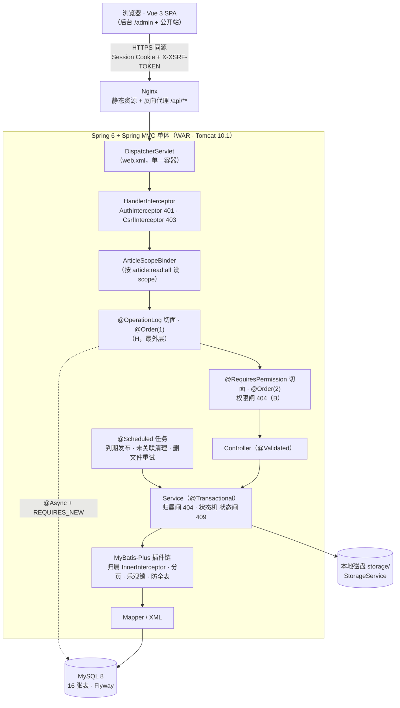
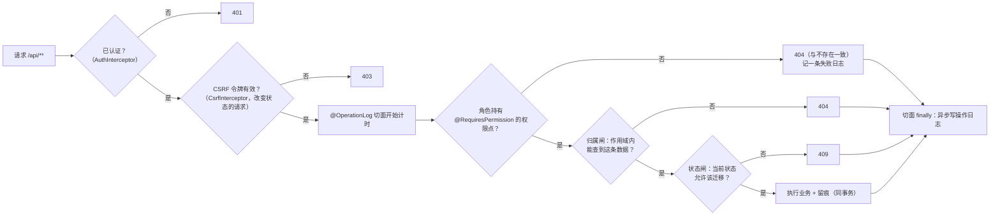

# 架构设计

> 本文是 `doc/context/` 下的**内部架构基线**。唯一的**上游是根目录 `CMS-SRS.md`**（软件需求规格说明书，本项目的主文档）。
>
> 业务规则编号（`BR-*`，定义在 SRS §6、§10.1）、状态与迁移（§5）、权限矩阵与三道闸门（§4.4~4.5）、留痕类别（§6.6）、验收标准（§9）一律以 `CMS-SRS.md` 为准，本文只引用、不重新定义。若本文与 SRS 冲突，**以 SRS 为准**，并回来修正本文。
>
> `doc/context/project-overview.md` **不再是规则的真源**：它降为背景与取舍记录，保留需求来源、被否决的方案与"为什么这么定"的论证。本文只在引用**论证过程**时才指向它；出现取值冲突一律以 SRS 为准。
>
> **2026-11-23 按 SRS v2.6 更新**：授权由"一个 `AuthzInterceptor`"改为"`@RequiresPermission` 权限切面（Spring AOP）+ 归属拦截器 + 状态机"，认证不归授权管；新增 `@OperationLog` 操作日志切面、RBAC 三表与 `sys_operation_log`（16 张表）、逻辑删除、批量逐条事务、媒体下载。改动处标"v2.6"。
>
> **2026-11-23 技术栈修订（决策 T1～T9）**：不使用 Spring Boot 与 Spring Security。后端为 Spring 6.2 + Spring MVC + MyBatis-Plus，`web.xml` + Java 配置类装配、单一 Spring 容器，WAR 部署到 Tomcat 10.1；认证与 CSRF 改由 Spring MVC 拦截器实现（§5.1），密码哈希只引用 `spring-security-crypto`；Flyway 以 Spring Bean 在启动时迁移（§2.10）。改动处标"v2.6 修订"。
>
> 本文的每一条决策若发生变更，必须同步 `doc/context/progress-tracker.md`。追溯脚本 `doc/design/traceability-check.py` 已按用户要求**暂停使用**，不再是改动后的强制关卡。

---

## 1. 架构总览

一句话：**一个前后端分离的单体应用**。Vue 3 SPA 通过 REST 调用部署在 Tomcat 上的 Spring MVC 后端（WAR）；后端是唯一的写入者；MySQL 存结构化数据，本地磁盘存文件。没有缓存层，没有消息队列，没有独立检索服务，没有第二个服务进程。

**系统架构图（v2.6，报告用图的源）：**



```
浏览器 (Vue 3 SPA)
   │  HTTPS，同源，带 Session Cookie 与 CSRF 头
   ▼
Nginx ──── 静态资源：前端打包产物
   │
   └── 反向代理 /api/** ──▶ Tomcat 10.1 · Spring MVC WAR (单体，单实例)
                                │
                                ├─ DispatcherServlet ────────── 唯一的 Spring 容器
                                ├─ AuthInterceptor / CsrfInterceptor ── 只做认证、会话、CSRF（v2.6 修订）
                                ├─ ArticleScopeBinder ──────── 设置归属 scope
                                ├─ @OperationLog 切面 ───────── 记录后台写操作（v2.6）
                                ├─ @RequiresPermission 切面 ─── 权限闸（v2.6，替代 AuthzInterceptor）
                                ├─ Controller → Service → Mapper
                                │        │      └─ 归属闸（拦截器 + Repository 收口）、状态闸（状态机）
                                │        ├──▶ MySQL 8（结构化数据，唯一事实来源）
                                │        └──▶ 本地磁盘 storage/（文件字节）
                                └─ @Scheduled 任务线程 ── 到期自动发布、孤儿文件清理
```

### 1.1 这份架构要满足的三条最硬约束

整套需求里真正有架构分量的只有三件事，后面每一个技术选择都能追溯到其中之一：

| # | 约束 | 来源 | 对架构的直接要求 |
|---|---|---|---|
| 1 | 编辑之间的文章隔离必须在**数据层**强制执行，漏一处即漏洞 | BR-ISO-003、SRS §9.1 第 2 条 | 归属条件不能靠手写，必须有一个所有读路径都绕不过的强制点 |
| 2 | 未发布文章的媒体文件不可匿名访问，且下架后**立即**失效 | BR-MEDIA-003、SRS §9.1 第 3 条 | 媒体不能由 Web 服务器直托管；任何缓存都会破坏"立即" |
| 3 | 已发布的唯一入口是审核通过 | BR-010、SRS §9.1 第 1 条 | 状态迁移必须收口到唯一的代码出口 |

---

## 2. 技术栈

### 2.1 总表

| 层次 | 技术 | 角色 |
|---|---|---|
| 前端框架 | Vue 3（Composition API）+ Vite | SPA 骨架、开发服务器与打包 |
| 前端组件库 | Element Plus | 表格、表单、上传、对话框等后台管理组件 |
| 前端状态与路由 | Pinia + Vue Router | 会话上下文、角色路由守卫 |
| 前端 HTTP | Axios | 统一携带 Cookie 与 CSRF 头、统一错误处理与 404 归一 |
| Markdown 编辑 | `md-editor-v3` [建议] | 正文写作与编辑器内预览、图片上传钩子 |
| 语言 / 运行时 | Java 21 (LTS) | 后端语言；需要时可用虚拟线程 |
| 后端框架 | Spring Framework 6.2（**Spring MVC**，不用 Spring Boot） | REST 接口、事务、依赖注入；`web.xml` + Java 配置类手工装配（§2.10） |
| 认证（v2.6 修订） | Spring MVC `HandlerInterceptor`（**不用 Spring Security**）+ `spring-security-crypto`（只用 BCrypt） | 会话、httpOnly Cookie、CSRF 令牌、会话固定防护（§5.1） |
| 授权（v2.6） | **Spring AOP**：自定义注解 `@RequiresPermission` + `PermissionAspect`（`@Around`） | 权限闸（按权限点）；归属闸在拦截器与 Repository、状态闸在状态机（§5.2） |
| 操作日志（v2.6） | **Spring AOP**：`@OperationLog` + `OperationLogAspect`，`@Async` + `REQUIRES_NEW` 写入 | 后台写操作与登录登出的运维日志（SRS §6.7） |
| 持久化 | MyBatis-Plus | ORM、分页、乐观锁 `@Version`、逻辑删除 `@TableLogic`、自动填充 `MetaObjectHandler`、防全表更新、行级归属拦截器 |
| 数据库 | MySQL 8 | 结构化数据的唯一事实来源；需要窗口函数 |
| Schema 迁移 | Flyway（Spring Bean，启动时迁移，§2.10） | 版本化 DDL/DCL，含角色与权限点种子、初始管理员与表级授权 |
| 文件存储 | 本地磁盘 + `StorageService` 抽象 | 封面图、正文图片、文章音频 |
| 定时任务 | Spring `@Scheduled` | 到期自动发布、孤儿文件兜底清理 |
| 测试 | JUnit 5 + Spring TestContext（`@SpringJUnitWebConfig`）+ MockMvc + **Testcontainers** [建议] | 接口级越权用例，跑真实 MySQL |
| 构建 | Maven（单模块） | `pom.xml` 目前为空，依赖待补 |
| 部署 | 前端静态产物 + 后端 **WAR**（外部 Tomcat 10.1），置于 **Nginx** 之后 | 反向代理、同源 Cookie |

> **技术栈表述（决策 D12、T1～T9；任课老师确认尚待完成）**：报告与 SRS 统一写"Spring 6 + Spring MVC + MyBatis-Plus（不用 Spring Boot、Spring Security），基于实验二 SSM 升级"。实验二用的是 SSM（XML 配置、`CommonsMultipartResolver`、`ResponseEntity<byte[]>` 下载）；本项目保留"手工装配 Spring"的做法，改用 `web.xml` + Java 配置类、`StandardServletMultipartResolver`（`CommonsMultipartResolver` 已在 Spring 6 移除）、`Resource` 流式下载与 `ContentDisposition`（§5.4）。
>
> 具体版本号（Spring Framework / Vue / Element Plus / MyBatis-Plus / Flyway）在实现开始前统一定版并写入 `pom.xml` 与 `package.json`。本文只锁定技术选型，不锁定补丁版本。

### 2.2 后端为什么是 Spring MVC，而不是 WebFlux

本项目的业务全是**阻塞型 IO**：MySQL 查询、本地磁盘读写，而且媒体文件要经过应用读盘再回写（见 5.4）。这恰好是 WebFlux 最不擅长的地方——阻塞调用会占满事件循环线程，必须显式切到调度器，复杂度立刻反超收益。

WebFlux 能换来的是高并发下的资源效率。一个 8 人内网使用的课程项目 CMS 没有这个量级的需求。要换的话，代价是整个技术栈改成响应式：Controller 返回 `Mono`/`Flux`，MyBatis 要换成 R2DBC，团队原有的 Spring MVC 经验全部作废。

Java 21 的虚拟线程可以在需要时把"每请求一线程"的成本降下来，**不需要换编程模型**。所以：否决 WebFlux。

### 2.3 持久化为什么是 MyBatis-Plus，而不是 JPA

三条理由，按重要性排序：

1. **本项目要写明确形态的 SQL。** 文章列表要"带最近一条驳回/下架原因"（见 5.6），这是分组取最新，需要窗口函数；多标签筛选取交集（BR-SEARCH-005）需要分组计数而不是 `IN`。这两处在 JPQL / Criteria API 里都会写成灾难。
2. **行级归属拦截器在 MyBatis 上是一个小而成熟的机制。** MyBatis-Plus 的 `InnerInterceptor` 正是为"给所有查询自动追加一个条件"设计的（多租户插件的同构用法）。这是不变量 INV-02 的强制点。
3. 团队已有 MyBatis 经验。

**代价（必须由团队自己补上）：** JPA 的脏检查、级联保存、`@PrePersist` 这类自动行为在这里都没有。`created_at` / `updated_at` / `published_at` 不会被框架自动赋值，必须由写路径显式写入。这是最容易在实现阶段漏掉的一类细节，因此架构上把 article 表的**全部写操作收口到一个 Repository**（见 5.3），只在少数几个地方处理这些字段。

### 2.4 数据库为什么是 MySQL 8

选 MySQL 8 而不选更低版本，是因为本项目用到两个 8.0 才有的能力：**窗口函数**（5.6 的"每篇取最近一条留痕"）和更完整的 **CHECK 约束**。字符集必须 `utf8mb4`——文章标题、摘要、正文、驳回意见全是中文，标签还可能出现 emoji。

MySQL 在本项目里承担两个不能用 Java 代码替代的职责：

- **`ON DELETE RESTRICT`** 让 BR-DEL-001（只有从未提交过的草稿可删）从"应用层的约定"升级为**数据库层的结构约束**。可删除的文章必然没有留痕，因此这个外键在结构上就挡住了所有"删了已提交文章"的路径，不需要应用层再查一次。
- **表级权限**让 BR-AUDIT-001（留痕只增不改不删）落地为数据库账号权限，而不是代码自觉（见 4.1）。

### 2.5 Flyway 的两个特殊职责

Flyway 不只是管 DDL。它承担三件"必须结构性成立、不能写在 Java 里"的事：

| 迁移职责 | 服务的不变量 | 说明 |
|---|---|---|
| 初始化测试管理员账号 | SRS §1.4、§4.1.1、BR-ROLE-001 | 管理员不开放注册，初始管理员只能由数据库初始化产生（v2.6 起其余管理员经角色分配产生，BR-ROLE-005）。密码以 BCrypt 哈希字面量写入迁移脚本 |
| 写入角色、权限点及其对应关系（v2.6） | BR-RBAC-002、SRS §4.5 | 应用账号对 RBAC 三表只有 `SELECT`，角色权限只能随迁移变更，矩阵在运行期是不变量 |
| 对 `audit_log`、`sys_operation_log` 只授 `INSERT` / `SELECT` | BR-AUDIT-001、BR-OPLOG-005、INV-04 | 应用数据库账号对这两张表没有 `UPDATE` / `DELETE` 权限。写错代码也删不掉留痕和日志 |

最后一件事尤其重要：如果只靠"我们没写删除接口"来保证留痕不可篡改，那下一次有人为了排查问题手写一条 SQL、或者加了个批量维护接口，约束就没了。把它降级为数据库权限，才是可证明的。

### 2.6 文件存储：本地磁盘 + `StorageService` 抽象

接口只有四个方法，故意做得很窄：

```
String store(MediaType type, InputStream in, long size, String mimeType)   // 返回系统生成的相对路径
InputStream open(String relativePath)
void delete(String relativePath)
boolean exists(String relativePath)
```

抽象层的意义**不是**为了将来换对象存储（本期没有这个需求），而是为了让媒体文件的所有落盘行为集中在一处，从而做到两件事：

1. 路径拼接只在这个实现里发生，用户提供的文件名永远不参与路径构造（BR-MEDIA-002）；
2. 测试可以替换为内存实现，媒体判权用例（TU-09 / TU-10）不必依赖真实文件系统。

具体目录布局与文件名生成规则见 4.2。

### 2.7 定时任务为什么是 `@Scheduled`，而不是 Quartz

到期自动发布（迁移路径 #10）是本项目唯一的后台任务。选 `@Scheduled` 的核心理由是：**发布这件事的真相只有 `article.status` 与 `published_at` 两处，不能有第三处。**

Quartz 的持久化调度（或任何"发布任务表"方案）会引入一个任务状态字段，于是"任务已完成但文章未发布"或"文章已发布但任务仍待执行"成为可能。这类不一致没有业务含义，只会制造排查成本。数据库设计中已经否决了发布任务表，此处保持一致。

**代价与应对：** `@Scheduled` 在多实例部署下会重复触发。本期明确按**单实例**部署。但幂等性不依赖"只有一个实例"这个假设——它靠 SQL 条件实现（见 6.1），因此即使将来意外启动了第二个进程，也不会重复发布或覆盖 `published_at`。

### 2.8 测试为什么必须跑真 MySQL

`Testcontainers` 拉起真实的 MySQL 8 容器，而不是 H2 的内存兼容模式。

原因很具体：本项目三条最硬约束所依赖的机制，**H2 一个都不完整实现**——

- 不变量 INV-04 靠 MySQL 的表级权限，H2 没有对应用户权限模型；
- BR-DEL-001 靠 `ON DELETE RESTRICT` 的外键行为；
- 5.6 的"每篇取最近一条留痕"靠窗口函数。

在 H2 上跑通这些用例，证明不了任何事。而越权用例（18 条）恰恰是本项目对外演示时的核心材料，它们必须跑在一个和验收环境同构的数据库上。

**代价：** 每次跑集成测试要启动容器，CI 与本地开发都需要 Docker，首次拉镜像慢。这是为"测试结果可信"付的价钱，本项目中值得付。

> **2026-11-23 起暂缓（排期调整，不是否决）。** 按分工调整（`doc/context/team-division.md`），M0～M4 不安排测试任务，每个 PR 改附手工验证记录；本节与 §7 各不变量的「怎么发现违反」统一推迟到 M4 之后单独排期的「测试补齐」阶段落地。选型与理由不变：到时仍用 Testcontainers 真 MySQL，不用 H2。

### 2.9 Markdown 存储的口径

正文以 **Markdown 原文**入库，**绝不存渲染后的 HTML**（BR-MEDIA-006、范围外清单）。

编辑器的实时预览会在浏览器端把 Markdown 渲染成 HTML，但那份 HTML 只活在组件内存里，不进入任何请求体。后端对 `content` 字段的校验只认出/入两端是文本，不解析、不渲染、不做 HTML 消毒——因为**一旦开始消毒，就等于承认这里可以进 HTML**。正确的做法是让 HTML 根本无法进入这个字段的语义。

视频一律以 `https` URL 的形式出现在正文里，后端只做协议校验（BR-MEDIA-006），不判断链接目标的内容。

### 2.10 不用 Spring Boot、Spring Security 时怎么装配（v2.6 修订，决策 T1～T9）

没有 Boot 的自动配置，下面每一项都要由配置类显式声明；这正是本项目在课程里要展示的 Spring 知识点。

| 事项 | 做法 | 负责 |
|---|---|---|
| 启动入口 | `src/main/webapp/WEB-INF/web.xml` 声明唯一的 `DispatcherServlet`（`contextClass` = `AnnotationConfigWebApplicationContext`，`contextConfigLocation` = `com.liang.cms.config.AppConfig`，`load-on-startup` = 1），并声明 `CharacterEncodingFilter`（UTF-8）、`<multipart-config>`（单文件 20 MB、单请求 25 MB）与 `<session-config>`（§5.1）。没有 `main` 方法 | B |
| 容器（T7） | **只用一个 Spring 容器**：全部配置类都由 `DispatcherServlet` 的 WebApplicationContext 装载，**不配 `ContextLoaderListener` 父容器**。理由：本项目只有一个 `DispatcherServlet`，父子容器没有收益；而父子容器最常见的坑——切面、`@Transactional` 或 `@Async` 声明在一个容器、目标 Bean 在另一个容器，于是静默失效——会直接让权限闸与操作日志失效。报告里说明 `ContextLoaderListener` 的作用与本项目不用它的理由 | B |
| 配置类 | `AppConfig`（`@Configuration` + `@ComponentScan("com.liang.cms")` + `@PropertySource`）汇总：`DataSourceConfig`（HikariCP、`DataSourceTransactionManager`、`@EnableTransactionManagement`）、`MybatisPlusConfig`（`MybatisSqlSessionFactoryBean`、插件链、`MetaObjectHandler`、`@MapperScan`）、`FlywayConfig`、`WebMvcConfig`（`@EnableWebMvc`：拦截器注册、Jackson、校验器、`StandardServletMultipartResolver`）、`AopConfig`（`@EnableAspectJAutoProxy(proxyTargetClass = true)`）、`SchedulingConfig`（`@EnableScheduling`、`@EnableAsync` 与线程池） | B 建骨架，各配置类由归属人补全 |
| 外部配置 | `src/main/resources/application.properties` 经 `@PropertySource` 读入（数据库连接、`cms.storage.root` 等），口令类取值允许用环境变量覆盖。不用 `application.yml`，那是 Boot 的约定 | B |
| Flyway（T5） | `FlywayConfig` 定义 `@Bean(initMethod = "migrate") Flyway`，`SqlSessionFactory` 以 `@DependsOn("flyway")` 保证先迁移、后建会话工厂。迁移脚本放 `classpath:db/migration`，由迁移账号（有 DDL 权限）执行；应用账号只持有 §2.5 的 DML 权限。Flyway 10 起 MySQL 支持在单独的 `flyway-mysql` 模块里 | B |
| 认证与 CSRF（T1、T2） | `AuthInterceptor` + `CsrfInterceptor`（`HandlerInterceptor`，§5.1）；密码哈希只引入 `spring-security-crypto` 的 `BCryptPasswordEncoder`，**不引入** `spring-security-web` / `spring-security-config` | B |
| JSON 与校验 | `WebMvcConfig.configureMessageConverters` 注册统一的 `ObjectMapper`（`JavaTimeModule`、`snake_case`、时间格式按 api-spec §3）；`LocalValidatorFactoryBean`（Hibernate Validator）作为 MVC 校验器 | H |
| 全局异常与 404 | `@RestControllerAdvice` 统一返回体；不存在的路径由 `NoHandlerFoundException`（Spring 6.1 起默认抛出）/ `NoResourceFoundException` 转成 `404 40400`；不开默认 Servlet 的静态资源映射 | H |
| 部署（T4） | Maven `packaging = war`，`jakarta.servlet-api` 为 `provided`；部署到外部 **Tomcat 10.1**（Jakarta EE 10，Spring 6.2 支持）；Nginx 反向代理 `/api/**` 到 Tomcat。开发期用 IDE 的 Tomcat 运行配置 | B |
| 版本（T6） | Spring Framework 6.2.x + JDK 21；MyBatis-Plus 用非 Boot 依赖（`com.baomidou:mybatis-plus` + `mybatis-spring` 3.x；3.5.9 起分页插件另需 `mybatis-plus-jsqlparser`）；具体补丁版本在 `pom.xml` 定版 | B |

---

## 3. 系统边界

### 3.1 后端包结构

包根 `com.liang.cms`，按**功能域**分包（不是按 Controller/Service/Mapper 三层分包）。理由：文章域的一个改动会同时落在自己域的 Controller、Service、Mapper 里，按层分包会让每次改动横跨四个目录，也让人无法一眼看出"哪些东西属于媒体"。

```
src/main/java/com/liang/cms/
├── config/          AppConfig 与各配置类（v2.6 修订）：数据源与事务、MyBatis-Plus（插件链、MetaObjectHandler）、
│                    Flyway、Web MVC（拦截器注册、Jackson、校验、multipart）、AOP、调度与异步、存储
├── auth/            登录、登出、注册；AuthInterceptor、CsrfInterceptor、CurrentUserHolder（v2.6 修订）
├── security/        授权（v2.6）：@RequiresPermission、PermissionAspect、PermissionCoverageChecker、
│                    PermissionService（每请求加载权限集）、OwnershipGate、
│                    ArticleScopeBinder、ArticleScopeContext（唯一设置 scope 的地方）
├── system/          系统管理（v2.6）：用户列表 / 启停 / 角色分配与角色、权限点只读（G）、操作日志查询（H）
├── article/         文章聚合：Controller、Service、Repository、Mapper、Entity、DTO、状态机
├── taxonomy/        分类与标签
├── media/           上传、类型与大小校验、StorageService 实现、媒体交付出口
├── audit/           留痕写入与查询
├── publicapi/       博客前台公开接口（无认证，只读）
├── task/            后台任务：到期自动发布、孤儿文件清理
└── common/          统一响应体、全局异常处理、错误码、分页对象、排序白名单解析、枚举
    └── aop/         @OperationLog、OperationLogAspect、OperationLogWriter（v2.6，H）

src/main/webapp/WEB-INF/web.xml   DispatcherServlet、CharacterEncodingFilter、multipart 与会话配置（v2.6 修订）
src/main/webapp/META-INF/context.xml   Tomcat CookieProcessor：SameSite=Lax
```

没有 `CmsApplication.java`：不用 Spring Boot，应用由 Tomcat 加载 `web.xml` 启动（§2.10）。

每个包的职责与**禁止事项**：

| 包 | 负责 | 绝不允许做 |
|---|---|---|
| `config/` | 装配框架：注册拦截器、配置数据源与事务、Flyway、定义存储根目录 | 出现业务判断（角色、状态、归属都不在这里判） |
| `auth/` | 认证本身：校验密码、建立/销毁会话、注册编辑账号、登录拦截与 CSRF 校验 | 判角色能不能做某件事（那是 `security/` 的事） |
| `security/` | 授权：权限切面、权限点覆盖检查、归属闸、scope 设置、权限拒绝的统一响应 | 查询文章内容、返回业务数据；在会话里缓存权限集（BR-RBAC-005） |
| `system/` | 用户管理、角色与权限点只读、操作日志查询 | 修改角色的权限点（本期无此功能，BR-RBAC-002）；删除账号（BR-USER-002） |
| `article/` | 文章聚合的全部读写、状态机 | 自行拼接文件路径、自行拼 SQL 的归属条件 |
| `taxonomy/` | 分类树（两级）、排序、启停、标签的增删改查（逻辑删除）与关联维护 | 判"谁能改分类"（权限闸统一判） |
| `media/` | 类型白名单与大小上限校验、落盘、媒体请求的判权与回写 | 决定"这篇文章的编辑是谁"（向 `article/` 查） |
| `audit/` | 往 `audit_log` 写、按文章读 | 提供任何修改或删除留痕的方法——**这个包不该有 delete 与 update 方法** |
| `publicapi/` | 匿名读取已发布文章的公开字段 | 调用任何写方法；接受任何影响可见性的参数 |
| `task/` | 调度与幂等执行 | 绕过状态机直接改 `status`——发布也必须走状态机的迁移出口 |
| `common/` | 技术性横切 | 依赖任何一个业务包 |

**依赖方向规则：** `common` ← 所有包；`security` ← `article`/`media`/`audit`/`taxonomy`/`publicapi`/`system`；**`security` 不得反向依赖任何业务包**（否则闸门判定会被业务逻辑污染，不再是一个可以独立测试的东西）。`publicapi` 不得被任何后台包依赖。

### 3.2 前端目录结构

```
web/
├── src/
│   ├── api/          每域一个模块；统一的 axios 实例（携带 Cookie 与 CSRF 头、统一处理 404）
│   ├── router/       路由表 + 全局前置守卫
│   ├── stores/       session store（当前用户、角色，F）；taxonomy（前台分类 / 标签导航，来自公开列表 facets）
│   ├── composables/  组合式函数（如前台列表加载 usePublicList）
│   ├── layouts/      PublicLayout（博客前台）；AdminLayout（后台，F/G）
│   ├── views/
│   │   ├── public/       博客前台：首页、分类页、搜索页、文章详情、统一 404（匿名只读）
│   │   ├── auth/         登录、注册
│   │   ├── article/      编辑视角：我的文章列表、编辑页、详情、留痕
│   │   ├── review/       管理员视角：审核队列、通过、驳回、下架
│   │   └── taxonomy/     分类管理（管理员）、标签
│   ├── components/   跨页面复用组件
│   └── utils/
```

### 3.3 前端的边界：`views/article` 与 `views/review` 不共享可写组件

这不是目录洁癖，是 BR-007（管理员不能修改文章内容）在界面层的结构性落实。

`views/review` 下的任何页面**不得渲染正文编辑控件**。审核页展示的正文是只读渲染（Markdown 预览组件），审核动作只有两个按钮：驳回、通过。如果审核页复用了编辑页的表单组件，那么"管理员不能改内容"就退化成"我们没把保存按钮放出来"——而这正是 BR-ISO-003 所反对的那类保证方式。

前端守卫（`router/`）只负责体验：不显示进不去的入口。**它不承担任何权限职责**，所有判定在服务端。

### 3.4 不能越的五条边界

| 边界 | 规则 | 谁来保证 |
|---|---|---|
| 前端 → 权限 | 前端守卫只做体验，不做判定 | 越权用例直接打接口，绕过前端 |
| 后端 → 静态资源 | `storage/` 根目录**不得**出现在任何静态资源映射里 | 一条测试断言配置中不含 storage 路径（INV-05） |
| 公开接口 → 写操作 | `publicapi/` 只有 SELECT | 包结构 + 源码扫描测试 |
| 审核页 → 内容写入口 | 审核相关接口不接收任何内容字段 | DTO 里根本没有这些字段（结构性，不靠校验） |
| SQL → 归属条件 | 文章写路径只经 `ArticleRepository` 的固定几个方法 | 源码扫描 + 越权用例 |

---

## 4. 存储模型

### 4.1 数据库（MySQL）—— 结构化数据的唯一事实来源

十六张表（v2.6；v1 为 12 张），对应 SRS 已确立的领域划分（账号与权限见 §4，文章与分类标签见 §7，留痕见 §6.6，操作日志见 §6.7，媒体见 §6.4）。**字段级定义、函数依赖与范式论证、约束清单见 `doc/db/schema.md`**（v2）；本节只列每张表的职责。

| 表 | 所有者 | 存什么 | 关键约束 / 说明 |
|---|---|---|---|
| `role` / `permission` / `role_permission` | B | 2 个角色、27 个权限点及其对应关系（v2.6） | 运行时只读，种子随迁移写入（BR-RBAC-002） |
| `user` | B | 账号、BCrypt 密码、`role_id` 外键、`status`（启用 / 停用） | **建角色表，但不建用户-角色多对多**：`role_id` 单值非空外键让"一个账号挂两个角色"在结构上无法表达（BR-ROLE-001，决策 D1）；账号不删除只停用；登录名只存小写规范形式 |
| `login_throttle` | B | 按**登录名**的连续失败次数与锁定截止 | 故意不建指向 `user` 的外键：不存在的登录名也要计数（SRS §4.1.2） |
| `category` | F | 封闭的两级分类树：`parent_id`、`sort_order`、`status` | 仅管理员维护；逻辑删除；名称在未删除范围内不区分大小写唯一 |
| `tag` | F | 开放的标签集合，扁平无层级 | 编辑可随文创建；逻辑删除；名称规则同分类 |
| `article` | C | 文章本体；`status` 存 6 个**英文代码**（与 api-spec §4.1 一致）；`cover_media_id` / `audio_media_id`；乐观锁 `version`；逻辑删除 `deleted` | `author_id` 在组合索引首位；`published_at` 可空；`status` 与时间字段只经状态机写；**不存** `submitted_at`（由本轮提交留痕派生） |
| `article_tag` | F | 文章与标签的 N:M 关联 | 交集筛选的实现基础 |
| `media_format` | E | 8 种真实格式 → 大类、MIME、存储扩展名（字典） | 运行时只读；消除 `media_file` 里 MIME 对格式的传递依赖 |
| `media_file` | E | 文件索引：所属文章、用途、真实格式、`storage_key`、原始文件名（v2.6，下载用）、大小、`linked_at` | **不存字节**，也不存路径、MIME；引用解除即删行 |
| `media_purge_job` | E | 删文件**失败**的记录与重试时间 | 只记失败、`@Scheduled` 重试、成功即删行（BR-MEDIA-004、BR-DEL-004） |
| `reject_category` | D | 8 个驳回类别的代码、中文名、分组（字典） | 运行时只读（BR-CONTENT-005） |
| `review_standard` | D | 审核标准版本登记（字典） | 运行时只读；升级 = 追加一个 INSERT 迁移（SRS §6.1.1） |
| `audit_log` | H | 文章流程留痕（业务事实） | 只增不改不删（见下）；操作人为 `USER` / `SYSTEM` 双主体（见下）；与业务同事务 |
| `sys_operation_log` | H | 系统操作日志（运维审计，v2.6） | 只增不改不删；独立事务、尽力写入；不存请求体与密码（SRS §6.7） |

状态、动作、角色等枚举在库里与接口里是**同一套英文代码**，后端不做中英映射；中文只出现在界面与 `reject_category.label`。

**`audit_log` 的操作人列（BR-AUDIT-004）。** 留痕的操作人是双主体的，用两列表达，且两列的取值必须互相咬合：

| 列 | 类型 | 约束 |
|---|---|---|
| `actor_type` | 枚举 | `USER` / `SYSTEM`，非空 |
| `actor_id` | `BIGINT`，**可空** | `actor_type = 'USER'` 时必须非空并外键指向 `user(id)`；`actor_type = 'SYSTEM'` 时必须为 `NULL` |

落地为一条 CHECK 约束 `ck_audit_actor`：`(actor_type = 'USER') = (actor_id IS NOT NULL) AND (actor_type = 'SYSTEM') = (action = 'AUTO_PUBLISH')`，既让两列互相咬合，也锁住"只有到期自动发布是系统"。`actor_type` 能由 `action` 推出，属于**有意保留的受控冗余**（理由见 `doc/db/schema.md` §5.1）。把"人类留痕必须有人、系统留痕必须没有账号"写成数据库层的结构约束，而不是 Service 里的一句 `if`——后者在新增第 8 类留痕、或有人图省事给系统留痕填一个管理员 id 时都不会被审查到。

外键动作取默认的 `RESTRICT`，方向与 INV-04（留痕只增不改不删）一致：**只要一个账号还留着任何一条留痕，它就删不掉。** 因此 v2.6 的「账号停用」只有停用一条路，不能靠删账号（BR-USER-002）——这不是额外加的规则，而是这张表的外键自带的结论。

**逻辑删除（v2.6）。** `article`、`category`、`tag` 带 `deleted` 列，删除写入本行 `id`（`@TableLogic(delval = "id")`，M0 由 B 验证，见 `doc/db/schema.md` §1）。逻辑删除后外键 RESTRICT 不再能代替引用检查，分类、标签的"被引用不能删"改由 F 的 Service 做 `EXISTS` 检查；手写 SQL 必须显式带 `deleted = 0`（SRS X-DEL-01）。

**`audit_log` 的其余条件字段。** SRS §6.6 的"条件必填 / 不写入即 `NULL`"规则，库里只放 3 条关键条件 CHECK（上面的操作人、驳回必须有类别与意见、下架必须有原因），其余由 `audit/` 的 `AuditWriter` 在写入前校验（规则 AUD-01～08，见 `doc/db/schema.md` §6.2）。两条唯一键兜底并发：一轮提交最多一个审核结论，一次审核通过最多被到期发布一次。

> 2026-09-28 删除的旧数据库设计文档不再恢复；全部表的字段级定义自 2026-11-23 起以 `doc/db/schema.md` 为准，参考 DDL 为 `doc/db/schema-reference.sql`（参考脚本，不是迁移）。

**数据库账号权限分离（服务不变量 INV-04）：**

| 账号 | 权限 | 用途 |
|---|---|---|
| 迁移账号 | DDL + DCL 全量 | 只由 Flyway 使用 |
| 应用账号 | `login_throttle`、`article_tag`、`media_file`、`media_purge_job` 全部 CRUD；`user`、`category`、`tag`、`article` 仅 `SELECT`/`INSERT`/`UPDATE`（逻辑删除或不可删除）；三张字典表与三张 RBAC 表仅 `SELECT`；`audit_log`、`sys_operation_log` 仅 `SELECT`/`INSERT` | 后端运行时使用 |

这是一条**结构性**保证：留痕不可篡改不是因为"我们没写删除接口"，而是因为应用连一把能删的钥匙都没有。同理，应用改不了角色的权限点（给编辑授 `review:approve`），也物理删除不了文章。

### 4.2 文件存储（本地磁盘）

`storage/` 根目录由配置项 `cms.storage.root` 指定，**不在 Git 仓库内**（加入 `.gitignore`）。

| 用途 | 目录 | 类型白名单 | 单文件上限 | 每篇数量 | 来源 |
|---|---|---|---|---|---|
| 封面图 | `storage/cover/{uuid}.{ext}` | `jpg` `jpeg` `png` `gif` `webp` | 5 MB | ≤ 1 | BR-MEDIA-002 |
| 正文图片 | `storage/inline/{uuid}.{ext}` | 同上（共用同一份白名单） | 5 MB | 不限 | BR-MEDIA-001/002 |
| 文章音频 | `storage/audio/{uuid}.{ext}` | `mp3` `m4a` `wav` `ogg` | 20 MB | ≤ 1 | BR-MEDIA-005 |

**文件名生成规则：** `{UUID}.{ext}`，其中 UUID 存为 `media_file.storage_key`，`ext` 由服务端按魔数判定的真实格式查 `media_format.extension` 得出，**不取自上传请求里的原始文件名或扩展名**。原始文件名不入库（api-spec §4.9 也不返回），相对路径不存、运行时由「用途目录 + storage_key + 扩展名」拼出，因此路径穿越（`../`）在本架构下没有入口。路径分隔符由 `StorageService` 实现统一处理。

**文件与数据库的一致性策略：** 文件系统是文件内容的唯一存放处，数据库是文件的唯一索引。两者都要动时，顺序固定为：

- **新增（上传 / 替换）：** 先落盘 → 再写 `media_file` 行 → 最后删除被替换的旧行（与新引用同一事务）与旧文件（事务提交后）。
- **删除文章：** 先把数据库事务提交（删行）→ 再删文件。
- **删文件失败：** 写一行 `media_purge_job`（路径、失败次数、最近错误、下次重试时间），由 §6.2 的定时任务重试，成功即删行。

这样安排的理由是：任何一步中断，结果都只是**孤儿文件**（占空间、不可达、不泄露）；而反过来先删文件，会产生**指向不存在文件的行**，接口读到它会 500。孤儿文件由兜底清理任务收拾（6.2），孤儿行则没有任何自动修复手段。

### 4.3 缓存 —— 明确没有

本架构**不含任何缓存层**：没有 Redis、没有 Spring Cache、没有本地 Caffeine、没有 HTTP 缓存头。

这不是"先不做，以后再补"，而是一条有约束力的设计决定。理由是 BR-MEDIA-003 要求文章下架后媒体文件**立即**停止匿名访问，而任何缓存都会把"立即"悄悄变成"最多 N 秒后"。媒体访问是整份需求里唯一落在静态资源而非数据行上的越权面（这条判断的论证见 `project-overview.md` §6.5 的批注，SRS 未收录分析文字），它恰恰最不能承受一个模糊的时间窗。

同理，BR-SEARCH-003 要求分页总数基于过滤后的结果集，缓存计数会重新打开"通过总数推断他人文章存在性"这条侧信道。

**因此：在引入任何缓存之前，必须先显式定义全部失效点（下架、撤回、改期、编辑、删除、审核通过各一处），并把"状态变更必须同步失效对应缓存"写成一条新的不变量。** 没有这步，不要加缓存。

### 4.4 什么放在哪里 —— 判定表

| 内容 | 位置 | 理由 |
|---|---|---|
| Markdown 正文原文 | MySQL `article.content` | 是文章的一部分，要参与归属与状态判定 |
| 渲染后的 HTML | **不存** | BR-MEDIA-006；存了就要求前台打开 raw HTML 直通，那就是 XSS 面 |
| 上传的文件字节 | 本地磁盘 | 大对象，不进数据库、不进事务 |
| 文件的格式 / 大小 / 所属文章 / 引用标记 | MySQL `media_file`（MIME、扩展名在 `media_format`；路径运行时拼出） | 判权必须按 `article_id` 关联到文章状态 |
| 删文件失败的重试记录 | MySQL `media_purge_job` | 磁盘操作的重试状态在数据库里没有别的落点；与「发布任务不建表」不冲突（那条管的是发布状态的唯一来源） |
| 登录失败计数与锁定 | MySQL `login_throttle` | 按登录名计数，后端重启后锁定仍有效 |
| 审核标准版本 | MySQL `review_standard`（Flyway 维护） | 留痕只能引用登记过的版本；升级有迁移记录（2026-11-23 起取代"服务端配置项"） |
| 视频 | **不存**，只存 https URL | BR-MEDIA-006/007；不下载、不代理、不转码 |
| 会话 | 服务端 `HttpSession`（单实例，内存） | 后端重启导致登录态丢失，对本项目是可接受的代价 |
| 留痕 | MySQL `audit_log`，只增 | BR-AUDIT-001 |
| 发布任务 | **不建表** | 真相只有 `article.status` 与 `published_at`，不能有第三处 |
| 缓存 | **不存在** | 见 4.3 |

---

## 5. 认证与访问模型

### 5.1 认证（v2.6 修订：Spring MVC 拦截器，不用 Spring Security）

| 事项 | 做法 |
|---|---|
| 会话 | Servlet 容器的 `HttpSession`，Cookie 名 `JSESSIONID`，`httpOnly` = true，`SameSite` = Lax，`Path` = /，`Max-Age` 与会话绝对有效期一致，生产环境 `Secure` = true。由 `web.xml` 的 `<session-config>`（`session-timeout` = 30、`cookie-config` 的 `http-only` / `secure` / `max-age` = 43200、`tracking-mode` = COOKIE）与 Tomcat `META-INF/context.xml` 的 `Rfc6265CookieProcessor sameSiteCookies="lax"` 配置 |
| 会话里存什么 | 登录成功后只存 `LOGIN_USER_ID`、`LOGIN_AT` 与 `CSRF_TOKEN`；**不存角色、权限或账号状态**（BR-RBAC-005） |
| 登录拦截 | `AuthInterceptor`（`HandlerInterceptor.preHandle`，B）：取不到会话或 `LOGIN_USER_ID` → 401；`LOGIN_AT` 距今超过 12 小时 → 销毁会话、401；**每个请求按 `user_id` 查一次 `user` 的 `status` 与 `role_id`**，查不到或为 `DISABLED` → 销毁会话、401（BR-USER-001）。通过后把 `CurrentUser(userId, roleId)` 放进 `CurrentUserHolder`（ThreadLocal，`afterCompletion` 清理），供权限切面、归属 scope 与操作日志使用 |
| 拦截范围 | `/api/**`。完全匿名：`/api/auth/login`、`/api/auth/register`、`/api/auth/csrf`、`/api/public/**`。**可选认证**：媒体出口 `/api/media/**`（#29、#43）有合法会话时识别身份，没有时按匿名处理，任何情况都不返回 401（§5.4） |
| CSRF（T2） | `CsrfInterceptor`（排在 `AuthInterceptor` 之后，B）：对 POST / PUT / PATCH / DELETE 且不是 `POST /api/auth/login` 的请求，用 `MessageDigest.isEqual` 比较请求头 `X-XSRF-TOKEN` 与会话属性 `CSRF_TOKEN`，缺失或不等 → 403 `40300`。令牌由 `GET /api/auth/csrf`（#1）用 `SecureRandom` 生成 32 字节、Base64URL 编码后存进会话（无会话时建匿名会话），贴合 SRS §4.1.2 的会话绑定令牌；不下发可读的 CSRF Cookie |
| 密码（T1） | `spring-security-crypto` 的 `BCryptPasswordEncoder`（强度 10）；只引这一个 jar |
| 会话固定攻击 | 登录成功后调用 `HttpServletRequest.changeSessionId()` 更换会话标识，并重新生成 `CSRF_TOKEN`，登录前的令牌随之失效（api-spec §2.2） |
| 会话有效期 | 空闲 30 分钟由容器 `session-timeout` 负责；绝对有效期 12 小时由 `AuthInterceptor` 比较 `LOGIN_AT`；到期后请求返回 401，须重新登录（SRS 4.1.2） |
| 登录失败限制 | 同一登录名连续失败 5 次锁定 15 分钟；锁定期间即使密码正确也拒绝，响应与普通失败一致（SRS 4.1.2）。计数存 `login_throttle`，不存在的登录名同样计数 |
| 并发会话 | 同一账号允许多个会话同时存在；登出只销毁当前会话（SRS 4.1.2） |
| 登录 | `POST /api/auth/login`：普通的 `AuthController` 方法，`AuthService` 校验密码、状态与失败计数，失败统一 401 `40101`；标 `@OperationLog`（§5.7） |
| 登出 | `POST /api/auth/logout`：`session.invalidate()`，并以 `Max-Age=0` 清除 `JSESSIONID` |
| 注册 | `POST /api/auth/register`，**只创建编辑角色**，注册成功即启用（SRS §4.1.1、FR-USER-001） |
| 管理员账号 | 不开放注册；初始管理员由 Flyway 迁移创建；其余管理员只能经角色分配产生，至少保留一个启用管理员（SRS BR-ROLE-004/005） |
| 停用账号（v2.6） | 登录时 `DISABLED` 账号按普通失败处理（统一 401）；已有会话由 `AuthInterceptor` 每请求查状态发现并返回 401（BR-USER-001） |
| 授权 | 拦截器只判"是否已登录"，**不做任何角色或权限判断**；授权全部交给 §5.2 的权限切面，避免两套授权并存（决策 D2） |
| 未认证访问后台接口 | **401** |
| 拦截器顺序 | `WebMvcConfig.addInterceptors` 依次注册 `AuthInterceptor` → `CsrfInterceptor` → `ArticleScopeBinder`。三者都在参数绑定之前执行，所以 401、403 一定先于请求体校验的 400 |
| 不存在的路径 | 没有匹配的 Handler 时拦截器不执行，直接由全局异常处理返回 `404 40400`（H），未登录也是 404 而不是 401（api-spec §3.3） |

> **关于 CSRF 令牌。** 会话凭据 `JSESSIONID` 保持 httpOnly；CSRF 令牌存于服务端会话并通过 `#1` 接口下发，前端只把它放进请求头，不作为第二份凭据持久化在可读 cookie 里。单独的 CSRF 令牌泄露不构成攻击，攻击者必须同时持有会话 cookie。
>
> 本架构不采用 JWT 存 localStorage 的方案：token 存在 JS 可读的位置，等于把凭据暴露给每一个 XSS 点（此为本文的取舍；上游文档未涉及该议题）。

### 5.2 授权：三道闸门（v2.6：权限闸改为 AOP 切面）

一个请求要通过**三道互相独立**的闸门，全过才放行（SRS §4.4）：

| 闸门 | 判断的问题 | 输入 | 实现（v2.6） | 失败结果 |
|---|---|---|---|---|
| 权限闸 | 你的角色有这个接口声明的权限点吗 | 当前用户角色的权限集 + 方法上的 `@RequiresPermission("review:approve")` | `PermissionAspect`（`@Around`，B） | 404 |
| 归属闸 | 这条数据是你的吗 | `article.author_id` vs 当前用户；是否持有 `article:read:all` | `ArticleScopeBinder` + MP `InnerInterceptor` + `ArticleRepository` 写路径收口（§5.3） | 404 |
| 状态闸 | 当前状态允许这个动作吗 | `article.status` + 目标迁移 | 状态机的条件 UPDATE（G） | 409 |

**权限闸与归属闸失败一律返回 404，响应与"资源不存在"逐字节一致；状态闸失败返回 409。** 若权限闸返回 403、归属闸返回 404，攻击者仅凭状态码就能分辨"这篇文章存在但不是你的"，等于泄露资源存在性；能走到状态闸说明前两闸已过、请求者对该资源的可见性本来确定，因此 409 不泄露新信息（SRS §4.4）。

**401 与 404 可以并存，不矛盾：** 401 只发生在"你根本没登录"这一种情况，它不携带任何关于目标资源的信息。因此**未认证 = 401，CSRF 失败 = 403，已认证但权限闸／归属闸失败 = 404，状态闸失败 = 409**。

**请求鉴权链（流程图 3 的源，B 负责细化）：**



**v2.6 为什么改成切面**（推翻 v2.5"三道闸门全部实现在一个 `AuthzInterceptor`"）：课程评分表点名要求"基于 Spring AOP 的接口权限校验"；而权限点必须声明在具体的 Controller 方法上，注解 + 切面正是 Spring 的惯用写法。为了保住原来"权限判断只有一处可证明"的根基，改为三条结构保证：

1. **判定点仍只有一个**：`PermissionAspect` 是全代码库唯一读取权限集并做比较的地方；Service 里不出现角色或权限判断（源码扫描测试断言 `hasPermission` 只在 `security/` 被调用）。
2. **漏声明启动即失败**（BR-RBAC-003）：`PermissionCoverageChecker`（v2.6 修订：监听 `ContextRefreshedEvent`，不再是 Boot 的 `ApplicationRunner`）启动时从 `RequestMappingHandlerMapping` 取全部映射，`/api/**` 下除白名单（登录、注册、CSRF 令牌、登出、当前用户、`/api/public/**`、媒体出口 #29 与下载 #43）外，缺 `@RequiresPermission` 的方法直接抛异常、应用部署失败；同时断言声明了 `@RequiresPermission` 的 Controller Bean 是 AOP 代理（`AopUtils.isAopProxy`），防止 `@EnableAspectJAutoProxy` 漏配导致切面静默失效。
3. **权限集每请求从库加载**（BR-RBAC-005）：用 `AuthInterceptor` 本次请求按 `user_id` 查到的 `role_id`，`role_permission JOIN permission` 一条 SQL（N+1 落点）；角色和权限都不缓存在会话里，所以角色分配、停用在下一次请求生效。

**切面顺序**：认证与 CSRF 在拦截器里、早于两个切面；`OperationLogAspect` `@Order(1)` 在最外层、`PermissionAspect` `@Order(2)` 在内，权限失败也能留下一条失败日志。`@Transactional` 代理在两者之内（Service 层），所以日志不在业务事务里。

**与请求体校验的先后（待 A、B 在 M1 前确认，api-spec §16-#17）**：切面包在 Controller 代理上，而 Spring MVC 在调用代理**之前**就完成参数绑定、JSON 解析和 `@Valid`，所以请求体格式错误的 400 会先于权限闸 / 归属闸的 404。格式校验与资源是否存在无关，不泄露存在性；暂定接受这个顺序，越权用例一律用格式合法的请求体。v2.5 的 `HandlerInterceptor.preHandle` 在参数解析之前执行，没有这个差别。

**批量接口**（#40～#42）：方法级权限闸只判一次（`review:approve` 等）；归属闸与状态闸对每条目在独立事务里判定（§6.5），逐条结果遵守同一 404 收口。

### 5.3 归属隔离的落地（本节是全文最重的一节）

BR-ISO-003 要求隔离"在数据层强制执行，漏一处即漏洞"。落地方式是**读路径自动追加 + 写路径收口 + 唯一的 scope 设置点**。

**第一层：请求进来时确定 scope。**
`ArticleScopeBinder` 根据**请求路径与当前用户角色**，在每个请求开始时把 scope 放进 `ArticleScopeContext`（ThreadLocal）：

| 请求 | scope | 效果 |
|---|---|---|
| `/api/public/**` | `PUBLIC` | 读文章时自动追加 `status = 'PUBLISHED'` |
| `/api/**`，当前用户持有 `article:read:all`（管理员） | `ALL` | 读文章时不追加归属条件 |
| `/api/**`，其余已认证用户（编辑） | `OWNER(userId)` | 读文章时自动追加 `author_id = userId` |

**`ArticleScopeBinder` 是整个代码库里唯一能设置 scope 的类。** 没有任何 Controller、Service 或测试可以通过别的方式提升自己的可见范围——因为不存在这样的 API。这一点由一条源码扫描测试盯住：断言 `ArticleScopeContext` 的设置方法只出现在 `ArticleScopeBinder` 中（首选 ArchUnit 写一条规则；不引入新依赖的话，退化为一条读取 `src/main/java` 源码做文本断言的 JUnit 测试）。

注意 `PUBLIC` 让"公开接口只返回已发布文章"也变成了同一个强制点上的结构事实，而不是 publicapi 包里的自觉。

**第二层：读路径由 MyBatis-Plus 拦截器自动追加条件。**
`ArticleOwnershipInterceptor`（`InnerInterceptor`）在所有针对 `article` 表的 SELECT 上追加条件。它是"单租户的多租户插件"用法：把 `author_id` 当作租户列。

这一步解决的是 BR-ISO-003 真正担心的事：文章列表、筛选、计数、留痕查询、审核队列、媒体判权、公开接口——**七条独立的读路径**。手写条件意味着七个地方各可能漏一次，而漏写不报错、不抛异常、代码评审时也看不出来。

**第三层：写路径不参与自动追加，改为收口。**
拦截器**只作用于 SELECT**。对 `article` 表的所有写操作只能通过 `ArticleRepository` 上固定命名的少数几个方法进行（草稿保存、状态迁移、草稿删除、到期发布）。这些方法是全代码库唯一持有 article 写 Mapper 的地方，每一个都在内部显式带归属条件。

这样处理而不是让拦截器也管写，是为了让 **BR-007（管理员不能修改文章内容）成为结构性事实**：管理员的作用域是 `ALL`，如果拦截器也管写，那么"管理员作用域内的写操作"就会合法，管理员改内容就成了一个配置问题；而现在，写路径根本不看 scope，它只有归属编辑这一个入口。

**为什么没选另两条路（记录备查）：**

- *每个查询手写归属条件* —— 这正是 BR-ISO-003 想避免的形态。漏一处不报错，只能靠 18 条越权用例碰巧覆盖到。
- *`ArticleScope` 作为必填参数，编译期强制* —— 结构性上最强（漏传编译不过），但代价是所有 Mapper / Service 签名变形，对 8 人课程项目属偏重的投入。若将来读路径继续增多、源码扫描测试不够可靠，这是升级方向。

**管理员的绕过为什么不是后门：** 管理员的 `ALL` 作用域由请求路径与角色推导得出，不接受任何来自客户端的输入，也不存在"临时提权"的方法。它由 `ArticleScopeBinder` 依据权限集里是否有 `article:read:all` 统一推导，权限集又只来自数据库种子（应用账号改不了），因此和编辑的 `OWNER` 一样会被同一批越权用例打到。

### 5.4 媒体文件的访问判定

所有媒体文件**只有一个判权入口**，对外两个路径：在线访问 `GET /api/media/{mediaId}`（#29，`inline`，音频支持 Range）与下载 `GET /api/media/{mediaId}/download`（#43，v2.6，`attachment`）。两者共用同一个 `MediaAccessPolicy`，判定结果必须逐条一致。磁盘上的 `storage/` 目录不对任何静态资源映射开放，也没有可通过 Nginx 直达的路径（这条边界由 §3.4 的测试断言守住）。

判定流程（与 `doc/api/api-spec.md` §10.2、FR-MEDIA-002 对齐；顺序固定）：

| 步骤 | 判断 | 结果 |
|---|---|---|
| 1 | 按 `mediaId` 查 `media_file`，查不到 | 404 |
| 2 | 已上传但从未关联到当前文章引用（`media_file.linked_at IS NULL`，接口 `linked = false`） | 仅归属编辑 / 管理员可读；其余（含匿名）404 |
| 3 | 已被移除或替换、失去全部当前引用，或所属文章已删除（即使文件尚未清理） | **任何人** 404。引用解除时 `media_file` 行在同一事务里删除，所以本步在第 1 步就已命中 |
| 4 | 已关联到当前引用，且文章为「已发布」 | 回写文件（匿名可访问） |
| 5 | 已关联到当前引用，文章为其他五种状态 | 仅归属编辑 / 管理员可读；其余 404 |
| 6 | 其余 | 404 |

**这个接口永远返回 404，不返回 401。** 因为它是一个匿名可达的路径，返回 401 会告诉匿名探测者"这个 mediaId 是存在的"，那正是需要避免的信息泄露。步骤 2／3／5／6 与步骤 1 的拒绝响应必须完全一致。

**为什么必须经过应用而不是交给 Nginx 直发**（媒体判权属于界面上看不出来、只能靠测试兜的一类漏洞，见 `project-overview.md` §6.5 的批注）：直发 + UUID 不可猜路径的安全性退化为"猜不到"，而下架后文件依然在磁盘上、依然可匿名访问——"猜不到"不是"不可访问"。走应用判权之后，SRS §9.1 第 3 条的"未公开内容不泄露"才是一条可被自动化用例证明的陈述。

代价是文件 IO 经过 JVM，吞吐不如 Nginx 直发；音频上限 20 MB，会占用请求线程。对 8 人内网项目，这个代价远小于它换来的可证明性。

**上传与下载的 Spring 实现（v2.6，实验二的延续，E 负责）：**

| 环节 | 实验二（SSM） | 本项目 |
|---|---|---|
| 接收 | `CommonsMultipartResolver`（XML 配置） | `WebMvcConfig` 声明 `StandardServletMultipartResolver` Bean（`CommonsMultipartResolver` 已在 Spring 6 移除）；大小上限写在 `web.xml` 的 `<multipart-config>`（`max-file-size` / `max-request-size`），按用途的细分上限由 `media/` 校验 |
| 校验 | 扩展名 | 魔数判真实格式 + 白名单字典 `media_format` + 用途匹配 |
| 存储 | 直接写目录 | `StorageService` 接口，本地磁盘实现（可用 `@Profile` 换实现） |
| 下载 | `ResponseEntity<byte[]>` 整读 | `ResponseEntity<Resource>` 流式；`ContentDisposition.attachment().filename(originalName, UTF_8)`（RFC 5987）；在线访问用 `inline` + `ResourceRegion` 支持 Range |
| 判权 | 无 | 与文章状态绑定，任何拒绝 404 |

### 5.5 博客前台公开接口

位于 `/api/public/**`，匿名可访问，**只读**。

- 请求作用域固定为 `PUBLIC`，读文章时由拦截器追加 `status = 'PUBLISHED'`（见 5.3）——即便 `publicapi/` 的查询里忘了写条件，结果集也不会泄露。
- 只返回已发布文章的公开字段：标题、摘要、Markdown 正文、分类、标签、封面图地址、文章音频地址、实际发布时间（SRS §8.2 FR-PUBLIC-002）。
- **不接受任何影响可见性的参数。** 传入 `status=DRAFT` 之类的未知参数不得改变结果集，这由一条用例断言。
- 多标签筛选严格为交集语义（BR-SEARCH-005），与后台使用同一套实现。

### 5.6 "每篇取最近一条驳回/下架原因"

文章列表需要显示每篇文章最近一次驳回或下架的原因与时间（SRS §7.2（3）的查询要求；"状态可见性"这条理由见 SRS §5.1「驳回」）。这是**分组取最新**，不能写成 N+1 查询。

实现使用 MySQL 8 的窗口函数，配合 `audit_log` 上的索引 `(article_id, action, created_at, id)`：

```sql
SELECT article_id, action, reason, reject_category_code, actor_type, actor_id, created_at
FROM (
  SELECT article_id, action, reason, reject_category_code, actor_type, actor_id, created_at,
         ROW_NUMBER() OVER (PARTITION BY article_id ORDER BY created_at DESC, id DESC) AS rn
  FROM audit_log
  WHERE action IN ('REJECT', 'UNPUBLISH')
    AND article_id IN ( /* 已过滤后的当页文章 id */ )
) t
WHERE t.rn = 1
```

三点必须注意：

1. 子查询的 `article_id IN (...)` 用的是**已经过归属过滤、已经分页**的文章 id 列表，而不是全量。顺序反了就会通过"返回了不属于我的文章的原因"泄露内容，与 BR-SEARCH-003 的同类风险一致。
2. 这是一次额外查询（主查询 + 留痕查询，共 2 次），不是 N+1。
3. 列表还要展示操作人与驳回类别（SRS §7.2（3）），因此查询须带 `actor_type`／`actor_id` 与 `reject_category_code`，并按需关联账号名；只取原因与时间会漏字段。

### 5.7 系统操作日志（v2.6，H 负责）

- 注解：`@OperationLog(module = "ARTICLE", operation = "ARTICLE_DELETE", targetType = "ARTICLE", targetId = "#id")`，`targetId` 用 SpEL 从方法参数取值；批量操作不填 `targetId`。
- 切面：`OperationLogAspect`（`@Around`，`@Order(1)`）记录开始时间，`finally` 里组装记录（操作人、方法与路径、客户端 IP、成功与否、错误码、耗时），交给 `OperationLogWriter`。
- 写入：`OperationLogWriter.write` 标 `@Async` + `@Transactional(propagation = REQUIRES_NEW)`，在独立线程、独立事务里 INSERT；失败只写应用日志，不影响业务（BR-OPLOG-004）。
- 登录、登出（v2.6 修订）：不再有 Security 过滤链，两者都是普通的 `AuthController` 方法，和其他写接口一样标 `@OperationLog`。登录失败由 `AuthService` 抛业务异常，切面在 `finally` 里照常记一条失败记录；登录成功的操作人取方法返回的 `user_id`；登出的操作人在方法执行前（会话销毁前）取得。登录失败不记尝试的登录名（BR-OPLOG-003）。
- 在拦截器阶段就被拒绝的请求（401、403 `CSRF_INVALID`）、参数绑定或请求体格式失败的 400、不存在的路径不进入切面，因此不记录（SRS BR-OPLOG-001 的例外）。
- 不记请求体、不记密码；读操作（GET）不记。
- 与 `audit_log` 的分工见 SRS §6.7：留痕与业务同事务、失败则业务回滚；操作日志相反。两张表不合并（决策 D8）。

### 5.8 检索、排序与自动填充（v2.6）

- 多字段排序 `sort=updated_at,desc&sort=title,asc`：`common/` 提供 `SortParser`，按各列表的白名单（SRS BR-SEARCH-007）把字段映射成列名，再交给 MP `OrderItem`；非白名单字段 `400 40018`；末尾固定追加 `id`。**不允许把客户端字符串直接拼进 ORDER BY**。
- 关键字匹配标题或摘要：`LambdaQueryWrapper.and(w -> w.like(title, kw).or().like(excerpt, kw))`；时间范围 `ge` / `lt`；按一级分类筛选展开为 `category_id IN (父, 子们)`（BR-SEARCH-008）。
- 自动填充：`MetaObjectHandler` 填 `created_at` / `updated_at`（UTC）。状态迁移用 `LambdaUpdateWrapper` 不传实体，不触发填充，所以审核、发布不改文章的 `updated_at`。
- 防误操作：注册 `BlockAttackInnerInterceptor`，拦截无 WHERE 的全表 UPDATE / DELETE。

---

## 6. 后台任务模型

### 6.1 到期自动发布（迁移路径 #10）

**调度：** `@Scheduled(fixedDelayString = "${cms.publish.scan-interval:30s}")`，扫描间隔可配置（v2.6 修订：没有 Boot，占位符要靠 `@PropertySource` + `PropertySourcesPlaceholderConfigurer` Bean 解析，`@EnableScheduling` 也要显式声明，见 §2.10）。按**单实例**部署，不引入分布式锁。

**幂等性靠状态门闩 + 本周期留痕，不靠调度器，也不靠 `published_at IS NULL`。** 每篇文章的发布是一条带完整条件的 UPDATE：

```sql
UPDATE article
SET status = 'PUBLISHED', published_at = #{now}, updated_at = #{now}
WHERE id = #{id}
  AND status = 'SCHEDULED'
  AND scheduled_publish_time <= #{now}
```

这些条件分别防住：

| 条件 | 防住什么 |
|---|---|
| `status = 'SCHEDULED'` | 同周期重复发布（成功后状态已变，重试影响 0 行） |
| `scheduled_publish_time <= now` | 未到期的文章被提前发布 |
| `id = #{id}` | 批量误伤 |

**为什么去掉 `published_at IS NULL`：** SRS §5.5、BR-PUB-006 要求下架期间**保留**上次 `published_at`，再次审核发布或到期发布时**更新为本次时间**；同周期重试才不得覆盖。若 UPDATE 仍要求 `published_at IS NULL`，下架后重新过审、且设了未来预定时间的文章会永远停在「待发布」（api-spec §15 冲突 3）。同周期「不重复留痕、不覆盖 `published_at`」改由事务内先确认：当前有效审核通过之后尚无「到期自动发布」留痕，再执行 UPDATE + 留痕 INSERT。`AUTO_PUBLISH` 留痕的 `related_approval_id` 上有唯一键，同一个审核通过被第二次到期发布时 INSERT 失败、本篇回滚，作为结构性兜底。

**时间源统一：** 整个扫描批次使用**同一个** `now` 值（由应用传入），不用 SQL 的 `NOW()`。否则"筛选用的时间"与"写入的时间"可能分属两个不同时刻，在预定时间恰好落在扫描窗口内的那一瞬间产生不一致。

**留痕：** 每篇文章的 UPDATE 与对应的留痕 INSERT 在**同一个事务**内完成（都走状态机的迁移出口，见 §7 的 INV-01）。

**失败隔离：** 每篇文章一个独立事务（`REQUIRES_NEW`），单篇异常被捕获、记日志，不阻塞同批次其他文章，也不中断整个任务。

### 6.2 媒体文件清理（对齐 BR-MEDIA-004 / FR-MEDIA-003）

清理分三类，都不得因磁盘失败回滚业务写：

- **替换或移除引用时同步清理**：封面图 / 正文图片 / 音频在引用解除后，于业务事务外删除已不再使用的文件；失败写入 `media_purge_job` 并进入自动重试，不恢复已解除的引用。
- **文章删除时清理**：按 BR-DEL-004 清理该文拥有的全部媒体（含尚未保存进引用的上传）；失败同样写入 `media_purge_job` 并重试，不得恢复已删文章。
- **未关联上传的定时清理**：上传成功但从未写入文章引用的文件，在上传满 **24 小时**后由系统清理；正常运行时在接下来的 **60 秒**内完成。清理前必须再次确认仍未关联，禁止与「保存引用」竞争而误删有效文件。

**判权与清理解耦：** 引用已解除或文章已删除的文件，即使尚未从磁盘删掉，媒体出口也必须立即对任何人返回 404（§5.4 步骤 3）。未关联上传在清理前仅归属编辑 / 管理员可读。

**重试任务：** `@Scheduled` 扫 `media_purge_job.next_attempt_at <= now` 的行；删除成功（或文件已不存在）就删行，失败则失败次数加一、按退避推迟下次重试、记下最近错误。只有这三列状态，不做任务状态机。

**为什么需要定时兜底、而不是"删行时同步删文件就够了"：** 文件删除会失败（占用、杀毒、缩略图等）。放进业务事务会让瞬时磁盘故障拖垮业务；只放事务外又不做重试，会永久留下已不可达的文件。定时任务把删除失败从错误降级为延迟。

### 6.3 明确不做的后台任务

| 不做 | 原因 |
|---|---|
| 邮件发送 | v2 已取消注册验证与密码找回；`MailSender` 抽象已于 2026-09-29 裁决删除，不保留无调用方的接口占位（见 §9.1） |
| 通知 / 推送 | 范围外 |
| 搜索索引同步 | 不做正文检索（BR-SEARCH-001） |
| 视频下载 / 转码 / 清理 | BR-MEDIA-006/007，CMS 不接触视频文件 |
| 发布任务表 / 任务状态机 | 见 2.7、4.4 |

### 6.4 定时发布的留痕与操作人（2026-09-29 已决）

**问题（2026-09-29 修复前的状态）。** SRS §5.2 #10 与 X-AUDIT-01 都要求到期自动发布生成留痕，但当时 §6.6 的留痕清单只有**六类**（提交审核、审核通过、驳回、下架、撤回、改期），且"操作人"一栏只有**归属编辑 / 管理员**两种人类角色，没有"系统"。两处后果：

1. **迁移路径 #10（待发布 → 已发布，触发者「系统」）没有对应的留痕类型。** 六类里最接近的"审核通过"记录的是**审核动作与审核人**，它说明不了文章**实际**是什么时候上线的——那是两个不同时刻（BR-PUB-004 允许两者相隔任意长）。
2. **`audit_log` 的操作人字段无法表达"系统"这个操作者。** 这条留痕不是"可以省略"，而是**根本写不进去**。

**决策。** 新增第 7 类留痕「到期自动发布」（操作人为系统），操作人改为 `USER` / `SYSTEM` **双主体**，列级约束见 §4.1。落点：SRS §6.6、BR-AUDIT-004、§10.1、§10.2（`project-overview.md` §7.1、§7.3 当时同步了一份副本，但自 SRS 转为主文档后它不再定义取值）。业务规则 52 → **53 条**。

两条被否决的路，理由记在这里：

- **「谁触发 / 谁执行」两对列。** 到期自动发布确实存在"是谁把它送到待发布的"这个问题，但那个事实**已经**在留痕表里：文章进「待发布」只可能来自路径 #8（审核通过）或路径 #3（改期），两条都各自有留痕。再存一列，就是给一个已经存在的事实立第二份副本，而副本会不一致。
- **把系统建成一个不可登录账号。** 它能让外键保持非空，但会让账号体系从两类变三类、`user` 表混进一条非人记录，于是「每库仅一个管理员」这类初始化断言、角色闸、归属编辑枚举都要跟着重写——用一处表结构的表达力换一串语义污染。

**这一节真正的教训不在留痕，在校验脚本。** 追溯脚本第【5】项原先只断言"这六类都在"，不校验"恰好六类"——所以新增第 7 类**不会**让脚本失败，**这个缺口可以让脚本一直绿着**。值得记下来的不是"少写了一个断言"，而是它的形状：`required_actions` 是同一份事实的**第二个手维护副本**。文档新增一类留痕时副本不会跟着变，脚本继续通过，而它通过的理由只是"副本没被更新"，不是"文档是对的"。

与之并列的还有一种更隐蔽的形态：留痕类别在两份文档里各抄了一份（`project-overview.md` §7.1 与 SRS §6.6），两份**彼此吻合**，所以任何"跨文档一致性"校验都会通过——而两份可能同时是漏的。**副本之间的一致性，证明不了任何一个副本的完整性。**（SRS 转为主文档后，`project-overview.md` 那份副本已不再定义取值，但文字仍在——同一份事实的第二份副本并没有消失。）

已把第【5】项改成**派生式**校验：留痕表的操作人集合必须等于状态迁移表的触发者集合。迁移表是两份文档都有、且已被【4】交叉校验过的表，因此新增或改动迁移路径会自动把缺口顶出来，不再需要手工同步任何枚举。改造当日对未修文档报红：

```
✗ 留痕操作人覆盖全部迁移触发者  迁移触发者 ['归属编辑','管理员','系统'] vs 留痕操作人 ['归属编辑','管理员']
```

补齐 SRS 与 `project-overview.md` 两侧后转绿；删掉留痕表里任一行、或新增一条带全新触发者的迁移路径，都再次报红（脚本现已按用户要求暂停使用，这项自动发现漂移的能力暂时没有替代品，见 `progress-tracker.md` 的 Open Questions #6）。这与 `progress-tracker.md` Session Notes 里那条固定检查项同族：**凡规则指向一份清单，就要问这份清单从哪里派生；如果答案是"人手抄的"，它迟早会漏。**

### 6.5 批量操作的事务边界（v2.6，D、C 负责）

批量审核通过 #40、批量下架 #41、批量删除 #42 都是"逐条独立事务"（SRS BR-BATCH-003）：

- 外层方法**不加** `@Transactional`；每条调用单条业务方法，单条方法在**另一个 Bean** 上标 `@Transactional(propagation = REQUIRES_NEW)`，或用 `TransactionTemplate` 显式开事务。
- **不能**在同一个类里 `this.approveOne(...)` 自调用：Spring 事务基于代理，自调用绕过代理，事务注解失效——这是 D 要在报告里讲清的重难点。
- 每条捕获业务异常转成 `{id, success: false, code, message}`；不存在与无权都映射为 40400，不泄露存在性。
- 条目上限 50（`400 40017`），先去重再计数。

---

## 7. 不变量

代码库**绝不能违反**的规则。每条都注明了强制在哪一层、以及违反时会被什么抓住——没有捕获手段的不变量只是愿望。

| # | 不变量 | 强制层 | 违反时被谁抓住 |
|---|---|---|---|
| INV-01 | 进入「已发布」的唯一路径是**审核通过**；不存在第二条入口 | 状态机单一出口 | 5 条禁止路径的用例 + 源码扫描 |
| INV-02 | 每一条针对 `article` 的读查询都带归属条件；scope 只能由 `ArticleScopeBinder` 设置 | MyBatis-Plus 拦截器 | 18 条越权用例 + 源码扫描 |
| INV-03 | 管理员不能通过任何接口修改文章内容 | 审核接口的 DTO 里没有内容字段；写路径收口 | 禁止组合用例 + 审核页无编辑控件 |
| INV-04 | `audit_log`、`sys_operation_log` 只增、不改、不删；RBAC 三表运行时只读 | MySQL 表级权限（应用账号仅 `INSERT`/`SELECT`、RBAC 仅 `SELECT`） | 集成测试直接用应用账号 `UPDATE`，断言失败 |
| INV-05 | 未发布文章的媒体文件不可匿名访问；下架后**立即**失效 | 媒体单一出口 + `storage/` 不在静态映射中 | TU-09 / TU-10 + 静态映射断言 |
| INV-06 | 正文只存 Markdown 原文；任何字段都不接受 HTML / 脚本 / iframe；视频只存 `https` URL | 字段类型与协议校验 | 禁止组合用例 |
| INV-07 | `published_at` 只由系统写入；同周期重试不覆盖，下架后再发布更新为本次时间（BR-PUB-006、SRS §5.5） | DTO 无该字段 + 到期发布以 `status='SCHEDULED'` 为门闩，并以本周期无「到期自动发布」留痕防重复 | 同周期重试 + 下架后再发布用例 |
| INV-08 | `article.author_id` 创建后不可修改 | DTO 无该字段 + 写路径收口 | 禁止组合用例 |
| INV-09 | 三道闸门的拒绝一律 404，响应体与"资源不存在"完全一致 | 统一异常处理 | 断言两种响应体逐字节相等的用例 |
| INV-10 | 公开接口只返回已发布文章，且无任何可绕过它的参数 | `PUBLIC` scope 在拦截器追加条件 | 公开接口用例（含 `status=DRAFT` 无效断言） |
| INV-11（v2.6） | 每个 `/api/**` 后台接口都声明权限点或在白名单内 | `PermissionCoverageChecker` 启动检查 | 应用启动失败 |
| INV-12（v2.6） | 已逻辑删除的文章、分类、标签不出现在任何查询结果中 | `@TableLogic` 自动条件 + 手写 SQL 显式 `deleted = 0` | X-DEL-01 用例 |

以下四条需要展开说明，因为它们不是"多加一条校验"，而是用结构消掉了一整类问题。

### INV-01 · 已发布的唯一入口是审核通过

**来源：** BR-010，全套需求的中心不变量。
**为什么：** 只要它成立，"任何未过审的内容都不会对外展示"就可以被穷举验证；一旦为「已发布」开出第二条入口（管理员一键恢复、编辑自行发布、下架直接复活），可证明性立刻消失，越权演示也失去说服力。
**怎么强制：** `article.status` 只有一个写入口——状态机 `ArticleStateMachine.transition(article, targetAction, actor, reason)`，它内部校验"当前状态 + 动作"是否是 11 条迁移路径之一。代码里**不存在** `setStatus`，也不存在能接受任意 `status` 值的 DTO。后台任务的发布同样走这个出口，不直接写 SQL 改状态。
**怎么发现违反：** 5 条被明确禁止的路径（编辑→已发布、管理员→手动发布、已下架→已发布直连、非草稿→删除、编辑→读写他人文章）各有一条用例；外加一条源码扫描测试，断言没有任何地方直接对 `article` 执行带 `status` 的 UPDATE。

### INV-02 · 归属隔离不可遗漏

**来源：** BR-ISO-003、SRS §9.1 第 2 条。
**为什么：** 这是整套需求里唯一有技术分量的部分——同角色之间的越权（两个编辑互相看不到对方稿件）无法靠隐藏按钮蒙混，只能靠数据层过滤。它是"任意角色在任何接口都不能读写他人数据"这条验收标准的成立前提。
**怎么强制：** 读走拦截器自动追加，写走 `ArticleRepository` 收口，scope 只由 `ArticleScopeBinder` 设置（详见 5.3）。
**怎么发现违反：** 18 条越权用例覆盖详情、编辑、删除、提交、筛选、计数、留痕、封面访问全部路径；源码扫描测试盯住 scope 的唯一设置点。

> 本项目的做法不是"在某处多加一条判断"，而是**让"忘记加条件"这件事在结构上无法表达**：读路径上没有一个需要人记得加条件的地方，写路径上没有一个能自行决定作用域的地方。

### INV-04 · 留痕不可篡改

**来源：** BR-AUDIT-001。
**为什么：** 留痕是"状态可见性"需求的事实来源，也是审核过程唯一的追溯依据。一个能被修改的审计表等于没有审计。
**怎么强制：** 降级为数据库权限。应用账号对 `audit_log` 只有 `INSERT` 与 `SELECT`，`UPDATE` / `DELETE` 在权限层就被拒绝。同时 `audit/` 包里不提供任何修改或删除方法——两层同时成立。
**怎么发现违反：** 一条集成测试用应用账号直接执行 `UPDATE audit_log ...` 与 `DELETE FROM audit_log ...`，断言两者都抛异常。

> 这条的价值在于它的**位置**：如果只靠"我们没写删除接口"来保证，那么下一次有人为排查问题手写一条维护 SQL，约束就没了。

### INV-05 · 未发布内容的媒体不可匿名访问

**来源：** BR-MEDIA-003、SRS §9.1 第 3 条。
**为什么：** 整份需求里其他所有越权风险都落在数据行上，只有这条落在**静态资源**上。文章列表做了归属过滤，媒体文件如果漏了判权，任何人猜到路径就能看到未发布文章的配图、正文插图与音频。这类漏洞在界面上完全看不出来，演示时也不会暴露。
**怎么强制：** 媒体只有 `/api/media/{mediaId}` 一个出口；`storage/` 根目录不出现在任何静态资源映射里，也不被 Nginx 直接服务；判权与文章状态实时关联，不做任何缓存（4.3）。
**怎么发现违反：** TU-09 / TU-10 覆盖封面图、正文图片、文章音频三类文件 × 六种文章状态；另有一条测试断言 `spring.web.resources.static-locations` 中不含 storage 路径。

---

## 8. 每个架构决策的由来

本文没有引入任何新需求。下表说明每条架构决策是被哪一条既有规则或验收标准倒逼出来的。

| 架构决策 | 倒逼它的规则 / 标准 |
|---|---|
| MyBatis-Plus 行级拦截器自动追加归属条件 | BR-ISO-003、SRS §9.1 第 2 条 |
| scope 只有一个设置点（`ArticleScopeBinder`） | BR-ISO-003 的"漏一处即漏洞" |
| 管理员不能改内容做成"写路径收口"而非权限判断 | BR-007、INV-03 |
| 媒体只有一条出口、经应用判权 | BR-MEDIA-003、SRS §9.1 第 3 条 |
| 不引入任何缓存 | BR-MEDIA-003 的"立即"、BR-SEARCH-003 |
| 正文只存 Markdown 原文 | BR-MEDIA-006、SRS §3.2（不在本期范围） |
| 视频只存 https URL，不做白名单 | BR-MEDIA-006 的取舍（2026-09-29 拍板） |
| `audit_log` 只有 `INSERT`/`SELECT` 权限 | BR-AUDIT-001 |
| `ON DELETE RESTRICT` | BR-DEL-001（可删 = 草稿且无留痕） |
| 不建发布任务表、用 `@Scheduled` | 避免第二处任务状态来源 |
| 发布 UPDATE 以 `status='SCHEDULED'` 为门闩，同周期靠无发布留痕防重复（不使用 `published_at IS NULL`） | BR-PUB-006、SRS §5.5、§5.2 #10 |
| 越权测试跑 Testcontainers 真 MySQL | SRS §9.1 第 2 / 3 条需要可信的自动化用例 |
| 不用 Spring Boot、Spring Security：`web.xml` + Java 配置、单一容器、WAR 部署 Tomcat 10.1；认证、CSRF 用拦截器，BCrypt 用 `spring-security-crypto`；Flyway 作为 Spring Bean | 决策 T1～T9（2026-11-23）；技术栈表述待老师确认 |
| ~~三道闸门集中在一个拦截器~~ → v2.6：权限闸为 `@RequiresPermission` 切面，归属闸、状态闸不变；判定点唯一 + 启动覆盖检查 | SRS §4.4、BR-RBAC-003、课程评分表"基于 Spring AOP 的接口权限校验" |
| 建角色、权限点表，但用户只有一个 `role_id`（不建多对多） | BR-ROLE-001、BR-RBAC-001（决策 D1） |
| 角色权限运行时只读 | BR-RBAC-002（决策 D5），保住 §4.5 矩阵不变量 |
| 操作日志与留痕分两张表，日志独立事务 | SRS §6.7、BR-OPLOG-004（决策 D8） |
| 文章、分类、标签逻辑删除，删除标记写 `id` | BR-DEL-002、BR-DEL-007 |
| 批量逐条 `REQUIRES_NEW` | BR-BATCH-003 |
| 统一 404 | 三道闸门模型的存在性保密要求 |
| `audit_log` 加 `actor_type`、`actor_id` 可空 | BR-AUDIT-004、SRS §5.2 #10、X-AUDIT-01 |
| 16 张表（v2；v1 为 12 张）按 BCNF 定稿，保留 4 处受控冗余（`actor_type`、`status`、`published_at`、封面 / 音频外键） | 2026-11-23 A 批准折中版，见 `doc/db/schema.md` §0、§5 |
| 枚举在库里存英文代码，不做中英映射 | api-spec §4.1、§15 冲突 9 |
| 登录失败计数单独建表 `login_throttle` | SRS §4.1.2（不存在的登录名也计数） |
| 删文件失败写 `media_purge_job` 重试 | BR-MEDIA-004、BR-DEL-004（"记录并自动重试"） |
| 审核标准版本建表 `review_standard` | SRS §6.1.1、BR-AUDIT-005、api-spec §16-#14 |
| `audit_log` 只留 3 条关键条件 CHECK，其余由 `AuditWriter` 校验 | 学期重点在 Spring：校验写在 Java 里、报错可读 |
| 删除 `MailSender` 抽象 | 本期无任何发信流程（SRS §3.2 不在本期范围） |
| 追溯脚本第【5】项改为派生式校验 | 留痕类别此前是手维护副本，副本漏项不会报错 |

---

## 9. 尚未决定 / 留给后续

### 9.1 两条已于 2026-09-29 拍板（结论备查）

1. **定时发布的留痕与操作人 —— 已决。** 分析见 §6.4，列级定义见 `doc/db/schema.md` §4.11。新增第 7 类留痕「到期自动发布」，`audit_log` 增加 `actor_type`（`USER` / `SYSTEM`）并把 `actor_id` 改为可空，用一条 CHECK 咬合两列。采用的是**单主体**变体，不是「谁触发 / 谁执行」两对列。同时把追溯脚本第【5】项从"存在性断言"改为派生式校验。
2. **`MailSender` 抽象 —— 删除。** 它在 v1 有明确用途（注册验证、密码找回），v2 取消这两件事后既无调用方、也无计划。保留一个没有实现也没有调用方的接口，只会让新人以为存在一个"邮件模块"；本期不存在任何需要发信的流程，将来真要用，重新设计一个接口的成本远低于长期维护一个悬空抽象。连带结论：邮箱地址也随之失去用途。**2026-11-23 账号域定稿：`user` 表不设 email 字段**（SRS §4.1.1 本期不采集，见 `doc/db/schema.md` §4.1）。

### 9.2 已知未闭合，不阻塞实现

| 事项 | 归属 |
|---|---|
| 归属编辑离职后的文章改派 | 与账号停用、角色修改同组，已整体搁置 |
| 接口清单、请求响应字段、错误码、分页排序、幂等语义 | 接口设计阶段 |
| 非功能需求：扫描间隔具体取值、失败重试、日志、监控、性能目标 | 非功能需求阶段 |
| 生产环境管理员账号的初始化、轮换与恢复流程 | 后续版本 |

### 9.3 实现开始前要定的小事

- Spring Framework 6.2.x / Tomcat 10.1.x / Vue 3 / Element Plus / MyBatis-Plus / Flyway / Testcontainers 的具体版本号，写入 `pom.xml` 与 `package.json`
- Markdown 编辑器选型，当前 [建议] `md-editor-v3`
- 部署形态确认：Nginx 同源反向代理（本架构假设如此，因为 Cookie 的 `SameSite=Lax` 依赖同源）
- `cms.storage.root` 的默认值与 `.gitignore` 条目

---

## 10. 相关文档

| 文件 | 关系 |
|---|---|
| `CMS-SRS.md` | **唯一主文档（上游）**：业务规则、状态与迁移、留痕类别、权限矩阵与验收标准的定义处。本文引用的所有 `BR-*` 编号都以它为准 |
| `doc/context/project-overview.md` | **背景与取舍记录（已降级，不再是规则真源）**：需求来源、被否决的方案与"为什么这么定"的论证。本文只引用其中的论证过程；取值冲突一律以 SRS 为准 |
| `doc/context/progress-tracker.md` | 决策记录；本文的每个决策变更都要在此留痕 |
| `doc/db/schema.md` | 16 张表的字段级定义、范式论证、约束分工与迁移顺序；本文 §4.1 的展开 |
| `doc/context/team-division.md` | 人员分工、表所有权与任务细分规则 |
| `doc/design/traceability-check.py` | 追溯性校验脚本（**已暂停使用**，不再是改动后的强制关卡） |
| `doc/reference/chatgpt-srs-conversation.md` | 需求原始输入归档，**当前仓库内缺失**（2026-09-29 仓库事故的未恢复项之一） |
| `doc/context/ui-context.md` | **尚未创建** —— 主题、颜色、字体与组件约定 |
| `doc/context/code-standards.md` | **尚未创建** —— 实现规则与命名约定 |
| `doc/context/ai-workflow-rules.md` | **尚未创建** —— 开发流程与交付方式 |
