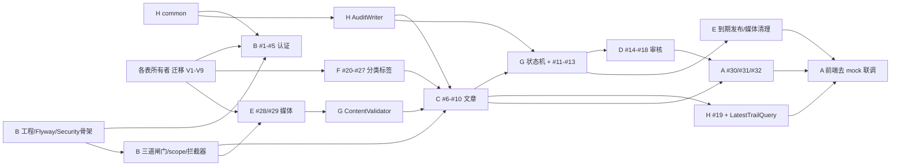

# CMS-TeamWork 分工与任务细分规则

| 项 | 内容 |
|---|---|
| 依据 | `CMS-SRS.md` v2.5、`doc/context/architecture.md`、`doc/api/api-spec.md` 草案 v0.1（32 个接口）、`doc/db/schema.md`（12 张表，2026-11-23 定稿）、`doc/context/git-standards.md` |
| 适用阶段 | 后端实现 M0～M4；测试暂缓（§3.7） |
| 决策人 | A（2026-11-23 批准折中版表结构与本分工） |
| 维护 | 分工或表所有权变化时改本文，并在 `progress-tracker.md` 记一条决策 |

> 口径：**A 负责全部前端，外加一块较轻、和前端联动最紧的后端**，同时仍是统筹、接口契约负责人和合并审核人；**B～H 全部做后端**；**暂时不安排测试**；**每人至少用到 3 张表**。

---

## 0. 角色变化一览

| 人 | 原分工 | 新分工 | 变化 |
|---|---|---|---|
| A | 统筹 / 集成 | 统筹 + **全部前端（`web/`）** + 公开读接口 #30/#31 + 计数 #32 + 接口契约 + 合并审核 | 新增前端与一块后端 |
| B | 后端基础 + 认证 | M0 工程骨架 + 认证 #1～#5 + `security/` 三道闸门 | 基本不变，多了闸门 |
| C | 文章 + 公开接口 | 文章 CRUD #6～#10（`article/` 内容写路径） | **公开接口移交 A** |
| D | 审核流 | 审核 #14～#18 | 不变 |
| E | 媒体 + 分类标签 + 定时发布 | 媒体 #28/#29 + `task/` 两个后台任务（到期发布、媒体清理） | **分类标签移交 F** |
| F | 前端编辑端（含登录） | **后端**：分类标签 #20～#27（`taxonomy/`） | **前端 → 后端** |
| G | 前端管理端 | **后端**：状态机 + 提交 / 撤回 / 改期 #11～#13 + 正文校验器 | **前端 → 后端** |
| H | 测试与部署 | **后端**：`common/` 横切 + 留痕 `audit/`（写入服务、#19、最近驳回 / 下架查询） | **测试 → 后端** |

各人拥有的表（字段级定义见 `doc/db/schema.md` §4）：B `user`、`login_throttle`；C `article`；D `reject_category`、`review_standard`；E `media_format`、`media_file`、`media_purge_job`；F `category`、`tag`、`article_tag`；H `audit_log`。A、G 不拥有表。

> 之前给 F、G 的前端工作，以及 PR #7 之后的前端工作，全部转给 A 一人。

---

## 1. 表清单

### 1.1 12 张表与所有者

字段、约束、范式论证与迁移以 **`doc/db/schema.md`** 为准（参考 DDL：`doc/db/schema-reference.sql`）。本节只列所有权。

| # | 表 | 存什么 | 所有者 | 迁移 |
|---|---|---|---|---|
| 1 | `user` | 账号、BCrypt 密码、`role`（`EDITOR` / `ADMIN`），登录名只存小写 | **B** | V1 |
| 2 | `login_throttle` | 按登录名的连续失败次数与锁定截止（不建指向 `user` 的外键） | **B** | V2 |
| 3 | `category` | 封闭的分类集合 | **F** | V3 |
| 4 | `tag` | 开放的标签集合 | **F** | V3 |
| 5 | `article` | 文章本体；`status` 存英文代码；`version` 乐观锁；不存 `submitted_at` | **C** | V4、V9 |
| 6 | `article_tag` | 文章与标签 N:M | **F** | V5 |
| 7 | `media_format` | 8 种格式 → 大类、MIME、扩展名（字典，只读） | **E** | V6 |
| 8 | `media_file` | 文件索引：所属文章、用途、格式、`storage_key`、大小、`linked_at` | **E** | V6 |
| 9 | `media_purge_job` | 删文件失败的记录与重试时间 | **E** | V6 |
| 10 | `reject_category` | 8 个驳回类别（字典，只读） | **D** | V7 |
| 11 | `review_standard` | 审核标准版本（字典，只读） | **D** | V7 |
| 12 | `audit_log` | 操作留痕，只增不改不删 | **H** | V8 |

### 1.2 明确**不建**的表（不要发明）

| 候选 | 结论 | 依据 |
|---|---|---|
| `submission`（提交轮次） | **不建**。提交轮次 ID 就是本轮「提交审核」那条留痕的 ID | api-spec §4.10 `current_submission_id` |
| `review` / `reject` / `unpublish` 记录表 | **不建**。都是 `audit_log` 的行；「最近驳回 / 下架」由窗口函数派生 | arch §5.6；SRS §7.2（不得冗余存回文章） |
| 发布任务表 | **不建** | arch §2.7、§4.4 |
| `session` / 持久化会话 | **不建**。会话放在服务端内存 `HttpSession` | arch §4.3 |
| 角色表 / 用户-角色关联表 | **不建**。`role` 是单列 | arch §4.1、BR-ROLE-001 |
| `article_media`（正文图片引用关联表） | **不建**。封面和音频用 `article` 两列外键，正文图片的引用状态记在 `media_file.linked_at` | api-spec §4.9、§6.0.1；schema §5.4 |
| `audit_action` 动作字典表 | **不建**。7 个动作代码用 CHECK 固定 | schema §12 |

### 1.3 表所有权规则

1. **每张表只有一个所有者**。所有者负责：核对并维护 `doc/db/schema.md` 里本表的规格，编写建表和以后的改表 Flyway 迁移，并维护该表的 Entity、写 Mapper 和对外的 Service 接口。字典表（`media_format`、`reject_category`、`review_standard`）只有迁移能写，运行时只读。
2. 别人想改这张表的结构，要先给所有者提需求，由所有者在自己的 PR 里加迁移，并同步改 `doc/db/schema.md`。**不得在别人的表上自己写 `ALTER`**。
3. 初版迁移的编号固定如下（为满足外键依赖顺序）：

| 版本 | 所有者 | 内容 | 依赖 |
|---|---|---|---|
| `V1__user.sql` | B | `user` + 唯一管理员种子（BCrypt 字面量，arch §2.5） | — |
| `V2__login_throttle.sql` | B | `login_throttle` | — |
| `V3__taxonomy.sql` | F | `category`、`tag` | — |
| `V4__article.sql` | C | `article`（`cover_media_id` / `audio_media_id` 两列先不加外键） | V1、V3 |
| `V5__article_tag.sql` | F | `article_tag` | V3、V4 |
| `V6__media.sql` | E | `media_format` + 8 行种子、`media_file`、`media_purge_job` | V4 |
| `V7__review_lookup.sql` | D | `reject_category` + 8 行、`review_standard` + 1 行 | — |
| `V8__audit_log.sql` | H | `audit_log`（3 条关键条件 CHECK、两条唯一键、外键 RESTRICT） | V1、V4、V7 |
| `V9__article_media_fk.sql` | C | `article` 两列 → `media_file` 的外键（环形依赖，必须在 V6 之后） | V4、V6 |
| `R__app_grants.sql` | B | 应用账号权限：业务表 CRUD；字典表只 `SELECT`；`audit_log` 只 `SELECT`/`INSERT`（INV-04） | 全部 |

4. 之后新增的迁移按 `V<下一个空号>__<表>_<说明>.sql` 编号，在 PR 标题里写明号码；合并前撞号的，由**后合并的一方**改号（只允许改未合并的迁移）。**已合并的迁移不得修改**，只能追加新的。

---

## 2. 分工

### 2.1 每人职责

> 工作量是粗估的「人日」，不含测试，仅用于平衡负载。

#### A：统筹 + 全部前端 + 公开读接口（轻量后端）
- **前端**：`web/` 全部，包括公开前台、登录注册、编辑端、管理端，以及从 mock 切到真实后端的联调。
- **后端包**：`publicapi/`（只读），另加 `article/` 里的计数查询。
- **接口**：#30 `GET /api/public/articles`（含 `with_facets`、`q`），#31 `GET /api/public/articles/{id}`，#32 `GET /api/articles/counts`。
- **需求**：FR-PUBLIC-001/002、INV-10、BR-SEARCH-003/005、api-spec §6.9、§11、§15 冲突 7/10。
- **表**：`article` R，`category` R，`tag` R，`article_tag` R（交集筛选、facets），`media_file` R、`media_format` R（拼封面和音频的 `MediaRef`），共 **6 张**。
- **约束**：`publicapi/` 只有 SELECT，不能被任何后台包依赖（arch §3.1、§3.4）。#32 必须复用 C 的 `ArticleFilter` 条件构造，和 #6 用同一套归属过滤（api-spec §6.9、X-ISO-03）。
- **其他职责**：接口契约负责人（`api-spec.md`、`openapi.yaml` 只有 A 能批准变更）、合并审核人、里程碑验收。
- **A 自己的后端 PR 由谁审**：**C**（文章读模型和 `ArticleFilter` 的所有者）必审；涉及 `PUBLIC` scope 的部分再加 **B**。A 不能自己批准自己的 PR，要拿到同伴的 Approve 才能合并。
- **后端工作量**：约 3～4 人日。

#### B：M0 工程骨架 + 认证 + 三道闸门
- **包**：`config/`、`auth/`、`security/`，以及工程本身（`pom.xml` 定版、`application.yml`、Flyway 接入、数据库双账号）。
- **接口**：#1 `GET /api/auth/csrf`，#2 `POST /api/auth/register`，#3 `POST /api/auth/login`，#4 `POST /api/auth/logout`，#5 `GET /api/auth/me`。
- **横切**：
  - Spring Security 只做认证：`HttpSessionCsrfTokenRepository` + `X-XSRF-TOKEN`、会话 Cookie 属性、空闲 30 分钟 / 绝对 12 小时、登录 5 次失败锁 15 分钟、会话固定防护（arch §5.1、SRS §4.1.2）。
  - `AuthzInterceptor`（角色 / 归属 / 状态三道闸门）、`ArticleScopeBinder`/`ArticleScopeContext`、`ArticleOwnershipInterceptor`（arch §5.2、§5.3、INV-02、INV-09）。
- **需求**：FR-AUTH-001~005、FR-USER-001、SRS §4.1.1、§4.4。
- **表**：
  - `user` W（所有者；注册只建 `EDITOR`、登录、管理员种子）；
  - `login_throttle` W（所有者；按登录名计数和锁定，不存在的登录名也计数，SRS §4.1.2）；
  - `article` R（拦截器改写所有针对 `article` 的 SELECT；归属闸和状态闸读取 `author_id`/`status`）；
  - `audit_log` G（`R__app_grants.sql` 把它锁成只能 INSERT/SELECT，这是 INV-04 的落地）。
  - 共 **3 张**真实读写，另有 1 张权限接触。
- **约束**：`security/` 不得依赖任何业务包（arch §3.1）。闸门需要的 `author_id`/`status` 通过 `security` 包里定义的端口接口取得，由 `article/` 实现（C 负责实现）。
- **工作量**：约 8 人日，集中在前期，M3 之后主要做评审。

#### C：文章内容写路径
- **包**：`article/`，具体是 Controller、`ArticleRepository` 的草稿保存和删除方法、DTO、`ArticleFilter`。
- **接口**：#6 `GET /api/articles`，#7 `POST /api/articles`，#8 `GET /api/articles/{id}`，#9 `PUT /api/articles/{id}`，#10 `DELETE /api/articles/{id}?confirm=true`。
- **需求**：FR-ARTICLE-001~006、BR-DEL-001~005、BR-007、INV-03/06/08，api-spec §6.0.1、§6.1～§6.5。
- **表**：
  - `article` W（所有者）；
  - `article_tag` w（通过 F 的 `TaxonomyService.replaceArticleTags`，在同一事务内写）；
  - `category` r、`tag` r（校验 `category_id`/`tag_ids`，否则返回 40008）；
  - `media_file` w、`media_format` r（通过 E 的 `MediaRefService` 同步引用和 `linked_at`）；
  - `media_purge_job` w（删除草稿后文件删不掉时，经 E 的服务登记重试）；
  - `audit_log` r（通过 H 的 `LatestTrailQuery` 取最近驳回 / 下架与 `submitted_at`；#10 借外键 RESTRICT 判断「曾提交过」，返回 40903）；
  - `user` R（`author` 的 `UserBrief`）。
  - 共 **9 张**。
- **乐观锁**：#9 必带 `expected_version`，与 `article.version` 不一致返回 `409 40907 VERSION_CONFLICT`；`version` 只由内容保存加 1，状态迁移不动它（api-spec §6.4、§16-#11）。
- **对外提供**：
  - `security` 端口的实现（文章的 `author_id`/`status`）；
  - `ArticleFilter`，给 A 的 #32 用；
  - 文章实体的只读查询服务，给 D、E、G、H 用。
- **工作量**：约 7 人日。

#### D：审核
- **包**：`article/review`（或 `review/` 子包），另含两张字典表的读服务 `ReviewStandardService`、`RejectCategoryService`。
- **接口**：#14 `GET /api/reviews/queue`，#15 `GET /api/reviews/standard`，#16 `POST /api/articles/{id}/approve`，#17 `POST /api/articles/{id}/reject`，#18 `POST /api/articles/{id}/unpublish`。
- **需求**：FR-REVIEW-001~004、FR-PUBLISH-001/003、BR-003/004、BR-CONTENT-005、BR-PUB-001/006、SRS §5.5、§5.6（提交轮次过期返回 40901）。
- **表**：
  - `article` w + R（通过 G 的状态机迁移；队列查询读取文章）；
  - `audit_log` w + r（通过 H 的 `AuditWriter` 写入审核通过、驳回、下架；读取当前「提交审核」留痕做 `submission_id` 校验）；
  - `reject_category` W、`review_standard` W（两张字典表的所有者，V7；运行时只读，#15 返回当前版本和 8 个类别）；
  - `media_file` r（审核页查看媒体）；
  - `user` R、`category` R、`tag` R、`article_tag` R（`ReviewQueueItem` 联表）。
  - 共 **9 张**。
- **约束**：审核接口的 DTO 里**不得有任何内容字段**（INV-03、arch §3.4）。
- **工作量**：约 6 人日。

#### E：媒体 + 后台任务
- **包**：`media/`（`StorageService`、上传校验、判权出口、`MediaRefService`）和 `task/`。
- **接口**：#28 `POST /api/articles/{id}/media`，#29 `GET /api/media/{media_id}`。
- **后台任务**：
  - 到期自动发布：arch §6.1、FR-PUBLISH-002，走 G 的状态机，写 `AUTO_PUBLISH`（`actor_type=SYSTEM`）。
  - 媒体清理三类：arch §6.2、FR-MEDIA-003、BR-MEDIA-004，未关联满 24 小时后在 60 秒内清理；
  - 文件删除重试：扫 `media_purge_job`，成功删行、失败退避（schema §9 第 4 条）。
- **需求**：FR-MEDIA-001~003、BR-MEDIA-002/003/005/008、INV-05、INV-07。
- **表**：
  - `media_format` W、`media_file` W、`media_purge_job` W（三张的所有者，V6）；
  - `article` R + w（判权读取状态和归属；到期发布通过状态机写入）；
  - `audit_log` w + r（`AUTO_PUBLISH` 留痕，带 `related_approval_id`；撞唯一键说明本周期已发布，回滚即可）。
  - 共 **5 张**。
- **规则**：用途与格式大类要匹配（MEDIA-01 → 40006）；封面、音频必须属于本文且用途正确（MEDIA-02 → 40005），见 schema §6.3。
- **约束**：
  - `storage/` 不得出现在任何静态资源映射里；
  - #29 永远返回 404、不返回 401（arch §5.4）；
  - 每篇文章的发布用独立 `REQUIRES_NEW` 事务；同一批次共用同一个 `now`。
- **工作量**：约 7 人日。

#### F：分类与标签
- **包**：`taxonomy/`。
- **接口**：#20～#23（分类），#24～#27（标签）。
- **需求**：FR-TAX-001~003、BR-TAX-001~005（引用保护和并发一致性）、api-spec §9、409 子码 40904/40906。
- **表**：
  - `category` W、`tag` W、`article_tag` W（三张的所有者）；
  - `article` R（分类是否被引用要看 `article.category_id`）。
  - 共 **4 张**。
- **对外提供**：`TaxonomyService`（校验 ID、`replaceArticleTags`、引用检查加锁），给 C 用；提供 facets 查询片段，给 A 用。
- **工作量**：约 5 人日，接口多但简单；难点是 BR-TAX-005 的并发一致性。

#### G：状态机 + 提交流程 + 正文校验
- **包**：`article/flow`，包括 `ArticleStateMachine` 和 `ArticleRepository.transition*` 方法。另外负责 `ContentValidator`，可放 `article/` 或 `media/`，见 §5 R8。
- **接口**：#11 `POST /api/articles/{id}/submit`，#12 `POST /api/articles/{id}/withdraw`，#13 `POST /api/articles/{id}/reschedule`。
- **横切**：
  - 状态机是 `article.status` **唯一的写入口**，覆盖 11 条迁移路径（arch §7、INV-01、X-STATE-01/02）；
  - 提供 `allowedActions(article, actor)`，供 C、A、D 填 `allowed_actions`；
  - `ContentValidator` 实现 api-spec §6.0 的 8 条正文规则（BR-MEDIA-001/006、FR-MEDIA-004）。
- **需求**：FR-SUBMIT-001~003、BR-001、BR-PUB-008/009、SRS §5.2、§5.6。
- **表**：
  - `article` W（只写 `status`/`scheduled_publish_time`/`published_at`，通过 transition 方法；不动 `version`）；
  - `audit_log` w（通过 `AuditWriter` 写提交、撤回、改期，改期带新旧预定时间）；
  - `media_file` r（`ContentValidator` 校验正文图片属于本文章且用途为 `INLINE_IMAGE`）；
  - `category` r（提交时做完整性检查，返回 40014）；
  - `review_standard` r（审核类迁移时取当前版本，随留痕写入）。
  - 共 **5 张**。
- **工作量**：约 6～7 人日。

#### H：common 横切 + 留痕
- **包**：`common/` 和 `audit/`。
- **M0 交付**：
  - 统一响应体 `{code,message,data}`；
  - `ErrorCode` 枚举（api-spec §3.3 全表）；
  - `GlobalExceptionHandler`，保证 404 响应体逐字节一致（INV-09）；
  - 分页对象（api-spec §1.5）；
  - 时间格式（§1.3）；
  - 共享枚举：`ArticleStatus`、`AuditAction`、`ActorType`、`Role`、`MediaUsage` 等。数据库和接口同为英文代码，用 MyBatis-Plus `@EnumValue` 直接映射，**不做中英映射**（api-spec §4.1、§15 冲突 9 已结案）。
- **接口**：#19 `GET /api/articles/{id}/audit-logs`。
- **对外提供**：
  - `AuditWriter`：只有 append，没有 update 和 delete 方法（arch §3.1 表、INV-04）；写入前校验 AUD-01～08（schema §6.2），违反抛 `AuditRuleViolationException` → `500 50000`（这是调用方的代码错误，用户输入错误要在调用方先变成 40010/40011/40012）；
  - `LatestTrailQuery`：最近驳回 / 下架的窗口函数查询，只针对已过滤、已分页的文章 ID（arch §5.6）；
  - 当前提交轮次查询。
- **需求**：FR-AUDIT-001/002、X-AUDIT-01~03、BR-AUDIT-001~004、SRS §6.6。
- **表**：
  - `audit_log` W（所有者，V8）；
  - `user` R（`Actor` 联表取账号名）；
  - `article` R（#19 先过 scope 可见性；窗口查询按文章 ID 过滤）；
  - `reject_category` R、`review_standard` R（#19 返回驳回类别与标准版本代码）。
  - 共 **5 张**。
- **工作量**：约 6 人日。

### 2.2 人 × 表矩阵

图例：**W** 所有者（本人 Mapper 写）；**w** 经所有者的 Service 写；**R** 本模块 SQL 只读 / 联表；**r** 经所有者的 Service 读；**G** 数据库权限（DCL）。

| 人 | user | login_throttle | category | tag | article | article_tag | media_format | media_file | media_purge_job | reject_category | review_standard | audit_log | 真实读写的表数 | 拥有的迁移 |
|---|---|---|---|---|---|---|---|---|---|---|---|---|---|---|
| A | — | — | R | R | R | R | R | R | — | — | — | — | **6** | 无 |
| B | **W** | **W** | — | — | R | — | — | — | — | — | — | G | **3**（另有 G） | V1、V2、R__ |
| C | R | — | r | r | **W** | w | r | w | w | — | — | r | **9** | V4、V9 |
| D | R | — | R | R | w/R | R | — | r | — | **W** | **W** | w/r | **9** | V7 |
| E | — | — | — | — | R/w | — | **W** | **W** | **W** | — | — | w/r | **5** | V6 |
| F | — | — | **W** | **W** | R | **W** | — | — | — | — | — | — | **4** | V3、V5 |
| G | — | — | r | — | **W**(状态列) | — | — | r | — | — | r | w | **5** | 无 |
| H | R | — | — | — | R | — | — | — | — | R | R | **W** | **5** | V8 |

- 每人真实读写的表都 ≥ 3 张（`G` 不计入）。B 现在拥有 `user`、`login_throttle` 两张并读 `article`（闸门），之前"第 3 张表只是权限接触"的问题已解决，#19 不用挪。
- 每张表只有一个所有者（§1.1）。A 的 6 张全部只读。

### 2.3 接口覆盖核对（32 / 32）

| 人 | 接口编号 | 个数 |
|---|---|---|
| A | #30、#31、#32 | 3 |
| B | #1～#5 | 5 |
| C | #6～#10 | 5 |
| D | #14～#18 | 5 |
| E | #28、#29（+ 2 个后台任务） | 2 |
| F | #20～#27 | 8 |
| G | #11～#13（+ 状态机、正文校验器） | 3 |
| H | #19（+ common、AuditWriter、LatestTrailQuery） | 1 |
| 合计 | | **32** |

### 2.4 共享骨架的归属与顺序（M0）

1. **B**：`pom.xml` 定版（Spring Boot 3.x、MyBatis-Plus、Flyway、MySQL 驱动；版本号见 arch §9.3）、包根 `com.liang.cms` 和 arch §3.1 的空包、`application.yml`（`cms.storage.root`、`cms.publish.scan-interval`）、Flyway 接入、迁移账号和应用账号分离、Security 过滤链骨架（CSRF、会话、401 入口）。
2. **H**（和 1 并行）：`common/` 全部，内容见 §2.1 H。
3. **各表所有者**（和 1、2 并行）：核对 `doc/db/schema.md` 里本表的规格（有异议提 Issue，A 决定），然后按 §1.3 的顺序写 `V1`～`V9`。参考 DDL 已在本地 MySQL 8.4 跑通，可以直接拆用。
4. **B**：`security/` 三道闸门和 scope。端口接口先合入，C 再实现它。
5. **H**：`AuditWriter`，必须在 D、E、G 开工前合入。

---

## 3. 任务细分规则

### 3.1 粒度
- **一个任务对应一个接口、一个迁移或一个横切组件**，工作量不超过 1～2 人日；超过就拆，比如 #9 可以拆成「内容和分类标签」「媒体引用」两个任务。
- 每个任务（GitHub Issue）必须写清：
  1. api-spec 编号和小节，比如「#17 · api-spec §7.4」；
  2. 涉及的表，标明 W/w/R/r；
  3. 对应的 BR/FR/INV 编号；
  4. 依赖的任务，比如「依赖 AuditWriter」；
  5. 完成标准（见 §3.8）；
  6. 负责人和审核人。
- Issue 标题格式：`[BE-<模块>] #<接口号> <动词开头的中文描述>`，例如 `[BE-review] #17 实现驳回接口`。

### 3.2 分支
- 后端分支命名：`feat/be-<模块>-<主题>`，例如 `feat/be-auth-login`、`feat/be-review-reject`。修 bug 用 `fix/be-<模块>-<主题>`，文档用 `docs/<主题>`（符合 git-standards §5 的 `<type>/<kebab-case>`）。
- 一个分支只做一个任务。**禁止直接推 main**。

### 3.3 提交
- 按 `git-standards.md`：Conventional Commits，scope 用后端域取值（`auth`/`security`/`article`/`taxonomy`/`media`/`audit`/`publicapi`/`task`/`common`/`config`/`db`，§4）。描述用中文、动词开头、不加句号、不超过 50 字；正文写清为什么改，单行不超过 72 字符。
- 迁移单独提交，scope 用 `db`，例如 `feat(db): 新增 article 表迁移`。文档和代码分开提交，`pom.xml` 的改动用 `build`。
- 提交用各人自己的 git 身份，不加 co-author。

### 3.4 PR
- **PR 要小**：一个任务一个 PR，建议改动不超过 400 行（不含迁移和生成代码）。
- PR 描述必须包括：接口编号、表、BR/FR、手工验证记录（curl 或 Apifox 的请求和响应摘要，覆盖成功、400、404、409 等典型分支）、迁移版本号。
- **审核人**：A + 一位同伴，同伴是依赖本模块、或被本模块依赖的那个人。

| 作者 | 同伴审核人 |
|---|---|
| A | C（涉及 `PUBLIC` scope 时加 B） |
| B | H（common 对接）；闸门部分加 C |
| C | G（状态机和 transition 共用 `ArticleRepository`） |
| D | G |
| E | C（媒体引用）；任务部分加 G |
| F | C（关联写入和引用检查） |
| G | D |
| H | B |

- 合并方式：**squash 合并**（git-standards §7 要求线性历史）。审核期间作者只追加提交，不强推。合并由 A 执行；A 自己的 PR 必须先拿到同伴的 Approve。

### 3.5 跨模块规则
1. **调用别的域，只能走对方的 Service 接口，不能直接用对方的 Mapper**。写操作必须经过所有者的 Service。只读联表可以写在本模块的 Mapper XML 里（只限 SELECT），但要在 PR 里 @ 表所有者。
2. **`article` 的写操作只能经过 `ArticleRepository` 固定的几个方法**（arch §5.3）：C 的保存和删除，G 的 transition。`status` 只能由状态机改（INV-01）。
3. **留痕只能经过 H 的 `AuditWriter`**，并且和业务写在同一个事务里（FR-AUDIT-001）。
4. **共享的枚举、错误码、分页、响应体都放在 `common/`**，由 H 维护。新增错误码要先改 api-spec（见 §3.6），再改 `ErrorCode`。
5. `security/` 不依赖业务包；`publicapi/` 不被任何后台包依赖；`common/` 不依赖任何业务包（arch §3.1）。
6. **只有 `ArticleScopeBinder` 能设置 scope**（arch §5.3）。任何人都不能在 Service 里手写 `author_id = ?` 来替代拦截器。
7. 表结构的变更由所有者执行（§1.3）。

### 3.6 接口契约变更流程
- `api-spec.md` 和 `openapi.yaml` 是唯一的契约，**只能通过 docs PR 修改，A 批准后才能合并**。
- 流程：发现问题 → 在 Issue 里提出 → A 在 api-spec §16 登记或直接决定 → docs PR → 合并后实现方才能改代码。
- 不允许「先改代码，再补文档」。契约没变时，代码行为必须和 api-spec 完全一致，包括响应体、错误码和字段名（snake_case）。

### 3.7 暂缓测试（刻意为之）
- 按用户要求，**本阶段不安排测试任务**：不要求单元测试、Testcontainers、越权用例或源码扫描测试。架构文档 §2.8、§7 原本要求的这些，统一推迟到后续的「测试补齐里程碑」。
- 代替做法：每个 PR 都附手工验证记录；越权相关接口至少手工验证一次「编辑 B 访问编辑 A 的文章返回 404」。
- 写代码时要保证以后能补测试：比如 `StorageService` 要能替换，时间源 `now` 由外部注入。

### 3.8 完成定义（DoD，不含测试）
1. `mvn -q compile` 通过，应用能启动。
2. 在一个空库上 Flyway 能从 V1 一路迁移成功，没有手工修补。
3. 用 curl 或 Apifox 手工验证，响应和 api-spec 一致：envelope、HTTP 状态码、`code` 子码、字段名、拒绝统一为 404（INV-09）。验证记录贴进 PR。
4. 所涉的 BR/FR/INV 在 PR 描述里逐条说明怎么满足。
5. 没有跨域直接用对方的 Mapper；没有越过 `AuditWriter` 或状态机。
6. 提交符合 git-standards。PR 经 A 和同伴审核后 squash 合并。
7. A 在前端把对应的 mock 切到真实接口，跑通一次（M4 之前可以只做接口级验证）。

---

## 4. 里程碑与依赖

| 里程碑 | 内容 | 负责人 | 前置 |
|---|---|---|---|
| **M0 骨架** | 工程、`pom`、配置、Flyway、双账号、Security 骨架；`common/`；12 张表的迁移 V1～V9、`R__app_grants` | B、H、各表所有者 | 表规格已定（`doc/db/schema.md`，2026-11-23） |
| **M1 认证 + 账号 + 分类标签 + 闸门** | #1～#5；三道闸门、scope、拦截器；#20～#27；`AuditWriter` | B、F、H | M0 |
| **M2 文章 + 媒体** | #6～#10；#28/#29、`MediaRefService`；`ContentValidator`；状态机骨架和 `allowedActions` | C、E、G | M1（闸门、`TaxonomyService`、`AuditWriter`） |
| **M3 审核 + 发布** | #11～#13；#14～#18（含立即发布） | G、D | M2 |
| **M4 公开 + 留痕 + 任务** | #30/#31/#32；#19 和 `LatestTrailQuery`（#8 的派生字段在此补全）；到期发布、媒体清理任务；A 前端全面去 mock 联调 | A、H、E | M3 |
| （后续）M5 测试补齐 | 越权用例、Testcontainers、源码扫描 | 待定 | M4 |

A 的前端工作贯穿始终：M1 联调登录，M2 联调编辑端，M3 联调管理端，M4 联调公开前台。

---

## 5. 风险与待定

### 5.1 风险
| # | 风险 | 影响 | 建议 |
|---|---|---|---|
| R1 | **暂缓测试**。架构的三条最硬约束（归属隔离 INV-02、媒体判权 INV-05、唯一发布入口 INV-01）原本都靠自动化用例证明（arch §2.8、§7） | 漏一处归属条件不会报错，手工抽查很难发现 | 每个 PR 强制附越权手工验证记录；M4 结束后立即安排 M5 测试补齐；B 和 E 的 PR 由 A 重点审 |
| R2 | ~~7 张表缺字段级定义~~ | — | **已解决（2026-11-23）**：`doc/db/schema.md` 给出 12 张表的规格，并在本地 MySQL 8.4 验证 |
| R3 | ~~B 的第 3 张表只是权限接触~~ | — | **已解决**：B 新增 `login_throttle`，真实读写 3 张，#19 不用挪 |
| R7 | 不少规则从 CHECK 挪到了 Java（AUD-01～08、USER-01、TAX-01、MEDIA-01～03、ART-01，schema §6） | 漏写一条，数据库不会报错 | 每条规则在 PR 描述里写明在哪个方法校验；H 审所有写留痕的 PR |
| R4 | C 是枢纽（端口实现、`ArticleFilter`、读服务），同时还要审 A、E、F 的 PR | C 一卡，M2～M4 全部延后 | C 在 M1 末先合入端口实现和读服务的接口骨架 |
| R5 | A 同时负责全部前端和一块后端，还要审所有 PR | A 成为瓶颈 | A 的后端放在 M4，工作量轻；同伴审核人先审一轮，A 做最终审核 |
| R6 | 多人共用 `article/` 包（C、G、D、A 的计数） | 合并冲突 | 按子包划分：`article/`（C）、`article/flow`（G）、`article/review`（D）；`ArticleRepository` 按方法划分所有权 |

### 5.2 待定项的状态

| # | 待定项 | 状态 |
|---|---|---|
| Q1 | api-spec §16 #2：分类和标签名称规则 | **已决**：去空白、1～50、不区分大小写唯一（schema §4.3） |
| Q2 | §16 #3：长度上限 | **已决**：标题 200、摘要 500、正文 1 MiB、原因 500 |
| Q3 | §16 #5：枚举英文 + snake_case | 维持暂定；库里也已改存英文代码 |
| Q4 | §16 #6：400 和 409 同时成立时谁优先 | 维持 api-spec §2.3 |
| Q5 | §16 #7：登录名统一小写 | **已决**：只存小写 |
| Q6 | §16 #8：后台列表默认排序 | 维持暂定（`updated_at` 降序） |
| Q7 | §16 #10：公开详情是否单独列出正文图片和视频 | 维持暂定（不单列） |
| Q8 | §16 #11：乐观锁 | **已决**：`version` + `expected_version`，`409 40907` |
| Q9 | §16 #13：编辑能否看到 `in_use` | 维持暂定（只给布尔） |
| Q10 | §16 #14：审核标准版本的配置方式 | **已决**：`review_standard` 表 |
| Q11 | §16 #15：同一篇文章能否重复引用同一个媒体 | 维持暂定（允许） |
| Q12 | §16 #16：管理员在 #6 上的筛选范围 | 维持暂定（全部筛选） |
| R7 | 封面 / 音频外键 | **已决**：保留，放 V9 |
| R8 | `ContentValidator` 放哪个包 | 建议放 `article/`，通过 E 的 `MediaRefService` 查媒体（G 定） |
| R9 | 登录失败计数存哪 | **已决**：`login_throttle` 表 |
| R10 | `media_file` 的引用状态 | **已决**：`linked_at`；解除引用即删行 |
| R11 | `user` 是否保留 email | **已决**：不设 |
| R12 | 中英映射放哪 | **已决**：不映射 |
| R13 | 留痕「改期」类别还待复核 | 未决（G、H；tracker Open Q7） |
