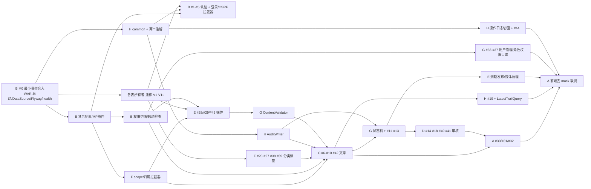

# CMS-TeamWork 分工与任务细分规则

| 项 | 内容 |
|---|---|
| 依据 | `CMS-SRS.md` v2.6、`doc/context/architecture.md`、`doc/api/api-spec.md` 草案 v0.2（44 个接口）、`doc/db/schema.md` v2（16 张表）、`doc/context/git-standards.md` |
| 适用阶段 | 后端实现 M0～M4；测试暂缓（§3.7） |
| 决策人 | A（2026-11-23 批准折中版表结构与本分工；同日批准 v2.6 补齐课程评分项方案，D1～D12 全部按推荐） |
| 维护 | 分工或表所有权变化时改本文，并在 `progress-tracker.md` 记一条决策 |

> 口径：**A 负责全部前端，外加一块较轻、和前端联动最紧的后端**，同时仍是统筹、接口契约负责人和合并审核人；**B～H 全部做后端**；**暂时不安排测试**；**每人至少用到 3 张表**。
>
> v2.6 变化：新增 RBAC 三表与操作日志表（共 16 张）、12 个接口（#33～#44）和两个 AOP 切面。B 做权限切面 + RBAC，H 做操作日志切面，G 加用户管理 #33～#35；其余人各加 1～2 个接口（§0）。每人的重点 Spring 知识点见 §2.5，答辩时各讲自己那部分。
>
> 技术栈名称（D12，2026-11-23 按决策 T1～T9 修订）：报告与 SRS 写"Spring 6 + Spring MVC + MyBatis-Plus（不用 Spring Boot、Spring Security），基于实验二 SSM 升级"；**A 需跟老师确认一次**是否接受（尚未确认）。
>
> 2026-11-23 工作量再平衡（决策 T8）：#36/#37 由 B 移给 G（同在 `system/`）；Jackson 消息转换器、校验器装配与不存在路径的 404 映射归 H。

---

## 0. 角色变化一览

| 人 | 原分工 | 新分工 | 变化 |
|---|---|---|---|
| A | 统筹 / 集成 | 统筹 + **全部前端（`web/`）** + 公开读接口 #30/#31 + 计数 #32 + 接口契约 + 合并审核 + 集成（报告、ApiFox、设计图汇总） | 新增前端与一块后端 |
| B | 后端基础 + 认证 | M0 工程骨架（`web.xml` + Java 配置）+ 认证 #1～#5（登录拦截器、CSRF 拦截器）+ RBAC 三表 + `@RequiresPermission` 权限切面与启动检查 | v2.6：闸门改为 AOP 切面，加 RBAC；v2.6 修订：去掉 Spring Boot / Security，#36/#37 移给 G，归属 / scope 移给 F |
| C | 文章 + 公开接口 | 文章 CRUD #6～#10 + 批量删除草稿 #42（`article/` 内容写路径；多维检索、逻辑删除） | **公开接口移交 A**；v2.6 加 #42 |
| D | 审核流 | 审核 #14～#18 + 批量审核通过 #40、批量下架 #41 | v2.6 加批量（逐条独立事务） |
| E | 媒体 + 分类标签 + 定时发布 | 媒体 #28/#29 + 下载 #43（实验二延续）+ `task/` 两个后台任务（到期发布、媒体清理） | **分类标签移交 F**；v2.6 加 #43 |
| F | 前端编辑端（含登录） | **后端**：两级分类 #20～#23、启停 #38、排序 #39；标签 #24～#27（`taxonomy/`）+ 归属 scope 与归属拦截器（`security/` 下的 `ArticleScopeBinder` 等） | **前端 → 后端**；v2.6 加多级分类；v2.6 修订接手归属 / scope |
| G | 前端管理端 | **后端**：状态机 + 提交 / 撤回 / 改期 #11～#13 + 正文校验器 + 用户管理 #33～#35 + 角色与权限点只读 #36/#37（`system/`） | **前端 → 后端**；v2.6 加用户管理；v2.6 修订接手 #36/#37 |
| H | 测试与部署 | **后端**：`common/` 横切（含 Jackson、校验器装配与 404 映射）+ 留痕 `audit/`（写入服务、#19、最近驳回 / 下架查询）+ `@OperationLog` 切面与 #44 | **测试 → 后端**；v2.6 加操作日志；v2.6 修订接手 Jackson / 校验 / 404 |

各人拥有的表（字段级定义见 `doc/db/schema.md` §4）：B `role`、`permission`、`role_permission`、`user`、`login_throttle`；C `article`；D `reject_category`、`review_standard`；E `media_format`、`media_file`、`media_purge_job`；F `category`、`tag`、`article_tag`；H `audit_log`、`sys_operation_log`。A、G 不拥有表（G 只改 `article` 的状态列，经 C 的 `ArticleRepository` transition 方法，记为 w）。

> 之前给 F、G 的前端工作，以及 PR #7 之后的前端工作，全部转给 A 一人。

---

## 1. 表清单

### 1.1 16 张表与所有者

字段、约束、范式论证与迁移以 **`doc/db/schema.md`** 为准（参考 DDL：`doc/db/schema-reference.sql`）。本节只列所有权。

| # | 表 | 存什么 | 所有者 | 迁移 |
|---|---|---|---|---|
| 1 | `role` | 2 个角色（`EDITOR` / `ADMIN`），只由迁移写 | **B** | V1 |
| 2 | `permission` | 27 个权限点，只由迁移写 | **B** | V1 |
| 3 | `role_permission` | 角色 ↔ 权限点 N:M（34 行），只由迁移写 | **B** | V1 |
| 4 | `user` | 账号、BCrypt 密码、`role_id`（外键）、`status`（`ENABLED` / `DISABLED`），登录名只存小写 | **B** | V2 |
| 5 | `login_throttle` | 按登录名的连续失败次数与锁定截止（不建指向 `user` 的外键） | **B** | V3 |
| 6 | `category` | 两级分类：`parent_id`、`sort_order`、`status`，逻辑删除 | **F** | V4 |
| 7 | `tag` | 开放的标签集合，逻辑删除 | **F** | V4 |
| 8 | `article` | 文章本体；`status` 存英文代码；`version` 乐观锁；逻辑删除（只限草稿）；不存 `submitted_at` | **C** | V5、V11 |
| 9 | `article_tag` | 文章与标签 N:M | **F** | V6 |
| 10 | `media_format` | 8 种格式 → 大类、MIME、扩展名（字典，只读） | **E** | V7 |
| 11 | `media_file` | 文件索引：所属文章、用途、格式、`storage_key`、`original_name`、大小、`linked_at` | **E** | V7 |
| 12 | `media_purge_job` | 删文件失败的记录与重试时间 | **E** | V7 |
| 13 | `reject_category` | 8 个驳回类别（字典，只读） | **D** | V8 |
| 14 | `review_standard` | 审核标准版本（字典，只读） | **D** | V8 |
| 15 | `audit_log` | 文章操作留痕（业务事实），只增不改不删 | **H** | V9 |
| 16 | `sys_operation_log` | 系统操作日志（技术审计，切面写），只增不改不删 | **H** | V10 |

### 1.2 明确**不建**的表（不要发明）

| 候选 | 结论 | 依据 |
|---|---|---|
| `submission`（提交轮次） | **不建**。提交轮次 ID 就是本轮「提交审核」那条留痕的 ID | api-spec §4.10 `current_submission_id` |
| `review` / `reject` / `unpublish` 记录表 | **不建**。都是 `audit_log` 的行；「最近驳回 / 下架」由窗口函数派生 | arch §5.6；SRS §7.2（不得冗余存回文章） |
| 发布任务表 | **不建** | arch §2.7、§4.4 |
| `session` / 持久化会话 | **不建**。会话放在服务端内存 `HttpSession` | arch §4.3 |
| ~~角色表~~ / 用户-角色关联表 `user_role` | v2.6 **已建** `role`、`permission`、`role_permission`（D1）；但**不建** `user_role`：一人一角色，用 `user.role_id` 外键，结构上就不可能多角色 | SRS §4.7、BR-RBAC-001 |
| 运行时可编辑的角色权限 | **不做**。三张 RBAC 表只由迁移写，#36/#37 只读（D5） | BR-RBAC-002 |
| `article_media`（正文图片引用关联表） | **不建**。封面和音频用 `article` 两列外键，正文图片的引用状态记在 `media_file.linked_at` | api-spec §4.9、§6.0.1；schema §5.4 |
| `audit_action` 动作字典表 | **不建**。7 个动作代码用 CHECK 固定 | schema §12 |

### 1.3 表所有权规则

1. **每张表只有一个所有者**。所有者负责：核对并维护 `doc/db/schema.md` 里本表的规格，编写建表和以后的改表 Flyway 迁移，并维护该表的 Entity、写 Mapper 和对外的 Service 接口。字典表（`media_format`、`reject_category`、`review_standard`）只有迁移能写，运行时只读。
2. 别人想改这张表的结构，要先给所有者提需求，由所有者在自己的 PR 里加迁移，并同步改 `doc/db/schema.md`。**不得在别人的表上自己写 `ALTER`**。
3. 初版迁移的编号固定如下（为满足外键依赖顺序）：

| 版本 | 所有者 | 内容 | 依赖 |
|---|---|---|---|
| `V1__rbac.sql` | B | `role`、`permission`、`role_permission` + 种子（2 角色、27 权限点、34 行关联） | — |
| `V2__user.sql` | B | `user`（`role_id` 外键）+ 初始管理员种子（BCrypt 字面量，arch §2.5） | V1 |
| `V3__login_throttle.sql` | B | `login_throttle` | — |
| `V4__taxonomy.sql` | F | `category`（自引用外键）、`tag` | — |
| `V5__article.sql` | C | `article`（`cover_media_id` / `audio_media_id` 两列先不加外键） | V2、V4 |
| `V6__article_tag.sql` | F | `article_tag` | V4、V5 |
| `V7__media.sql` | E | `media_format` + 8 行种子、`media_file`、`media_purge_job` | V5 |
| `V8__review_lookup.sql` | D | `reject_category` + 8 行、`review_standard` + 1 行 | — |
| `V9__audit_log.sql` | H | `audit_log`（3 条关键条件 CHECK、两条唯一键、外键 RESTRICT） | V2、V5、V8 |
| `V10__sys_operation_log.sql` | H | `sys_operation_log`（指向 `user` 的外键可空） | V2 |
| `V11__article_media_fk.sql` | C | `article` 两列 → `media_file` 的外键（环形依赖，必须在 V7 之后） | V5、V7 |
| `R__app_grants.sql` | B | 应用账号权限：业务表 CRUD，但 `user`、`category`、`tag`、`article` 不给 `DELETE`（逻辑删除）；RBAC 三表与字典表只 `SELECT`；`audit_log`、`sys_operation_log` 只 `SELECT`/`INSERT`（INV-04） | 全部 |

4. 之后新增的迁移按 `V<下一个空号>__<表>_<说明>.sql` 编号，在 PR 标题里写明号码；合并前撞号的，由**后合并的一方**改号（只允许改未合并的迁移）。**已合并的迁移不得修改**，只能追加新的。

---

## 2. 分工

### 2.1 每人职责

> 工作量是粗估的「人日」，不含测试，仅用于平衡负载。

#### A：统筹 + 全部前端 + 公开读接口（轻量后端）
- **前端**：`web/` 全部，包括公开前台、登录注册、编辑端、管理端，以及从 mock 切到真实后端的联调。
- **后端包**：`publicapi/`（只读），另加 `article/` 里的计数查询。
- **接口**：#30 `GET /api/public/articles`（含 `with_facets`、`q`），#31 `GET /api/public/articles/{id}`，#32 `GET /api/articles/counts`。
- **需求**：FR-PUBLIC-001/002、INV-10、BR-SEARCH-003/005、api-spec §6.9、§11、§15 冲突 7/10。
- **表**：`article` R，`category` R，`tag` R，`article_tag` R（交集筛选、facets），`media_file` R、`media_format` R（拼封面和音频的 `MediaRef`），共 **6 张**。
- **约束**：`publicapi/` 只有 SELECT，不能被任何后台包依赖（arch §3.1、§3.4）。#32 必须复用 C 的 `ArticleFilter` 条件构造，和 #6 用同一套归属过滤（api-spec §6.9、X-ISO-03）。
- **其他职责**：接口契约负责人（`api-spec.md`、`openapi.yaml` 只有 A 能批准变更）、合并审核人、里程碑验收；**集成**：ApiFox 全量用例、设计图汇总（系统架构图、E-R 图，见 `doc/design/README.md`）、结题报告汇总。
- **v2.6 前端跟进**（A 自己排期，api-spec §17）：#5 的权限列表驱动菜单、分类树、批量操作按钮、用户管理页、操作日志页、媒体下载按钮；#6 排序参数改为 `字段,方向`。
- **A 自己的后端 PR 由谁审**：**C**（文章读模型和 `ArticleFilter` 的所有者）必审；涉及 `PUBLIC` scope 的部分再加 **B**。A 不能自己批准自己的 PR，要拿到同伴的 Approve 才能合并。
- **后端工作量**：约 3～4 人日。

#### B：M0 工程骨架 + 认证 + RBAC + 权限切面
- **包**：`config/`、`auth/`、`security/`，以及工程本身（`pom.xml` 定版、`packaging = war`、`web.xml`、`AppConfig` 与各配置类骨架、`application.properties`、Flyway Bean、数据库双账号；arch §2.10）。
- **接口**：#1 `GET /api/auth/csrf`，#2 `POST /api/auth/register`，#3 `POST /api/auth/login`，#4 `POST /api/auth/logout`，#5 `GET /api/auth/me`（v2.6 返回权限点列表）。#36/#37 已移给 G（决策 T8）。
- **横切**：
  - v2.6 修订（不用 Spring Boot / Security，arch §2.10、§5.1）：单一 `DispatcherServlet` 容器与 `AppConfig`；`DataSource`、`DataSourceTransactionManager`、`MybatisSqlSessionFactoryBean`、`@MapperScan`、Flyway Bean；`AuthInterceptor`（未登录 401、绝对 12 小时、**每请求按 `user_id` 查状态与 `role_id`**）、`CsrfInterceptor`（会话令牌 + `X-XSRF-TOKEN`，403）、`spring-security-crypto` 的 BCrypt、`changeSessionId()` 防会话固定、`web.xml` 会话与 Cookie 配置（空闲 30 分钟、`HttpOnly`、Tomcat `SameSite=Lax`）、登录 5 次失败锁 15 分钟（SRS §4.1.2）。
  - **v2.6**：`@RequiresPermission` 注解 + `PermissionAspect`（`@Around`，`@Order(2)`，失败抛统一 404）+ `PermissionCoverageChecker`（监听 `ContextRefreshedEvent`，启动时检查每个 Controller 方法都有注解或在白名单里，并断言 Controller 已被 AOP 代理）；`PermissionService` 用 `AuthInterceptor` 本次请求按会话里的 **`user_id`** 查到的 `role_id` 取权限集合，角色和权限都不放进会话（arch §5.2、BR-RBAC-001~005）。
  - 停用账号的会话在下一次请求返回 401（BR-USER-001）：`AuthInterceptor` 每请求查状态即可，G 的用户管理不需要找出并销毁对方会话。
  - 归属 scope 与 `ArticleOwnershipInterceptor` 已移给 F（2026-11-23 再平衡）；B 只负责在 `WebMvcConfig` 里按顺序注册 F 的 `ArticleScopeBinder`、在 MP 插件链里挂上 F 的 `ArticleOwnershipInterceptor`。状态闸仍在各 Service（409）。
  - MyBatis-Plus 插件与自动填充：分页、乐观锁、`BlockAttackInnerInterceptor`、`MetaObjectHandler`（`created_at`/`updated_at`）；**M0 验证项**：`@TableLogic(delval = "id")` 在本项目 MP 版本上是否生效（schema §1，不行就用 `setSql("deleted = id")`）。
- **需求**：FR-AUTH-001~005、FR-USER-001、SRS §4.1.1、§4.4、§4.7（BR-RBAC-001~005）。
- **表**：
  - `role` W、`permission` W、`role_permission` W（所有者，V1；运行时只读，权限切面读取；G 的 #36/#37 也读）；
  - `user` W（所有者；注册只建 `EDITOR`、登录、管理员种子；G 的用户管理经 B 的 `UserService` 写 `status`/`role_id`）；
  - `login_throttle` W（所有者；按登录名计数和锁定，不存在的登录名也计数，SRS §4.1.2）；
  - 另有 `R__app_grants.sql` 的权限接触（`audit_log`、`sys_operation_log` 只能 INSERT/SELECT，INV-04 的落地），不计入表数。
  - 共 **5 张**（原来的 `article` R 来自归属拦截器，已随拦截器移给 F）。
- **约束**：`security/` 不得依赖任何业务包（arch §3.1）。
- **工作量**：约 8.5 人日（#36/#37 移出约 −1，归属 scope 与拦截器移出约 −1.5，手工装配 Spring 与自研拦截器约 +1），集中在 M0～M1，M3 之后主要做评审。

#### C：文章内容写路径
- **包**：`article/`，具体是 Controller、`ArticleRepository` 的草稿保存和删除方法、DTO、`ArticleFilter`。
- **接口**：#6 `GET /api/articles`（v2.6 多维检索 + 多字段排序白名单），#7 `POST /api/articles`，#8 `GET /api/articles/{id}`，#9 `PUT /api/articles/{id}`，#10 `DELETE /api/articles/{id}?confirm=true`（v2.6 改逻辑删除），#42 `POST /api/articles/batch-delete`。
- **需求**：FR-ARTICLE-001~007、BR-DEL-001~008、BR-SEARCH-001~008、BR-BATCH-001~004、BR-007、INV-03/06/08，api-spec §6.0.1、§6.1～§6.5.1。
- **表**：
  - `article` W（所有者）；
  - `article_tag` w（通过 F 的 `TaxonomyService.replaceArticleTags`，在同一事务内写）；
  - `category` r、`tag` r（校验 `category_id`/`tag_ids`，否则返回 40008）；
  - `media_file` w、`media_format` r（通过 E 的 `MediaRefService` 同步引用和 `linked_at`）；
  - `media_purge_job` w（删除草稿后文件删不掉时，经 E 的服务登记重试）；
  - `audit_log` R（通过 H 的 `LatestTrailQuery` 取最近驳回 / 下架与 `submitted_at`；v2.6 逻辑删除后外键 RESTRICT 不再起作用，#10 改为显式 `NOT EXISTS` 判断「曾提交过」，返回 40903）；
  - `user` R（`author` 的 `UserBrief`）。
  - 共 **9 张**。
- **乐观锁**：#9 必带 `expected_version`，与 `article.version` 不一致返回 `409 40907 VERSION_CONFLICT`；`version` 只由内容保存加 1，状态迁移不动它（api-spec §6.4、§16-#11）。
- **对外提供**：
  - `security` 端口的实现（文章的 `author_id`/`status`）；
  - `ArticleFilter`，给 A 的 #32 用；
  - 文章实体的只读查询服务，给 D、E、G、H 用。
- **工作量**：约 7 人日。

#### D：审核
- **包**：`article/review`（或 `review/` 子包），另含两张字典表的读服务 `ReviewStandardService`、`RejectCategoryService`。
- **接口**：#14 `GET /api/reviews/queue`，#15 `GET /api/reviews/standard`，#16 `POST /api/articles/{id}/approve`，#17 `POST /api/articles/{id}/reject`，#18 `POST /api/articles/{id}/unpublish`，#40 `POST /api/reviews/batch-approve`，#41 `POST /api/reviews/batch-unpublish`。
- **批量**：逐条独立事务（`TransactionTemplate` 或另一个 Bean 上的 `REQUIRES_NEW`，**不能自调用**），一条失败不影响其他条；每条执行单条接口的完整规则（arch §6.5、BR-BATCH-001~005）。
- **需求**：FR-REVIEW-001~006、FR-PUBLISH-001/003、BR-003/004、BR-CONTENT-005、BR-PUB-001/006、SRS §5.5、§5.6（提交轮次过期返回 40901）。
- **表**：
  - `article` w + R（通过 G 的状态机迁移；队列查询读取文章）；
  - `audit_log` w + r（通过 H 的 `AuditWriter` 写入审核通过、驳回、下架；读取当前「提交审核」留痕做 `submission_id` 校验）；
  - `reject_category` W、`review_standard` W（两张字典表的所有者，V8；运行时只读，#15 返回当前版本和 8 个类别）；
  - `media_file` r（审核页查看媒体）；
  - `user` R、`category` R、`tag` R、`article_tag` R（`ReviewQueueItem` 联表）。
  - 共 **9 张**。
- **约束**：审核接口的 DTO 里**不得有任何内容字段**（INV-03、arch §3.4）。
- **工作量**：约 6 人日。

#### E：媒体 + 后台任务
- **包**：`media/`（`StorageService`、上传校验、判权出口、`MediaRefService`）和 `task/`。
- **接口**：#28 `POST /api/articles/{id}/media`（v2.6 保存 `original_name`），#29 `GET /api/media/{media_id}`，#43 `GET /api/media/{media_id}/download`（附件下载，判权同 #29，实验二上传下载的延续；不加新的附件类型，D10）。
- **后台任务**：
  - 到期自动发布：arch §6.1、FR-PUBLISH-002，走 G 的状态机，写 `AUTO_PUBLISH`（`actor_type=SYSTEM`）。
  - 媒体清理三类：arch §6.2、FR-MEDIA-003、BR-MEDIA-004，未关联满 24 小时后在 60 秒内清理；
  - 文件删除重试：扫 `media_purge_job`，成功删行、失败退避（schema §9 第 4 条）。
- **需求**：FR-MEDIA-001~003、FR-MEDIA-005、BR-MEDIA-002/003/005/008、INV-05、INV-07。
- **表**：
  - `media_format` W、`media_file` W、`media_purge_job` W（三张的所有者，V7）；
  - `article` R + w（判权读取状态和归属；到期发布通过状态机写入）；
  - `audit_log` w + r（`AUTO_PUBLISH` 留痕，带 `related_approval_id`；撞唯一键说明本周期已发布，回滚即可）。
  - 共 **5 张**。
- **规则**：用途与格式大类要匹配（MEDIA-01 → 40006）；封面、音频必须属于本文且用途正确（MEDIA-02 → 40005），见 schema §6.3。
- **约束**：
  - `storage/` 不得出现在任何静态资源映射里；
  - #29 永远返回 404、不返回 401（arch §5.4）；
  - 每篇文章的发布用独立 `REQUIRES_NEW` 事务；同一批次共用同一个 `now`。
- **工作量**：约 7 人日。

#### F：分类与标签
- **包**：`taxonomy/`。
- **接口**：#20～#23（分类，v2.6 两级树 + 改父分类），#38 `PUT /api/categories/{id}/status`（启停），#39 `PUT /api/categories/sort`（同级排序，单事务），#24～#27（标签）。
- **需求**：FR-TAX-001~006、BR-TAX-001~009（引用保护、并发一致性、两级、启停、排序）、api-spec §9、400 子码 40015/40016、409 子码 40904/40906/40908。
- **逻辑删除注意**：删除改为逻辑删除后，`article.category_id` 的外键 RESTRICT 不再拦截，引用保护（TAX-01）和「有子分类不能删」都要在 Service 里显式 `EXISTS` 检查并加锁（schema §4.3）。
- **表**：
  - `category` W、`tag` W、`article_tag` W（三张的所有者）；
  - `article` R（分类是否被引用要看 `article.category_id`）。
  - 共 **4 张**。
- **归属 scope 与归属拦截器**（2026-11-23 由 B 移交，arch §5.3、INV-02、INV-09、INV-10）：
  - `ArticleScopeBinder`（`HandlerInterceptor`，在 `AuthInterceptor`、`CsrfInterceptor` 之后执行）按请求路径和 B 的 `PermissionService` 是否给出 `article:read:all`，设置 `PUBLIC` / `ALL` / `OWNER(userId)`，`afterCompletion` 清理；它是唯一能设置 scope 的类；
  - `ArticleScopeContext`（ThreadLocal）；`ArticleOwnershipInterceptor`（MP `InnerInterceptor`）给所有针对 `article` 的 SELECT 追加归属或 `status = 'PUBLISHED'` 条件，不管写路径；
  - 闸门需要的文章 `author_id`/`status` 通过 `security` 包里定义的端口接口取得，由 `article/` 实现（C 负责实现）；端口先合入，C 再实现；
  - 代码放在 `security/` 包（不放 `taxonomy/`），遵守 `security/` 不依赖业务包的规则；当前用户取自 B 的 `CurrentUserHolder`，不自己查 `user` 表。
- **对外提供**：`TaxonomyService`（校验 ID、`replaceArticleTags`、引用检查加锁），给 C 用；提供 facets 查询片段，给 A 用；scope 与归属拦截器，给所有读 `article` 的人用。
- **工作量**：约 6.5 人日（分类标签约 5，归属 scope 与拦截器约 1.5）；难点是 BR-TAX-005 的并发一致性和拦截器覆盖全部 7 条读路径。

#### G：状态机 + 提交流程 + 正文校验 + 用户管理
- **包**：`article/flow`，包括 `ArticleStateMachine` 和 `ArticleRepository.transition*` 方法。另外负责 `ContentValidator`，可放 `article/` 或 `media/`，见 §5 R8。
- **接口**：#11 `POST /api/articles/{id}/submit`，#12 `POST /api/articles/{id}/withdraw`，#13 `POST /api/articles/{id}/reschedule`；v2.6 用户管理 #33 `GET /api/admin/users`、#34 `PUT /api/admin/users/{id}/status`、#35 `PUT /api/admin/users/{id}/role`；v2.6 修订接手 #36 `GET /api/roles`、#37 `GET /api/permissions`（`system/` 包，只读，决策 T8）。
- **用户管理规则**：至少保留一个启用管理员（40909）、有文章的编辑不能升为管理员（40910）、不能操作自己；停用或改角色后，被操作账号的会话在下一次请求生效（B 的 `AuthInterceptor` 每请求查状态与角色，G 不用维护会话登记表；BR-USER-001/002、BR-ROLE-004/005）。名下文章判定要包含已逻辑删除的文章，手写 SQL（schema USER-03）。并发互相停用 / 降级由 USER-02 的 `FOR UPDATE` 保证（TU-30）。
- **横切**：
  - 状态机是 `article.status` **唯一的写入口**，覆盖 11 条迁移路径（arch §7、INV-01、X-STATE-01/02）；
  - 提供 `allowedActions(article, actor)`，供 C、A、D 填 `allowed_actions`；
  - `ContentValidator` 实现 api-spec §6.0 的 8 条正文规则（BR-MEDIA-001/006、FR-MEDIA-004）。
- **需求**：FR-SUBMIT-001~003、FR-USER-002/003/006/007、BR-001、BR-PUB-008/009、BR-USER-001/002、SRS §4.2.1、§5.2、§5.6。
- **表**：
  - `article` w（只写 `status`/`scheduled_publish_time`/`published_at`，经 C 的 `ArticleRepository.transition*` 方法；不动 `version`）；
  - `audit_log` w（通过 `AuditWriter` 写提交、撤回、改期，改期带新旧预定时间）；
  - `media_file` r（`ContentValidator` 校验正文图片属于本文章且用途为 `INLINE_IMAGE`）；
  - `category` r（提交时做完整性检查，返回 40014）；
  - `review_standard` r（审核类迁移时取当前版本，随留痕写入）；
  - `user` w（用户管理改 `status`/`role_id`，经 B 的 `UserService`）、`role` R（#33 列表联表取角色名，#35 校验目标角色，#36 列角色）；
  - `permission` R、`role_permission` R（#36 角色及其权限点、#37 权限点清单）。
  - 共 **9 张**。
- **工作量**：约 7～8 人日。

#### H：common 横切 + 留痕 + 操作日志切面
- **包**：`common/` 和 `audit/`。
- **M0 交付**：
  - 统一响应体 `{code,message,data}`；
  - `ErrorCode` 枚举（api-spec §3.3 全表）；
  - `GlobalExceptionHandler`（`@RestControllerAdvice`），保证 404 响应体逐字节一致（INV-09）；v2.6 修订：没有 Boot 的默认错误处理，要自己覆盖 `NoHandlerFoundException` / `NoResourceFoundException`（不存在的路径 → 404）、`HttpMessageNotReadableException`、`MethodArgumentNotValidException`、`MaxUploadSizeExceededException` 等；
  - v2.6 修订（决策 T8）：`WebMvcConfig` 里的 Jackson `ObjectMapper`（`JavaTimeModule`、snake_case、时间格式）与 `LocalValidatorFactoryBean` 装配；
  - 分页对象（api-spec §1.5）；
  - 时间格式（§1.3）；
  - 共享枚举：`ArticleStatus`、`AuditAction`、`ActorType`、`Role`、`MediaUsage` 等。数据库和接口同为英文代码，用 MyBatis-Plus `@EnumValue` 直接映射，**不做中英映射**（api-spec §4.1、§15 冲突 9 已结案）。
- **接口**：#19 `GET /api/articles/{id}/audit-logs`，#44 `GET /api/admin/operation-logs`。
- **v2.6 操作日志**：`@OperationLog(module, operation, target = "#id")` 注解 + `OperationLogAspect`（`@Around`，`@Order(1)` 在最外层，权限失败也记一条失败日志）+ `@Async` + `REQUIRES_NEW` 的写入器，日志写失败不影响业务；不记请求体、密码和登录失败时的登录名（BR-OPLOG-001~005、arch §5.7）。
- **对外提供**：
  - `AuditWriter`：只有 append，没有 update 和 delete 方法（arch §3.1 表、INV-04）；写入前校验 AUD-01～08（schema §6.2），违反抛 `AuditRuleViolationException` → `500 50000`（这是调用方的代码错误，用户输入错误要在调用方先变成 40010/40011/40012）；
  - `LatestTrailQuery`：最近驳回 / 下架的窗口函数查询，只针对已过滤、已分页的文章 ID（arch §5.6）；
  - 当前提交轮次查询。
- **需求**：FR-AUDIT-001/002、FR-OPLOG-001/002、X-AUDIT-01~03、BR-AUDIT-001~004、BR-OPLOG-001~005、SRS §6.6、§6.7。
- **表**：
  - `audit_log` W（所有者，V9）、`sys_operation_log` W（所有者，V10）；
  - `user` R（`Actor` 联表取账号名）；
  - `article` R（#19 先过 scope 可见性；窗口查询按文章 ID 过滤）；
  - `reject_category` R、`review_standard` R（#19 返回驳回类别与标准版本代码）。
  - 共 **6 张**。
- **工作量**：约 6～7 人日（v2.6 修订接手 Jackson / 校验 / 404 映射）。

### 2.2 人 × 表矩阵

图例：**W** 所有者（本人 Mapper 写）；**w** 经所有者的 Service 写；**R** 本模块 SQL 只读 / 联表，或经所有者的 Service 读。与 `doc/db/schema.md` §10 一致。

| 人 | role | permission | role_permission | user | login_throttle | category | tag | article | article_tag | media_format | media_file | media_purge_job | reject_category | review_standard | audit_log | sys_operation_log | 合计 | 拥有的迁移 |
|---|---|---|---|---|---|---|---|---|---|---|---|---|---|---|---|---|---|---|
| A | | | | | | R | R | R | R | R | R | | | | | | **6** | 无 |
| B | **W** | **W** | **W** | **W** | **W** | | | | | | | | | | | | **5** | V1、V2、V3、R__ |
| C | | | | R | | R | R | **W** | w | R | w | w | | | R | | **9** | V5、V11 |
| D | | | | R | | R | R | w | R | | R | | **W** | **W** | w | | **9** | V8 |
| E | | | | | | | | R/w | | **W** | **W** | **W** | | | w | | **5** | V7 |
| F | | | | | | **W** | **W** | R | **W** | | | | | | | | **4** | V4、V6 |
| G | R | R | R | w | | R | | w | | | R | | | R | w | | **9** | 无 |
| H | | | | R | | | | R | | | | | R | R | **W** | **W** | **6** | V9、V10 |

- 每人真实读写的表都 ≥ 3 张；每张表只有一个所有者（W）。G 改 `article` 状态列经 C 的 `ArticleRepository.transition*` 方法，记为 w，`article` 的所有者是 C。
- `sys_operation_log` 只由 H 的切面写，其他人只在 Controller 方法上加 `@OperationLog`，不计入表数。`R__app_grants` 的权限接触也不计入。

### 2.3 接口覆盖核对（44 / 44）

| 人 | 接口编号 | 个数 |
|---|---|---|
| A | #30、#31、#32 | 3 |
| B | #1～#5（+ 工程骨架、登录与 CSRF 拦截器、权限切面） | 5 |
| C | #6～#10、#42 | 6 |
| D | #14～#18、#40、#41 | 7 |
| E | #28、#29、#43（+ 2 个后台任务） | 3 |
| F | #20～#27、#38、#39（+ 归属 scope 与拦截器） | 10 |
| G | #11～#13、#33～#37（+ 状态机、正文校验器） | 8 |
| H | #19、#44（+ common、AuditWriter、LatestTrailQuery、操作日志切面） | 2 |
| 合计 | | **44** |

### 2.4 共享骨架的归属与顺序（M0）

> **M0 最小骨架合入（2026-11-23 定）**：B 的第一个 PR 只做最小可运行骨架，**先合入 `main`**，验收四条：① WAR 能在 Tomcat 10.1 上启动；② `DataSource` 能连上 MySQL；③ Flyway Bean 在启动时执行迁移（至少跑通 `V1`）；④ 有一个健康检查接口 `GET /api/health` 返回 200。合入后其他人立即在这套骨架上并行开工（各表迁移、`common/`、各自模块）；`AuthInterceptor`、`CsrfInterceptor`、权限切面、操作日志切面和归属 scope 都放到 M1，不卡 M0。`/api/health` 只是 M0 冒烟用，不计入 44 个接口；进入 M1 前由 B 删除，或由 A 在 api-spec 登记后加进认证与权限覆盖检查的白名单。

1. **B**：`pom.xml` 定版（`packaging = war`；Spring Framework 6.2、MyBatis-Plus 非 Boot 依赖、Flyway、MySQL 驱动、HikariCP、`spring-security-crypto`；**不引入任何 `spring-boot-*` 与 `spring-security-web` / `-config`**；版本号见 arch §9.3）、包根 `com.liang.cms` 和 arch §3.1 的空包、`web.xml` 与 `AppConfig` 及各配置类骨架（arch §2.10）、`application.properties`（`cms.storage.root`、`cms.publish.scan-interval`）、Flyway Bean、迁移账号和应用账号分离、`GET /api/health`、Tomcat 10.1 本地运行说明。**这一步就是上面的最小骨架，先合入**；拦截器（`AuthInterceptor` 401、`CsrfInterceptor` 403）放到 M1。
2. **H**（和 1 并行）：`common/` 全部，内容见 §2.1 H。
3. **各表所有者**（和 1、2 并行）：核对 `doc/db/schema.md` 里本表的规格（有异议提 Issue，A 决定），然后按 §1.3 的顺序写 `V1`～`V11`。参考 DDL 已在本地 MySQL 8.4.6 空库跑通（52 项正反例，schema 附录 A.1），可以直接拆用。
4. **B**：RBAC 三表、MP 自动填充与逻辑删除验证（`delval = "id"`）、`@RequiresPermission` 注解定义；随后（M1）`security/` 权限切面与启动检查。scope 和归属拦截器由 F 在 M1 完成，端口接口先合入，C 再实现它。
5. **H**：`@OperationLog` 注解定义（M0，和 B 的注解一起合入，方便各人在 Controller 上先加注解）；`AuditWriter`，必须在 D、E、G 开工前合入。

### 2.5 每人的重点 Spring 知识点（v2.6；2026-11-23 按纯 Spring MVC 修订）

答辩时每人讲自己这一行；工作量是相对值。没有 Spring Boot 之后，「自动配置」不再是知识点，换成「手工装配」：每个 Bean 都要在配置类里显式声明，这部分在报告里可以和实验二的 XML 配置对照着讲。

| 人 | 模块与接口 | 重点 Spring 知识点 | 工作量 |
|---|---|---|---|
| A | 全部前端；公开接口 #30 #31、计数 #32；接口契约、ApiFox、报告汇总、合并审核 | MVC 只读接口、DTO 白名单、MP 分页与 XML、分类树查询 | 前端重；后端轻 |
| B | M0 工程骨架（`web.xml`、`AppConfig`、数据源与事务、Flyway Bean、MP 插件、自动填充）；登录与 CSRF 拦截器、会话；认证 #1～#5；RBAC 三表；`@RequiresPermission` 切面与启动检查 | **IoC/DI 与手工装配**（`web.xml` + `DispatcherServlet`、`@Configuration` / `@Bean` / `@ComponentScan` / `@PropertySource`；`ContextLoaderListener` 父子容器的作用与本项目只用一个容器的理由）、`DataSourceTransactionManager` + `@EnableTransactionManagement`、`MybatisSqlSessionFactoryBean` + `@MapperScan`、**`HandlerInterceptor`**（认证、CSRF、执行顺序）、**AOP（`@Around`、切点表达式、注解反射、`@EnableAspectJAutoProxy`）**、`ContextRefreshedEvent` | 重（仍是全组最深） |
| C | 文章 #6～#10、批量删除 #42；多维检索与排序；逻辑删除；乐观锁 | MVC 参数绑定与 `@Validated` 分组、`@Transactional`、MP Wrapper / `@Version` / `@TableLogic`、保存端 `FOR SHARE` 校验分类标签（TAX-03）、N+1 优化 | 重 |
| D | 审核 #14～#18、批量 #40 #41；两张字典表 | **事务传播**（批量逐条 `REQUIRES_NEW` / `TransactionTemplate`）、**自调用导致事务失效**的代理问题、窗口函数 XML | 中偏重 |
| E | 媒体上传 #28、出口 #29、下载 #43（实验二延续）；到期发布与清理任务 | `MultipartFile`、`StandardServletMultipartResolver` + `web.xml` `<multipart-config>`（对照实验二的 `CommonsMultipartResolver`，说明 Spring 6 为什么删除它）、`StorageService` 接口多实现（`@Profile`）、`Resource` / `ResourceRegion` 流式、`ContentDisposition`、`@Scheduled`、`@TransactionalEventListener(AFTER_COMMIT)` 删文件 | 中 |
| F | 两级分类 #20～#23、#38 #39；标签 #24～#27；文章-标签关联；归属 scope 与归属拦截器 | 自定义校验注解（`ConstraintValidator`）、`@Transactional` + `SELECT … FOR UPDATE`、树结构组装、逻辑删除与唯一键、`saveBatch`；**`HandlerInterceptor`**（`ArticleScopeBinder`，ThreadLocal 的设置与清理）、MP **`InnerInterceptor`**（改写 SELECT、多租户插件用法） | 中偏重 |
| G | 状态机、提交 / 撤回 / 改期 #11～#13、正文校验；用户管理 #33～#35；角色与权限点只读 #36 #37 | 策略 / 状态模式的 Bean 注册（`Map<String, Handler>` 注入）、条件 UPDATE、`ApplicationEvent`、`SELECT … FOR UPDATE` 防并发停用最后一个管理员、绕过 `@TableLogic` 的手写 SQL（USER-03）；停用即时生效靠 B 的拦截器每请求查状态，不用会话登记表 | 中偏重 |
| H | common（统一响应、错误码、`@RestControllerAdvice`、枚举、Jackson 与校验器装配、404 映射）；`AuditWriter` 与 #19；`@OperationLog` 切面与 #44 | **AOP + SpEL**（`@OperationLog(target = "#id")`，现在也覆盖登录和登出）、`@EnableAsync` + 线程池 Bean + `REQUIRES_NEW` 独立事务写日志、全局异常（自己覆盖 `NoHandlerFoundException`、`HttpMessageNotReadableException`、`MethodArgumentNotValidException`）、`configureMessageConverters` 手配 `ObjectMapper`、`LocalValidatorFactoryBean`、`ResponseBodyAdvice`（可选） | 中 |

**AOP 由两人分担**：B 做权限切面、H 做日志切面，答辩时两人都能讲。切面顺序用 `@Order` 约定：如果权限切面在外、日志切面在内，权限失败时日志切面根本不会执行，就漏记了；所以**日志切面 `@Order(1)` 在最外层、权限切面 `@Order(2)` 在内**，权限失败也能留下一条失败日志（arch §5.2、§5.7）。

---

## 3. 任务细分规则

### 3.1 粒度
- **一个任务对应一个接口、一个迁移或一个横切组件**，工作量不超过 1～2 人日；超过就拆，比如 #9 可以拆成「内容和分类标签」「媒体引用」两个任务。
- 每个任务（GitHub Issue）必须写清：
  1. api-spec 编号和小节，比如「#17 · api-spec §7.4」；
  2. 涉及的表，标明 W/w/R/r；
  3. 对应的 BR/FR/INV 编号；
  4. 依赖的任务，比如「依赖 AuditWriter」；
  5. 完成标准（见 §3.8）；
  6. 负责人和审核人。
- Issue 标题格式：`[BE-<模块>] #<接口号> <动词开头的中文描述>`，例如 `[BE-review] #17 实现驳回接口`。

### 3.2 分支
- 后端分支命名：`feat/be-<模块>-<主题>`，例如 `feat/be-auth-login`、`feat/be-review-reject`。修 bug 用 `fix/be-<模块>-<主题>`，文档用 `docs/<主题>`（符合 git-standards §5 的 `<type>/<kebab-case>`）。
- 一个分支只做一个任务。**禁止直接推 main**。

### 3.3 提交
- 按 `git-standards.md`：Conventional Commits，scope 用后端域取值（`auth`/`security`/`system`/`article`/`taxonomy`/`media`/`audit`/`oplog`/`publicapi`/`task`/`common`/`config`/`db`，§4）。描述用中文、动词开头、不加句号、不超过 50 字；正文写清为什么改，单行不超过 72 字符。
- 迁移单独提交，scope 用 `db`，例如 `feat(db): 新增 article 表迁移`。文档和代码分开提交，`pom.xml` 的改动用 `build`。
- 提交用各人自己的 git 身份，不加 co-author；小步提交，一个提交一件事（这些提交是课程要求的过程材料，见 `doc/ai-log/README.md`）。

### 3.4 PR
- **PR 要小**：一个任务一个 PR，建议改动不超过 400 行（不含迁移和生成代码）。
- PR 描述必须包括：接口编号、表、BR/FR、手工验证记录（curl 或 Apifox 的请求和响应摘要，覆盖成功、400、404、409 等典型分支）、迁移版本号、**AI 使用说明**（是否用了 AI、用在哪、对应哪篇 ai-log，git-standards §7.1）。
- **审核人**：A + 一位同伴，同伴是依赖本模块、或被本模块依赖的那个人。

| 作者 | 同伴审核人 |
|---|---|
| A | C（涉及 `PUBLIC` scope 时加 F） |
| B | H（common 对接、两个切面的顺序）；闸门部分加 C |
| C | G（状态机和 transition 共用 `ArticleRepository`） |
| D | G |
| E | C（媒体引用）；任务部分加 G |
| F | C（关联写入、引用检查、归属拦截器覆盖的读路径）；scope 部分加 B（拦截器注册顺序、权限集） |
| G | D；用户管理部分加 B（会话失效） |
| H | B |

- 合并方式（v2.6，D9）：**后端 PR 用 merge commit，不 squash**，让 `main` 上保留每个人的逐次提交；文档和前端 PR 仍可 squash（git-standards §7）。审核期间作者只追加提交，不强推。合并由 A 执行；A 自己的 PR 必须先拿到同伴的 Approve。

### 3.5 跨模块规则
1. **调用别的域，只能走对方的 Service 接口，不能直接用对方的 Mapper**。写操作必须经过所有者的 Service。只读联表可以写在本模块的 Mapper XML 里（只限 SELECT），但要在 PR 里 @ 表所有者。
2. **`article` 的写操作只能经过 `ArticleRepository` 固定的几个方法**（arch §5.3）：C 的保存和删除，G 的 transition。`status` 只能由状态机改（INV-01）。
3. **留痕只能经过 H 的 `AuditWriter`**，并且和业务写在同一个事务里（FR-AUDIT-001）。
4. **共享的枚举、错误码、分页、响应体都放在 `common/`**，由 H 维护。新增错误码要先改 api-spec（见 §3.6），再改 `ErrorCode`。
5. `security/` 不依赖业务包；`publicapi/` 不被任何后台包依赖；`common/` 不依赖任何业务包（arch §3.1）。
6. **只有 `ArticleScopeBinder` 能设置 scope**（arch §5.3）。任何人都不能在 Service 里手写 `author_id = ?` 来替代拦截器。
7. 表结构的变更由所有者执行（§1.3）。
8. **（v2.6）每个 Controller 方法都要有 `@RequiresPermission`，或者在 B 维护的白名单里**（匿名入口、只需登录的入口）；否则应用启动失败（`PermissionCoverageChecker`）。不要在 Service 里自己判断角色，也不要用 `@PreAuthorize`（D2）。
9. **（v2.6）写接口在 Controller 方法上加 `@OperationLog`**；不要在业务代码里直接写 `sys_operation_log`。文章业务留痕仍走 `AuditWriter`，两者不能互相替代（D8）。
10. **（v2.6）`user`、`category`、`tag`、`article` 只能逻辑删除**，应用账号没有它们的 `DELETE` 权限；查询依赖 MP `@TableLogic` 自动加 `deleted = 0`，手写 XML 必须自己加。

### 3.6 接口契约变更流程
- `api-spec.md` 和 `openapi.yaml` 是唯一的契约，**只能通过 docs PR 修改，A 批准后才能合并**。
- 流程：发现问题 → 在 Issue 里提出 → A 在 api-spec §16 登记或直接决定 → docs PR → 合并后实现方才能改代码。
- 不允许「先改代码，再补文档」。契约没变时，代码行为必须和 api-spec 完全一致，包括响应体、错误码和字段名（snake_case）。

### 3.7 暂缓测试（刻意为之）
- 按用户要求，**本阶段不安排测试任务**：不要求单元测试、Testcontainers、越权用例或源码扫描测试。架构文档 §2.8、§7 原本要求的这些，统一推迟到后续的「测试补齐里程碑」。
- 代替做法：每个 PR 都附手工验证记录；越权相关接口至少手工验证一次「编辑 B 访问编辑 A 的文章返回 404」。
- 写代码时要保证以后能补测试：比如 `StorageService` 要能替换，时间源 `now` 由外部注入。

### 3.8 完成定义（DoD，不含测试）
1. `mvn -q compile` 通过，应用能启动。
2. 在一个空库上 Flyway 能从 V1 一路迁移成功，没有手工修补。
3. 用 curl 或 Apifox 手工验证，响应和 api-spec 一致：envelope、HTTP 状态码、`code` 子码、字段名、拒绝统一为 404（INV-09）。验证记录贴进 PR。
4. 所涉的 BR/FR/INV 在 PR 描述里逐条说明怎么满足。
5. 没有跨域直接用对方的 Mapper；没有越过 `AuditWriter` 或状态机。
6. 提交符合 git-standards。PR 经 A 和同伴审核后合并（后端 merge commit，§3.4）。
7. A 在前端把对应的 mock 切到真实接口，跑通一次（M4 之前可以只做接口级验证）。
8. 本 PR 用到 AI 的，作者在 `doc/ai-log/<成员>/` 有对应记录，PR 描述的「AI 使用说明」指向它。

### 3.9 AI 使用与过程材料（v2.6）

规则以 `doc/ai-log/README.md` 为准，要点：

1. 后端代码由各负责人自己写；AI 只用于基础配置、通用片段、接口模板与报错解释。复杂逻辑（状态机、闸门、批量事务、切面、N+1 优化）必须自己写、自己排错。
2. 逐行看懂再提交；审核人可随机挑一段让作者讲，讲不清的退回。
3. 每人每周最少：1 篇 ai-log、≥ 3 个有意义的提交、PR 里对审核意见的逐条回复。

---

## 4. 里程碑与依赖

| 里程碑 | 内容 | 负责人 | 前置 |
|---|---|---|---|
| **M0 骨架** | **第一步（B，M0 最小骨架合入）**：最小可运行骨架——WAR 在 Tomcat 10.1 启动、`DataSource` 连上 MySQL、Flyway Bean 启动时迁移、`GET /api/health` 返回 200（§2.4）。合入后并行：工程其余配置、双账号、MP 插件与自动填充、`deleted` 验证（B）；`common/` + `@RequiresPermission`/`@OperationLog` 两个注解定义（H、B）；16 张表的迁移 V1～V11、`R__app_grants`（各表所有者）。拦截器与切面不在 M0 | B、H、各表所有者 | 表规格已定（`doc/db/schema.md` v2，2026-11-23） |
| **M1 认证 + 权限 + 分类标签 + 日志** | #1～#5 与登录、CSRF 拦截器（B）；权限切面与启动检查（B）；scope、归属拦截器（F）；两级分类与标签 #20～#27、#38/#39；操作日志切面与 #44；`AuditWriter` | B、F、H | M0 |
| **M2 文章 + 媒体 + 用户管理** | #6～#10、#42（含逻辑删除、多维检索）；#28/#29/#43、`MediaRefService`；`ContentValidator`；状态机骨架和 `allowedActions`；用户管理 #33～#35、角色与权限点 #36/#37 | C、E、G | M1（切面、`TaxonomyService`、`AuditWriter`） |
| **M3 审核 + 发布** | #11～#13；#14～#18（含立即发布）、批量 #40/#41；到期发布任务 | G、D、E | M2 |
| **M4 公开 + 留痕 + 联调 + 报告** | #30/#31/#32；#19 和 `LatestTrailQuery`（#8 的派生字段在此补全）；媒体清理任务；A 前端全面去 mock 联调；ApiFox 全量；结题报告 | A、H、E，全员 | M3 |
| （后续）M5 测试补齐 | 越权用例、Testcontainers、源码扫描 | 待定 | M4 |

A 的前端工作贯穿始终：M1 联调登录，M2 联调编辑端，M3 联调管理端，M4 联调公开前台。

---

## 5. 风险与待定

### 5.1 风险
| # | 风险 | 影响 | 建议 |
|---|---|---|---|
| R1 | **暂缓测试**。架构的三条最硬约束（归属隔离 INV-02、媒体判权 INV-05、唯一发布入口 INV-01）原本都靠自动化用例证明（arch §2.8、§7） | 漏一处归属条件不会报错，手工抽查很难发现 | 每个 PR 强制附越权手工验证记录；M4 结束后立即安排 M5 测试补齐；B、E、F 的 PR 由 A 重点审 |
| R2 | ~~7 张表缺字段级定义~~ | — | **已解决（2026-11-23）**：`doc/db/schema.md` 给出 16 张表的规格（v2），并在本地 MySQL 8.4.6 验证 |
| R3 | ~~B 的第 3 张表只是权限接触~~ | — | **已解决**：B 现在拥有 RBAC 三表、`user`、`login_throttle`（归属拦截器移给 F 后不再读 `article`，共 5 张） |
| R14 | （v2.6）权限闸改成 Controller 上的 AOP 切面后，Spring MVC 在进入 Controller 代理前就完成参数绑定和 `@Valid`，请求体格式错误的 400 会先于权限 / 归属 404 | 和 api-spec §2.3 原定顺序不同（不泄露资源存在性） | 暂定接受新顺序，越权用例用合法请求体（api-spec §16-#17）；A、B 在 M1 前确认 |
| R15 | （v2.6）逻辑删除后，指向 `category`/`article` 的外键 RESTRICT 不再拦截「删除被引用的行」 | 引用保护、「曾提交过不能删」可能漏判 | F、C 在 Service 里显式 `EXISTS` 检查并加锁（schema §4.3、§9）；H 审 |
| R16 | （v2.6）`@TableLogic(delval = "id")` 是否被所用 MP 版本支持未验证（**低**：读 MP 源码，字段为 `Long` 时原样拼接） | 删除后唯一键可能撞名 | 实体 `deleted` 声明为 `Long`；B 仍在 M0 实测；不行就改用 `setSql("deleted = id")`（schema §1） |
| R17 | （v2.6）B 的工作量全组最深（RBAC + 切面 + 认证 + 骨架）；去掉 Boot 后骨架要手工装配 | M1 延后 | 已把 #36/#37 移给 G、Jackson / 校验 / 404 移给 H（决策 T8），归属 scope 与拦截器移给 F（B 约 8.5 人日）；自动填充与 MP 插件可在 M0 先合；H 先合两个注解定义，各人不必等切面实现 |
| R18 | （v2.6 修订）切面、`@Transactional`、`@Async` 因配置遗漏而静默失效（没有 Boot 自动配置） | 权限闸、操作日志、事务看起来正常其实没生效 | 只用一个 Spring 容器（arch §2.10）；`PermissionCoverageChecker` 启动时断言 Controller 已被代理；M0 手工验证一次「编辑调管理员接口 → 404」与「事务回滚」 |
| R19 | （v2.6 修订）自研的会话、CSRF 拦截器写错不会报错 | 越权或 CSRF 绕过 | 按 arch §5.1 实现；B 的 PR 由 A 重点审，手工验证记录覆盖：无会话 401、令牌缺失 / 错误 403、登录后旧令牌失效、停用账号下一次请求 401、超过 12 小时 401 |
| R20 | M0 骨架拖延会卡住所有人（其余 7 人都要在它上面开工） | 全员空等 | B 的第一个 PR 只做最小骨架并先合入（§2.4、§4）；拦截器、切面推到 M1；拖延时 A 介入拆分或协助 |
| R7 | 不少规则从 CHECK 挪到了 Java（AUD-01～08、USER-01、TAX-01、MEDIA-01～03、ART-01，schema §6） | 漏写一条，数据库不会报错 | 每条规则在 PR 描述里写明在哪个方法校验；H 审所有写留痕的 PR |
| R4 | C 是枢纽（端口实现、`ArticleFilter`、读服务），同时还要审 A、E、F 的 PR | C 一卡，M2～M4 全部延后 | C 在 M1 末先合入端口实现和读服务的接口骨架 |
| R5 | A 同时负责全部前端和一块后端，还要审所有 PR | A 成为瓶颈 | A 的后端放在 M4，工作量轻；同伴审核人先审一轮，A 做最终审核 |
| R6 | 多人共用 `article/` 包（C、G、D、A 的计数） | 合并冲突 | 按子包划分：`article/`（C）、`article/flow`（G）、`article/review`（D）；`ArticleRepository` 按方法划分所有权 |

### 5.2 待定项的状态

| # | 待定项 | 状态 |
|---|---|---|
| Q1 | api-spec §16 #2：分类和标签名称规则 | **已决**：去空白、1～50、不区分大小写唯一（schema §4.3） |
| Q2 | §16 #3：长度上限 | **已决**：标题 200、摘要 500、正文 1 MiB、原因 500 |
| Q3 | §16 #5：枚举英文 + snake_case | 维持暂定；库里也已改存英文代码 |
| Q4 | §16 #6：400 和 409 同时成立时谁优先 | 维持 api-spec §2.3 |
| Q5 | §16 #7：登录名统一小写 | **已决**：只存小写 |
| Q6 | §16 #8：后台列表默认排序 | 维持暂定（`updated_at` 降序） |
| Q7 | §16 #10：公开详情是否单独列出正文图片和视频 | 维持暂定（不单列） |
| Q8 | §16 #11：乐观锁 | **已决**：`version` + `expected_version`，`409 40907` |
| Q9 | §16 #13：编辑能否看到 `in_use` | 维持暂定（只给布尔） |
| Q10 | §16 #14：审核标准版本的配置方式 | **已决**：`review_standard` 表 |
| Q11 | §16 #15：同一篇文章能否重复引用同一个媒体 | 维持暂定（允许） |
| Q12 | §16 #16：管理员在 #6 上的筛选范围 | 维持暂定（全部筛选） |
| R7 | 封面 / 音频外键 | **已决**：保留，放 V11（v2.6 重排前为 V9） |
| R8 | `ContentValidator` 放哪个包 | 建议放 `article/`，通过 E 的 `MediaRefService` 查媒体（G 定） |
| R9 | 登录失败计数存哪 | **已决**：`login_throttle` 表 |
| R10 | `media_file` 的引用状态 | **已决**：`linked_at`；解除引用即删行 |
| R11 | `user` 是否保留 email | **已决**：不设 |
| R12 | 中英映射放哪 | **已决**：不映射 |
| R13 | 留痕「改期」类别还待复核 | 未决（G、H；tracker Open Q7） |
| Q13 | （v2.6）技术栈名称是否被老师接受（D12） | 未决：A 跟老师确认 |
| Q14 | （v2.6）格式 400 先于权限 404 的新顺序（R14） | 暂定接受；A、B 在 M1 前确认 |
| Q15 | （v2.6）`delval = "id"` 是否可用（R16） | B 在 M0 验证 |
