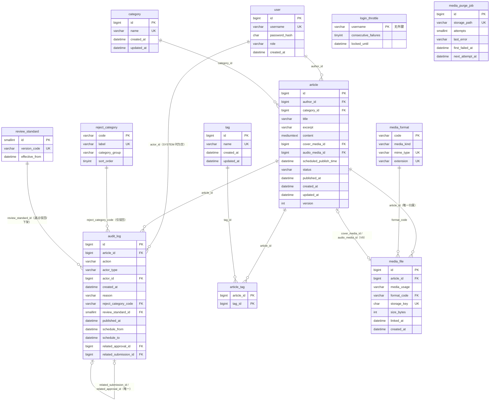

# 数据库表规格（折中版 v1）

> 依据：`CMS-SRS.md` v2.5（主文档）、`doc/context/architecture.md` §4～§7、`doc/api/api-spec.md` 草案 v0.1。
> 本文是 12 张表的**字段级定义**，也是各表所有者写 Flyway 迁移的唯一依据。与 SRS 冲突时以 SRS 为准；与 api-spec 冲突时，接口字段以 api-spec 为准、存储以本文为准。
> 参考 DDL：`doc/db/schema-reference.sql`。它**只是参考脚本，不是迁移**；后端脚手架建好后，由各表所有者按 §8 的版本号拆进 `src/main/resources/db/migration/`。
> 2026-11-23 起生效。改本文 = 改表结构，只能走 docs PR，由 A 批准；已合并的迁移不改，只追加。

---

## 0. 结论速览

| 项 | 改前（architecture §4.1 原表格） | 现在 |
|---|---|---|
| 表数 | 7 张，没有字段级定义 | **12 张**，全部有字段级定义 |
| 范式 | 未审查 | 12 张表全部满足 **BCNF**；有多值事实的地方满足 **4NF**。另有 4 处**有意保留的受控冗余**（§5），逐条写明理由 |
| 枚举存储 | 中文字面量，后端做中英映射 | **英文代码**，与 api-spec §4.1 完全一致，不再有映射层 |
| 约束分工 | — | 数据库只放**结构性、简单**的约束；跨行、条件复杂的规则放 Service，并给出规则编号（§6） |

这一版是"折中版"：在范式化草案的基础上，凡是会让 MyBatis-Plus 映射变复杂、或让报错难以排查的数据库技巧（生成列、函数索引、复合自引用外键、大量 CHECK）都退回到 Service 层实现。理由是本学期的学习重点是 Spring：事务、Service 分层和校验应该写在 Java 里，而不是藏在 SQL 里。

### 0.1 采纳的改动

| # | 改动 | 理由 |
|---|---|---|
| 1 | 新表 `login_throttle`（B） | SRS §4.1.2 要求按**登录名**计数，不存在的登录名也要计数、响应不得区分。登录名对不存在的账号没有 `user` 行，所以计数不能放在 `user` 上 |
| 2 | 新表 `media_format`（E） | MIME 和存储扩展名都由真实格式决定。原 `media_file.mime` 是 `id → format → mime` 的传递依赖（违反 3NF） |
| 3 | 新表 `reject_category`、`review_standard`（D） | 驳回类别的中文名、分组只存一处；留痕只能引用登记过的审核标准版本。审核标准版本**从服务端配置改为建表**，升级 = 追加一个只含 INSERT 的迁移（api-spec §16-#14） |
| 4 | 新表 `media_purge_job`（E） | BR-MEDIA-004、BR-DEL-004 要求"清理失败须记录并自动重试"，原设计没有落点。只记失败、定时重试，不做状态机 |
| 5 | 枚举一律存**英文代码** | 与接口一致，去掉 H 的中英映射层；Java 枚举配 MyBatis-Plus `@EnumValue` 直接映射 |
| 6 | **不存** `article.submitted_at` | 它就是本轮「提交审核」留痕的 `created_at`。接口照常返回，由查询派生（§7） |
| 7 | `article.version` 乐观锁 | MyBatis-Plus `@Version`；编辑接口带 `expected_version`，不一致返回 `409 40907`（api-spec §16-#11） |
| 8 | api-spec §16-#2/#3/#7 按默认值收口 | 见 §11 |

### 0.2 简化的部分

| # | 草案做法 | 折中版做法 |
|---|---|---|
| 1 | `audit_log` 用 10 条条件 CHECK 把 SRS §6.6 的字段规则全写进库 | 库里只留 **3 条关键条件 CHECK**（操作人、驳回、下架）+ 2 条取值域 CHECK；其余规则由 H 的 `AuditWriter` 用 Java 校验，带规则编号（§6.2） |
| 2 | `audit_log` 两个关联列用"复合自引用外键 + 生成列"保证同文章、同类型 | 只保留**普通自引用外键 + 唯一键**（简单，且能挡住"一轮两个结论""一次通过两次到期发布"）；"同文章、正确类型"由 `AuditWriter` 校验 |
| 3 | `media_purge_job` 带入队原因、状态等 | 只记**删文件失败**的文件：路径、失败次数、最近错误、下次重试时间；`@Scheduled` 重试，成功即删行 |
| 4 | `media_file.media_kind` 生成列 + 复合外键挡"封面传 MP3" | 去掉生成列；用途与格式大类的匹配由 E 的上传 Service 校验（`400 40006`） |
| 5 | `user` 用函数唯一索引保证"最多一个管理员" | 去掉函数索引；由 V1 种子、注册只建 `EDITOR`、本期没有改角色接口三点保证 |

### 0.3 没有采纳的改动

| # | 草案做法 | 结论与理由 |
|---|---|---|
| 1 | 删掉 `audit_log.actor_type`（它可由 `action` 推出） | **保留**。BR-AUDIT-004 和 architecture §4.1、§9.1 已按"类型 + ID"两列定稿，接口也输出 `operator.type`。作为受控冗余保留，并用一条 CHECK 锁死它和 `actor_id`、`action` 的一致性（§5.1） |
| 2 | 封面和音频改为 `media_file.linked_at` + 函数唯一索引，去掉 `article.cover_media_id` / `audio_media_id` | **保留两个外键列**。函数索引在 MyBatis-Plus 里不好映射；跨文章、用途检查放在 Service 的 `@Transactional` 里做，正好练 Spring 事务。代价是 `article` 与 `media_file` 互相引用，外键放在单独的 V9 迁移里补（§5.4） |
| 3 | 生成列、函数索引 | 全部不用，MyBatis-Plus 实体与表列一一对应，没有不可写列 |

---

## 1. 通用约定

- 引擎 InnoDB，字符集 `utf8mb4`，默认排序规则 `utf8mb4_0900_ai_ci`；代码类列（状态、动作、格式、登录名等）用 `ascii` / `ascii_bin`，写入中文或大小写不符会直接报错。
- 主键 `BIGINT AUTO_INCREMENT`，对应 Java `Long`；两张字典表用自然键（`code`）。
- **时间一律 `DATETIME(3)`，存 UTC。** 接口层按 SRS §5.5、api-spec §1.3 输出 `+08:00`。不用 `TIMESTAMP`，避开 2038 年问题和会话时区的隐式换算。时间值由应用传入（同一批次共用一个 `now`，architecture §6.1），列上不设默认值。
- **外键一律默认 `RESTRICT`**，不级联（architecture §4.1、§8）。
- **不用生成列、不用函数索引、不用 ENUM 类型。** 值固定、没有附属属性的枚举用 `VARCHAR + CHECK`；有附属属性（中文名、MIME 等）的建字典表。
- 需要 MySQL ≥ 8.0.16（CHECK 约束生效）。参考 DDL 已在 8.4.6 上验证（附录 A）。
- 字典表（`media_format`、`reject_category`、`review_standard`）**运行时只读**，改动只走迁移；`audit_log` 应用账号只有 `SELECT`/`INSERT`（INV-04）。

**MyBatis-Plus 映射提示**

| 场景 | 写法 |
|---|---|
| 状态、动作等英文代码 | Java 枚举 + `@EnumValue`，枚举名与库里的代码一致 |
| `article.version` | `@Version`，注册 `OptimisticLockerInnerInterceptor` |
| `media_file.media_usage` | 列名避开保留字 `usage`；实体字段可叫 `usage`，用 `@TableField("media_usage")` |
| `user` 表名 | 是保留字，`@TableName("`user`")` |
| 时间 | `LocalDateTime` 存 UTC；输出 `+08:00` 统一在 H 的 Jackson 配置里做 |

---

## 2. 怎样判定"符合范式"

- **1NF**：列都是原子值，没有重复组。标签不用逗号串；Markdown 正文对本系统是一个原子值（CMS 不拆它）。
- **2NF / 3NF**：非主属性完全依赖候选键，且不传递依赖于候选键，也就是没有"非键 → 非键"的依赖。
- **BCNF**：每个非平凡函数依赖 X → Y 的 X 都是超键。
- **4NF**：每个非平凡多值依赖 X →→ Y 的 X 都是超键。实际含义：两组彼此独立的多值事实不能放进同一张表。
- 本系统没有三元及以上的关联，满足 4NF 之后也满足 5NF。**不追求 6NF**：`audit_log` 的条件字段为空不违反任何范式（只有一个候选键 `id`，所有列都只依赖它），拆成子类型表在 MySQL 里反而无法强制"子行必须存在"。

两点说明：

1. **"宽表有很多 NULL"不等于违反范式。** NULL 是完整性问题，要靠约束（CHECK 或 Service 校验）解决，不是函数依赖问题。
2. **跨表的派生数据严格说不违反 3NF**（范式只看单表内部），但会造成同一事实的两份副本。本文把它和传递依赖放在同一标准下审查：能删就删（`submitted_at`），删不掉的列为**受控冗余**并写明理由（§5）。

---

## 3. 表清单与 ER 图

| # | 表 | 所有者 | 类别 | 主要内容 |
|---|---|---|---|---|
| 1 | `user` | B | 实体 | 账号、BCrypt、单一角色 |
| 2 | `login_throttle` | B | 实体 | 按登录名的失败计数与锁定 |
| 3 | `category` | F | 实体 | 分类（封闭集合） |
| 4 | `tag` | F | 实体 | 标签（开放集合、扁平） |
| 5 | `article` | C | 实体 | 文章本体；`status` 与时间字段只经 G 的状态机写 |
| 6 | `article_tag` | F | 关联 | 文章-标签 N:M |
| 7 | `media_format` | E | 字典 | 8 种真实格式 → 大类、MIME、扩展名 |
| 8 | `media_file` | E | 实体 | 媒体索引与引用标记 |
| 9 | `media_purge_job` | E | 实体 | 删文件失败的重试记录 |
| 10 | `reject_category` | D | 字典 | 8 个驳回类别 |
| 11 | `review_standard` | D | 字典 | 审核标准版本登记 |
| 12 | `audit_log` | H | 事件 | 7 类流程留痕，只增不改不删 |



`media_purge_job` 故意不连任何表：它记录的文件对应的 `media_file` 行已经删除了。`login_throttle` 故意不连 `user`（§4.2）。

---

## 4. 逐表规格

> 「依据」列引用 SRS（不带前缀）、arch（architecture.md）、api（api-spec.md）。

### 4.1 `user`（B）

| 列 | 类型 | 空 | 默认 | 键 / 约束 | 说明 | 依据 |
|---|---|---|---|---|---|---|
| `id` | BIGINT | 否 | 自增 | PK | 账号 ID | api §4.2 |
| `username` | VARCHAR(32) ascii_bin | 否 | — | UK；CHECK `^[a-z0-9_]{3,32}$` | **只存规范形式**：去首尾空白后转小写 | §4.1.1、api §16-#7 |
| `password_hash` | CHAR(60) ascii_bin | 否 | — | — | BCrypt | §4.1.2、arch §5.1 |
| `role` | VARCHAR(10) ascii_bin | 否 | — | CHECK IN (`EDITOR`,`ADMIN`) | 单一角色，单列 | BR-ROLE-001 |
| `created_at` | DATETIME(3) | 否 | — | — | 注册或初始化时间 | api §4.2 |

- 函数依赖：`id → *`；`username → *`。候选键 `{id}`、`{username}`。**BCNF**。
- 种子：V1 插入唯一管理员（BCrypt 字面量，arch §2.5）。
- "每库恰好一个管理员"（§1.4）：种子保证有一个；注册接口只建 `EDITOR`、本期没有改角色接口，保证不会多（规则 USER-01，§6.3）。
- 不加 `email`：本期不采集（§4.1.1），arch §9.1 留的问题在此结案。

### 4.2 `login_throttle`（B）

| 列 | 类型 | 空 | 默认 | 键 / 约束 | 说明 | 依据 |
|---|---|---|---|---|---|---|
| `username` | VARCHAR(32) ascii_bin | 否 | — | PK；**无外键** | 规范化登录名，可以是不存在的账号 | §4.1.2 |
| `consecutive_failures` | TINYINT UNSIGNED | 否 | 0 | CHECK 0..4 | 当前连续失败次数 | §4.1.2 |
| `locked_until` | DATETIME(3) | 是 | NULL | — | 锁定截止；NULL 表示未锁定；过期自动视为未锁定 | §4.1.2 |

- 函数依赖：`username → *`。**BCNF**。`locked_until` 不能由其他列推出（锁定时计数已归零）。
- 用法：锁定中（`locked_until > now`）直接按普通失败响应、不计数；失败用 `INSERT … ON DUPLICATE KEY UPDATE` 原子累加，到 5 次时置 `locked_until = now + 15min` 并把计数归零；成功就删掉这一行。
- 为什么不放 `user` 上：计数的决定因素是**登录名**，不存在的登录名没有 `user` 行，放进去就无法对它计数，行为上就能区分"账号存在与否"。

### 4.3 `category` / `tag`（F）

两张表结构相同：

| 列 | 类型 | 空 | 默认 | 键 / 约束 | 说明 | 依据 |
|---|---|---|---|---|---|---|
| `id` | BIGINT | 否 | 自增 | PK | | api §4.5 |
| `name` | VARCHAR(50) utf8mb4_0900_as_ci | 否 | — | UK；CHECK 长度 1..50 且 `name = TRIM(name)` | 去首尾空白后存；同类内**不区分大小写**唯一 | BR-TAX-003/004、api §16-#2 |
| `created_at` | DATETIME(3) | 否 | — | | | api §4.5 |
| `updated_at` | DATETIME(3) | 否 | — | | 改名时更新 | api §4.5 |

- 函数依赖：`id → *`；`name → *`。**BCNF**。
- 不存 `in_use`（由 `EXISTS` 推出，§7）、不存 `created_by`（BR-TAX-005 不限制创建人，没有规则用到它）。
- 排序规则 `utf8mb4_0900_as_ci`：大小写不敏感、重音敏感。注意它会把全角、半角字母视为相同（`Ａ` = `a`），本项目接受这一点。
- 重名插入撞唯一键 → Service 映射为 `409 40906`。

### 4.4 `article`（C；`status`、`scheduled_publish_time`、`published_at` 只经 G 的状态机写）

| 列 | 类型 | 空 | 默认 | 键 / 约束 | 说明 | 依据 |
|---|---|---|---|---|---|---|
| `id` | BIGINT | 否 | 自增 | PK | | |
| `author_id` | BIGINT | 否 | — | FK → `user`；索引首列 `(author_id, status, updated_at)` | 归属编辑，创建后不可改 | BR-ISO-001、INV-08 |
| `category_id` | BIGINT | 否 | — | FK → `category` | 单选必填 | BR-TAX-001、§7.2 |
| `title` | VARCHAR(200) | 否 | — | CHECK 非全空白 | ≤ 200 字符 | §7.2、api §16-#3 |
| `excerpt` | VARCHAR(500) | 否 | `''` | — | 未填为空串，不自动截取；≤ 500 | §7.2、api §16-#3 |
| `content` | MEDIUMTEXT | 否 | — | CHECK `OCTET_LENGTH ≤ 1048576` | Markdown 原文，≤ 1 MiB（UTF-8 字节） | §7.2、INV-06、api §16-#3 |
| `cover_media_id` | BIGINT | 是 | NULL | FK → `media_file`（V9） | 当前封面；**受控冗余**（§5.4） | api §4.10、§6.0.1 |
| `audio_media_id` | BIGINT | 是 | NULL | FK → `media_file`（V9） | 当前音频；**受控冗余**（§5.4） | api §4.10、§6.0.1 |
| `scheduled_publish_time` | DATETIME(3) | 是 | NULL | 索引 `(status, scheduled_publish_time)` | 预定发布时间；撤回时清空 | §5.5、BR-PUB-009 |
| `status` | VARCHAR(16) ascii_bin | 否 | `DRAFT` | CHECK 6 个英文代码 | 只经状态机改；**受控冗余**（§5.2） | §5.1、INV-01 |
| `published_at` | DATETIME(3) | 是 | NULL | CHECK 已发布 / 已下架时非空；索引 `(status, published_at)` | 本次实际发布时间，下架期间保留；**受控冗余**（§5.3） | §5.5、INV-07 |
| `created_at` | DATETIME(3) | 否 | — | | | §7.2 |
| `updated_at` | DATETIME(3) | 否 | — | | 最后修改时间 | §7.2 |
| `version` | INT UNSIGNED | 否 | 0 | — | 乐观锁，MyBatis-Plus `@Version` | §5.6、api §16-#11 |

- 另有 CHECK：`status = 'SCHEDULED'` 时 `scheduled_publish_time` 必须非空。
- 函数依赖：`id → *`。`author_id`、`category_id` 不决定其他列；`status` 与 `published_at` 之间是约束不是函数依赖。**BCNF**。
- 两组独立的多值事实（标签、媒体）分别在 `article_tag`、`media_file`，**4NF**。
- **不存的列**：`submitted_at`（§7 派生）、`current_submission_id`、任何"最近驳回 / 下架"列（SRS §7.2(3) 明文禁止冗余存回）。
- `version` 何时加 1：C 的内容保存（#7 创建为 0、#9 编辑 +1）。状态迁移走 G 的条件 UPDATE（`WHERE status = …`），不依赖也不修改 `version`，这样审核、到期发布不会让编辑页的 `expected_version` 莫名失效。

### 4.5 `article_tag`（F）

| 列 | 类型 | 空 | 键 / 约束 | 依据 |
|---|---|---|---|---|
| `article_id` | BIGINT | 否 | PK(1)；FK → `article` | BR-TAX-002 |
| `tag_id` | BIGINT | 否 | PK(2)；FK → `tag`；索引 `(tag_id, article_id)` 用于交集筛选 | BR-TAX-004、BR-SEARCH-005 |

- 全键表，没有非主属性，**BCNF / 4NF / 5NF**。
- 被引用的标签删不掉由外键 RESTRICT 保证（BR-TAX-004）；"被引用不能改名"由 F 的 Service 在 `SELECT … FOR UPDATE` 锁住标签行后做 `EXISTS` 检查（规则 TAX-01）。分类同理（`article.category_id`）。

### 4.6 `media_format`（E，字典，运行时只读）

| 列 | 类型 | 空 | 键 / 约束 | 说明 |
|---|---|---|---|---|
| `code` | VARCHAR(8) ascii_bin | 否 | PK | JPEG / PNG / GIF / WEBP / MP3 / M4A / WAV / OGG |
| `media_kind` | VARCHAR(5) ascii_bin | 否 | CHECK IN (IMAGE, AUDIO) | 大类 |
| `mime_type` | VARCHAR(32) ascii_bin | 否 | UK | 响应 `Content-Type` |
| `extension` | VARCHAR(8) ascii_bin | 否 | UK | 规范扩展名（JPEG 存 `jpg`） |

- 函数依赖：`code → *`；`mime_type → *`；`extension → *`。三个候选键，**BCNF**。
- 种子 8 行（V6）。上传声明的扩展名别名（`jpeg` 视为 JPEG）放在 E 的代码常量里。
- 依据：BR-MEDIA-002/005，arch §4.2。

### 4.7 `media_file`（E）

| 列 | 类型 | 空 | 默认 | 键 / 约束 | 说明 | 依据 |
|---|---|---|---|---|---|---|
| `id` | BIGINT | 否 | 自增 | PK | 即接口的 `media_id` | api §4.9 |
| `article_id` | BIGINT | 否 | — | FK → `article` | 唯一归属文章，不可改派 | BR-MEDIA-008 |
| `media_usage` | VARCHAR(12) ascii_bin | 否 | — | CHECK IN (COVER, INLINE_IMAGE, AUDIO) | 上传时确定；接口字段名 `usage` | api §4.1、FR-MEDIA-001 |
| `format_code` | VARCHAR(8) ascii_bin | 否 | — | FK → `media_format` | 魔数判定的真实格式 | BR-MEDIA-002 |
| `storage_key` | CHAR(36) ascii_bin | 否 | — | UK | 系统生成的 UUID | BR-MEDIA-002、arch §4.2 |
| `size_bytes` | INT UNSIGNED | 否 | — | CHECK `> 0`，AUDIO ≤ 20 MiB，其余 ≤ 5 MiB | 字节数 | BR-MEDIA-002/005 |
| `linked_at` | DATETIME(3) | 是 | NULL | 索引 `(linked_at, created_at)` | 首次保存进文章引用的时间；NULL = 未关联上传；**解除引用即删行** | BR-MEDIA-004、api §4.9 `linked` |
| `created_at` | DATETIME(3) | 否 | — | | 上传时间（24 小时清理起点） | BR-MEDIA-004 |

- 函数依赖：`id → *`；`storage_key → *`。**BCNF**。
- **不存的列**：`mime`、扩展名（由 `format_code` 决定，见 `media_format`）；相对路径（= `{cover|inline|audio}/{storage_key}.{extension}`，运行时拼出）；上传人（只有归属编辑能上传，= `article.author_id`）；`original_name`（api §4.9 不返回，SRS 不要求）；`linked` 布尔列（= `linked_at IS NOT NULL`）。
- 引用一旦解除（封面被替换、正文不再引用某图、文章删除），**同一事务里删掉这一行**，事务提交后再删文件。所以"已失去全部引用但文件还没删"的媒体在出口第 1 步就查不到，直接 404（arch §5.4 第 3 步自动满足）。
- 用途与格式大类的匹配（封面不能是 MP3）由 E 的上传 Service 校验（规则 MEDIA-01）。

### 4.8 `media_purge_job`（E）

| 列 | 类型 | 空 | 默认 | 键 / 约束 | 说明 |
|---|---|---|---|---|---|
| `id` | BIGINT | 否 | 自增 | PK | |
| `storage_path` | VARCHAR(64) ascii_bin | 否 | — | UK | 待删文件的相对路径 |
| `attempts` | SMALLINT UNSIGNED | 否 | 1 | | 已失败次数 |
| `last_error` | VARCHAR(500) | 是 | NULL | | 最近一次失败原因 |
| `first_failed_at` | DATETIME(3) | 否 | — | | 第一次失败时间 |
| `next_attempt_at` | DATETIME(3) | 否 | — | 索引 | 下次重试时间 |

- 函数依赖：`id → *`；`storage_path → *`。**BCNF**。
- **只记失败**：正常情况是"事务提交 → 删文件成功"，这张表里不留任何东西。删文件失败才插一行；`@Scheduled` 任务扫 `next_attempt_at <= now` 的行重试，成功（含文件已不存在）就删行，失败则 `attempts + 1`、推迟 `next_attempt_at`、记 `last_error`。没有入队原因、没有状态列。
- 进程在"提交之后、删文件之前"崩溃留下的孤儿文件，按 arch §6.2 由低频磁盘对账兜底（可选）。
- 这和 arch §4.4"发布任务不建表"不冲突：那一条说的是**发布状态**只能有一个来源；这里记录的是**磁盘操作的重试状态**，它在数据库里没有别的落点。
- 依据：BR-MEDIA-004、BR-DEL-004、FR-MEDIA-003。

### 4.9 `reject_category`（D，字典，运行时只读）

| 列 | 类型 | 空 | 键 / 约束 | 说明 |
|---|---|---|---|---|
| `code` | VARCHAR(32) ascii_bin | 否 | PK | api §4.1 的 8 个英文值 |
| `label` | VARCHAR(20) | 否 | UK | 中文名 |
| `category_group` | VARCHAR(10) ascii_bin | 否 | CHECK IN (COMPLIANCE, QUALITY, OTHER) | 合规 / 质量 / 其他 |
| `sort_order` | TINYINT UNSIGNED | 否 | UK | 展示顺序 |

- 函数依赖：`code → *`；`label → *`；`sort_order → *`。**BCNF**。
- 种子 8 行（V7）：前 5 类（违法违规、真实性／来源、版权／隐私、未成年人／低俗／暴力、歧视／骚扰／引战）归 `COMPLIANCE`，"垃圾／营销""内容质量／博客定位"归 `QUALITY`，"其他"归 `OTHER`。
- **分组是【建议】**：SRS 只要求"合规违规与内容质量必须用不同类别"（BR-CONTENT-005），没有规定分组。分组只用于审核页展示和统计，不影响任何判定。
- 为什么建表而不是只写代码常量：中文名只存一处，#15 直接查表；应用账号只授 SELECT，"固定 8 类"在权限层落实。

### 4.10 `review_standard`（D，字典，运行时只读）

| 列 | 类型 | 空 | 键 / 约束 | 说明 |
|---|---|---|---|---|
| `id` | SMALLINT UNSIGNED | 否 | PK | |
| `version_code` | VARCHAR(40) ascii_bin | 否 | UK | 如 `CMS-CONTENT-REVIEW-1.0` |
| `effective_from` | DATETIME(3) | 否 | UK | 生效时间 |

- 函数依赖：`id → *`；`version_code → *`；`effective_from → *`。**BCNF**。
- **当前版本** = `effective_from <= now` 的最新一行。#15 从这里读；审核通过、驳回、下架时由服务端取当前版本写进留痕，客户端不传。
- 升级（SRS §6.1.1"审核标准变更时必须提升版本号"）：追加迁移 `V<n>__review_standard_<版本>.sql`，内容只有一句 `INSERT`。版本历史随之留在 git 里。
- 依据：§6.1.1、BR-AUDIT-005、api §16-#14。

### 4.11 `audit_log`（H，应用账号只有 SELECT / INSERT）

| 列 | 类型 | 空 | 键 / 约束 | 出现于（其余一律 NULL） | 依据 |
|---|---|---|---|---|---|
| `id` | BIGINT | 否 | PK | 全部 | §6.6 |
| `article_id` | BIGINT | 否 | FK → `article` | 全部 | §6.6、BR-DEL-001 |
| `action` | VARCHAR(16) ascii_bin | 否 | CHECK 7 个英文代码 | 全部 | §6.6 |
| `actor_type` | VARCHAR(6) ascii_bin | 否 | CHECK IN (USER, SYSTEM)；见 `ck_audit_actor` | 全部；**受控冗余**（§5.1） | BR-AUDIT-004 |
| `actor_id` | BIGINT | 是 | FK → `user` | USER 时有值；SYSTEM 时 NULL | BR-AUDIT-004 |
| `created_at` | DATETIME(3) | 否 | — | 全部 | §6.6 |
| `reason` | VARCHAR(500) | 是 | 见 `ck_audit_reject` / `ck_audit_unpublish` | REJECT（驳回意见）、UNPUBLISH（下架原因） | BR-004/008、BR-AUDIT-003 |
| `reject_category_code` | VARCHAR(32) ascii_bin | 是 | FK → `reject_category` | REJECT | BR-CONTENT-005 |
| `review_standard_id` | SMALLINT UNSIGNED | 是 | FK → `review_standard` | APPROVE、REJECT、UNPUBLISH | §6.1.1、BR-AUDIT-005 |
| `published_at` | DATETIME(3) | 是 | — | APPROVE（立即发布时）、AUTO_PUBLISH | §6.6、BR-PUB-006 |
| `schedule_from` / `schedule_to` | DATETIME(3) | 是 | — | RESCHEDULE（两列都有） | §6.6 |
| `related_approval_id` | BIGINT | 是 | FK → `audit_log(id)`；UK | AUTO_PUBLISH | §6.6、INV-07 |
| `related_submission_id` | BIGINT | 是 | FK → `audit_log(id)`；UK | APPROVE、REJECT | §5.6、BR-AUDIT-005 |

- **数据库里的 CHECK（共 5 条）**：
  - 取值域：`ck_audit_action`（7 个动作）、`ck_audit_actor_type`（USER / SYSTEM）；
  - 关键条件 1 `ck_audit_actor`：`(actor_type='USER') = (actor_id IS NOT NULL) AND (actor_type='SYSTEM') = (action='AUTO_PUBLISH')`。既锁住两列互相咬合（arch §4.1 原 CHECK），又锁住"只有到期自动发布是系统"；
  - 关键条件 2 `ck_audit_reject`：驳回必须有类别和非空白意见；
  - 关键条件 3 `ck_audit_unpublish`：下架必须有非空白原因。
- 选这 3 条的理由：它们是 SRS 里最容易被"图省事"写错、且一旦写错就无法事后补救的规则（系统留痕挂上管理员账号、驳回没写意见、下架没写原因），而且都是单向的简单条件，出错时数据库报错信息能直接看出是哪条。其余条件字段规则（"其他动作必须为 NULL"、轮次指向等）交给 `AuditWriter`（§6.2）。
- **唯一键**：`uk_audit_submission_once`（一轮提交最多一个审核结论，SRS §5.6 并发兜底）、`uk_audit_approval_once`（一次审核通过最多被到期发布一次，INV-07 同周期不重复的兜底）。外键只保证"指向一条存在的留痕"，"同文章、类型正确"由 `AuditWriter` 校验。
- **索引**：`(article_id, action, created_at, id)` 给 arch §5.6 的窗口函数和本轮 SUBMIT 查询；`(article_id, created_at, id)` 给 #19 留痕列表；`(actor_id)`。
- 函数依赖：`id → *`；`related_submission_id`、`related_approval_id` 非空时也决定整行（候选键）。**BCNF / 4NF / 5NF**（§2）。
- `reason` 一列同时承担驳回意见和下架原因，与 SRS §6.6 字段规则表、api §4.13 的 `reason` 一致，不拆两列。长度 ≤ 500（【建议】，SRS 未定，api §16-#3）。

---

## 5. 有意保留的受控冗余

范式上能删、但本项目**有意保留**的 4 处。每处都写明：为什么留、靠什么保证两份不会不一致。

| # | 冗余 | 它能从哪里推出来 | 为什么保留 | 一致性怎么保证 |
|---|---|---|---|---|
| 5.1 | `audit_log.actor_type` | 由 `action` 决定（只有 `AUTO_PUBLISH` 是 `SYSTEM`），也由 `actor_id IS NULL` 决定 | BR-AUDIT-004 和 arch §4.1、§9.1 已按"类型 + ID"定稿；接口输出 `operator.type`，代码直接读列更直观；新增第 8 类留痕时，类型列让"这条是谁做的"在库里一眼可见 | CHECK `ck_audit_actor` 同时锁住 `actor_type`↔`actor_id`、`actor_type`↔`action`，三者不可能不一致 |
| 5.2 | `article.status` | 大体可以按留痕回放，但新建草稿没有留痕 | 它是状态机的门闩：发布、撤回、改期都是 `UPDATE … WHERE status = …` 的条件更新（arch §6.1、SRS §5.6）；按留痕回放属于事件溯源，与架构冲突 | 只有 G 的状态机能写；状态 UPDATE 与对应留痕 INSERT 在同一事务（INV-01、FR-AUDIT-001） |
| 5.3 | `article.published_at` | 等于最近一条发布留痕（立即发布的 APPROVE 或 AUTO_PUBLISH）的 `published_at` | SRS §5.5 明文要求"系统维护两个字段"；公开列表按它排序，需要 `(status, published_at)` 索引；INV-07 直接作用在它上 | 同 5.2：同一出口（状态机）、同一事务写入 |
| 5.4 | `article.cover_media_id` / `audio_media_id`（以及 `media_file.linked_at` 对这两类媒体的标记） | 媒体行本身带 `article_id` 和用途；"哪张是当前封面"也可以只用媒体行上的标记表达 | 接口按"文章的封面、音频"读写（api §4.10、§6.0.1），两个外键列最直观；"每篇最多一个封面 / 音频"由单列天然保证，不需要函数唯一索引；跨文章、用途检查放 Service 的 `@Transactional` 里，是 Spring 事务的练习点 | C 调 E 的 `MediaRefService`，在同一事务里同时改 `article` 的两列和 `media_file.linked_at`；被替换的旧媒体行在同一事务里删除（规则 MEDIA-02，§6.3、§9） |

代价（5.4）：`article` 与 `media_file` 互相引用。`article` 先建（V4，只有列没有外键），`media_file` 在 V6 建，两个外键在 V9 补上。删除草稿时要先把两列置 NULL 再删媒体行（§9）。

不保留的派生数据：`article.submitted_at`（= 本轮 SUBMIT 留痕的 `created_at`）、`current_submission_id`、最近驳回 / 下架、`in_use`、`media_file.linked`、`media_file` 的 MIME / 扩展名 / 路径 / 上传人。

---

## 6. 约束分工：数据库管什么，Service 管什么

### 6.1 数据库负责（结构性、简单）

- 主键、唯一键、外键（RESTRICT）；
- 取值域 CHECK（状态、角色、用途、动作、操作人类型、驳回分组）；
- 单列或单行的简单 CHECK：登录名格式、名称去空白与长度、标题非全空白、正文 ≤ 1 MiB、媒体大小上限、已发布必有 `published_at`、待发布必有预定时间、登录失败计数 0..4；
- `audit_log` 的 3 条关键条件 CHECK（§4.11）；
- 表级权限：`audit_log` 只授 SELECT / INSERT，三张字典表只授 SELECT（INV-04）。

### 6.2 `AuditWriter` 负责（H）：SRS §6.6 的其余条件字段规则

`AuditWriter` 是写 `audit_log` 的唯一入口（只有 append 方法）。每次写入前按下表校验，违反时抛 `AuditRuleViolationException(ruleCode)`：

| 规则 | 内容 |
|---|---|
| AUD-01 | `reason` 只在 REJECT、UNPUBLISH 有值，其余动作必须为 NULL；有值时去首尾空白后非空、≤ 500 |
| AUD-02 | `reject_category_code` 只在 REJECT 有值 |
| AUD-03 | `review_standard_id` 在 APPROVE、REJECT、UNPUBLISH 必填（取当前版本），其余必须为 NULL |
| AUD-04 | `published_at`：AUTO_PUBLISH 必填；APPROVE 仅在立即发布时填；其余必须为 NULL |
| AUD-05 | `schedule_from`、`schedule_to`：RESCHEDULE 两个都必填，其余都为 NULL |
| AUD-06 | `related_submission_id`：APPROVE、REJECT 必填，必须指向**同一篇文章**的**本轮** SUBMIT；其余为 NULL |
| AUD-07 | `related_approval_id`：AUTO_PUBLISH 必填，必须指向**同一篇文章**仍有效的 APPROVE；其余为 NULL |
| AUD-08 | `actor_type` / `actor_id` 与动作匹配（库里有 CHECK 兜底，这里提前给出清楚的错误） |

错误怎么报：这些规则保护的是**代码写错**，不是用户输入错。用户输入错（驳回没选类别、意见为空、轮次缺失）在 D 的请求校验里就以 `400 40011` / `40012` / `40010` 返回，到不了 `AuditWriter`。所以 `AuditRuleViolationException` 由 `GlobalExceptionHandler` 记录规则编号、整个事务回滚，对外返回 `500 50000`（api §3.3），流程操作整体不生效（SRS §5.6）。

撞上唯一键时：`uk_audit_submission_once` → D 映射为 `409 40901 SUBMISSION_STALE`；`uk_audit_approval_once` → E 的到期发布任务回滚本篇，视为"本周期已发布"。

### 6.3 其他 Service 规则

| 规则 | 负责人 | 内容 | 失败响应 |
|---|---|---|---|
| USER-01 | B | 注册只建 `EDITOR`；本期没有改角色、建管理员的接口 | — |
| TAX-01 | F | 被任意文章引用的分类、标签不能改名：`SELECT … FOR UPDATE` 锁行后 `EXISTS` 检查 | `409 40904` |
| MEDIA-01 | E | 上传时用途与真实格式的大类一致（封面、正文图片只能是 IMAGE，音频只能是 AUDIO） | `400 40006` |
| MEDIA-02 | C 调 E | `cover_media_id` / `audio_media_id` 指向的媒体必须属于本文章、用途分别为 COVER / AUDIO | `400 40005` |
| MEDIA-03 | G（`ContentValidator`）调 E | 正文引用的 `/api/media/{id}` 必须属于本文章、用途为 INLINE_IMAGE | `400 40005` |
| ART-01 | C | 编辑时 `expected_version` 与当前 `version` 不一致（MyBatis-Plus `@Version` 更新 0 行） | `409 40907` |

---

## 7. 派生字段怎么查（替代不存的列）

```sql
-- submitted_at + current_submission_id（审核队列，FR-REVIEW-001：按提交时间升序，同时间按文章 ID）
SELECT a.id, s.id AS current_submission_id, s.created_at AS submitted_at
FROM article a
JOIN audit_log s ON s.id = (SELECT MAX(x.id) FROM audit_log x
                            WHERE x.article_id = a.id AND x.action = 'SUBMIT')
WHERE a.status = 'PENDING_REVIEW'
ORDER BY s.created_at, a.id;

-- 最近一次驳回或下架（arch §5.6）：只对已过滤、已分页的文章 ID 查
SELECT article_id, action, reason, reject_category_code, actor_type, actor_id, created_at FROM (
  SELECT l.*, ROW_NUMBER() OVER (PARTITION BY article_id ORDER BY created_at DESC, id DESC) AS rn
  FROM audit_log l
  WHERE action IN ('REJECT', 'UNPUBLISH') AND article_id IN (/* 当页文章 id */)
) t WHERE t.rn = 1;

-- 当前审核标准版本（#15、审核写留痕时）
SELECT id, version_code FROM review_standard
WHERE effective_from <= ? ORDER BY effective_from DESC LIMIT 1;

-- 分类 / 标签 in_use
SELECT EXISTS (SELECT 1 FROM article WHERE category_id = ?);
SELECT EXISTS (SELECT 1 FROM article_tag WHERE tag_id = ?);

-- 媒体的 mime、存储路径、linked
SELECT m.id, f.mime_type, m.size_bytes, m.linked_at IS NOT NULL AS linked,
       CONCAT(CASE m.media_usage WHEN 'COVER' THEN 'cover' WHEN 'AUDIO' THEN 'audio' ELSE 'inline' END,
              '/', m.storage_key, '.', f.extension) AS storage_path
FROM media_file m JOIN media_format f ON f.code = m.format_code
WHERE m.id = ?;
```

`submitted_at` 在接口里照常返回（api §4.10、§4.11、§4.12、§6.6），只是不落在 `article` 表上。

---

## 8. Flyway 迁移顺序与权限

| 版本 | 所有者 | 内容 | 依赖 |
|---|---|---|---|
| `V1__user.sql` | B | `user` + 唯一管理员种子 | — |
| `V2__login_throttle.sql` | B | `login_throttle` | — |
| `V3__taxonomy.sql` | F | `category`、`tag` | — |
| `V4__article.sql` | C | `article`（含 `cover_media_id` / `audio_media_id` 两列，暂不加外键） | V1、V3 |
| `V5__article_tag.sql` | F | `article_tag` | V3、V4 |
| `V6__media.sql` | E | `media_format` + 8 行种子、`media_file`、`media_purge_job` | V4 |
| `V7__review_lookup.sql` | D | `reject_category` + 8 行、`review_standard` + 1 行 | — |
| `V8__audit_log.sql` | H | `audit_log` | V1、V4、V7 |
| `V9__article_media_fk.sql` | C | `article.cover_media_id` / `audio_media_id` → `media_file` 外键 | V4、V6 |
| `R__app_grants.sql` | B | 应用账号权限 | 全部 |

- 之后的迁移按 `V<下一个空号>__<表>_<说明>.sql` 追加；已合并的迁移不得修改。
- 权限（`R__app_grants.sql`）：8 张业务表授 CRUD；3 张字典表只授 SELECT；`audit_log` 只授 SELECT、INSERT（INV-04）。
- 参考 DDL 原文：`doc/db/schema-reference.sql`（按上表顺序拼接）。

---

## 9. 写路径要点

1. **保存文章并变更媒体引用**（C 调 E 的 `MediaRefService`、G 的 `ContentValidator`，同一个 `@Transactional`）：
   1. `SELECT … FOR UPDATE` 锁文章，校验归属与状态；`expected_version` 与 `version` 不符 → `409 40907`；
   2. `ContentValidator` 解析正文，得到引用的正文图片集合，校验都属于本文、用途为 INLINE_IMAGE（MEDIA-03）；
   3. 校验 `cover_media_id` / `audio_media_id`（MEDIA-02），并对涉及的媒体行加锁；
   4. 新引用的媒体置 `linked_at = now`；
   5. 更新 `article`（含两列外键，`version + 1`）；
   6. 不再被引用的旧媒体（被替换的封面、正文删掉的图）：**先更新文章、再删媒体行**，否则会撞 V9 的外键；
   7. 事务提交后删除这些文件；失败写 `media_purge_job`。
2. **24 小时未关联清理**（E，`@Scheduled`）：扫 `linked_at IS NULL AND created_at <= now - 24h`；逐行 `SELECT … FOR UPDATE` 后再确认一次 `linked_at IS NULL`，删行、提交、删文件，失败写 `media_purge_job`。保存路径在同一行锁下置 `linked_at`，两者不会互相误删（BR-MEDIA-004）。
3. **删除草稿**（C，BR-DEL-001～004）：条件是 `DRAFT` 且没有任何留痕（`audit_log` 的 RESTRICT 外键兜底，撞上即 `409 40903`）。同一事务内：两列媒体引用置 NULL → 删 `media_file` → 删 `article_tag` → 删 `article`；提交后删文件，失败写 `media_purge_job`。
4. **文件删除重试**（E，`@Scheduled`）：扫 `next_attempt_at <= now`；成功或文件已不存在 → 删行；失败 → `attempts + 1`、`next_attempt_at` 按退避推迟（如 1、2、4 … 分钟，上限 1 小时）、记 `last_error`。
5. **审核通过或驳回**（D 经 G、H）：锁文章 → 查本轮 SUBMIT 的 ID → 与请求的 `submission_id` 比较，不同 → `409 40901` → 状态迁移 + `AuditWriter` 写留痕（`related_submission_id`），撞 `uk_audit_submission_once` 同样映射为 `40901`。
6. **到期自动发布**（E 经 G、H）：每篇一个 `REQUIRES_NEW` 事务；`UPDATE article … WHERE status='SCHEDULED' AND scheduled_publish_time <= now`，同事务 INSERT `AUTO_PUBLISH`（`actor_type='SYSTEM'`、`related_approval_id` = 本周期有效的审核通过）。撞 `uk_audit_approval_once` 说明本周期已发布，回滚即可。
7. **登录**（B）：见 §4.2。

---

## 10. 人 × 表

图例：**W** 所有者（本人 Mapper 写）；**w** 经所有者的 Service 写；**R** 本模块 SQL 只读 / 联表；**r** 经所有者的 Service 读；**G** 数据库权限（DCL）。

| 人 | user | login_throttle | category | tag | article | article_tag | media_format | media_file | media_purge_job | reject_category | review_standard | audit_log | 真实读写的表数 | 拥有的迁移 |
|---|---|---|---|---|---|---|---|---|---|---|---|---|---|---|
| A | — | — | R | R | R | R | R | R | — | — | — | — | **6** | 无 |
| B | **W** | **W** | — | — | R | — | — | — | — | — | — | G | **3**（另有 G） | V1、V2、R__ |
| C | R | — | r | r | **W** | w | r | w | w | — | — | r | **9** | V4、V9 |
| D | R | — | R | R | w/R | R | — | r | — | **W** | **W** | w/r | **9** | V7 |
| E | — | — | — | — | R/w | — | **W** | **W** | **W** | — | — | w/r | **5** | V6 |
| F | — | — | **W** | **W** | R | **W** | — | — | — | — | — | — | **4** | V3、V5 |
| G | — | — | r | — | **W**(状态列) | — | — | r | — | — | r | w | **5** | 无 |
| H | R | — | — | — | R | — | — | — | — | R | R | **W** | **5** | V8 |

- 每人真实读写的表都 ≥ 3 张（`G` 不计入）。B 现在拥有 `user`、`login_throttle` 两张并读 `article`（闸门），之前"第 3 张表只是权限接触"的问题已解决，#19 不用挪。
- 每张表只有一个所有者。

---

## 11. api-spec §16 的收口结论（2026-11-23）

| # | 问题 | 结论 | 落在哪 |
|---|---|---|---|
| 2 | 分类、标签名称规则 | 去首尾空白；1～50 字符；同类内不区分大小写唯一；重名 `409 40906` | `category` / `tag` |
| 3 | 长度上限 | 标题 ≤ 200 字符、摘要 ≤ 500 字符、正文 ≤ 1 MiB（UTF-8 字节）；驳回意见、下架原因 ≤ 500 字符；每篇标签数暂不限 | `article`、`audit_log` |
| 7 | 登录名存储 | 只存小写规范形式（去首尾空白后转小写），返回也是规范形式 | `user`、`login_throttle` |
| 11 | 乐观锁 | `article.version` + MyBatis-Plus `@Version`；#9 请求带 `expected_version`，不一致 `409 40907 VERSION_CONFLICT` | `article`、api §6.4 |
| 14 | 审核标准版本 | `review_standard` 表登记，Flyway 维护；当前版本 = 已生效的最新一行；#15 只读展示 | `review_standard` |

同时结案：api §15 冲突 9（数据库与接口同为英文代码，不再映射）。

---

## 12. 没有采用的方案（备查）

| 方案 | 不采用的原因 |
|---|---|
| `audit_log` 按事件类型拆成 7～8 张子表（6NF） | MySQL 强制不了"子行必须存在"；联表多，INV-04 授权也分散 |
| 删除 `audit_log.actor_type` | 见 §0.3、§5.1 |
| `audit_log` 10 条条件 CHECK + 复合自引用外键（含生成列） | 报错难排查、MyBatis-Plus 映射复杂；改为 3 条关键 CHECK + `AuditWriter`（§6.2） |
| 封面 / 音频改用 `media_file.linked_at` + 函数唯一索引 | 见 §0.3、§5.4 |
| `media_file.media_kind` 生成列 + 复合外键 | 改由上传 Service 校验（MEDIA-01） |
| `user` 函数唯一索引"最多一个管理员" | 改由 USER-01 保证 |
| 登录失败计数放 `user` 上，或放内存 | 不存在的登录名无处可记；重启丢失 |
| `media_file` 状态列（PENDING / LINKED / DETACHED） | LINKED 可由 `linked_at` 推出；DETACHED 行留在表里，判权要多一个分支 |
| `article_status`、`role`、`audit_action` 字典表 | 没有附属属性，`VARCHAR + CHECK` 足够 |
| 文章状态按留痕回放（事件溯源） | 与状态机门闩、条件 UPDATE 的架构冲突 |

---

## 附录 A：验证记录（2026-11-23）

环境：本机 MySQL 8.4.6 空库，依次执行 V1～V9 和 `R__app_grants.sql`，全部成功；用合并后的 `schema-reference.sql` 在空库上重跑一次，同样成功。

**正例**全部通过：编辑注册；不存在的登录名计数；分类、标签、文章、文章标签；封面、音频（恰好 20 MiB）、正文图片（恰好 5 MiB）并关联、`version` 条件更新；删文件失败记录；SUBMIT → REJECT → SUBMIT → APPROVE → RESCHEDULE → AUTO_PUBLISH → UNPUBLISH → SUBMIT → APPROVE（立即发布）的完整留痕链；另一篇文章的 WITHDRAW；先清引用再删媒体、删草稿。派生查询取到本轮 `submitted_at` 和当前审核标准版本。

**反例** 49 条全部被拒：

| 被拒的写入 | 拦截者 |
|---|---|
| 大写登录名、2 字符登录名、重复登录名、未知角色 | `ck_user_username`、`uk_user_username`、`ck_user_role` |
| 连续失败计数 = 5 | `ck_throttle_failures` |
| 分类重名、标签只有大小写不同、带首尾空格、空名、51 字符 | 唯一键、`ck_tag_name`、列长度 |
| 全空白标题、201 字符标题、正文超过 1 MiB | `ck_article_title`、列长度、`ck_article_content_size` |
| 已发布但没有 `published_at`、待发布但没有预定时间、状态写中文 | `ck_article_published`、`ck_article_scheduled`、`ascii` 字符集 |
| 不存在的分类、不存在的封面媒体 | 外键 |
| 删除被引用的分类、标签、被设为封面的媒体、有子行的文章 | 外键 RESTRICT |
| 未登记的格式（SVG）、图片超 5 MiB、音频超 20 MiB、未知用途 | 外键、`ck_media_size`、`ck_media_usage` |
| 重复的待删路径 | `uk_purge_path` |
| 到期自动发布标成 USER 或带账号、SUBMIT 标成 SYSTEM、USER 不带账号、未知类型、未知动作 | `ck_audit_actor`、`ck_audit_actor_type`、`ck_audit_action` |
| 驳回缺意见、缺类别、意见全空白；未登记的驳回类别 | `ck_audit_reject`、外键 |
| 下架缺原因、原因为空串 | `ck_audit_unpublish` |
| 未登记的审核标准版本、指向不存在的提交留痕、不存在的文章 | 外键 |
| 同一轮二次审核结论、同一审核通过二次到期发布 | `uk_audit_submission_once`、`uk_audit_approval_once` |
| 应用账号 UPDATE / DELETE `audit_log`，INSERT `reject_category`，UPDATE `review_standard`，DELETE `media_format` | 表级权限 |

**交给 Service 的规则**：另用 6 条写入确认数据库**会接受**它们（封面传 MP3、跨文章封面、撤回带原因、SUBMIT 带驳回类别、跨文章引用提交轮次、改期只填一边），对应 MEDIA-01/02、AUD-01/02/03/06/05，由 §6 的 Service 规则拦截。这是折中版有意的取舍。

`EXPLAIN` 确认：公开列表 `WHERE status='PUBLISHED' ORDER BY published_at DESC` 走 `idx_article_status_published` 覆盖索引。
